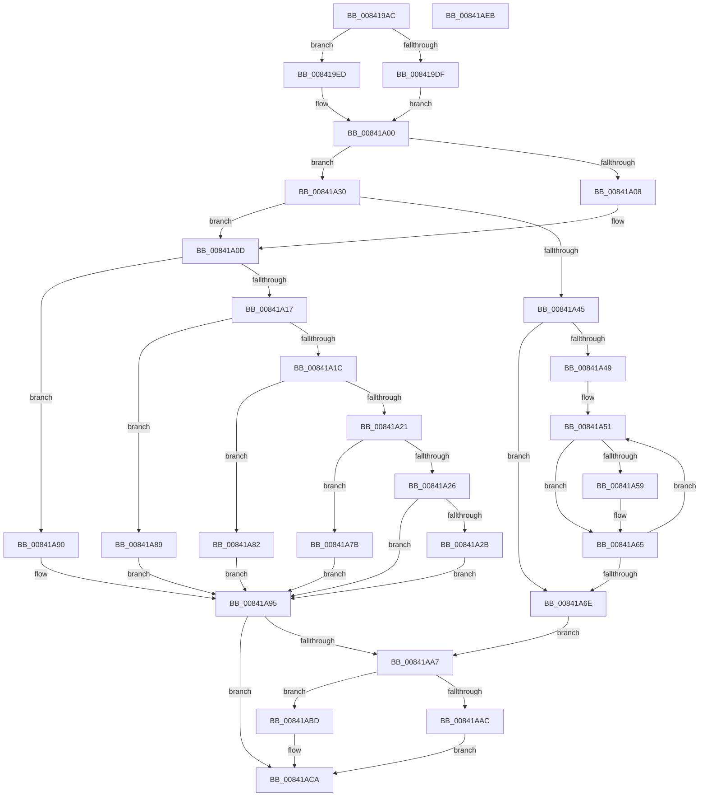

# HashpHashMemory

- RVA: `0x008419AC`–`0x00841AEC` (길이 `320` bytes)
- VA: `0x00000001408419AC`
- 실행 섹션: `PAGE`
- PDB 이름 있음: `예`; PDB Function 태그: `아니요`
- unwind 정보 RVA: `0x000847EC`
- 디코드: `97`개 명령, `320/320` bytes 표시
- 미해석 바이트: `0` (있으면 어셈블리에 `.byte`로 보존)

> 이 문서는 커널 이미지의 기계어와 PDB 기호를 분석해 생성했습니다. 4번과 5번은 함수 원형과 자료형을 바이너리 사용 방식에서 추정한 C 해석이며 원본 소스 복구 결과는 아닙니다.

## 1. Dependencies

- 직접 호출 지점: **8**; 고유 호출 대상: **8**
- 직접 호출자로 확인된 함수: **1**
- RIP 상대 이미지 참조: **2**

### Outgoing calls
- `0x008419E6` → [ExAllocateFromPagedLookasideList](../../text/3F/ExAllocateFromPagedLookasideList_function_003FB730.md) (function, `0x003FB730`)
- `0x008419FB` → [ExAllocatePool2](../../poolcode/B8/ExAllocatePool2_function_00B820F0.md) (function, `0x00B820F0`)
- `0x00841A3A` → [HashpInitHash](HashpInitHash_function_00842018.md) (function, `0x00842018`)
- `0x00841A60` → [HashpHashBytes](HashpHashBytes_function_00841FA0.md) (function, `0x00841FA0`)
- `0x00841A74` → [HashpFinalizeHash](HashpFinalizeHash_function_00841F34.md) (function, `0x00841F34`)
- `0x00841A9D` → [memset](../../text/6C/memset_function_006C6C40.md) (function, `0x006C6C40`)
- `0x00841AB6` → [ExFreeToPagedLookasideList](../../text/38/ExFreeToPagedLookasideList_function_00387D30.md) (function, `0x00387D30`)
- `0x00841AC5` → [ExFreePoolWithTag](../../poolcode/B8/ExFreePoolWithTag_function_00B82870.md) (function, `0x00B82870`)

### Direct callers
- [MinCryptHashMemory](../../text/6A/MinCryptHashMemory_function_006A5F04.md) at `0x006A5F12`

### Static image references
- `0x008419C9` → RVA `0x00EF010C` (`.data`; read)
- `0x008419DF` → RVA `0x00E65A40` (`.data`; read)

## 2. Other-region calls and transfers

- 다른 실행 섹션으로 향하는 call: **5**
  - `0x008419E6` → [ExAllocateFromPagedLookasideList](../../text/3F/ExAllocateFromPagedLookasideList_function_003FB730.md) (`PAGE` → `.text`)
  - `0x008419FB` → [ExAllocatePool2](../../poolcode/B8/ExAllocatePool2_function_00B820F0.md) (`PAGE` → `POOLCODE`)
  - `0x00841A9D` → [memset](../../text/6C/memset_function_006C6C40.md) (`PAGE` → `.text`)
  - `0x00841AB6` → [ExFreeToPagedLookasideList](../../text/38/ExFreeToPagedLookasideList_function_00387D30.md) (`PAGE` → `.text`)
  - `0x00841AC5` → [ExFreePoolWithTag](../../poolcode/B8/ExFreePoolWithTag_function_00B82870.md) (`PAGE` → `POOLCODE`)
- 별도 외부 분기/꼬리 이동을 확인하지 못했습니다.

## 3. Assembly (complete function range)

```asm
008419AC  48 8B C4                        mov rax, rsp
008419AF  48 89 58 08                     mov qword ptr [rax + 8], rbx
008419B3  48 89 68 10                     mov qword ptr [rax + 0x10], rbp
008419B7  48 89 70 18                     mov qword ptr [rax + 0x18], rsi
008419BB  48 89 78 20                     mov qword ptr [rax + 0x20], rdi
008419BF  41 54                           push r12
008419C1  41 56                           push r14
008419C3  41 57                           push r15
008419C5  48 83 EC 30                     sub rsp, 0x30
008419C9  44 8A 3D 3C E7 6A 00            mov r15b, byte ptr [rip + 0x6ae73c]
008419D0  4D 8B E1                        mov r12, r9
008419D3  8B FA                           mov edi, edx
008419D5  4D 8B F0                        mov r14, r8
008419D8  8B D9                           mov ebx, ecx
008419DA  45 84 FF                        test r15b, r15b
008419DD  74 0E                           je 0x1408419ed
008419DF  48 8D 0D 5A 40 62 00            lea rcx, [rip + 0x62405a]
008419E6  E8 45 9D BB FF                  call 0x1403fb730
008419EB  EB 13                           jmp 0x140841a00
008419ED  BA F0 00 00 00                  mov edx, 0xf0
008419F2  41 B8 43 49 63 72               mov r8d, 0x72634943
008419F8  8D 4A 12                        lea ecx, [rdx + 0x12]
008419FB  E8 F0 06 34 00                  call 0x140b820f0
00841A00  48 8B F0                        mov rsi, rax
00841A03  48 85 C0                        test rax, rax
00841A06  75 28                           jne 0x140841a30
00841A08  BD 17 00 00 C0                  mov ebp, 0xc0000017
00841A0D  33 FF                           xor edi, edi
00841A0F  81 EB 03 80 00 00               sub ebx, 0x8003
00841A15  74 79                           je 0x140841a90
00841A17  83 EB 01                        sub ebx, 1
00841A1A  74 6D                           je 0x140841a89
00841A1C  83 EB 08                        sub ebx, 8
00841A1F  74 61                           je 0x140841a82
00841A21  83 EB 01                        sub ebx, 1
00841A24  74 55                           je 0x140841a7b
00841A26  83 FB 01                        cmp ebx, 1
00841A29  75 6A                           jne 0x140841a95
00841A2B  8D 7B 3F                        lea edi, [rbx + 0x3f]
00841A2E  EB 65                           jmp 0x140841a95
00841A30  48 8B 54 24 70                  mov rdx, qword ptr [rsp + 0x70]
00841A35  48 8B CE                        mov rcx, rsi
00841A38  89 1E                           mov dword ptr [rsi], ebx
00841A3A  E8 D9 05 00 00                  call 0x140842018
00841A3F  8B E8                           mov ebp, eax
00841A41  85 C0                           test eax, eax
00841A43  78 C8                           js 0x140841a0d
00841A45  85 FF                           test edi, edi
00841A47  74 25                           je 0x140841a6e
00841A49  48 8B DF                        mov rbx, rdi
00841A4C  BF 10 00 00 00                  mov edi, 0x10
00841A51  45 8B 06                        mov r8d, dword ptr [r14]
00841A54  45 85 C0                        test r8d, r8d
00841A57  74 0C                           je 0x140841a65
00841A59  49 8B 56 08                     mov rdx, qword ptr [r14 + 8]
00841A5D  48 8B CE                        mov rcx, rsi
00841A60  E8 3B 05 00 00                  call 0x140841fa0
00841A65  4C 03 F7                        add r14, rdi
00841A68  48 83 EB 01                     sub rbx, 1
00841A6C  75 E3                           jne 0x140841a51
00841A6E  49 8B D4                        mov rdx, r12
00841A71  48 8B CE                        mov rcx, rsi
00841A74  E8 BB 04 00 00                  call 0x140841f34
00841A79  EB 2C                           jmp 0x140841aa7
00841A7B  BF 30 00 00 00                  mov edi, 0x30
00841A80  EB 13                           jmp 0x140841a95
00841A82  BF 20 00 00 00                  mov edi, 0x20
00841A87  EB 0C                           jmp 0x140841a95
00841A89  BF 14 00 00 00                  mov edi, 0x14
00841A8E  EB 05                           jmp 0x140841a95
00841A90  BF 10 00 00 00                  mov edi, 0x10
00841A95  4C 8B C7                        mov r8, rdi
00841A98  33 D2                           xor edx, edx
00841A9A  49 8B CC                        mov rcx, r12
00841A9D  E8 9E 51 E8 FF                  call 0x1406c6c40
00841AA2  48 85 F6                        test rsi, rsi
00841AA5  74 23                           je 0x140841aca
00841AA7  45 84 FF                        test r15b, r15b
00841AAA  74 11                           je 0x140841abd
00841AAC  48 8B D6                        mov rdx, rsi
00841AAF  48 8D 0D 8A 3F 62 00            lea rcx, [rip + 0x623f8a]
00841AB6  E8 75 62 B4 FF                  call 0x140387d30
00841ABB  EB 0D                           jmp 0x140841aca
00841ABD  BA 43 49 63 72                  mov edx, 0x72634943
00841AC2  48 8B CE                        mov rcx, rsi
00841AC5  E8 A6 0D 34 00                  call 0x140b82870
00841ACA  48 8B 5C 24 50                  mov rbx, qword ptr [rsp + 0x50]
00841ACF  8B C5                           mov eax, ebp
00841AD1  48 8B 6C 24 58                  mov rbp, qword ptr [rsp + 0x58]
00841AD6  48 8B 74 24 60                  mov rsi, qword ptr [rsp + 0x60]
00841ADB  48 8B 7C 24 68                  mov rdi, qword ptr [rsp + 0x68]
00841AE0  48 83 C4 30                     add rsp, 0x30
00841AE4  41 5F                           pop r15
00841AE6  41 5E                           pop r14
00841AE8  41 5C                           pop r12
00841AEA  C3                              ret
00841AEB  CC                              int3
```

## 4. C-style interpretation (structured pseudocode)

```c
__int64 __fastcall HashpHashMemory(int a1, int a2, __int64 a3, __int64 a4, __int64 a5)
{
    __int64 result;
    __int64 v_r14;
    __int64 v_rbx;
    __int64 v_rdi;
    __int64 v_rsp;
    unsigned __int64 v_stack_p10;
    unsigned __int64 v_stack_p18;
    unsigned __int64 v_stack_p20;
    unsigned __int64 v_stack_p8;

    *(unsigned __int64 *)(v_rsp + 8) = v_rbx;
    *(unsigned __int64 *)(v_rsp + 16) = v_rbp;
    *(unsigned __int64 *)(v_rsp + 24) = v_rsi;
    *(unsigned __int64 *)(v_rsp + 32) = v_rdi;
    v_rsp = (v_rsp) - (48);
    if ((unsigned __int8)(*(unsigned __int8 *)(v_rip + 7006012)) == 0) goto loc_008419ED;
    result = ExAllocateFromPagedLookasideList(v_rip + 6439002, a2, a3, a4);
    goto loc_00841A00;
loc_008419ED:
    result = ExAllocatePool2(240 + 18, 240, (unsigned int)(0x72634943ULL), a4);
loc_00841A00:
    if (result != 0) goto loc_00841A30;
loc_00841A0D:
    v_rdi = 0;
    v_rbx = (unsigned int)(((unsigned int)(a1)) - (0x8003ULL));
    if (condition_is_equal) goto loc_00841A90;
    v_rbx = (unsigned int)((v_rbx) - (1));
    if (condition_is_equal) goto loc_00841A89;
    v_rbx = (unsigned int)((v_rbx) - (8));
    if (condition_is_equal) goto loc_00841A82;
    v_rbx = (unsigned int)((v_rbx) - (1));
    if (condition_is_equal) goto loc_00841A7B;
    if (((unsigned int)(v_rbx)) != 1) goto loc_00841A95;
    goto loc_00841A95;
loc_00841A30:
    *(unsigned int *)(result) = (unsigned int)(v_rbx);
    result = HashpInitHash(result, a5, (unsigned int)(0x72634943ULL), a4);
    if (sign_flag) goto loc_00841A0D;
    if ((unsigned int)(v_rbx + 63) == 0) goto loc_00841A6E;
loc_00841A51:
    if ((unsigned int)((unsigned int)(*(unsigned int *)(a3))) != 0) {
        a2 = *(unsigned __int64 *)(a3 + 8);
        a1 = result;
        result = HashpHashBytes(a1, a2, (unsigned int)(*(unsigned int *)(a3)), a4);
    }
    v_r14 = (a3) + (16);
    v_rbx = (v_rbx + 63) - (1);
    if (condition_is_not_equal) goto loc_00841A51;
loc_00841A6E:
    result = HashpFinalizeHash(result, a4, (unsigned int)(*(unsigned int *)(a3)), a4);
    goto loc_00841AA7;
loc_00841A7B:
    goto loc_00841A95;
loc_00841A82:
    goto loc_00841A95;
loc_00841A89:
    goto loc_00841A95;
loc_00841A90:
loc_00841A95:
    a2 = 0;
    result = memset(a4, a2, 16, a4);
    if (result == 0) goto loc_00841ACA;
loc_00841AA7:
    if ((unsigned __int8)(*(unsigned __int8 *)(v_rip + 7006012)) == 0) goto loc_00841ABD;
    result = ExFreeToPagedLookasideList(v_rip + 6438794, result, 16, a4);
    goto loc_00841ACA;
loc_00841ABD:
    result = ExFreePoolWithTag(result, (unsigned int)(0x72634943ULL), 16, a4);
loc_00841ACA:
    v_rsp = (v_rsp) + (48);
    return (unsigned int)((unsigned int)((unsigned int)((unsigned int)(result))));
}
```

## 5. (Beta) C Style

```c
int64_t HashpHashMemory(int32_t Arg1, int32_t Arg2, void *Arg3, int64_t Arg4, int64_t Arg5)
{
    uint8_t *arg3 = (uint8_t *)Arg3;

    int64_t result;
    int64_t local_r14;
    int64_t local_rbx;
    int64_t local_rdi;
    int64_t local_rsp;
    uint64_t v_stack_p10;
    uint64_t v_stack_p18;
    uint64_t v_stack_p20;
    uint64_t v_stack_p8;

    *(uint64_t *)(local_rsp + 0x8) = local_rbx;
    *(uint64_t *)(local_rsp + 0x10) = local_rbp;
    *(uint64_t *)(local_rsp + 0x18) = local_rsi;
    *(uint64_t *)(local_rsp + 0x20) = local_rdi;
    local_rsp = (local_rsp) - (48);
    if ((uint8_t)(*(uint8_t *)(v_rip + 0x6AE73C)) == 0) goto loc_008419ED;
    result = ExAllocateFromPagedLookasideList(v_rip + 6439002, Arg2, Arg3, Arg4);
    goto loc_00841A00;
loc_008419ED:
    result = ExAllocatePool2(240 + 18, 240, (uint32_t)(0x72634943ULL), Arg4);
loc_00841A00:
    if (result != 0) goto loc_00841A30;
loc_00841A0D:
    local_rdi = 0;
    local_rbx = (uint32_t)(((uint32_t)(Arg1)) - (0x8003ULL));
    if (condition_is_equal) goto loc_00841A90;
    local_rbx = (uint32_t)((local_rbx) - (1));
    if (condition_is_equal) goto loc_00841A89;
    local_rbx = (uint32_t)((local_rbx) - (8));
    if (condition_is_equal) goto loc_00841A82;
    local_rbx = (uint32_t)((local_rbx) - (1));
    if (condition_is_equal) goto loc_00841A7B;
    if (((uint32_t)(local_rbx)) != 1) goto loc_00841A95;
    goto loc_00841A95;
loc_00841A30:
    *(uint32_t *)(result) = (uint32_t)(local_rbx);
    result = HashpInitHash(result, Arg5, (uint32_t)(0x72634943ULL), Arg4);
    if (sign_flag) goto loc_00841A0D;
    if ((uint32_t)(local_rbx + 63) == 0) goto loc_00841A6E;
loc_00841A51:
    if ((uint32_t)((uint32_t)(*(uint32_t *)(arg3))) != 0) {
        Arg2 = *(uint64_t *)(arg3 + 0x8);
        Arg1 = result;
        result = HashpHashBytes(Arg1, Arg2, (uint32_t)(*(uint32_t *)(arg3)), Arg4);
    }
    local_r14 = (Arg3) + (16);
    local_rbx = (local_rbx + 63) - (1);
    if (condition_is_not_equal) goto loc_00841A51;
loc_00841A6E:
    result = HashpFinalizeHash(result, Arg4, (uint32_t)(*(uint32_t *)(arg3)), Arg4);
    goto loc_00841AA7;
loc_00841A7B:
    goto loc_00841A95;
loc_00841A82:
    goto loc_00841A95;
loc_00841A89:
    goto loc_00841A95;
loc_00841A90:
loc_00841A95:
    Arg2 = 0;
    result = memset(Arg4, Arg2, 16, Arg4);
    if (result == 0) goto loc_00841ACA;
loc_00841AA7:
    if ((uint8_t)(*(uint8_t *)(v_rip + 0x6AE73C)) == 0) goto loc_00841ABD;
    result = ExFreeToPagedLookasideList(v_rip + 6438794, result, 16, Arg4);
    goto loc_00841ACA;
loc_00841ABD:
    result = ExFreePoolWithTag(result, (uint32_t)(0x72634943ULL), 16, Arg4);
loc_00841ACA:
    local_rsp = (local_rsp) + (48);
    return (uint32_t)((uint32_t)((uint32_t)((uint32_t)(result))));
}
```

### 관측된 메모리 오프셋

구조체 형식이 확인되지 않은 접근은 인자 기준의 오프셋으로만 기록했습니다.

| 기준 인자 | 오프셋 표현 | 폭 (bit) | 접근 |
|---|---:|---:|---|
| `Arg3` | `+ 0x0` | `32` | `R` |
| `Arg3` | `+ 0x8` | `64` | `R` |

## 6. Execution-region graph

[열기: 2D/3D 그래프와 함수 탐색 컨트롤 패널](../../../control-panel.html?section=page&rva=0x008419AC&view=graph)

- 2D 그래프는 위에서 아래로 흐르고, 3D 그래프는 빈 공간을 드래그해 회전합니다. Shift+드래그는 이동, 휠은 확대·축소, 함수 노드 선택은 대상 보고서 이동입니다.

### Static fallback


