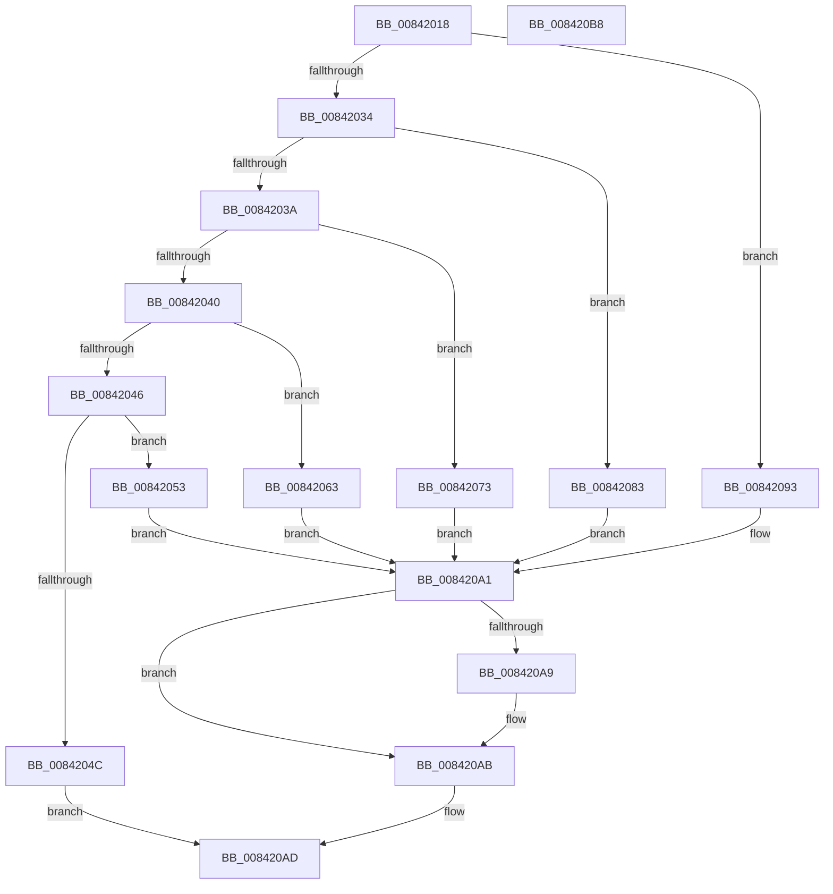

# HashpInitHash

- RVA: `0x00842018`–`0x008420B9` (길이 `161` bytes)
- VA: `0x0000000140842018`
- 실행 섹션: `PAGE`
- PDB 이름 있음: `예`; PDB Function 태그: `아니요`
- unwind 정보 RVA: `0x0005CAAC`
- 디코드: `47`개 명령, `161/161` bytes 표시
- 미해석 바이트: `0` (있으면 어셈블리에 `.byte`로 보존)

> 이 문서는 커널 이미지의 기계어와 PDB 기호를 분석해 생성했습니다. 4번과 5번은 함수 원형과 자료형을 바이너리 사용 방식에서 추정한 C 해석이며 원본 소스 복구 결과는 아닙니다.

## 1. Dependencies

- 직접 호출 지점: **5**; 고유 호출 대상: **5**
- 직접 호출자로 확인된 함수: **1**
- RIP 상대 이미지 참조: **0**

### Outgoing calls
- `0x00842057` → [SymCryptSha512Init](../../text/52/SymCryptSha512Init_function_00528AF4.md) (function, `0x00528AF4`)
- `0x00842067` → [SymCryptSha384Init](../../text/52/SymCryptSha384Init_function_00527464.md) (function, `0x00527464`)
- `0x00842077` → [SymCryptSha256Init](../../text/51/SymCryptSha256Init_function_0051E2C0.md) (function, `0x0051E2C0`)
- `0x00842087` → [SymCryptSha1Init](../../text/52/SymCryptSha1Init_function_00529E70.md) (function, `0x00529E70`)
- `0x00842097` → [SymCryptMd5Init](../../text/52/SymCryptMd5Init_function_0052A890.md) (function, `0x0052A890`)

### Direct callers
- [HashpHashMemory](HashpHashMemory_function_008419AC.md) at `0x00841A3A`

### Static image references
- 디코드된 RIP-relative 메모리 참조가 없습니다.

## 2. Other-region calls and transfers

- 다른 실행 섹션으로 향하는 call: **5**
  - `0x00842057` → [SymCryptSha512Init](../../text/52/SymCryptSha512Init_function_00528AF4.md) (`PAGE` → `.text`)
  - `0x00842067` → [SymCryptSha384Init](../../text/52/SymCryptSha384Init_function_00527464.md) (`PAGE` → `.text`)
  - `0x00842077` → [SymCryptSha256Init](../../text/51/SymCryptSha256Init_function_0051E2C0.md) (`PAGE` → `.text`)
  - `0x00842087` → [SymCryptSha1Init](../../text/52/SymCryptSha1Init_function_00529E70.md) (`PAGE` → `.text`)
  - `0x00842097` → [SymCryptMd5Init](../../text/52/SymCryptMd5Init_function_0052A890.md) (`PAGE` → `.text`)
- 별도 외부 분기/꼬리 이동을 확인하지 못했습니다.

## 3. Assembly (complete function range)

```asm
00842018  48 89 5C 24 08                  mov qword ptr [rsp + 8], rbx
0084201D  57                              push rdi
0084201E  48 83 EC 20                     sub rsp, 0x20
00842022  44 8B 01                        mov r8d, dword ptr [rcx]
00842025  48 8B FA                        mov rdi, rdx
00842028  48 8B D9                        mov rbx, rcx
0084202B  41 81 E8 03 80 00 00            sub r8d, 0x8003
00842032  74 5F                           je 0x140842093
00842034  41 83 E8 01                     sub r8d, 1
00842038  74 49                           je 0x140842083
0084203A  41 83 E8 08                     sub r8d, 8
0084203E  74 33                           je 0x140842073
00842040  41 83 E8 01                     sub r8d, 1
00842044  74 1D                           je 0x140842063
00842046  41 83 F8 01                     cmp r8d, 1
0084204A  74 07                           je 0x140842053
0084204C  B8 28 04 00 C0                  mov eax, 0xc0000428
00842051  EB 5A                           jmp 0x1408420ad
00842053  48 83 C1 10                     add rcx, 0x10
00842057  E8 98 6A CE FF                  call 0x140528af4
0084205C  B8 40 00 00 00                  mov eax, 0x40
00842061  EB 3E                           jmp 0x1408420a1
00842063  48 83 C1 10                     add rcx, 0x10
00842067  E8 F8 53 CE FF                  call 0x140527464
0084206C  B8 30 00 00 00                  mov eax, 0x30
00842071  EB 2E                           jmp 0x1408420a1
00842073  48 83 C1 10                     add rcx, 0x10
00842077  E8 44 C2 CD FF                  call 0x14051e2c0
0084207C  B8 20 00 00 00                  mov eax, 0x20
00842081  EB 1E                           jmp 0x1408420a1
00842083  48 83 C1 10                     add rcx, 0x10
00842087  E8 E4 7D CE FF                  call 0x140529e70
0084208C  B8 14 00 00 00                  mov eax, 0x14
00842091  EB 0E                           jmp 0x1408420a1
00842093  48 83 C1 10                     add rcx, 0x10
00842097  E8 F4 87 CE FF                  call 0x14052a890
0084209C  B8 10 00 00 00                  mov eax, 0x10
008420A1  89 43 04                        mov dword ptr [rbx + 4], eax
008420A4  48 85 FF                        test rdi, rdi
008420A7  74 02                           je 0x1408420ab
008420A9  89 07                           mov dword ptr [rdi], eax
008420AB  33 C0                           xor eax, eax
008420AD  48 8B 5C 24 30                  mov rbx, qword ptr [rsp + 0x30]
008420B2  48 83 C4 20                     add rsp, 0x20
008420B6  5F                              pop rdi
008420B7  C3                              ret
008420B8  CC                              int3
```

## 4. C-style interpretation (structured pseudocode)

```c
__int64 __fastcall HashpInitHash(__int64 a1, __int64 a2)
{
    __int64 result;
    __int64 v_rsp;
    unsigned __int64 v_stack_p8;

    v_stack_p8 = v_rbx;
    v_rsp = (v_rsp) - (32);
    a3 = (unsigned int)(((unsigned int)(*(unsigned int *)(a1))) - (0x8003ULL));
    if (condition_is_equal) goto loc_00842093;
    a3 = (unsigned int)((a3) - (1));
    if (condition_is_equal) goto loc_00842083;
    a3 = (unsigned int)((a3) - (8));
    if (condition_is_equal) goto loc_00842073;
    a3 = (unsigned int)((a3) - (1));
    if (condition_is_equal) goto loc_00842063;
    if (((unsigned int)(a3)) == 1) goto loc_00842053;
    goto loc_008420AD;
loc_00842053:
    a1 = (a1) + (16);
    result = SymCryptSha512Init(a1, a2, a3, a4);
    goto loc_008420A1;
loc_00842063:
    a1 = (a1) + (16);
    result = SymCryptSha384Init(a1, a2, a3, a4);
    goto loc_008420A1;
loc_00842073:
    a1 = (a1) + (16);
    result = SymCryptSha256Init(a1, a2, a3, a4);
    goto loc_008420A1;
loc_00842083:
    a1 = (a1) + (16);
    result = SymCryptSha1Init(a1, a2, a3, a4);
    goto loc_008420A1;
loc_00842093:
    a1 = (a1) + (16);
    result = SymCryptMd5Init(a1, a2, a3, a4);
loc_008420A1:
    *(unsigned int *)(a1 + 4) = 16;
    if (a2 != 0) {
        *(unsigned int *)(a2) = 16;
    }
    result = 0;
loc_008420AD:
    v_rsp = (v_rsp) + (32);
    return result;
}
```

## 5. (Beta) C Style

```c
int64_t HashpInitHash(void *Arg1, int64_t Arg2)
{
    uint8_t *arg1 = (uint8_t *)Arg1;

    int64_t result;
    int64_t local_rsp;
    uint64_t v_stack_p8;

    v_stack_p8 = local_rbx;
    local_rsp = (local_rsp) - (32);
    a3 = (uint32_t)(((uint32_t)(*(uint32_t *)(arg1))) - (0x8003ULL));
    if (condition_is_equal) goto loc_00842093;
    a3 = (uint32_t)((a3) - (1));
    if (condition_is_equal) goto loc_00842083;
    a3 = (uint32_t)((a3) - (8));
    if (condition_is_equal) goto loc_00842073;
    a3 = (uint32_t)((a3) - (1));
    if (condition_is_equal) goto loc_00842063;
    if (((uint32_t)(a3)) == 1) goto loc_00842053;
    goto loc_008420AD;
loc_00842053:
    Arg1 = (Arg1) + (16);
    result = SymCryptSha512Init(Arg1, Arg2, a3, a4);
    goto loc_008420A1;
loc_00842063:
    Arg1 = (Arg1) + (16);
    result = SymCryptSha384Init(Arg1, Arg2, a3, a4);
    goto loc_008420A1;
loc_00842073:
    Arg1 = (Arg1) + (16);
    result = SymCryptSha256Init(Arg1, Arg2, a3, a4);
    goto loc_008420A1;
loc_00842083:
    Arg1 = (Arg1) + (16);
    result = SymCryptSha1Init(Arg1, Arg2, a3, a4);
    goto loc_008420A1;
loc_00842093:
    Arg1 = (Arg1) + (16);
    result = SymCryptMd5Init(Arg1, Arg2, a3, a4);
loc_008420A1:
    *(uint32_t *)(arg1 + 0x4) = 16;
    if (Arg2 != 0) {
        *(uint32_t *)(Arg2) = 16;
    }
    result = 0;
loc_008420AD:
    local_rsp = (local_rsp) + (32);
    return result;
}
```

### 관측된 메모리 오프셋

구조체 형식이 확인되지 않은 접근은 인자 기준의 오프셋으로만 기록했습니다.

| 기준 인자 | 오프셋 표현 | 폭 (bit) | 접근 |
|---|---:|---:|---|
| `Arg1` | `+ 0x0` | `32` | `R` |
| `Arg1` | `+ 0x4` | `32` | `W` |

## 6. Execution-region graph

[열기: 2D/3D 그래프와 함수 탐색 컨트롤 패널](../../../control-panel.html?section=page&rva=0x00842018&view=graph)

- 2D 그래프는 위에서 아래로 흐르고, 3D 그래프는 빈 공간을 드래그해 회전합니다. Shift+드래그는 이동, 휠은 확대·축소, 함수 노드 선택은 대상 보고서 이동입니다.

### Static fallback


