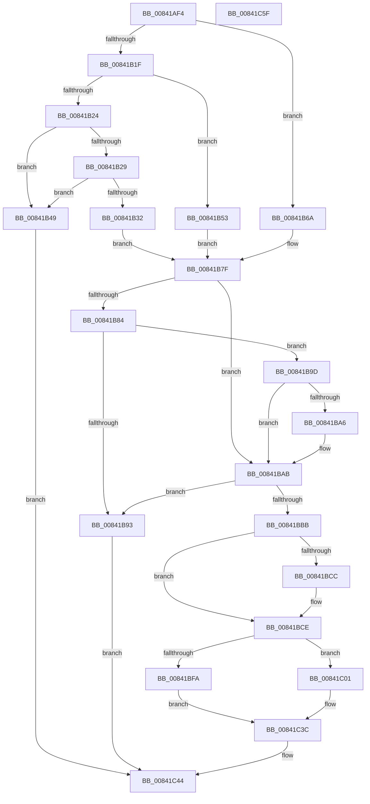

# HashpVerifyEcdsaSignature

- RVA: `0x00841AF4`–`0x00841C60` (길이 `364` bytes)
- VA: `0x0000000140841AF4`
- 실행 섹션: `PAGE`
- PDB 이름 있음: `예`; PDB Function 태그: `아니요`
- unwind 정보 RVA: `0x00093E28`
- 디코드: `97`개 명령, `364/364` bytes 표시
- 미해석 바이트: `0` (있으면 어셈블리에 `.byte`로 보존)

> 이 문서는 커널 이미지의 기계어와 PDB 기호를 분석해 생성했습니다. 4번과 5번은 함수 원형과 자료형을 바이너리 사용 방식에서 추정한 C 해석이며 원본 소스 복구 결과는 아닙니다.

## 1. Dependencies

- 직접 호출 지점: **8**; 고유 호출 대상: **7**
- 직접 호출자로 확인된 함수: **1**
- RIP 상대 이미지 참조: **6**

### Outgoing calls
- `0x00841B29` → [Feature_CodeIntegrity_EccSupport__private_IsEnabledDeviceUsageNoInline](../../text/6A/Feature_CodeIntegrity_EccSupport__private_IsEnabledDeviceUsageNoInline_function_006A5EB0.md) (function, `0x006A5EB0`)
- `0x00841B86` → [SymCryptEcurveAllocate](../../text/52/SymCryptEcurveAllocate_function_00524074.md) (function, `0x00524074`)
- `0x00841BA6` → [SymCryptEcurveFree](../../text/52/SymCryptEcurveFree_function_0052417C.md) (function, `0x0052417C`)
- `0x00841BAE` → [SymCryptEckeyAllocate](../../text/52/SymCryptEckeyAllocate_function_00524A0C.md) (function, `0x00524A0C`)
- `0x00841BBB` → [Feature_CodeIntegrity_EccSupport__private_IsEnabledDeviceUsageNoInline](../../text/6A/Feature_CodeIntegrity_EccSupport__private_IsEnabledDeviceUsageNoInline_function_006A5EB0.md) (function, `0x006A5EB0`)
- `0x00841BF1` → [SymCryptEckeySetValue](../../text/52/SymCryptEckeySetValue_function_00524C34.md) (function, `0x00524C34`)
- `0x00841C2B` → [SymCryptEcDsaVerify](../../text/52/SymCryptEcDsaVerify_function_00526400.md) (function, `0x00526400`)
- `0x00841C3F` → [SymCryptEckeyFree](../../text/52/SymCryptEckeyFree_function_00524AF8.md) (function, `0x00524AF8`)

### Direct callers
- [MinCryptVerifySignedHash2](../83/MinCryptVerifySignedHash2_function_008362A0.md) at `0x0083642A`

### Static image references
- `0x00841B32` → RVA `0x00006BD8` (`.rdata`; read)
- `0x00841B39` → RVA `0x00EF0118` (`.data`; read)
- `0x00841B53` → RVA `0x00006BF8` (`.rdata`; read)
- `0x00841B5A` → RVA `0x00EF0110` (`.data`; read)
- `0x00841B6A` → RVA `0x00006BE8` (`.rdata`; read)
- `0x00841B71` → RVA `0x00EF0120` (`.data`; read)

## 2. Other-region calls and transfers

- 다른 실행 섹션으로 향하는 call: **8**
  - `0x00841B29` → [Feature_CodeIntegrity_EccSupport__private_IsEnabledDeviceUsageNoInline](../../text/6A/Feature_CodeIntegrity_EccSupport__private_IsEnabledDeviceUsageNoInline_function_006A5EB0.md) (`PAGE` → `.text`)
  - `0x00841B86` → [SymCryptEcurveAllocate](../../text/52/SymCryptEcurveAllocate_function_00524074.md) (`PAGE` → `.text`)
  - `0x00841BA6` → [SymCryptEcurveFree](../../text/52/SymCryptEcurveFree_function_0052417C.md) (`PAGE` → `.text`)
  - `0x00841BAE` → [SymCryptEckeyAllocate](../../text/52/SymCryptEckeyAllocate_function_00524A0C.md) (`PAGE` → `.text`)
  - `0x00841BBB` → [Feature_CodeIntegrity_EccSupport__private_IsEnabledDeviceUsageNoInline](../../text/6A/Feature_CodeIntegrity_EccSupport__private_IsEnabledDeviceUsageNoInline_function_006A5EB0.md) (`PAGE` → `.text`)
  - `0x00841BF1` → [SymCryptEckeySetValue](../../text/52/SymCryptEckeySetValue_function_00524C34.md) (`PAGE` → `.text`)
  - `0x00841C2B` → [SymCryptEcDsaVerify](../../text/52/SymCryptEcDsaVerify_function_00526400.md) (`PAGE` → `.text`)
  - `0x00841C3F` → [SymCryptEckeyFree](../../text/52/SymCryptEckeyFree_function_00524AF8.md) (`PAGE` → `.text`)
- 별도 외부 분기/꼬리 이동을 확인하지 못했습니다.

## 3. Assembly (complete function range)

```asm
00841AF4  48 89 5C 24 08                  mov qword ptr [rsp + 8], rbx
00841AF9  48 89 6C 24 10                  mov qword ptr [rsp + 0x10], rbp
00841AFE  48 89 74 24 18                  mov qword ptr [rsp + 0x18], rsi
00841B03  57                              push rdi
00841B04  41 56                           push r14
00841B06  41 57                           push r15
00841B08  48 83 EC 40                     sub rsp, 0x40
00841B0C  33 FF                           xor edi, edi
00841B0E  41 8B E8                        mov ebp, r8d
00841B11  4D 8B F9                        mov r15, r9
00841B14  4C 8B F2                        mov r14, rdx
00841B17  81 E9 01 2E 00 00               sub ecx, 0x2e01
00841B1D  74 4B                           je 0x140841b6a
00841B1F  83 E9 01                        sub ecx, 1
00841B22  74 2F                           je 0x140841b53
00841B24  83 F9 01                        cmp ecx, 1
00841B27  75 20                           jne 0x140841b49
00841B29  E8 82 43 E6 FF                  call 0x1406a5eb0
00841B2E  85 C0                           test eax, eax
00841B30  74 17                           je 0x140841b49
00841B32  48 8B 0D 9F 50 7C FF            mov rcx, qword ptr [rip - 0x83af61]
00841B39  48 8D 1D D8 E5 6A 00            lea rbx, [rip + 0x6ae5d8]
00841B40  48 8B 05 D1 E5 6A 00            mov rax, qword ptr [rip + 0x6ae5d1]
00841B47  EB 36                           jmp 0x140841b7f
00841B49  BB 28 04 00 C0                  mov ebx, 0xc0000428
00841B4E  E9 F1 00 00 00                  jmp 0x140841c44
00841B53  48 8B 0D 9E 50 7C FF            mov rcx, qword ptr [rip - 0x83af62]
00841B5A  48 8D 1D AF E5 6A 00            lea rbx, [rip + 0x6ae5af]
00841B61  48 8B 05 A8 E5 6A 00            mov rax, qword ptr [rip + 0x6ae5a8]
00841B68  EB 15                           jmp 0x140841b7f
00841B6A  48 8B 0D 77 50 7C FF            mov rcx, qword ptr [rip - 0x83af89]
00841B71  48 8D 1D A8 E5 6A 00            lea rbx, [rip + 0x6ae5a8]
00841B78  48 8B 05 A1 E5 6A 00            mov rax, qword ptr [rip + 0x6ae5a1]
00841B7F  48 85 C0                        test rax, rax
00841B82  75 27                           jne 0x140841bab
00841B84  33 D2                           xor edx, edx
00841B86  E8 E9 24 CE FF                  call 0x140524074
00841B8B  48 8B C8                        mov rcx, rax
00841B8E  48 85 C0                        test rax, rax
00841B91  75 0A                           jne 0x140841b9d
00841B93  BB 17 00 00 C0                  mov ebx, 0xc0000017
00841B98  E9 A7 00 00 00                  jmp 0x140841c44
00841B9D  33 C0                           xor eax, eax
00841B9F  F0 48 0F B1 0B                  lock cmpxchg qword ptr [rbx], rcx
00841BA4  74 05                           je 0x140841bab
00841BA6  E8 D1 25 CE FF                  call 0x14052417c
00841BAB  48 8B 0B                        mov rcx, qword ptr [rbx]
00841BAE  E8 59 2E CE FF                  call 0x140524a0c
00841BB3  48 8B F0                        mov rsi, rax
00841BB6  48 85 C0                        test rax, rax
00841BB9  74 D8                           je 0x140841b93
00841BBB  E8 F0 42 E6 FF                  call 0x1406a5eb0
00841BC0  85 C0                           test eax, eax
00841BC2  4C 8B CD                        mov r9, rbp
00841BC5  B8 01 00 00 00                  mov eax, 1
00841BCA  74 02                           je 0x140841bce
00841BCC  8B C7                           mov eax, edi
00841BCE  48 89 74 24 38                  mov qword ptr [rsp + 0x38], rsi
00841BD3  83 C0 10                        add eax, 0x10
00841BD6  C1 E0 08                        shl eax, 8
00841BD9  BB 02 00 00 00                  mov ebx, 2
00841BDE  89 44 24 30                     mov dword ptr [rsp + 0x30], eax
00841BE2  4D 8B C6                        mov r8, r14
00841BE5  89 5C 24 28                     mov dword ptr [rsp + 0x28], ebx
00841BE9  33 D2                           xor edx, edx
00841BEB  33 C9                           xor ecx, ecx
00841BED  89 5C 24 20                     mov dword ptr [rsp + 0x20], ebx
00841BF1  E8 3E 30 CE FF                  call 0x140524c34
00841BF6  85 C0                           test eax, eax
00841BF8  74 07                           je 0x140841c01
00841BFA  BB 28 04 00 C0                  mov ebx, 0xc0000428
00841BFF  EB 3B                           jmp 0x140841c3c
00841C01  8B 84 24 90 00 00 00            mov eax, dword ptr [rsp + 0x90]
00841C08  49 8B D7                        mov rdx, r15
00841C0B  44 8B 84 24 80 00 00 00         mov r8d, dword ptr [rsp + 0x80]
00841C13  48 8B CE                        mov rcx, rsi
00841C16  4C 8B 8C 24 88 00 00 00         mov r9, qword ptr [rsp + 0x88]
00841C1E  89 7C 24 30                     mov dword ptr [rsp + 0x30], edi
00841C22  89 5C 24 28                     mov dword ptr [rsp + 0x28], ebx
00841C26  48 89 44 24 20                  mov qword ptr [rsp + 0x20], rax
00841C2B  E8 D0 47 CE FF                  call 0x140526400
00841C30  BB 28 04 00 C0                  mov ebx, 0xc0000428
00841C35  85 C0                           test eax, eax
00841C37  0F 45 FB                        cmovne edi, ebx
00841C3A  8B DF                           mov ebx, edi
00841C3C  48 8B CE                        mov rcx, rsi
00841C3F  E8 B4 2E CE FF                  call 0x140524af8
00841C44  48 8B 6C 24 68                  mov rbp, qword ptr [rsp + 0x68]
00841C49  8B C3                           mov eax, ebx
00841C4B  48 8B 5C 24 60                  mov rbx, qword ptr [rsp + 0x60]
00841C50  48 8B 74 24 70                  mov rsi, qword ptr [rsp + 0x70]
00841C55  48 83 C4 40                     add rsp, 0x40
00841C59  41 5F                           pop r15
00841C5B  41 5E                           pop r14
00841C5D  5F                              pop rdi
00841C5E  C3                              ret
00841C5F  CC                              int3
```

## 4. C-style interpretation (structured pseudocode)

```c
__int64 __fastcall HashpVerifyEcdsaSignature(int a1, __int64 a2, int a3, __int64 a4, unsigned int a5, __int64 a6, unsigned int a7)
{
    __int64 result;
    __int64 v_rdi;
    __int64 v_rsp;
    unsigned __int64 v_stack_m20;
    unsigned int v_stack_m28;
    unsigned int v_stack_m30;
    unsigned int v_stack_m38;
    unsigned __int64 v_stack_p10;
    unsigned __int64 v_stack_p18;
    unsigned __int64 v_stack_p8;

    v_stack_p8 = v_rbx;
    v_stack_p10 = v_rbp;
    v_stack_p18 = v_rsi;
    v_rsp = (v_rsp) - (64);
    v_rdi = 0;
    a1 = (unsigned int)((a1) - (0x2E01ULL));
    if (condition_is_equal) goto loc_00841B6A;
    a1 = (unsigned int)((a1) - (1));
    if (condition_is_equal) goto loc_00841B53;
    if (a1 != 1) goto loc_00841B49;
    result = Feature_CodeIntegrity_EccSupport__private_IsEnabledDeviceUsageNoInline(a1, a2, a3, a4);
    if ((unsigned int)(result) == 0) goto loc_00841B49;
    goto loc_00841B7F;
loc_00841B49:
    goto loc_00841C44;
loc_00841B53:
    goto loc_00841B7F;
loc_00841B6A:
loc_00841B7F:
    if (*(unsigned __int64 *)(v_rip + 7005601) != 0) goto loc_00841BAB;
    a2 = 0;
    result = SymCryptEcurveAllocate(*(unsigned __int64 *)(v_rip - 8630153), a2, a3, a4);
    if (result != 0) goto loc_00841B9D;
loc_00841B93:
    goto loc_00841C44;
loc_00841B9D:
    result = 0;
    if (!(condition_is_equal)) {
        result = SymCryptEcurveFree(result, a2, a3, a4);
    }
    result = SymCryptEckeyAllocate(*(unsigned __int64 *)((unsigned int)(0xC0000017ULL)), a2, a3, a4);
    if (result == 0) goto loc_00841B93;
    result = Feature_CodeIntegrity_EccSupport__private_IsEnabledDeviceUsageNoInline(*(unsigned __int64 *)((unsigned int)(0xC0000017ULL)), a2, a3, a4);
    result = 1;
    if ((unsigned int)(result) != 0) {
        result = 0;
    }
    v_stack_m20 = result;
    result = (unsigned int)((result) + (16));
    result = (unsigned int)((result) << (8));
    v_stack_m28 = (unsigned int)(result);
    v_stack_m30 = 2;
    a2 = 0;
    a1 = 0;
    v_stack_m38 = 2;
    result = SymCryptEckeySetValue(a1, a2, 0, (unsigned int)(a3));
    if ((unsigned int)(result) == 0) goto loc_00841C01;
    goto loc_00841C3C;
loc_00841C01:
    v_stack_m28 = 0;
    v_stack_m30 = (unsigned int)((unsigned int)(0xC0000428ULL));
    v_stack_m38 = (unsigned int)(a7);
    result = SymCryptEcDsaVerify(result, a4, (unsigned int)(a5), a6);
    if ((unsigned int)(result) != 0) { v_rdi = (unsigned int)((unsigned int)(0xC0000428ULL)); }
loc_00841C3C:
    result = SymCryptEckeyFree(result, a4, (unsigned int)(a5), a6);
loc_00841C44:
    v_rsp = (v_rsp) + (64);
    return (unsigned int)((unsigned int)((unsigned int)((unsigned int)(v_rdi))));
}
```

## 5. (Beta) C Style

```c
int64_t HashpVerifyEcdsaSignature(int32_t Arg1, int64_t Arg2, int32_t Arg3, int64_t Arg4, uint32_t Arg5, int64_t Arg6, uint32_t Arg7)
{
    int64_t result;
    int64_t local_rdi;
    int64_t local_rsp;
    uint64_t v_stack_m20;
    uint32_t v_stack_m28;
    uint32_t v_stack_m30;
    uint32_t v_stack_m38;
    uint64_t v_stack_p10;
    uint64_t v_stack_p18;
    uint64_t v_stack_p8;

    v_stack_p8 = local_rbx;
    v_stack_p10 = local_rbp;
    v_stack_p18 = local_rsi;
    local_rsp = (local_rsp) - (64);
    local_rdi = 0;
    Arg1 = (uint32_t)((Arg1) - (0x2E01ULL));
    if (condition_is_equal) goto loc_00841B6A;
    Arg1 = (uint32_t)((Arg1) - (1));
    if (condition_is_equal) goto loc_00841B53;
    if (Arg1 != 1) goto loc_00841B49;
    result = Feature_CodeIntegrity_EccSupport__private_IsEnabledDeviceUsageNoInline(Arg1, Arg2, Arg3, Arg4);
    if ((uint32_t)(result) == 0) goto loc_00841B49;
    goto loc_00841B7F;
loc_00841B49:
    goto loc_00841C44;
loc_00841B53:
    goto loc_00841B7F;
loc_00841B6A:
loc_00841B7F:
    if (*(uint64_t *)(v_rip + 0x6AE5A1) != 0) goto loc_00841BAB;
    Arg2 = 0;
    result = SymCryptEcurveAllocate(*(uint64_t *)(v_rip - 0x83AF89), Arg2, Arg3, Arg4);
    if (result != 0) goto loc_00841B9D;
loc_00841B93:
    goto loc_00841C44;
loc_00841B9D:
    result = 0;
    if (!(condition_is_equal)) {
        result = SymCryptEcurveFree(result, Arg2, Arg3, Arg4);
    }
    result = SymCryptEckeyAllocate(*(uint64_t *)((uint32_t)(0xC0000017ULL)), Arg2, Arg3, Arg4);
    if (result == 0) goto loc_00841B93;
    result = Feature_CodeIntegrity_EccSupport__private_IsEnabledDeviceUsageNoInline(*(uint64_t *)((uint32_t)(0xC0000017ULL)), Arg2, Arg3, Arg4);
    result = 1;
    if ((uint32_t)(result) != 0) {
        result = 0;
    }
    v_stack_m20 = result;
    result = (uint32_t)((result) + (16));
    result = (uint32_t)((result) << (8));
    v_stack_m28 = (uint32_t)(result);
    v_stack_m30 = 2;
    Arg2 = 0;
    Arg1 = 0;
    v_stack_m38 = 2;
    result = SymCryptEckeySetValue(Arg1, Arg2, 0, (uint32_t)(Arg3));
    if ((uint32_t)(result) == 0) goto loc_00841C01;
    goto loc_00841C3C;
loc_00841C01:
    v_stack_m28 = 0;
    v_stack_m30 = (uint32_t)((uint32_t)(0xC0000428ULL));
    v_stack_m38 = (uint32_t)(Arg7);
    result = SymCryptEcDsaVerify(result, Arg4, (uint32_t)(Arg5), Arg6);
    if ((uint32_t)(result) != 0) { local_rdi = (uint32_t)((uint32_t)(0xC0000428ULL)); }
loc_00841C3C:
    result = SymCryptEckeyFree(result, Arg4, (uint32_t)(Arg5), Arg6);
loc_00841C44:
    local_rsp = (local_rsp) + (64);
    return (uint32_t)((uint32_t)((uint32_t)((uint32_t)(local_rdi))));
}
```

## 6. Execution-region graph

[열기: 2D/3D 그래프와 함수 탐색 컨트롤 패널](../../../control-panel.html?section=page&rva=0x00841AF4&view=graph)

- 2D 그래프는 위에서 아래로 흐르고, 3D 그래프는 빈 공간을 드래그해 회전합니다. Shift+드래그는 이동, 휠은 확대·축소, 함수 노드 선택은 대상 보고서 이동입니다.

### Static fallback


