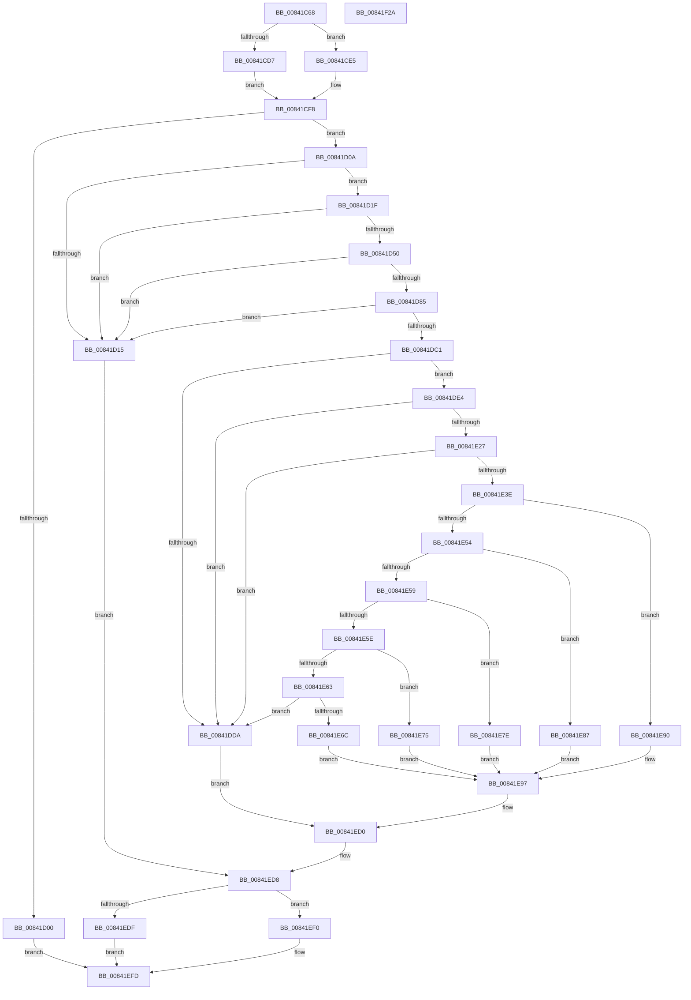

# HashpVerifyPkcs1Signature

- RVA: `0x00841C68`–`0x00841F2B` (길이 `707` bytes)
- VA: `0x0000000140841C68`
- 실행 섹션: `PAGE`
- PDB 이름 있음: `예`; PDB Function 태그: `아니요`
- unwind 정보 RVA: `0x000DB6EC`
- 디코드: `171`개 명령, `707/707` bytes 표시
- 미해석 바이트: `0` (있으면 어셈블리에 `.byte`로 보존)

> 이 문서는 커널 이미지의 기계어와 PDB 기호를 분석해 생성했습니다. 4번과 5번은 함수 원형과 자료형을 바이너리 사용 방식에서 추정한 C 해석이며 원본 소스 복구 결과는 아닙니다.

## 1. Dependencies

- 직접 호출 지점: **16**; 고유 호출 대상: **16**
- 직접 호출자로 확인된 함수: **1**
- RIP 상대 이미지 참조: **8**

### Outgoing calls
- `0x00841CDE` → [ExAllocateFromPagedLookasideList](../../text/3F/ExAllocateFromPagedLookasideList_function_003FB730.md) (function, `0x003FB730`)
- `0x00841CF3` → [ExAllocatePool2](../../poolcode/B8/ExAllocatePool2_function_00B820F0.md) (function, `0x00B820F0`)
- `0x00841D35` → [SymCryptDigitsFromBits](../../text/52/SymCryptDigitsFromBits_function_0052544C.md) (function, `0x0052544C`)
- `0x00841D43` → [SymCryptIntCreate](../../text/52/SymCryptIntCreate_function_0052556C.md) (function, `0x0052556C`)
- `0x00841D64` → [SymCryptIntSetValue](../../text/52/SymCryptIntSetValue_function_00525730.md) (function, `0x00525730`)
- `0x00841D6C` → [SymCryptIntBitsizeOfValue](../../text/52/SymCryptIntBitsizeOfValue_function_005254F4.md) (function, `0x005254F4`)
- `0x00841D77` → [SymCryptIntWipe](../../text/52/SymCryptIntWipe_function_00525850.md) (function, `0x00525850`)
- `0x00841DB0` → [SymCryptRsakeyCreate](../../text/52/SymCryptRsakeyCreate_function_00523594.md) (function, `0x00523594`)
- `0x00841DD1` → [SymCryptLoadMsbFirstUint64](../../text/51/SymCryptLoadMsbFirstUint64_function_0051F8C4.md) (function, `0x0051F8C4`)
- `0x00841E1E` → [SymCryptRsakeySetValue](../../text/52/SymCryptRsakeySetValue_function_0052386C.md) (function, `0x0052386C`)
- `0x00841E2A` → [SymCryptRsakeySizeofModulus](../../text/52/SymCryptRsakeySizeofModulus_function_00523FB8.md) (function, `0x00523FB8`)
- `0x00841EC0` → [SymCryptRsaPkcs1Verify](../../text/52/SymCryptRsaPkcs1Verify_function_005272FC.md) (function, `0x005272FC`)
- `0x00841ED3` → [SymCryptRsakeyWipe](../../text/52/SymCryptRsakeyWipe_function_00523FCC.md) (function, `0x00523FCC`)
- `0x00841EE9` → [ExFreeToPagedLookasideList](../../text/38/ExFreeToPagedLookasideList_function_00387D30.md) (function, `0x00387D30`)
- `0x00841EF8` → [ExFreePoolWithTag](../../poolcode/B8/ExFreePoolWithTag_function_00B82870.md) (function, `0x00B82870`)
- `0x00841F0A` → [_security_check_cookie](../../text/6A/_security_check_cookie_function_006AC640.md) (function, `0x006AC640`)

### Direct callers
- [MinCryptVerifySignedHash2](../83/MinCryptVerifySignedHash2_function_008362A0.md) at `0x008364A8`

### Static image references
- `0x00841C7F` → RVA `0x00E0A740` (`.data`; read)
- `0x00841CBA` → RVA `0x00EF010C` (`.data`; read)
- `0x00841CD7` → RVA `0x00E659C0` (`.data`; read)
- `0x00841E6C` → RVA `0x00006770` (`.rdata`; read)
- `0x00841E75` → RVA `0x00006750` (`.rdata`; read)
- `0x00841E7E` → RVA `0x000067B0` (`.rdata`; read)
- `0x00841E87` → RVA `0x00006790` (`.rdata`; read)
- `0x00841E90` → RVA `0x00006730` (`.rdata`; read)

## 2. Other-region calls and transfers

- 다른 실행 섹션으로 향하는 call: **16**
  - `0x00841CDE` → [ExAllocateFromPagedLookasideList](../../text/3F/ExAllocateFromPagedLookasideList_function_003FB730.md) (`PAGE` → `.text`)
  - `0x00841CF3` → [ExAllocatePool2](../../poolcode/B8/ExAllocatePool2_function_00B820F0.md) (`PAGE` → `POOLCODE`)
  - `0x00841D35` → [SymCryptDigitsFromBits](../../text/52/SymCryptDigitsFromBits_function_0052544C.md) (`PAGE` → `.text`)
  - `0x00841D43` → [SymCryptIntCreate](../../text/52/SymCryptIntCreate_function_0052556C.md) (`PAGE` → `.text`)
  - `0x00841D64` → [SymCryptIntSetValue](../../text/52/SymCryptIntSetValue_function_00525730.md) (`PAGE` → `.text`)
  - `0x00841D6C` → [SymCryptIntBitsizeOfValue](../../text/52/SymCryptIntBitsizeOfValue_function_005254F4.md) (`PAGE` → `.text`)
  - `0x00841D77` → [SymCryptIntWipe](../../text/52/SymCryptIntWipe_function_00525850.md) (`PAGE` → `.text`)
  - `0x00841DB0` → [SymCryptRsakeyCreate](../../text/52/SymCryptRsakeyCreate_function_00523594.md) (`PAGE` → `.text`)
  - `0x00841DD1` → [SymCryptLoadMsbFirstUint64](../../text/51/SymCryptLoadMsbFirstUint64_function_0051F8C4.md) (`PAGE` → `.text`)
  - `0x00841E1E` → [SymCryptRsakeySetValue](../../text/52/SymCryptRsakeySetValue_function_0052386C.md) (`PAGE` → `.text`)
  - `0x00841E2A` → [SymCryptRsakeySizeofModulus](../../text/52/SymCryptRsakeySizeofModulus_function_00523FB8.md) (`PAGE` → `.text`)
  - `0x00841EC0` → [SymCryptRsaPkcs1Verify](../../text/52/SymCryptRsaPkcs1Verify_function_005272FC.md) (`PAGE` → `.text`)
  - `0x00841ED3` → [SymCryptRsakeyWipe](../../text/52/SymCryptRsakeyWipe_function_00523FCC.md) (`PAGE` → `.text`)
  - `0x00841EE9` → [ExFreeToPagedLookasideList](../../text/38/ExFreeToPagedLookasideList_function_00387D30.md) (`PAGE` → `.text`)
  - `0x00841EF8` → [ExFreePoolWithTag](../../poolcode/B8/ExFreePoolWithTag_function_00B82870.md) (`PAGE` → `POOLCODE`)
  - `0x00841F0A` → [_security_check_cookie](../../text/6A/_security_check_cookie_function_006AC640.md) (`PAGE` → `.text`)
- 별도 외부 분기/꼬리 이동을 확인하지 못했습니다.

## 3. Assembly (complete function range)

```asm
00841C68  48 89 5C 24 08                  mov qword ptr [rsp + 8], rbx
00841C6D  55                              push rbp
00841C6E  56                              push rsi
00841C6F  57                              push rdi
00841C70  41 54                           push r12
00841C72  41 55                           push r13
00841C74  41 56                           push r14
00841C76  41 57                           push r15
00841C78  48 81 EC 90 00 00 00            sub rsp, 0x90
00841C7F  48 8B 05 BA 8A 5C 00            mov rax, qword ptr [rip + 0x5c8aba]
00841C86  48 33 C4                        xor rax, rsp
00841C89  48 89 84 24 88 00 00 00         mov qword ptr [rsp + 0x88], rax
00841C91  48 8B 84 24 08 01 00 00         mov rax, qword ptr [rsp + 0x108]
00841C99  0F 57 C0                        xorps xmm0, xmm0
00841C9C  48 83 64 24 58 00               and qword ptr [rsp + 0x58], 0
00841CA2  4D 8B E9                        mov r13, r9
00841CA5  4C 8B A4 24 F8 00 00 00         mov r12, qword ptr [rsp + 0xf8]
00841CAD  8B D9                           mov ebx, ecx
00841CAF  48 89 44 24 60                  mov qword ptr [rsp + 0x60], rax
00841CB4  41 BE 20 0A 00 00               mov r14d, 0xa20
00841CBA  8A 05 4C E4 6A 00               mov al, byte ptr [rip + 0x6ae44c]
00841CC0  4C 89 44 24 68                  mov qword ptr [rsp + 0x68], r8
00841CC5  48 89 54 24 70                  mov qword ptr [rsp + 0x70], rdx
00841CCA  88 44 24 50                     mov byte ptr [rsp + 0x50], al
00841CCE  0F 11 44 24 78                  movups xmmword ptr [rsp + 0x78], xmm0
00841CD3  84 C0                           test al, al
00841CD5  74 0E                           je 0x140841ce5
00841CD7  48 8D 0D E2 3C 62 00            lea rcx, [rip + 0x623ce2]
00841CDE  E8 4D 9A BB FF                  call 0x1403fb730
00841CE3  EB 13                           jmp 0x140841cf8
00841CE5  41 B8 43 49 63 72               mov r8d, 0x72634943
00841CEB  49 8B D6                        mov rdx, r14
00841CEE  B9 02 01 00 00                  mov ecx, 0x102
00841CF3  E8 F8 03 34 00                  call 0x140b820f0
00841CF8  48 8B F8                        mov rdi, rax
00841CFB  48 85 C0                        test rax, rax
00841CFE  75 0A                           jne 0x140841d0a
00841D00  BB 17 00 00 C0                  mov ebx, 0xc0000017
00841D05  E9 F3 01 00 00                  jmp 0x140841efd
00841D0A  48 83 BC 24 F0 00 00 00 08      cmp qword ptr [rsp + 0xf0], 8
00841D13  76 0A                           jbe 0x140841d1f
00841D15  BB 28 04 00 C0                  mov ebx, 0xc0000428
00841D1A  E9 B9 01 00 00                  jmp 0x140841ed8
00841D1F  48 8D 6F 1F                     lea rbp, [rdi + 0x1f]
00841D23  48 8B F7                        mov rsi, rdi
00841D26  48 83 E5 E0                     and rbp, 0xffffffffffffffe0
00841D2A  B9 00 10 00 00                  mov ecx, 0x1000
00841D2F  48 2B F5                        sub rsi, rbp
00841D32  49 03 F6                        add rsi, r14
00841D35  E8 12 37 CE FF                  call 0x14052544c
00841D3A  44 8B C0                        mov r8d, eax
00841D3D  48 8B D6                        mov rdx, rsi
00841D40  48 8B CD                        mov rcx, rbp
00841D43  E8 24 38 CE FF                  call 0x14052556c
00841D48  4C 8B F0                        mov r14, rax
00841D4B  48 85 C0                        test rax, rax
00841D4E  74 C5                           je 0x140841d15
00841D50  48 8B 94 24 00 01 00 00         mov rdx, qword ptr [rsp + 0x100]
00841D58  4C 8B C8                        mov r9, rax
00841D5B  41 B8 02 00 00 00               mov r8d, 2
00841D61  49 8B CC                        mov rcx, r12
00841D64  E8 C7 39 CE FF                  call 0x140525730
00841D69  49 8B CE                        mov rcx, r14
00841D6C  E8 83 37 CE FF                  call 0x1405254f4
00841D71  49 8B CE                        mov rcx, r14
00841D74  44 8B F8                        mov r15d, eax
00841D77  E8 D4 3A CE FF                  call 0x140525850
00841D7C  41 81 FF 00 04 00 00            cmp r15d, 0x400
00841D83  72 90                           jb 0x140841d15
00841D85  83 A4 24 80 00 00 00 00         and dword ptr [rsp + 0x80], 0
00841D8D  4C 8D 44 24 78                  lea r8, [rsp + 0x78]
00841D92  41 BE 01 00 00 00               mov r14d, 1
00841D98  44 89 7C 24 7C                  mov dword ptr [rsp + 0x7c], r15d
00841D9D  48 8B D6                        mov rdx, rsi
00841DA0  44 89 74 24 78                  mov dword ptr [rsp + 0x78], r14d
00841DA5  48 8B CD                        mov rcx, rbp
00841DA8  44 89 B4 24 84 00 00 00         mov dword ptr [rsp + 0x84], r14d
00841DB0  E8 DF 17 CE FF                  call 0x140523594
00841DB5  48 8B F0                        mov rsi, rax
00841DB8  48 85 C0                        test rax, rax
00841DBB  0F 84 54 FF FF FF               je 0x140841d15
00841DC1  48 8B 94 24 F0 00 00 00         mov rdx, qword ptr [rsp + 0xf0]
00841DC9  4C 8D 44 24 58                  lea r8, [rsp + 0x58]
00841DCE  49 8B CD                        mov rcx, r13
00841DD1  E8 EE DA CD FF                  call 0x14051f8c4
00841DD6  85 C0                           test eax, eax
00841DD8  74 0A                           je 0x140841de4
00841DDA  BB 28 04 00 C0                  mov ebx, 0xc0000428
00841DDF  E9 EC 00 00 00                  jmp 0x140841ed0
00841DE4  48 8B 94 24 00 01 00 00         mov rdx, qword ptr [rsp + 0x100]
00841DEC  4C 8D 44 24 58                  lea r8, [rsp + 0x58]
00841DF1  48 89 74 24 48                  mov qword ptr [rsp + 0x48], rsi
00841DF6  BD 02 00 00 00                  mov ebp, 2
00841DFB  C7 44 24 40 00 10 00 00         mov dword ptr [rsp + 0x40], 0x1000
00841E03  45 8B CE                        mov r9d, r14d
00841E06  89 6C 24 38                     mov dword ptr [rsp + 0x38], ebp
00841E0A  49 8B CC                        mov rcx, r12
00841E0D  83 64 24 30 00                  and dword ptr [rsp + 0x30], 0
00841E12  48 83 64 24 28 00               and qword ptr [rsp + 0x28], 0
00841E18  48 83 64 24 20 00               and qword ptr [rsp + 0x20], 0
00841E1E  E8 49 1A CE FF                  call 0x14052386c
00841E23  85 C0                           test eax, eax
00841E25  75 B3                           jne 0x140841dda
00841E27  48 8B CE                        mov rcx, rsi
00841E2A  E8 89 21 CE FF                  call 0x140523fb8
00841E2F  48 8B 94 24 10 01 00 00         mov rdx, qword ptr [rsp + 0x110]
00841E37  8B C0                           mov eax, eax
00841E39  48 3B D0                        cmp rdx, rax
00841E3C  75 9C                           jne 0x140841dda
00841E3E  44 84 B4 24 18 01 00 00         test byte ptr [rsp + 0x118], r14b
00841E46  8D 4D FE                        lea ecx, [rbp - 2]
00841E49  0F 45 CD                        cmovne ecx, ebp
00841E4C  81 EB 03 80 00 00               sub ebx, 0x8003
00841E52  74 3C                           je 0x140841e90
00841E54  41 2B DE                        sub ebx, r14d
00841E57  74 2E                           je 0x140841e87
00841E59  83 EB 08                        sub ebx, 8
00841E5C  74 20                           je 0x140841e7e
00841E5E  41 2B DE                        sub ebx, r14d
00841E61  74 12                           je 0x140841e75
00841E63  41 3B DE                        cmp ebx, r14d
00841E66  0F 85 6E FF FF FF               jne 0x140841dda
00841E6C  48 8D 05 FD 48 7C FF            lea rax, [rip - 0x83b703]
00841E73  EB 22                           jmp 0x140841e97
00841E75  48 8D 05 D4 48 7C FF            lea rax, [rip - 0x83b72c]
00841E7C  EB 19                           jmp 0x140841e97
00841E7E  48 8D 05 2B 49 7C FF            lea rax, [rip - 0x83b6d5]
00841E85  EB 10                           jmp 0x140841e97
00841E87  48 8D 05 02 49 7C FF            lea rax, [rip - 0x83b6fe]
00841E8E  EB 07                           jmp 0x140841e97
00841E90  48 8D 05 99 48 7C FF            lea rax, [rip - 0x83b767]
00841E97  4C 8B 4C 24 60                  mov r9, qword ptr [rsp + 0x60]
00841E9C  4C 8B 44 24 68                  mov r8, qword ptr [rsp + 0x68]
00841EA1  89 4C 24 40                     mov dword ptr [rsp + 0x40], ecx
00841EA5  48 8B CE                        mov rcx, rsi
00841EA8  48 89 6C 24 38                  mov qword ptr [rsp + 0x38], rbp
00841EAD  48 89 44 24 30                  mov qword ptr [rsp + 0x30], rax
00841EB2  89 6C 24 28                     mov dword ptr [rsp + 0x28], ebp
00841EB6  48 89 54 24 20                  mov qword ptr [rsp + 0x20], rdx
00841EBB  48 8B 54 24 70                  mov rdx, qword ptr [rsp + 0x70]
00841EC0  E8 37 54 CE FF                  call 0x1405272fc
00841EC5  F7 D8                           neg eax
00841EC7  BB 28 04 00 C0                  mov ebx, 0xc0000428
00841ECC  1B D2                           sbb edx, edx
00841ECE  23 DA                           and ebx, edx
00841ED0  48 8B CE                        mov rcx, rsi
00841ED3  E8 F4 20 CE FF                  call 0x140523fcc
00841ED8  80 7C 24 50 00                  cmp byte ptr [rsp + 0x50], 0
00841EDD  74 11                           je 0x140841ef0
00841EDF  48 8B D7                        mov rdx, rdi
00841EE2  48 8D 0D D7 3A 62 00            lea rcx, [rip + 0x623ad7]
00841EE9  E8 42 5E B4 FF                  call 0x140387d30
00841EEE  EB 0D                           jmp 0x140841efd
00841EF0  BA 43 49 63 72                  mov edx, 0x72634943
00841EF5  48 8B CF                        mov rcx, rdi
00841EF8  E8 73 09 34 00                  call 0x140b82870
00841EFD  8B C3                           mov eax, ebx
00841EFF  48 8B 8C 24 88 00 00 00         mov rcx, qword ptr [rsp + 0x88]
00841F07  48 33 CC                        xor rcx, rsp
00841F0A  E8 31 A7 E6 FF                  call 0x1406ac640
00841F0F  48 8B 9C 24 D0 00 00 00         mov rbx, qword ptr [rsp + 0xd0]
00841F17  48 81 C4 90 00 00 00            add rsp, 0x90
00841F1E  41 5F                           pop r15
00841F20  41 5E                           pop r14
00841F22  41 5D                           pop r13
00841F24  41 5C                           pop r12
00841F26  5F                              pop rdi
00841F27  5E                              pop rsi
00841F28  5D                              pop rbp
00841F29  C3                              ret
00841F2A  CC                              int3
```

## 4. C-style interpretation (structured pseudocode)

```c
__int64 __fastcall HashpVerifyPkcs1Signature(int a1, __int64 a2, __int64 a3, __int64 a4, __int64 a5, __int64 a6, __int64 a7, __int64 a8, __int64 a9)
{
    __int64 result;
    __int64 v_rbp;
    __int64 v_rbx;
    __int64 v_rsi;
    __int64 v_rsp;
    unsigned __int64 v_stack_m40;
    unsigned int v_stack_m44;
    unsigned int v_stack_m48;
    unsigned int v_stack_m4C;
    unsigned __int64 v_stack_m50;
    unsigned __int64 v_stack_m58;
    unsigned __int64 v_stack_m60;
    unsigned __int64 v_stack_m68;
    unsigned __int64 v_stack_m70;
    unsigned __int8 v_stack_m78;
    unsigned __int64 v_stack_m80;
    unsigned int v_stack_m88;
    unsigned int v_stack_m90;
    unsigned int v_stack_m98;
    unsigned __int64 v_stack_mA0;
    unsigned __int64 v_stack_mA8;
    unsigned __int8 v_stack_p50;
    unsigned __int64 v_stack_p8;

    v_stack_p8 = v_rbx;
    v_rsp = (v_rsp) - (144);
    result = (*(unsigned __int64 *)(v_rip + 6064826)) ^ (v_rsp);
    v_stack_m40 = result;
    v_stack_m68 = a8;
    v_stack_m60 = a3;
    v_stack_m58 = a2;
    v_stack_m78 = (unsigned __int8)(*(unsigned __int8 *)(v_rip + 7005260));
    v_stack_m50 = v_xmm0;
    if ((unsigned __int8)(*(unsigned __int8 *)(v_rip + 7005260)) == 0) goto loc_00841CE5;
    result = ExAllocateFromPagedLookasideList(v_rip + 6438114, a2, a3, a4);
    goto loc_00841CF8;
loc_00841CE5:
    result = ExAllocatePool2(258, (unsigned int)(0xA20ULL), (unsigned int)(0x72634943ULL), a4);
loc_00841CF8:
    if (result != 0) goto loc_00841D0A;
    goto loc_00841EFD;
loc_00841D0A:
    if (a5 <= 8) goto loc_00841D1F;
loc_00841D15:
    goto loc_00841ED8;
loc_00841D1F:
    v_rbp = (result + 31) & (-32);
    v_rsi = (result) - (v_rbp);
    v_rsi = (v_rsi) + ((unsigned int)(0xA20ULL));
    result = SymCryptDigitsFromBits((unsigned int)(0x1000ULL), (unsigned int)(0xA20ULL), (unsigned int)(0x72634943ULL), a4);
    result = SymCryptIntCreate(v_rbp, v_rsi, (unsigned int)((unsigned int)(result)), a4);
    if (result == 0) goto loc_00841D15;
    result = SymCryptIntSetValue(a6, a7, 2, result);
    result = SymCryptIntBitsizeOfValue(result, a7, 2, result);
    result = SymCryptIntWipe(result, a7, 2, result);
    if (((unsigned int)((unsigned int)((unsigned int)(result)))) < 0x400ULL) goto loc_00841D15;
    v_stack_m4C = (unsigned int)((unsigned int)((unsigned int)(result)));
    v_stack_m50 = 1;
    v_stack_m44 = 1;
    result = SymCryptRsakeyCreate(v_rbp, v_rsi, v_stack_m50, result);
    if (result == 0) goto loc_00841D15;
    result = SymCryptLoadMsbFirstUint64(a4, a5, v_stack_m70, result);
    if ((unsigned int)(result) == 0) goto loc_00841DE4;
loc_00841DDA:
    goto loc_00841ED0;
loc_00841DE4:
    v_stack_m80 = result;
    v_stack_m88 = 0x1000ULL;
    v_stack_m90 = 2;
    result = SymCryptRsakeySetValue(a6, a7, v_stack_m70, 1);
    if ((unsigned int)(result) != 0) goto loc_00841DDA;
    result = SymCryptRsakeySizeofModulus(result, a7, v_stack_m70, 1);
    if (a9 != ((unsigned int)((unsigned int)(result)))) goto loc_00841DDA;
    a1 = 2 - 2;
    if (((v_stack_p50) & (1)) != 0) { a1 = 2; }
    v_rbx = (unsigned int)(((unsigned int)(0xC0000428ULL)) - (0x8003ULL));
    if (condition_is_equal) goto loc_00841E90;
    v_rbx = (unsigned int)((v_rbx) - (1));
    if (condition_is_equal) goto loc_00841E87;
    v_rbx = (unsigned int)((v_rbx) - (8));
    if (condition_is_equal) goto loc_00841E7E;
    v_rbx = (unsigned int)((v_rbx) - (1));
    if (condition_is_equal) goto loc_00841E75;
    if (((unsigned int)(v_rbx)) != 1) goto loc_00841DDA;
    goto loc_00841E97;
loc_00841E75:
    goto loc_00841E97;
loc_00841E7E:
    goto loc_00841E97;
loc_00841E87:
    goto loc_00841E97;
loc_00841E90:
loc_00841E97:
    v_stack_m88 = a1;
    v_stack_m90 = 2;
    v_stack_m98 = v_rip - 8632167;
    v_stack_mA0 = 2;
    v_stack_mA8 = a9;
    result = SymCryptRsaPkcs1Verify(result, v_stack_m58, v_stack_m60, v_stack_m68);
    result = (unsigned int)(-(result));
    v_rbx = (unsigned int)(((unsigned int)(0xC0000428ULL)) & ((unsigned int)(v_stack_m58)));
loc_00841ED0:
    result = SymCryptRsakeyWipe(result, v_stack_m58, v_stack_m60, v_stack_m68);
loc_00841ED8:
    if (v_stack_m78 == 0) goto loc_00841EF0;
    result = ExFreeToPagedLookasideList(v_rip + 6437591, result, v_stack_m60, v_stack_m68);
    goto loc_00841EFD;
loc_00841EF0:
    result = ExFreePoolWithTag(result, (unsigned int)(0x72634943ULL), v_stack_m60, v_stack_m68);
loc_00841EFD:
    a1 = (v_stack_m40) ^ (v_rsp);
    result = _security_check_cookie(a1, (unsigned int)(0x72634943ULL), v_stack_m60, v_stack_m68);
    v_rsp = (v_rsp) + (144);
    return result;
}
```

## 5. (Beta) C Style

```c
int64_t HashpVerifyPkcs1Signature(int32_t Arg1, int64_t Arg2, int64_t Arg3, int64_t Arg4, int64_t Arg5, int64_t Arg6, int64_t Arg7, int64_t Arg8, int64_t Arg9)
{
    int64_t result;
    int64_t local_rbp;
    int64_t local_rbx;
    int64_t local_rsi;
    int64_t local_rsp;
    uint64_t v_stack_m40;
    uint32_t v_stack_m44;
    uint32_t v_stack_m48;
    uint32_t v_stack_m4C;
    uint64_t v_stack_m50;
    uint64_t v_stack_m58;
    uint64_t v_stack_m60;
    uint64_t v_stack_m68;
    uint64_t v_stack_m70;
    uint8_t v_stack_m78;
    uint64_t v_stack_m80;
    uint32_t v_stack_m88;
    uint32_t v_stack_m90;
    uint32_t v_stack_m98;
    uint64_t v_stack_mA0;
    uint64_t v_stack_mA8;
    uint8_t v_stack_p50;
    uint64_t v_stack_p8;

    v_stack_p8 = local_rbx;
    local_rsp = (local_rsp) - (144);
    result = (*(uint64_t *)(v_rip + 0x5C8ABA)) ^ (local_rsp);
    v_stack_m40 = result;
    v_stack_m68 = Arg8;
    v_stack_m60 = Arg3;
    v_stack_m58 = Arg2;
    v_stack_m78 = (uint8_t)(*(uint8_t *)(v_rip + 0x6AE44C));
    v_stack_m50 = v_xmm0;
    if ((uint8_t)(*(uint8_t *)(v_rip + 0x6AE44C)) == 0) goto loc_00841CE5;
    result = ExAllocateFromPagedLookasideList(v_rip + 6438114, Arg2, Arg3, Arg4);
    goto loc_00841CF8;
loc_00841CE5:
    result = ExAllocatePool2(258, (uint32_t)(0xA20ULL), (uint32_t)(0x72634943ULL), Arg4);
loc_00841CF8:
    if (result != 0) goto loc_00841D0A;
    goto loc_00841EFD;
loc_00841D0A:
    if (Arg5 <= 8) goto loc_00841D1F;
loc_00841D15:
    goto loc_00841ED8;
loc_00841D1F:
    local_rbp = (result + 31) & (-32);
    local_rsi = (result) - (local_rbp);
    local_rsi = (local_rsi) + ((uint32_t)(0xA20ULL));
    result = SymCryptDigitsFromBits((uint32_t)(0x1000ULL), (uint32_t)(0xA20ULL), (uint32_t)(0x72634943ULL), Arg4);
    result = SymCryptIntCreate(local_rbp, local_rsi, (uint32_t)((uint32_t)(result)), Arg4);
    if (result == 0) goto loc_00841D15;
    result = SymCryptIntSetValue(Arg6, Arg7, 2, result);
    result = SymCryptIntBitsizeOfValue(result, Arg7, 2, result);
    result = SymCryptIntWipe(result, Arg7, 2, result);
    if (((uint32_t)((uint32_t)((uint32_t)(result)))) < 0x400ULL) goto loc_00841D15;
    v_stack_m4C = (uint32_t)((uint32_t)((uint32_t)(result)));
    v_stack_m50 = 1;
    v_stack_m44 = 1;
    result = SymCryptRsakeyCreate(local_rbp, local_rsi, v_stack_m50, result);
    if (result == 0) goto loc_00841D15;
    result = SymCryptLoadMsbFirstUint64(Arg4, Arg5, v_stack_m70, result);
    if ((uint32_t)(result) == 0) goto loc_00841DE4;
loc_00841DDA:
    goto loc_00841ED0;
loc_00841DE4:
    v_stack_m80 = result;
    v_stack_m88 = 0x1000ULL;
    v_stack_m90 = 2;
    result = SymCryptRsakeySetValue(Arg6, Arg7, v_stack_m70, 1);
    if ((uint32_t)(result) != 0) goto loc_00841DDA;
    result = SymCryptRsakeySizeofModulus(result, Arg7, v_stack_m70, 1);
    if (Arg9 != ((uint32_t)((uint32_t)(result)))) goto loc_00841DDA;
    Arg1 = 2 - 2;
    if (((v_stack_p50) & (1)) != 0) { Arg1 = 2; }
    local_rbx = (uint32_t)(((uint32_t)(0xC0000428ULL)) - (0x8003ULL));
    if (condition_is_equal) goto loc_00841E90;
    local_rbx = (uint32_t)((local_rbx) - (1));
    if (condition_is_equal) goto loc_00841E87;
    local_rbx = (uint32_t)((local_rbx) - (8));
    if (condition_is_equal) goto loc_00841E7E;
    local_rbx = (uint32_t)((local_rbx) - (1));
    if (condition_is_equal) goto loc_00841E75;
    if (((uint32_t)(local_rbx)) != 1) goto loc_00841DDA;
    goto loc_00841E97;
loc_00841E75:
    goto loc_00841E97;
loc_00841E7E:
    goto loc_00841E97;
loc_00841E87:
    goto loc_00841E97;
loc_00841E90:
loc_00841E97:
    v_stack_m88 = Arg1;
    v_stack_m90 = 2;
    v_stack_m98 = v_rip - 8632167;
    v_stack_mA0 = 2;
    v_stack_mA8 = Arg9;
    result = SymCryptRsaPkcs1Verify(result, v_stack_m58, v_stack_m60, v_stack_m68);
    result = (uint32_t)(-(result));
    local_rbx = (uint32_t)(((uint32_t)(0xC0000428ULL)) & ((uint32_t)(v_stack_m58)));
loc_00841ED0:
    result = SymCryptRsakeyWipe(result, v_stack_m58, v_stack_m60, v_stack_m68);
loc_00841ED8:
    if (v_stack_m78 == 0) goto loc_00841EF0;
    result = ExFreeToPagedLookasideList(v_rip + 6437591, result, v_stack_m60, v_stack_m68);
    goto loc_00841EFD;
loc_00841EF0:
    result = ExFreePoolWithTag(result, (uint32_t)(0x72634943ULL), v_stack_m60, v_stack_m68);
loc_00841EFD:
    Arg1 = (v_stack_m40) ^ (local_rsp);
    result = _security_check_cookie(Arg1, (uint32_t)(0x72634943ULL), v_stack_m60, v_stack_m68);
    local_rsp = (local_rsp) + (144);
    return result;
}
```

## 6. Execution-region graph

[열기: 2D/3D 그래프와 함수 탐색 컨트롤 패널](../../../control-panel.html?section=page&rva=0x00841C68&view=graph)

- 2D 그래프는 위에서 아래로 흐르고, 3D 그래프는 빈 공간을 드래그해 회전합니다. Shift+드래그는 이동, 휠은 확대·축소, 함수 노드 선택은 대상 보고서 이동입니다.

### Static fallback


