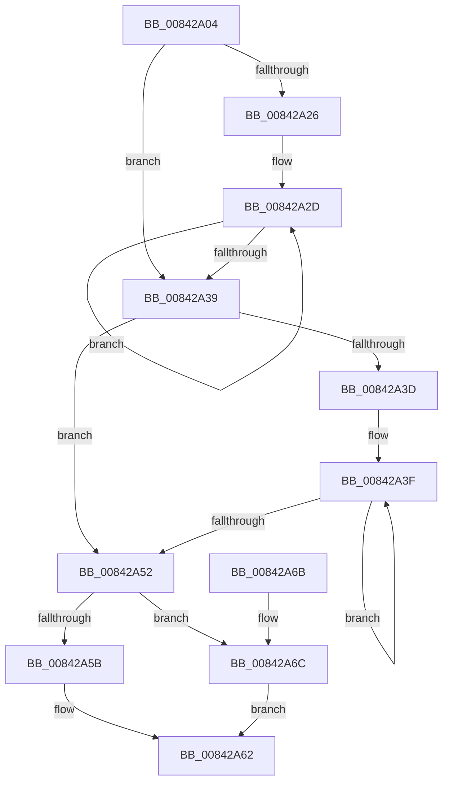

# HvBufferCheckSum

- RVA: `0x00842A04`–`0x00842A74` (길이 `112` bytes)
- VA: `0x0000000140842A04`
- 실행 섹션: `PAGE`
- PDB 이름 있음: `예`; PDB Function 태그: `아니요`
- unwind 정보 RVA: `0x00068FC0`
- 디코드: `36`개 명령, `112/112` bytes 표시
- 미해석 바이트: `0` (있으면 어셈블리에 `.byte`로 보존)

> 이 문서는 커널 이미지의 기계어와 PDB 기호를 분석해 생성했습니다. 4번과 5번은 함수 원형과 자료형을 바이너리 사용 방식에서 추정한 C 해석이며 원본 소스 복구 결과는 아닙니다.

## 1. Dependencies

- 직접 호출 지점: **0**; 고유 호출 대상: **0**
- 직접 호출자로 확인된 함수: **3**
- RIP 상대 이미지 참조: **0**

### Outgoing calls
- 직접 디코드된 call 명령이 없습니다.

### Direct callers
- [CmpVerifyLogRecord](../7F/CmpVerifyLogRecord_function_007F10DC.md) at `0x007F110D`
- [CmAddLogForAction](CmAddLogForAction_function_008445AC.md) at `0x008448D7`
- [CmLogTmRmAction](../9B/CmLogTmRmAction_function_009B1598.md) at `0x009B15FE`

### Static image references
- 디코드된 RIP-relative 메모리 참조가 없습니다.

## 2. Other-region calls and transfers

- 다른 실행 섹션으로 향하는 call: **0**
- 별도 외부 분기/꼬리 이동을 확인하지 못했습니다.

## 3. Assembly (complete function range)

```asm
00842A04  48 89 5C 24 08                  mov qword ptr [rsp + 8], rbx
00842A09  44 8B D2                        mov r10d, edx
00842A0C  45 33 C9                        xor r9d, r9d
00842A0F  41 C1 EA 02                     shr r10d, 2
00842A13  83 E2 03                        and edx, 3
00842A16  45 33 C0                        xor r8d, r8d
00842A19  41 8D 59 01                     lea ebx, [r9 + 1]
00842A1D  4E 8D 1C 91                     lea r11, [rcx + r10*4]
00842A21  44 3B D3                        cmp r10d, ebx
00842A24  76 13                           jbe 0x140842a39
00842A26  48 83 C1 04                     add rcx, 4
00842A2A  41 FF CA                        dec r10d
00842A2D  44 33 01                        xor r8d, dword ptr [rcx]
00842A30  48 8D 49 04                     lea rcx, [rcx + 4]
00842A34  4C 2B D3                        sub r10, rbx
00842A37  75 F4                           jne 0x140842a2d
00842A39  85 D2                           test edx, edx
00842A3B  74 15                           je 0x140842a52
00842A3D  8B CA                           mov ecx, edx
00842A3F  41 0F B6 03                     movzx eax, byte ptr [r11]
00842A43  4C 03 DB                        add r11, rbx
00842A46  41 C1 E1 08                     shl r9d, 8
00842A4A  44 03 C8                        add r9d, eax
00842A4D  48 2B CB                        sub rcx, rbx
00842A50  75 ED                           jne 0x140842a3f
00842A52  45 33 C1                        xor r8d, r9d
00842A55  41 83 F8 FF                     cmp r8d, -1
00842A59  74 11                           je 0x140842a6c
00842A5B  45 85 C0                        test r8d, r8d
00842A5E  44 0F 44 C3                     cmove r8d, ebx
00842A62  48 8B 5C 24 08                  mov rbx, qword ptr [rsp + 8]
00842A67  41 8B C0                        mov eax, r8d
00842A6A  C3                              ret
00842A6B  CC                              int3
00842A6C  41 B8 FE FF FF FF               mov r8d, 0xfffffffe
00842A72  EB EE                           jmp 0x140842a62
```

## 4. C-style interpretation (structured pseudocode)

```c
__int64 __fastcall HvBufferCheckSum(__int64 a1, int a2, int a3, int a4)
{
    __int64 v_r10;
    __int64 v_r11;
    unsigned __int64 v_stack_p8;

    v_stack_p8 = v_rbx;
    a4 = 0;
    v_r10 = (unsigned int)(((unsigned int)(a2)) >> (2));
    a2 = (unsigned int)((a2) & (3));
    a3 = 0;
    if (((unsigned int)(v_r10)) <= ((unsigned int)(a4 + 1))) goto loc_00842A39;
    a1 = (a1) + (4);
    v_r10 = (unsigned int)((v_r10) - 1);
loc_00842A2D:
    a3 = (unsigned int)((a3) ^ (*(unsigned int *)(a1)));
    v_r10 = (v_r10) - (a4 + 1);
    if (condition_is_not_equal) goto loc_00842A2D;
loc_00842A39:
    if (a2 == 0) goto loc_00842A52;
loc_00842A3F:
    v_r11 = (a1 + v_r10 * 4) + (a4 + 1);
    a4 = (unsigned int)((a4) << (8));
    a4 = (unsigned int)((a4) + ((unsigned int)(*(unsigned __int8 *)(a1 + v_r10 * 4))));
    a1 = ((unsigned int)(a2)) - (a4 + 1);
    if (condition_is_not_equal) goto loc_00842A3F;
loc_00842A52:
    a3 = (unsigned int)((a3) ^ (a4));
    if (a3 == -1) goto loc_00842A6C;
    if (a3 == 0) { a3 = (unsigned int)(a4 + 1); }
loc_00842A62:
    return (unsigned int)(a3);
loc_00842A6C:
    goto loc_00842A62;
}
```

## 5. (Beta) C Style

```c
int64_t HvBufferCheckSum(void *Arg1, int32_t Arg2, int32_t Arg3, int32_t Arg4)
{
    uint8_t *arg1 = (uint8_t *)Arg1;

    int64_t local_r10;
    int64_t local_r11;
    uint64_t v_stack_p8;

    v_stack_p8 = local_rbx;
    Arg4 = 0;
    local_r10 = (uint32_t)(((uint32_t)(Arg2)) >> (2));
    Arg2 = (uint32_t)((Arg2) & (3));
    Arg3 = 0;
    if (((uint32_t)(local_r10)) <= ((uint32_t)(Arg4 + 1))) goto loc_00842A39;
    Arg1 = (Arg1) + (4);
    local_r10 = (uint32_t)((local_r10) - 1);
loc_00842A2D:
    Arg3 = (uint32_t)((Arg3) ^ (*(uint32_t *)(arg1)));
    local_r10 = (local_r10) - (Arg4 + 1);
    if (condition_is_not_equal) goto loc_00842A2D;
loc_00842A39:
    if (Arg2 == 0) goto loc_00842A52;
loc_00842A3F:
    local_r11 = (Arg1 + local_r10 * 4) + (Arg4 + 1);
    Arg4 = (uint32_t)((Arg4) << (8));
    Arg4 = (uint32_t)((Arg4) + ((uint32_t)(*(uint8_t *)(arg1 + local_r10 * 4))));
    Arg1 = ((uint32_t)(Arg2)) - (Arg4 + 1);
    if (condition_is_not_equal) goto loc_00842A3F;
loc_00842A52:
    Arg3 = (uint32_t)((Arg3) ^ (Arg4));
    if (Arg3 == -1) goto loc_00842A6C;
    if (Arg3 == 0) { Arg3 = (uint32_t)(Arg4 + 1); }
loc_00842A62:
    return (uint32_t)(Arg3);
loc_00842A6C:
    goto loc_00842A62;
}
```

### 관측된 메모리 오프셋

구조체 형식이 확인되지 않은 접근은 인자 기준의 오프셋으로만 기록했습니다.

| 기준 인자 | 오프셋 표현 | 폭 (bit) | 접근 |
|---|---:|---:|---|
| `Arg1` | `+ 0x0` | `8` | `R` |
| `Arg1` | `+ 0x0` | `32` | `R` |
| `Arg1` | `+ 0x0 + r10*4` | `64` | `R` |
| `Arg1` | `+ 0x4` | `64` | `R` |

## 6. Execution-region graph

[열기: 2D/3D 그래프와 함수 탐색 컨트롤 패널](../../../control-panel.html?section=page&rva=0x00842A04&view=graph)

- 2D 그래프는 위에서 아래로 흐르고, 3D 그래프는 빈 공간을 드래그해 회전합니다. Shift+드래그는 이동, 휠은 확대·축소, 함수 노드 선택은 대상 보고서 이동입니다.

### Static fallback


