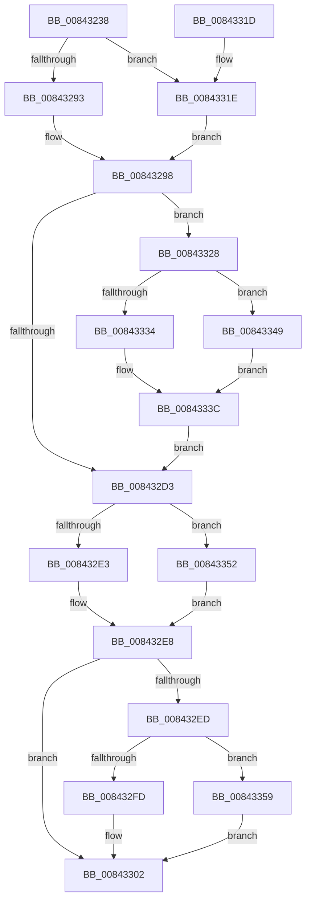

# HvDuplicateCell

- RVA: `0x00843238`–`0x00843360` (길이 `296` bytes)
- VA: `0x0000000140843238`
- 실행 섹션: `PAGE`
- PDB 이름 있음: `예`; PDB Function 태그: `아니요`
- unwind 정보 RVA: `0x00069078`
- 디코드: `85`개 명령, `296/296` bytes 표시
- 미해석 바이트: `0` (있으면 어셈블리에 `.byte`로 보존)

> 이 문서는 커널 이미지의 기계어와 PDB 기호를 분석해 생성했습니다. 4번과 5번은 함수 원형과 자료형을 바이너리 사용 방식에서 추정한 C 해석이며 원본 소스 복구 결과는 아닙니다.

## 1. Dependencies

- 직접 호출 지점: **11**; 고유 호출 대상: **8**
- 직접 호출자로 확인된 함수: **2**
- RIP 상대 이미지 참조: **0**

### Outgoing calls
- `0x0084326C` → [HvpGetCellContextInitialize](../85/HvpGetCellContextInitialize_function_00855F10.md) (function, `0x00855F10`)
- `0x0084327A` → [HvpGetCellContextInitialize](../85/HvpGetCellContextInitialize_function_00855F10.md) (function, `0x00855F10`)
- `0x00843293` → [HvpGetCellFlat](../85/HvpGetCellFlat_function_00854C60.md) (function, `0x00854C60`)
- `0x008432C4` → [HvAllocateCell](../85/HvAllocateCell_function_00859C94.md) (function, `0x00859C94`)
- `0x008432E3` → [HvpReleaseCellPaged](../85/HvpReleaseCellPaged_function_00855F40.md) (function, `0x00855F40`)
- `0x008432FD` → [HvpReleaseCellPaged](../85/HvpReleaseCellPaged_function_00855F40.md) (function, `0x00855F40`)
- `0x0084331E` → [HvpGetCellPaged](../85/HvpGetCellPaged_function_00854CB0.md) (function, `0x00854CB0`)
- `0x00843337` → [memcpy](../../text/6C/memcpy_function_006C6840.md) (function, `0x006C6840`)
- `0x0084334B` → [memset](../../text/6C/memset_function_006C6C40.md) (function, `0x006C6C40`)
- `0x00843352` → [HvpReleaseCellFlat](../85/HvpReleaseCellFlat_function_0085CC20.md) (function, `0x0085CC20`)
- `0x00843359` → [HvpReleaseCellFlat](../85/HvpReleaseCellFlat_function_0085CC20.md) (function, `0x0085CC20`)

### Direct callers
- [CmpDuplicateIndex](CmpDuplicateIndex_function_008420C0.md) at `0x00842149`
- [CmpDuplicateIndex](CmpDuplicateIndex_function_008420C0.md) at `0x008421AB`
- [CmpDuplicateIndex](CmpDuplicateIndex_function_008420C0.md) at `0x008421D4`
- [CmpCloneKCBValueListForTrans](CmpCloneKCBValueListForTrans_function_00844D30.md) at `0x00844DA7`

### Static image references
- 디코드된 RIP-relative 메모리 참조가 없습니다.

## 2. Other-region calls and transfers

- 다른 실행 섹션으로 향하는 call: **2**
  - `0x00843337` → [memcpy](../../text/6C/memcpy_function_006C6840.md) (`PAGE` → `.text`)
  - `0x0084334B` → [memset](../../text/6C/memset_function_006C6C40.md) (`PAGE` → `.text`)
- 별도 외부 분기/꼬리 이동을 확인하지 못했습니다.

## 3. Assembly (complete function range)

```asm
00843238  48 89 5C 24 10                  mov qword ptr [rsp + 0x10], rbx
0084323D  48 89 74 24 18                  mov qword ptr [rsp + 0x18], rsi
00843242  55                              push rbp
00843243  57                              push rdi
00843244  41 54                           push r12
00843246  41 56                           push r14
00843248  41 57                           push r15
0084324A  48 8B EC                        mov rbp, rsp
0084324D  48 83 EC 50                     sub rsp, 0x50
00843251  48 83 65 E0 00                  and qword ptr [rbp - 0x20], 0
00843256  48 8B D9                        mov rbx, rcx
00843259  48 83 65 E8 00                  and qword ptr [rbp - 0x18], 0
0084325E  48 8D 4D E0                     lea rcx, [rbp - 0x20]
00843262  83 4D 30 FF                     or dword ptr [rbp + 0x30], 0xffffffff
00843266  45 8A E1                        mov r12b, r9b
00843269  41 8B F8                        mov edi, r8d
0084326C  E8 9F 2C 01 00                  call 0x140855f10
00843271  48 83 65 F0 00                  and qword ptr [rbp - 0x10], 0
00843276  48 8D 4D E8                     lea rcx, [rbp - 0x18]
0084327A  E8 91 2C 01 00                  call 0x140855f10
0084327F  F6 83 8C 00 00 00 01            test byte ptr [rbx + 0x8c], 1
00843286  4C 8D 45 E0                     lea r8, [rbp - 0x20]
0084328A  48 8B CB                        mov rcx, rbx
0084328D  0F 84 8B 00 00 00               je 0x14084331e
00843293  E8 C8 19 01 00                  call 0x140854c60
00843298  4C 8B F0                        mov r14, rax
0084329B  4C 8D 4D 30                     lea r9, [rbp + 0x30]
0084329F  41 BF FC FF FF FF               mov r15d, 0xfffffffc
008432A5  44 8B C7                        mov r8d, edi
008432A8  44 2B 78 FC                     sub r15d, dword ptr [rax - 4]
008432AC  48 8B CB                        mov rcx, rbx
008432AF  48 8D 45 E8                     lea rax, [rbp - 0x18]
008432B3  41 8B D7                        mov edx, r15d
008432B6  48 89 44 24 28                  mov qword ptr [rsp + 0x28], rax
008432BB  48 8D 45 F0                     lea rax, [rbp - 0x10]
008432BF  48 89 44 24 20                  mov qword ptr [rsp + 0x20], rax
008432C4  E8 CB 69 01 00                  call 0x140859c94
008432C9  48 8B 7D F0                     mov rdi, qword ptr [rbp - 0x10]
008432CD  8B F0                           mov esi, eax
008432CF  85 C0                           test eax, eax
008432D1  79 55                           jns 0x140843328
008432D3  F6 83 8C 00 00 00 01            test byte ptr [rbx + 0x8c], 1
008432DA  48 8D 55 E0                     lea rdx, [rbp - 0x20]
008432DE  48 8B CB                        mov rcx, rbx
008432E1  75 6F                           jne 0x140843352
008432E3  E8 58 2C 01 00                  call 0x140855f40
008432E8  48 85 FF                        test rdi, rdi
008432EB  74 15                           je 0x140843302
008432ED  F6 83 8C 00 00 00 01            test byte ptr [rbx + 0x8c], 1
008432F4  48 8D 55 E8                     lea rdx, [rbp - 0x18]
008432F8  48 8B CB                        mov rcx, rbx
008432FB  75 5C                           jne 0x140843359
008432FD  E8 3E 2C 01 00                  call 0x140855f40
00843302  4C 8D 5C 24 50                  lea r11, [rsp + 0x50]
00843307  8B C6                           mov eax, esi
00843309  49 8B 5B 38                     mov rbx, qword ptr [r11 + 0x38]
0084330D  49 8B 73 40                     mov rsi, qword ptr [r11 + 0x40]
00843311  49 8B E3                        mov rsp, r11
00843314  41 5F                           pop r15
00843316  41 5E                           pop r14
00843318  41 5C                           pop r12
0084331A  5F                              pop rdi
0084331B  5D                              pop rbp
0084331C  C3                              ret
0084331D  CC                              int3
0084331E  E8 8D 19 01 00                  call 0x140854cb0
00843323  E9 70 FF FF FF                  jmp 0x140843298
00843328  4D 63 C7                        movsxd r8, r15d
0084332B  48 8B CF                        mov rcx, rdi
0084332E  41 80 FC 01                     cmp r12b, 1
00843332  75 15                           jne 0x140843349
00843334  49 8B D6                        mov rdx, r14
00843337  E8 04 35 E8 FF                  call 0x1406c6840
0084333C  48 8B 4D 50                     mov rcx, qword ptr [rbp + 0x50]
00843340  33 F6                           xor esi, esi
00843342  8B 45 30                        mov eax, dword ptr [rbp + 0x30]
00843345  89 01                           mov dword ptr [rcx], eax
00843347  EB 8A                           jmp 0x1408432d3
00843349  33 D2                           xor edx, edx
0084334B  E8 F0 38 E8 FF                  call 0x1406c6c40
00843350  EB EA                           jmp 0x14084333c
00843352  E8 C9 98 01 00                  call 0x14085cc20
00843357  EB 8F                           jmp 0x1408432e8
00843359  E8 C2 98 01 00                  call 0x14085cc20
0084335E  EB A2                           jmp 0x140843302
```

## 4. C-style interpretation (structured pseudocode)

```c
__int64 __fastcall HvDuplicateCell(__int64 a1, __int64 a2, int a3, unsigned __int8 a4, __int64 a5)
{
    __int64 result;
    __int64 v_r15;
    __int64 v_rsi;
    __int64 v_rsp;
    unsigned __int64 v_stack_m28;
    unsigned __int64 v_stack_m38;
    unsigned __int64 v_stack_m40;
    unsigned __int64 v_stack_m48;
    unsigned __int64 v_stack_m50;
    unsigned __int64 v_stack_m58;
    unsigned __int64 v_stack_p10;
    unsigned __int64 v_stack_p18;
    unsigned int v_stack_p8;

    v_stack_p10 = v_rbx;
    v_stack_p18 = v_rsi;
    v_rsp = (v_rsp) - (80);
    result = HvpGetCellContextInitialize(v_stack_m48, a2, a3, a4);
    result = HvpGetCellContextInitialize(v_stack_m40, a2, a3, a4);
    if (((*(unsigned __int8 *)(a1 + 140)) & (1)) == 0) goto loc_0084331E;
    result = HvpGetCellFlat(a1, a2, v_stack_m48, a4);
loc_00843298:
    v_r15 = (unsigned int)(((unsigned int)(0xFFFFFFFCULL)) - (*(unsigned int *)(result - 4)));
    v_stack_m50 = v_stack_m40;
    v_stack_m58 = v_stack_m38;
    result = HvAllocateCell(a1, (unsigned int)((unsigned int)(v_r15)), (unsigned int)((unsigned int)((unsigned int)(a3))), v_stack_p8);
    if (!sign_flag) goto loc_00843328;
loc_008432D3:
    if (((*(unsigned __int8 *)(a1 + 140)) & (1)) != 0) goto loc_00843352;
    result = HvpReleaseCellPaged(a1, v_stack_m48, (unsigned int)((unsigned int)((unsigned int)(a3))), v_stack_p8);
loc_008432E8:
    if (v_stack_m38 == 0) goto loc_00843302;
    if (((*(unsigned __int8 *)(a1 + 140)) & (1)) != 0) goto loc_00843359;
    result = HvpReleaseCellPaged(a1, v_stack_m40, (unsigned int)((unsigned int)((unsigned int)(a3))), v_stack_p8);
loc_00843302:
    return (unsigned int)((unsigned int)((unsigned int)((unsigned int)(result))));
loc_0084331E:
    result = HvpGetCellPaged(a1, v_stack_m40, (unsigned int)((unsigned int)((unsigned int)(a3))), v_stack_p8);
    goto loc_00843298;
loc_00843328:
    if (a4 != 1) goto loc_00843349;
    result = memcpy(v_stack_m38, result, (int)((unsigned int)(v_r15)), v_stack_p8);
loc_0084333C:
    v_rsi = 0;
    *(unsigned int *)(a5) = (unsigned int)((unsigned int)(v_stack_p8));
    goto loc_008432D3;
loc_00843349:
    a2 = 0;
    result = memset(a5, a2, (int)((unsigned int)(v_r15)), v_stack_p8);
    goto loc_0084333C;
loc_00843352:
    result = HvpReleaseCellFlat(a5, a2, (int)((unsigned int)(v_r15)), v_stack_p8);
    goto loc_008432E8;
loc_00843359:
    result = HvpReleaseCellFlat(a5, a2, (int)((unsigned int)(v_r15)), v_stack_p8);
    goto loc_00843302;
}
```

## 5. (Beta) C Style

```c
int64_t HvDuplicateCell(void *Arg1, int64_t Arg2, int32_t Arg3, uint8_t Arg4, void *Arg5)
{
    uint8_t *arg1 = (uint8_t *)Arg1;
    uint8_t *arg5 = (uint8_t *)Arg5;

    int64_t result;
    int64_t local_r15;
    int64_t local_rsi;
    int64_t local_rsp;
    uint64_t v_stack_m28;
    uint64_t v_stack_m38;
    uint64_t v_stack_m40;
    uint64_t v_stack_m48;
    uint64_t v_stack_m50;
    uint64_t v_stack_m58;
    uint64_t v_stack_p10;
    uint64_t v_stack_p18;
    uint32_t v_stack_p8;

    v_stack_p10 = local_rbx;
    v_stack_p18 = local_rsi;
    local_rsp = (local_rsp) - (80);
    result = HvpGetCellContextInitialize(v_stack_m48, Arg2, Arg3, Arg4);
    result = HvpGetCellContextInitialize(v_stack_m40, Arg2, Arg3, Arg4);
    if (((*(uint8_t *)(arg1 + 0x8C)) & (1)) == 0) goto loc_0084331E;
    result = HvpGetCellFlat(Arg1, Arg2, v_stack_m48, Arg4);
loc_00843298:
    local_r15 = (uint32_t)(((uint32_t)(0xFFFFFFFCULL)) - (*(uint32_t *)(result - 0x4)));
    v_stack_m50 = v_stack_m40;
    v_stack_m58 = v_stack_m38;
    result = HvAllocateCell(Arg1, (uint32_t)((uint32_t)(local_r15)), (uint32_t)((uint32_t)((uint32_t)(Arg3))), v_stack_p8);
    if (!sign_flag) goto loc_00843328;
loc_008432D3:
    if (((*(uint8_t *)(arg1 + 0x8C)) & (1)) != 0) goto loc_00843352;
    result = HvpReleaseCellPaged(Arg1, v_stack_m48, (uint32_t)((uint32_t)((uint32_t)(Arg3))), v_stack_p8);
loc_008432E8:
    if (v_stack_m38 == 0) goto loc_00843302;
    if (((*(uint8_t *)(arg1 + 0x8C)) & (1)) != 0) goto loc_00843359;
    result = HvpReleaseCellPaged(Arg1, v_stack_m40, (uint32_t)((uint32_t)((uint32_t)(Arg3))), v_stack_p8);
loc_00843302:
    return (uint32_t)((uint32_t)((uint32_t)((uint32_t)(result))));
loc_0084331E:
    result = HvpGetCellPaged(Arg1, v_stack_m40, (uint32_t)((uint32_t)((uint32_t)(Arg3))), v_stack_p8);
    goto loc_00843298;
loc_00843328:
    if (Arg4 != 1) goto loc_00843349;
    result = memcpy(v_stack_m38, result, (int32_t)((uint32_t)(local_r15)), v_stack_p8);
loc_0084333C:
    local_rsi = 0;
    *(uint32_t *)(arg5) = (uint32_t)((uint32_t)(v_stack_p8));
    goto loc_008432D3;
loc_00843349:
    Arg2 = 0;
    result = memset(Arg5, Arg2, (int32_t)((uint32_t)(local_r15)), v_stack_p8);
    goto loc_0084333C;
loc_00843352:
    result = HvpReleaseCellFlat(Arg5, Arg2, (int32_t)((uint32_t)(local_r15)), v_stack_p8);
    goto loc_008432E8;
loc_00843359:
    result = HvpReleaseCellFlat(Arg5, Arg2, (int32_t)((uint32_t)(local_r15)), v_stack_p8);
    goto loc_00843302;
}
```

### 관측된 메모리 오프셋

구조체 형식이 확인되지 않은 접근은 인자 기준의 오프셋으로만 기록했습니다.

| 기준 인자 | 오프셋 표현 | 폭 (bit) | 접근 |
|---|---:|---:|---|
| `Arg1` | `+ 0x8C` | `8` | `R` |
| `Arg5` | `+ 0x0` | `32` | `W` |

## 6. Execution-region graph

[열기: 2D/3D 그래프와 함수 탐색 컨트롤 패널](../../../control-panel.html?section=page&rva=0x00843238&view=graph)

- 2D 그래프는 위에서 아래로 흐르고, 3D 그래프는 빈 공간을 드래그해 회전합니다. Shift+드래그는 이동, 휠은 확대·축소, 함수 노드 선택은 대상 보고서 이동입니다.

### Static fallback


