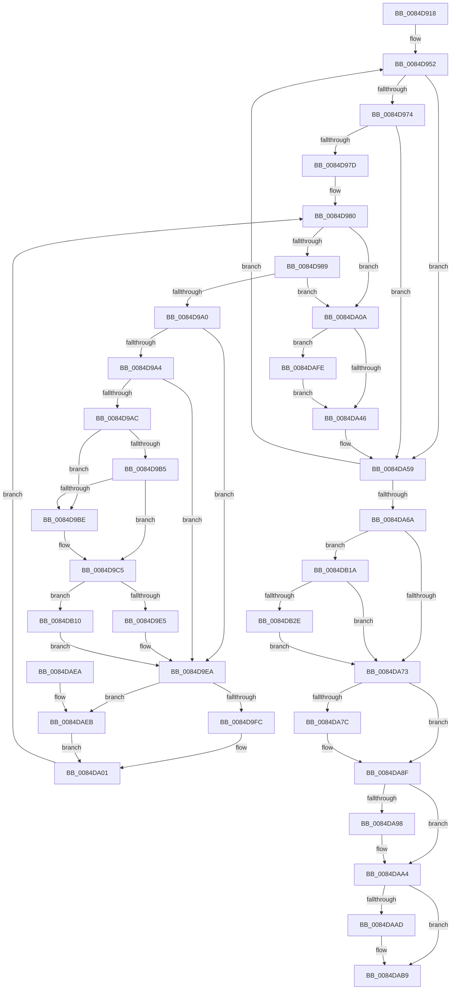

# HvHiveCleanup

- RVA: `0x0084D918`–`0x0084DB38` (길이 `544` bytes)
- VA: `0x000000014084D918`
- 실행 섹션: `PAGE`
- PDB 이름 있음: `예`; PDB Function 태그: `아니요`
- unwind 정보 RVA: `0x000675B8`
- 디코드: `135`개 명령, `544/544` bytes 표시
- 미해석 바이트: `0` (있으면 어셈블리에 `.byte`로 보존)

> 이 문서는 커널 이미지의 기계어와 PDB 기호를 분석해 생성했습니다. 4번과 5번은 함수 원형과 자료형을 바이너리 사용 방식에서 추정한 C 해석이며 원본 소스 복구 결과는 아닙니다.

## 1. Dependencies

- 직접 호출 지점: **13**; 고유 호출 대상: **9**
- 직접 호출자로 확인된 함수: **3**
- RIP 상대 이미지 참조: **2**

### Outgoing calls
- `0x0084D98F` → [HvpGetCellMap](../../pagecmrc/BC/HvpGetCellMap_function_00BC9710.md) (function, `0x00BC9710`)
- `0x0084D9E5` → [CmpFree](CmpFree_function_0084D8F0.md) (function, `0x0084D8F0`)
- `0x0084D9FC` → [CmpReleaseGlobalQuota](CmpReleaseGlobalQuota_function_0084DB40.md) (function, `0x0084DB40`)
- `0x0084DA2E` → [HvpFreeMap](../A6/HvpFreeMap_function_00A68674.md) (function, `0x00A68674`)
- `0x0084DA86` → [guard_dispatch_icall](../../text/6B/guard_dispatch_icall_function_006BAAD0.md) (function, `0x006BAAD0`)
- `0x0084DA9B` → [CmpFree](CmpFree_function_0084D8F0.md) (function, `0x0084D8F0`)
- `0x0084DAB0` → [CmpFree](CmpFree_function_0084D8F0.md) (function, `0x0084D8F0`)
- `0x0084DAC0` → [HvpViewMapCleanup](../9B/HvpViewMapCleanup_function_009B6E9C.md) (function, `0x009B6E9C`)
- `0x0084DAC8` → [HvpFreeHiveFreeDisplay](HvpFreeHiveFreeDisplay_function_0084C4C0.md) (function, `0x0084C4C0`)
- `0x0084DAF4` → [HvpFreeBin](../A8/HvpFreeBin_function_00A8158C.md) (function, `0x00A8158C`)
- `0x0084DB06` → [CmpFree](CmpFree_function_0084D8F0.md) (function, `0x0084D8F0`)
- `0x0084DB10` → [guard_dispatch_icall](../../text/6B/guard_dispatch_icall_function_006BAAD0.md) (function, `0x006BAAD0`)
- `0x0084DB2E` → [CmpFreeBootRegistry](../../text/66/CmpFreeBootRegistry_function_0066DF5C.md) (function, `0x0066DF5C`)

### Direct callers
- [CmShutdownSystem2](../../text/66/CmShutdownSystem2_function_0066A7FC.md) at `0x0066A890`
- [CmpDestroyHive](../9B/CmpDestroyHive_function_009B1708.md) at `0x009B1729`
- [CmpCompleteUnloadKey](../9B/CmpCompleteUnloadKey_function_009B32FC.md) at `0x009B3496`

### Static image references
- `0x0084D9CC` → RVA `0x0084D8F0` (`CmpFree`; read)
- `0x0084DB1D` → RVA `0x00EEFB50` (`.data`; read/write)

## 2. Other-region calls and transfers

- 다른 실행 섹션으로 향하는 call: **4**
  - `0x0084D98F` → [HvpGetCellMap](../../pagecmrc/BC/HvpGetCellMap_function_00BC9710.md) (`PAGE` → `PAGECMRC`)
  - `0x0084DA86` → [guard_dispatch_icall](../../text/6B/guard_dispatch_icall_function_006BAAD0.md) (`PAGE` → `.text`)
  - `0x0084DB10` → [guard_dispatch_icall](../../text/6B/guard_dispatch_icall_function_006BAAD0.md) (`PAGE` → `.text`)
  - `0x0084DB2E` → [CmpFreeBootRegistry](../../text/66/CmpFreeBootRegistry_function_0066DF5C.md) (`PAGE` → `.text`)
- 별도 외부 분기/꼬리 이동을 확인하지 못했습니다.

## 3. Assembly (complete function range)

```asm
0084D918  48 89 5C 24 08                  mov qword ptr [rsp + 8], rbx
0084D91D  48 89 6C 24 10                  mov qword ptr [rsp + 0x10], rbp
0084D922  48 89 74 24 18                  mov qword ptr [rsp + 0x18], rsi
0084D927  57                              push rdi
0084D928  41 54                           push r12
0084D92A  41 55                           push r13
0084D92C  41 56                           push r14
0084D92E  41 57                           push r15
0084D930  48 83 EC 20                     sub rsp, 0x20
0084D934  83 A1 A0 00 00 00 FE            and dword ptr [rcx + 0xa0], 0xfffffffe
0084D93B  48 8B D9                        mov rbx, rcx
0084D93E  44 8B A1 A0 00 00 00            mov r12d, dword ptr [rcx + 0xa0]
0084D945  41 83 E4 10                     and r12d, 0x10
0084D949  45 33 FF                        xor r15d, r15d
0084D94C  41 8B EF                        mov ebp, r15d
0084D94F  41 8B FF                        mov edi, r15d
0084D952  8B C5                           mov eax, ebp
0084D954  48 69 F0 78 02 00 00            imul rsi, rax, 0x278
0084D95B  44 8B AC 1E 18 01 00 00         mov r13d, dword ptr [rsi + rbx + 0x118]
0084D963  44 03 EF                        add r13d, edi
0084D966  4C 39 BC 1E 20 01 00 00         cmp qword ptr [rsi + rbx + 0x120], r15
0084D96E  0F 84 E5 00 00 00               je 0x14084da59
0084D974  44 3B EF                        cmp r13d, edi
0084D977  0F 84 DC 00 00 00               je 0x14084da59
0084D97D  44 8B F7                        mov r14d, edi
0084D980  45 3B F5                        cmp r14d, r13d
0084D983  0F 83 81 00 00 00               jae 0x14084da0a
0084D989  41 8B D6                        mov edx, r14d
0084D98C  48 8B CB                        mov rcx, rbx
0084D98F  E8 7C BD 37 00                  call 0x140bc9710
0084D994  4C 8B F8                        mov r15, rax
0084D997  48 8B 40 08                     mov rax, qword ptr [rax + 8]
0084D99B  48 85 C0                        test rax, rax
0084D99E  74 6A                           je 0x14084da0a
0084D9A0  A8 02                           test al, 2
0084D9A2  74 46                           je 0x14084d9ea
0084D9A4  49 8B 0F                        mov rcx, qword ptr [r15]
0084D9A7  48 85 C9                        test rcx, rcx
0084D9AA  74 3E                           je 0x14084d9ea
0084D9AC  48 8B 11                        mov rdx, qword ptr [rcx]
0084D9AF  48 39 4A 08                     cmp qword ptr [rdx + 8], rcx
0084D9B3  75 09                           jne 0x14084d9be
0084D9B5  48 8B 41 08                     mov rax, qword ptr [rcx + 8]
0084D9B9  48 39 08                        cmp qword ptr [rax], rcx
0084D9BC  74 07                           je 0x14084d9c5
0084D9BE  B9 03 00 00 00                  mov ecx, 3
0084D9C3  CD 29                           int 0x29
0084D9C5  48 89 10                        mov qword ptr [rax], rdx
0084D9C8  48 89 42 08                     mov qword ptr [rdx + 8], rax
0084D9CC  48 8D 15 1D FF FF FF            lea rdx, [rip - 0xe3]
0084D9D3  48 8B 43 20                     mov rax, qword ptr [rbx + 0x20]
0084D9D7  48 3B C2                        cmp rax, rdx
0084D9DA  BA 18 00 00 00                  mov edx, 0x18
0084D9DF  0F 85 2B 01 00 00               jne 0x14084db10
0084D9E5  E8 06 FF FF FF                  call 0x14084d8f0
0084D9EA  4D 8B 47 08                     mov r8, qword ptr [r15 + 8]
0084D9EE  41 8B 4F 10                     mov ecx, dword ptr [r15 + 0x10]
0084D9F2  41 F6 C0 08                     test r8b, 8
0084D9F6  0F 85 EF 00 00 00               jne 0x14084daeb
0084D9FC  E8 3F 01 00 00                  call 0x14084db40
0084DA01  45 03 77 10                     add r14d, dword ptr [r15 + 0x10]
0084DA05  E9 76 FF FF FF                  jmp 0x14084d980
0084DA0A  44 8B 8C 1E 18 01 00 00         mov r9d, dword ptr [rsi + rbx + 0x118]
0084DA12  45 33 C0                        xor r8d, r8d
0084DA15  4C 8B B4 1E 20 01 00 00         mov r14, qword ptr [rsi + rbx + 0x120]
0084DA1D  48 8B CB                        mov rcx, rbx
0084DA20  41 C1 E9 0C                     shr r9d, 0xc
0084DA24  49 8B D6                        mov rdx, r14
0084DA27  41 FF C9                        dec r9d
0084DA2A  41 C1 E9 09                     shr r9d, 9
0084DA2E  E8 41 AC 21 00                  call 0x140a68674
0084DA33  48 8D 83 28 01 00 00            lea rax, [rbx + 0x128]
0084DA3A  48 03 C6                        add rax, rsi
0084DA3D  4C 3B F0                        cmp r14, rax
0084DA40  0F 85 B8 00 00 00               jne 0x14084dafe
0084DA46  45 33 FF                        xor r15d, r15d
0084DA49  4C 89 BC 1E 20 01 00 00         mov qword ptr [rsi + rbx + 0x120], r15
0084DA51  44 89 BC 1E 18 01 00 00         mov dword ptr [rsi + rbx + 0x118], r15d
0084DA59  FF C5                           inc ebp
0084DA5B  81 C7 00 00 00 80               add edi, 0x80000000
0084DA61  83 FD 02                        cmp ebp, 2
0084DA64  0F 82 E8 FE FF FF               jb 0x14084d952
0084DA6A  45 85 E4                        test r12d, r12d
0084DA6D  0F 85 A7 00 00 00               jne 0x14084db1a
0084DA73  48 8B 4B 40                     mov rcx, qword ptr [rbx + 0x40]
0084DA77  48 85 C9                        test rcx, rcx
0084DA7A  74 13                           je 0x14084da8f
0084DA7C  48 8B 43 20                     mov rax, qword ptr [rbx + 0x20]
0084DA80  8B 93 84 00 00 00               mov edx, dword ptr [rbx + 0x84]
0084DA86  E8 45 D0 E6 FF                  call 0x1406baad0
0084DA8B  4C 89 7B 40                     mov qword ptr [rbx + 0x40], r15
0084DA8F  48 8B 4B 60                     mov rcx, qword ptr [rbx + 0x60]
0084DA93  48 85 C9                        test rcx, rcx
0084DA96  74 0C                           je 0x14084daa4
0084DA98  8B 53 6C                        mov edx, dword ptr [rbx + 0x6c]
0084DA9B  E8 50 FE FF FF                  call 0x14084d8f0
0084DAA0  4C 89 7B 60                     mov qword ptr [rbx + 0x60], r15
0084DAA4  48 8B 4B 78                     mov rcx, qword ptr [rbx + 0x78]
0084DAA8  48 85 C9                        test rcx, rcx
0084DAAB  74 0C                           je 0x14084dab9
0084DAAD  8B 53 6C                        mov edx, dword ptr [rbx + 0x6c]
0084DAB0  E8 3B FE FF FF                  call 0x14084d8f0
0084DAB5  4C 89 7B 78                     mov qword ptr [rbx + 0x78], r15
0084DAB9  48 8D 8B E0 00 00 00            lea rcx, [rbx + 0xe0]
0084DAC0  E8 D7 93 16 00                  call 0x1409b6e9c
0084DAC5  48 8B CB                        mov rcx, rbx
0084DAC8  E8 F3 E9 FF FF                  call 0x14084c4c0
0084DACD  48 8B 5C 24 50                  mov rbx, qword ptr [rsp + 0x50]
0084DAD2  48 8B 6C 24 58                  mov rbp, qword ptr [rsp + 0x58]
0084DAD7  48 8B 74 24 60                  mov rsi, qword ptr [rsp + 0x60]
0084DADC  48 83 C4 20                     add rsp, 0x20
0084DAE0  41 5F                           pop r15
0084DAE2  41 5E                           pop r14
0084DAE4  41 5D                           pop r13
0084DAE6  41 5C                           pop r12
0084DAE8  5F                              pop rdi
0084DAE9  C3                              ret
0084DAEA  CC                              int3
0084DAEB  8B D1                           mov edx, ecx
0084DAED  49 83 E0 F0                     and r8, 0xfffffffffffffff0
0084DAF1  48 8B CB                        mov rcx, rbx
0084DAF4  E8 93 3A 23 00                  call 0x140a8158c
0084DAF9  E9 03 FF FF FF                  jmp 0x14084da01
0084DAFE  BA 00 20 00 00                  mov edx, 0x2000
0084DB03  49 8B CE                        mov rcx, r14
0084DB06  E8 E5 FD FF FF                  call 0x14084d8f0
0084DB0B  E9 36 FF FF FF                  jmp 0x14084da46
0084DB10  E8 BB CF E6 FF                  call 0x1406baad0
0084DB15  E9 D0 FE FF FF                  jmp 0x14084d9ea
0084DB1A  83 C8 FF                        or eax, 0xffffffff
0084DB1D  F0 0F C1 05 2B 20 6A 00         lock xadd dword ptr [rip + 0x6a202b], eax
0084DB25  83 F8 01                        cmp eax, 1
0084DB28  0F 85 45 FF FF FF               jne 0x14084da73
0084DB2E  E8 29 04 E2 FF                  call 0x14066df5c
0084DB33  E9 3B FF FF FF                  jmp 0x14084da73
```

## 4. C-style interpretation (structured pseudocode)

```c
__int64 __fastcall HvHiveCleanup(__int64 a1)
{
    __int64 result;
    __int64 v_r12;
    __int64 v_r13;
    __int64 v_r14;
    __int64 v_r15;
    __int64 v_rbp;
    __int64 v_rdi;
    __int64 v_rsi;
    __int64 v_rsp;
    unsigned __int64 v_stack_p10;
    unsigned __int64 v_stack_p18;
    unsigned __int64 v_stack_p8;

    v_stack_p8 = v_rbx;
    v_stack_p10 = v_rbp;
    v_stack_p18 = v_rsi;
    v_rsp = (v_rsp) - (32);
    v_r12 = (unsigned int)(((unsigned int)(*(unsigned int *)(a1 + 160))) & (16));
    v_r15 = 0;
loc_0084D952:
    v_rsi = (v_rsi) * (0);
    v_r13 = (unsigned int)(((unsigned int)(*(unsigned int *)(v_rsi + a1 * 1 + 280))) + (0));
    if ((*(unsigned __int64 *)(v_rsi + a1 * 1 + 288)) == 0) goto loc_0084DA59;
    if (((unsigned int)(v_r13)) == 0) goto loc_0084DA59;
loc_0084D980:
    if (0 >= ((unsigned int)(v_r13))) goto loc_0084DA0A;
    result = HvpGetCellMap(a1, 0, a3, a4);
    if (*(unsigned __int64 *)(result + 8) == 0) goto loc_0084DA0A;
    if ((((unsigned __int8)(*(unsigned __int64 *)(result + 8))) & (2)) == 0) goto loc_0084D9EA;
    if (*(unsigned __int64 *)(result) == 0) goto loc_0084D9EA;
    if ((*(unsigned __int64 *)(*(unsigned __int64 *)(*(unsigned __int64 *)(result)) + 8)) != (*(unsigned __int64 *)(result))) goto loc_0084D9BE;
    if ((*(unsigned __int64 *)(*(unsigned __int64 *)(*(unsigned __int64 *)(result) + 8))) != (*(unsigned __int64 *)(result))) {
        a1 = 3;
    }
    *(unsigned __int64 *)(*(unsigned __int64 *)(*(unsigned __int64 *)(result) + 8)) = *(unsigned __int64 *)(*(unsigned __int64 *)(result));
    *(unsigned __int64 *)(*(unsigned __int64 *)(*(unsigned __int64 *)(result)) + 8) = *(unsigned __int64 *)(*(unsigned __int64 *)(result) + 8);
    if ((*(unsigned __int64 *)(a1 + 32)) != (v_rip - 227)) goto loc_0084DB10;
    result = CmpFree(a1, 24, a3, a4);
loc_0084D9EA:
    if ((((unsigned __int8)(*(unsigned __int64 *)(result + 8))) & (8)) != 0) goto loc_0084DAEB;
    result = CmpReleaseGlobalQuota((unsigned int)(*(unsigned int *)(result + 16)), 24, *(unsigned __int64 *)(result + 8), a4);
loc_0084DA01:
    v_r14 = (unsigned int)((0) + (*(unsigned int *)(result + 16)));
    goto loc_0084D980;
loc_0084DA0A:
    a3 = 0;
    a4 = (unsigned int)(((unsigned int)(*(unsigned int *)(v_rsi + a1 * 1 + 280))) >> (12));
    a4 = (unsigned int)((a4) - 1);
    a4 = (unsigned int)((a4) >> (9));
    result = HvpFreeMap(a1, *(unsigned __int64 *)(v_rsi + a1 * 1 + 288), a3, a4);
    result = (a1 + 296) + (v_rsi);
    if ((*(unsigned __int64 *)(v_rsi + a1 * 1 + 288)) != result) goto loc_0084DAFE;
loc_0084DA46:
    v_r15 = 0;
    *(unsigned __int64 *)(v_rsi + a1 * 1 + 288) = 0;
    *(unsigned int *)(v_rsi + a1 * 1 + 280) = 0;
loc_0084DA59:
    v_rbp = (unsigned int)((0) + 1);
    v_rdi = (unsigned int)((0) + (0x80000000ULL));
    if (((unsigned int)(v_rbp)) < 2) goto loc_0084D952;
    if ((unsigned int)(v_r12) != 0) goto loc_0084DB1A;
loc_0084DA73:
    if (*(unsigned __int64 *)(a1 + 64) != 0) {
        result = *(unsigned __int64 *)(a1 + 32);
        a2 = *(unsigned int *)(a1 + 132);
        result = guard_dispatch_icall(*(unsigned __int64 *)(a1 + 64), a2, a3, a4);
        *(unsigned __int64 *)(a1 + 64) = 0;
    }
    if (*(unsigned __int64 *)(a1 + 96) != 0) {
        a2 = *(unsigned int *)(a1 + 108);
        result = CmpFree(*(unsigned __int64 *)(a1 + 96), a2, a3, a4);
        *(unsigned __int64 *)(a1 + 96) = 0;
    }
    if (*(unsigned __int64 *)(a1 + 120) != 0) {
        a2 = *(unsigned int *)(a1 + 108);
        result = CmpFree(*(unsigned __int64 *)(a1 + 120), a2, a3, a4);
        *(unsigned __int64 *)(a1 + 120) = 0;
    }
    result = HvpViewMapCleanup(a1 + 224, a2, a3, a4);
    result = HvpFreeHiveFreeDisplay(a1, a2, a3, a4);
    v_rsp = (v_rsp) + (32);
    return result;
loc_0084DAEB:
    a3 = (a3) & (-16);
    result = HvpFreeBin(v_stack_p8, (unsigned int)((unsigned int)(a1)), a3, a4);
    goto loc_0084DA01;
loc_0084DAFE:
    result = CmpFree(*(unsigned __int64 *)(v_rsi + a1 * 1 + 288), (unsigned int)(0x2000ULL), a3, a4);
    goto loc_0084DA46;
loc_0084DB10:
    result = guard_dispatch_icall(*(unsigned __int64 *)(v_rsi + a1 * 1 + 288), (unsigned int)(0x2000ULL), a3, a4);
    goto loc_0084D9EA;
loc_0084DB1A:
    result = (unsigned int)((result) | (0xFFFFFFFFULL));
    if (((unsigned int)(result)) != 1) goto loc_0084DA73;
    result = CmpFreeBootRegistry(*(unsigned __int64 *)(v_rsi + a1 * 1 + 288), (unsigned int)(0x2000ULL), a3, a4);
    goto loc_0084DA73;
}
```

## 5. (Beta) C Style

```c
int64_t HvHiveCleanup(void *Arg1)
{
    uint8_t *arg1 = (uint8_t *)Arg1;

    int64_t result;
    int64_t local_r12;
    int64_t local_r13;
    int64_t local_r14;
    int64_t local_r15;
    int64_t local_rbp;
    int64_t local_rdi;
    int64_t local_rsi;
    int64_t local_rsp;
    uint64_t v_stack_p10;
    uint64_t v_stack_p18;
    uint64_t v_stack_p8;

    v_stack_p8 = local_rbx;
    v_stack_p10 = local_rbp;
    v_stack_p18 = local_rsi;
    local_rsp = (local_rsp) - (32);
    local_r12 = (uint32_t)(((uint32_t)(*(uint32_t *)(arg1 + 0xA0))) & (16));
    local_r15 = 0;
loc_0084D952:
    local_rsi = (local_rsi) * (0);
    local_r13 = (uint32_t)(((uint32_t)(*(uint32_t *)(local_rsi + arg1 * 1 + 0x118))) + (0));
    if ((*(uint64_t *)(local_rsi + arg1 * 1 + 0x120)) == 0) goto loc_0084DA59;
    if (((uint32_t)(local_r13)) == 0) goto loc_0084DA59;
loc_0084D980:
    if (0 >= ((uint32_t)(local_r13))) goto loc_0084DA0A;
    result = HvpGetCellMap(Arg1, 0, a3, a4);
    if (*(uint64_t *)(result + 0x8) == 0) goto loc_0084DA0A;
    if ((((uint8_t)(*(uint64_t *)(result + 0x8))) & (2)) == 0) goto loc_0084D9EA;
    if (*(uint64_t *)(result) == 0) goto loc_0084D9EA;
    if ((*(uint64_t *)(*(uint64_t *)(*(uint64_t *)(result)) + 0x8)) != (*(uint64_t *)(result))) goto loc_0084D9BE;
    if ((*(uint64_t *)(*(uint64_t *)(*(uint64_t *)(result) + 0x8))) != (*(uint64_t *)(result))) {
        Arg1 = 3;
    }
    *(uint64_t *)(*(uint64_t *)(*(uint64_t *)(result) + 0x8)) = *(uint64_t *)(*(uint64_t *)(result));
    *(uint64_t *)(*(uint64_t *)(*(uint64_t *)(result)) + 0x8) = *(uint64_t *)(*(uint64_t *)(result) + 0x8);
    if ((*(uint64_t *)(arg1 + 0x20)) != (v_rip - 227)) goto loc_0084DB10;
    result = CmpFree(Arg1, 24, a3, a4);
loc_0084D9EA:
    if ((((uint8_t)(*(uint64_t *)(result + 0x8))) & (8)) != 0) goto loc_0084DAEB;
    result = CmpReleaseGlobalQuota((uint32_t)(*(uint32_t *)(result + 0x10)), 24, *(uint64_t *)(result + 0x8), a4);
loc_0084DA01:
    local_r14 = (uint32_t)((0) + (*(uint32_t *)(result + 0x10)));
    goto loc_0084D980;
loc_0084DA0A:
    a3 = 0;
    a4 = (uint32_t)(((uint32_t)(*(uint32_t *)(local_rsi + arg1 * 1 + 0x118))) >> (12));
    a4 = (uint32_t)((a4) - 1);
    a4 = (uint32_t)((a4) >> (9));
    result = HvpFreeMap(Arg1, *(uint64_t *)(local_rsi + arg1 * 1 + 0x120), a3, a4);
    result = (Arg1 + 296) + (local_rsi);
    if ((*(uint64_t *)(local_rsi + arg1 * 1 + 0x120)) != result) goto loc_0084DAFE;
loc_0084DA46:
    local_r15 = 0;
    *(uint64_t *)(local_rsi + arg1 * 1 + 0x120) = 0;
    *(uint32_t *)(local_rsi + arg1 * 1 + 0x118) = 0;
loc_0084DA59:
    local_rbp = (uint32_t)((0) + 1);
    local_rdi = (uint32_t)((0) + (0x80000000ULL));
    if (((uint32_t)(local_rbp)) < 2) goto loc_0084D952;
    if ((uint32_t)(local_r12) != 0) goto loc_0084DB1A;
loc_0084DA73:
    if (*(uint64_t *)(arg1 + 0x40) != 0) {
        result = *(uint64_t *)(arg1 + 0x20);
        a2 = *(uint32_t *)(arg1 + 0x84);
        result = guard_dispatch_icall(*(uint64_t *)(arg1 + 0x40), a2, a3, a4);
        *(uint64_t *)(arg1 + 0x40) = 0;
    }
    if (*(uint64_t *)(arg1 + 0x60) != 0) {
        a2 = *(uint32_t *)(arg1 + 0x6C);
        result = CmpFree(*(uint64_t *)(arg1 + 0x60), a2, a3, a4);
        *(uint64_t *)(arg1 + 0x60) = 0;
    }
    if (*(uint64_t *)(arg1 + 0x78) != 0) {
        a2 = *(uint32_t *)(arg1 + 0x6C);
        result = CmpFree(*(uint64_t *)(arg1 + 0x78), a2, a3, a4);
        *(uint64_t *)(arg1 + 0x78) = 0;
    }
    result = HvpViewMapCleanup(Arg1 + 224, a2, a3, a4);
    result = HvpFreeHiveFreeDisplay(Arg1, a2, a3, a4);
    local_rsp = (local_rsp) + (32);
    return result;
loc_0084DAEB:
    a3 = (a3) & (-16);
    result = HvpFreeBin(v_stack_p8, (uint32_t)((uint32_t)(Arg1)), a3, a4);
    goto loc_0084DA01;
loc_0084DAFE:
    result = CmpFree(*(uint64_t *)(local_rsi + arg1 * 1 + 0x120), (uint32_t)(0x2000ULL), a3, a4);
    goto loc_0084DA46;
loc_0084DB10:
    result = guard_dispatch_icall(*(uint64_t *)(local_rsi + arg1 * 1 + 0x120), (uint32_t)(0x2000ULL), a3, a4);
    goto loc_0084D9EA;
loc_0084DB1A:
    result = (uint32_t)((result) | (0xFFFFFFFFULL));
    if (((uint32_t)(result)) != 1) goto loc_0084DA73;
    result = CmpFreeBootRegistry(*(uint64_t *)(local_rsi + arg1 * 1 + 0x120), (uint32_t)(0x2000ULL), a3, a4);
    goto loc_0084DA73;
}
```

### 관측된 메모리 오프셋

구조체 형식이 확인되지 않은 접근은 인자 기준의 오프셋으로만 기록했습니다.

| 기준 인자 | 오프셋 표현 | 폭 (bit) | 접근 |
|---|---:|---:|---|
| `Arg1` | `+ 0x20` | `64` | `R` |
| `Arg1` | `+ 0x40` | `64` | `R` |
| `Arg1` | `+ 0x40` | `64` | `W` |
| `Arg1` | `+ 0x60` | `64` | `R` |
| `Arg1` | `+ 0x60` | `64` | `W` |
| `Arg1` | `+ 0x6C` | `32` | `R` |
| `Arg1` | `+ 0x78` | `64` | `R` |
| `Arg1` | `+ 0x78` | `64` | `W` |
| `Arg1` | `+ 0x84` | `32` | `R` |
| `Arg1` | `+ 0xA0` | `32` | `R` |
| `Arg1` | `+ 0xA0` | `32` | `R/W` |
| `Arg1` | `+ 0xE0` | `64` | `R` |
| `Arg1` | `+ 0x128` | `64` | `R` |

## 6. Execution-region graph

[열기: 2D/3D 그래프와 함수 탐색 컨트롤 패널](../../../control-panel.html?section=page&rva=0x0084D918&view=graph)

- 2D 그래프는 위에서 아래로 흐르고, 3D 그래프는 빈 공간을 드래그해 회전합니다. Shift+드래그는 이동, 휠은 확대·축소, 함수 노드 선택은 대상 보고서 이동입니다.

### Static fallback


