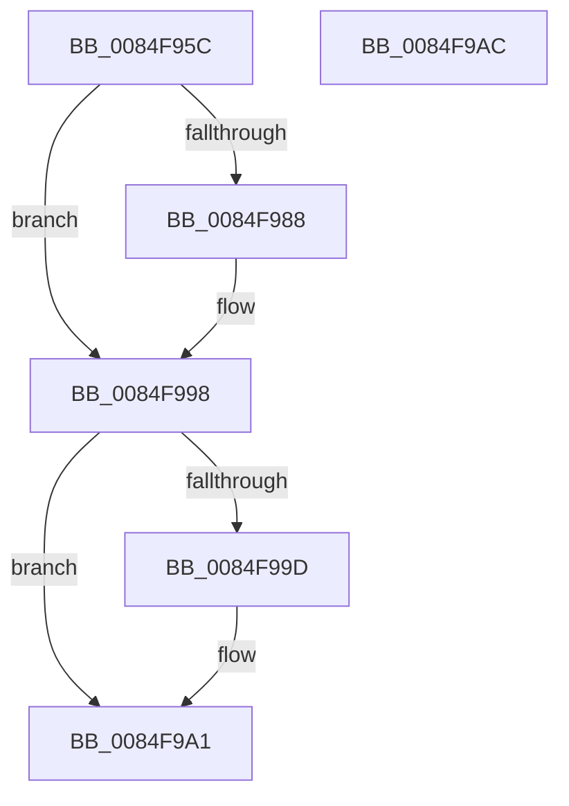

# HvLockHiveFlusherShared

- RVA: `0x0084F95C`–`0x0084F9AD` (길이 `81` bytes)
- VA: `0x000000014084F95C`
- 실행 섹션: `PAGE`
- PDB 이름 있음: `예`; PDB Function 태그: `아니요`
- unwind 정보 RVA: `0x00068D5C`
- 디코드: `26`개 명령, `81/81` bytes 표시
- 미해석 바이트: `0` (있으면 어셈블리에 `.byte`로 보존)

> 이 문서는 커널 이미지의 기계어와 PDB 기호를 분석해 생성했습니다. 4번과 5번은 함수 원형과 자료형을 바이너리 사용 방식에서 추정한 C 해석이며 원본 소스 복구 결과는 아닙니다.

## 1. Dependencies

- 직접 호출 지점: **2**; 고유 호출 대상: **2**
- 직접 호출자로 확인된 함수: **30**
- RIP 상대 이미지 참조: **0**

### Outgoing calls
- `0x0084F972` → [KeAbPreAcquire](../../text/21/KeAbPreAcquire_function_00210230.md) (function, `0x00210230`)
- `0x0084F993` → [ExfAcquirePushLockSharedEx](../../text/21/ExfAcquirePushLockSharedEx_function_0021044C.md) (function, `0x0021044C`)

### Direct callers
- [CmpRemoveHiveFromNamespace](../../text/49/CmpRemoveHiveFromNamespace_function_0049C4CC.md) at `0x0049C50A`
- [CmpCreateTombstone](../../text/66/CmpCreateTombstone_function_0066AF50.md) at `0x0066AFDE`
- [CmpLoadHiveThread](../7D/CmpLoadHiveThread_function_007DB040.md) at `0x007DB8D4`
- [CmpLoadHiveThread](../7D/CmpLoadHiveThread_function_007DB040.md) at `0x007DBB06`
- [CmRestoreKey](../7D/CmRestoreKey_function_007DCF04.md) at `0x007DD148`
- [CmpRefreshHive](../7D/CmpRefreshHive_function_007DEAD0.md) at `0x007DEBC0`
- [CmpAssignKeySecurity](../7E/CmpAssignKeySecurity_function_007EC8B0.md) at `0x007EC94C`
- [CmpRecoverFlushProtocolStateFromFiles](../7E/CmpRecoverFlushProtocolStateFromFiles_function_007EE4B0.md) at `0x007EE4F3`
- [CmSetLastWriteTimeKey](CmSetLastWriteTimeKey_function_00843368.md) at `0x00843584`
- [CmpPromoteKey](CmpPromoteKey_function_00844388.md) at `0x00844551`
- [CmpPromoteKey](CmpPromoteKey_function_00844388.md) at `0x0084458C`
- [CmSetValueKey](CmSetValueKey_function_008457C0.md) at `0x00845CCF`
- [CmSetValueKey](CmSetValueKey_function_008457C0.md) at `0x00846151`
- [CmQueryMultipleValueKey](CmQueryMultipleValueKey_function_00846EC0.md) at `0x00846FC6`
- [CmDeleteValueKey](CmDeleteValueKey_function_008476E8.md) at `0x008479F7`
- [CmDeleteValueKey](CmDeleteValueKey_function_008476E8.md) at `0x00847E6F`
- [CmDeleteValueKey](CmDeleteValueKey_function_008476E8.md) at `0x00847F70`
- [CmDeleteKey](CmDeleteKey_function_00848E5C.md) at `0x00849141`
- [sub_0084E4B5](Unknown_function_0084E4B5.md) at `0x0084E68D`
- [CmpDoParseKey](../85/CmpDoParseKey_function_0085F750.md) at `0x00861687`
- [CmpCreateHive](../87/CmpCreateHive_function_00879DF0.md) at `0x0087A203`
- [CmpReorganizeHive](../87/CmpReorganizeHive_function_0087B92C.md) at `0x0087BAD5`
- [CmpInitCmRM](../87/CmpInitCmRM_function_0087C700.md) at `0x0087CE5F`
- [CmpCreateChild](../94/CmpCreateChild_function_0094817C.md) at `0x009483CF`
- [CmpCreateChild](../94/CmpCreateChild_function_0094817C.md) at `0x00948F8C`
- [CmpSetKeySecurity](../94/CmpSetKeySecurity_function_0094A124.md) at `0x0094A327`
- [CmpUndoDeleteKeyForTrans](../94/CmpUndoDeleteKeyForTrans_function_0094A728.md) at `0x0094A923`
- [CmSetKeyFlags](../9A/CmSetKeyFlags_function_009AEEA4.md) at `0x009AF057`
- [CmpDoLocalizeNextHive](../9B/CmpDoLocalizeNextHive_function_009B7400.md) at `0x009B7435`
- [CmpTrimHive](../A4/CmpTrimHive_function_00A4F2FC.md) at `0x00A4F336`
- [CmpUpdateHiveRootCellFlags](../A6/CmpUpdateHiveRootCellFlags_function_00A6B124.md) at `0x00A6B14A`
- [CmpCreateHiveRootCell](../AB/CmpCreateHiveRootCell_function_00ABF568.md) at `0x00ABF5B2`
- [sub_00B16026](../B1/Unknown_function_00B16026.md) at `0x00B1602A`
- [sub_00B160F4](../B1/Unknown_function_00B160F4.md) at `0x00B1629A`
- [sub_00B169F2](../B1/Unknown_function_00B169F2.md) at `0x00B16B2B`
- [sub_00B1845C](../B1/Unknown_function_00B1845C.md) at `0x00B186CB`
- [sub_00B1845C](../B1/Unknown_function_00B1845C.md) at `0x00B187C3`
- [sub_00B1845C](../B1/Unknown_function_00B1845C.md) at `0x00B188E0`

### Static image references
- 디코드된 RIP-relative 메모리 참조가 없습니다.

## 2. Other-region calls and transfers

- 다른 실행 섹션으로 향하는 call: **2**
  - `0x0084F972` → [KeAbPreAcquire](../../text/21/KeAbPreAcquire_function_00210230.md) (`PAGE` → `.text`)
  - `0x0084F993` → [ExfAcquirePushLockSharedEx](../../text/21/ExfAcquirePushLockSharedEx_function_0021044C.md) (`PAGE` → `.text`)
- 별도 외부 분기/꼬리 이동을 확인하지 못했습니다.

## 3. Assembly (complete function range)

```asm
0084F95C  48 89 5C 24 10                  mov qword ptr [rsp + 0x10], rbx
0084F961  57                              push rdi
0084F962  48 83 EC 20                     sub rsp, 0x20
0084F966  48 8D 79 48                     lea rdi, [rcx + 0x48]
0084F96A  45 33 C0                        xor r8d, r8d
0084F96D  48 8B CF                        mov rcx, rdi
0084F970  33 D2                           xor edx, edx
0084F972  E8 B9 08 9C FF                  call 0x140210230
0084F977  48 8B D8                        mov rbx, rax
0084F97A  B9 11 00 00 00                  mov ecx, 0x11
0084F97F  33 C0                           xor eax, eax
0084F981  F0 48 0F B1 0F                  lock cmpxchg qword ptr [rdi], rcx
0084F986  74 10                           je 0x14084f998
0084F988  4C 8B CF                        mov r9, rdi
0084F98B  4C 8B C3                        mov r8, rbx
0084F98E  33 D2                           xor edx, edx
0084F990  48 8B CF                        mov rcx, rdi
0084F993  E8 B4 0A 9C FF                  call 0x14021044c
0084F998  48 85 DB                        test rbx, rbx
0084F99B  74 04                           je 0x14084f9a1
0084F99D  C6 43 0A 01                     mov byte ptr [rbx + 0xa], 1
0084F9A1  48 8B 5C 24 38                  mov rbx, qword ptr [rsp + 0x38]
0084F9A6  48 83 C4 20                     add rsp, 0x20
0084F9AA  5F                              pop rdi
0084F9AB  C3                              ret
0084F9AC  CC                              int3
```

## 4. C-style interpretation (structured pseudocode)

```c
__int64 __fastcall HvLockHiveFlusherShared(__int64 a1, int a2, int a3)
{
    __int64 result;
    __int64 v_rsp;
    unsigned __int64 v_stack_p10;

    v_stack_p10 = v_rbx;
    v_rsp = (v_rsp) - (32);
    a3 = 0;
    a2 = 0;
    result = KeAbPreAcquire(a1 + 72, a2, a3, a4);
    result = 0;
    if (!(condition_is_equal)) {
        a4 = a1 + 72;
        a3 = 0;
        a2 = 0;
        a1 = a1 + 72;
        result = ExfAcquirePushLockSharedEx(a1, a2, a3, a4);
    }
    if (result != 0) {
        *(unsigned __int8 *)(result + 10) = 1;
    }
    v_rsp = (v_rsp) + (32);
    return result;
}
```

## 5. (Beta) C Style

```c
int64_t HvLockHiveFlusherShared(void *Arg1, int32_t Arg2, int32_t Arg3)
{
    uint8_t *arg1 = (uint8_t *)Arg1;

    int64_t result;
    int64_t local_rsp;
    uint64_t v_stack_p10;

    v_stack_p10 = local_rbx;
    local_rsp = (local_rsp) - (32);
    Arg3 = 0;
    Arg2 = 0;
    result = KeAbPreAcquire(Arg1 + 72, Arg2, Arg3, a4);
    result = 0;
    if (!(condition_is_equal)) {
        a4 = Arg1 + 72;
        Arg3 = 0;
        Arg2 = 0;
        Arg1 = Arg1 + 72;
        result = ExfAcquirePushLockSharedEx(Arg1, Arg2, Arg3, a4);
    }
    if (result != 0) {
        *(uint8_t *)(result + 0xA) = 1;
    }
    local_rsp = (local_rsp) + (32);
    return result;
}
```

### 관측된 메모리 오프셋

구조체 형식이 확인되지 않은 접근은 인자 기준의 오프셋으로만 기록했습니다.

| 기준 인자 | 오프셋 표현 | 폭 (bit) | 접근 |
|---|---:|---:|---|
| `Arg1` | `+ 0x0` | `64` | `R` |
| `Arg1` | `+ 0x48` | `64` | `R` |

## 6. Execution-region graph

[열기: 2D/3D 그래프와 함수 탐색 컨트롤 패널](../../../control-panel.html?section=page&rva=0x0084F95C&view=graph)

- 2D 그래프는 위에서 아래로 흐르고, 3D 그래프는 빈 공간을 드래그해 회전합니다. Shift+드래그는 이동, 휠은 확대·축소, 함수 노드 선택은 대상 보고서 이동입니다.

### Static fallback


