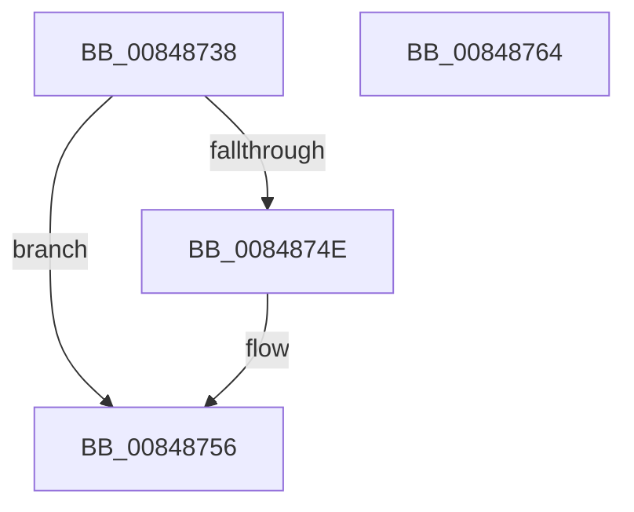

# HvUnlockHiveFlusherShared

- RVA: `0x00848738`–`0x00848765` (길이 `45` bytes)
- VA: `0x0000000140848738`
- 실행 섹션: `PAGE`
- PDB 이름 있음: `예`; PDB Function 태그: `아니요`
- unwind 정보 RVA: `0x0005CF00`
- 디코드: `15`개 명령, `45/45` bytes 표시
- 미해석 바이트: `0` (있으면 어셈블리에 `.byte`로 보존)

> 이 문서는 커널 이미지의 기계어와 PDB 기호를 분석해 생성했습니다. 4번과 5번은 함수 원형과 자료형을 바이너리 사용 방식에서 추정한 C 해석이며 원본 소스 복구 결과는 아닙니다.

## 1. Dependencies

- 직접 호출 지점: **2**; 고유 호출 대상: **2**
- 직접 호출자로 확인된 함수: **29**
- RIP 상대 이미지 참조: **0**

### Outgoing calls
- `0x00848751` → [ExfReleasePushLockShared](../../text/26/ExfReleasePushLockShared_function_00263440.md) (function, `0x00263440`)
- `0x00848759` → [KeAbPostRelease](../../text/2E/KeAbPostRelease_function_002E1600.md) (function, `0x002E1600`)

### Direct callers
- [CmpRemoveHiveFromNamespace](../../text/49/CmpRemoveHiveFromNamespace_function_0049C4CC.md) at `0x0049C55E`
- [CmpCreateTombstone](../../text/66/CmpCreateTombstone_function_0066AF50.md) at `0x0066B218`
- [CmpLoadHiveThread](../7D/CmpLoadHiveThread_function_007DB040.md) at `0x007DB8EB`
- [CmpLoadHiveThread](../7D/CmpLoadHiveThread_function_007DB040.md) at `0x007DBB16`
- [CmRestoreKey](../7D/CmRestoreKey_function_007DCF04.md) at `0x007DD288`
- [CmRestoreKey](../7D/CmRestoreKey_function_007DCF04.md) at `0x007DDAF1`
- [CmpRefreshHive](../7D/CmpRefreshHive_function_007DEAD0.md) at `0x007DEBE7`
- [CmpRefreshHive](../7D/CmpRefreshHive_function_007DEAD0.md) at `0x007DEBFC`
- [CmpAssignKeySecurity](../7E/CmpAssignKeySecurity_function_007EC8B0.md) at `0x007ECA1F`
- [CmpRecoverFlushProtocolStateFromFiles](../7E/CmpRecoverFlushProtocolStateFromFiles_function_007EE4B0.md) at `0x007EE515`
- [CmSetLastWriteTimeKey](CmSetLastWriteTimeKey_function_00843368.md) at `0x008435ED`
- [CmpPromoteKey](CmpPromoteKey_function_00844388.md) at `0x00844565`
- [CmSetValueKey](CmSetValueKey_function_008457C0.md) at `0x00845E22`
- [CmSetValueKey](CmSetValueKey_function_008457C0.md) at `0x0084617A`
- [CmSetValueKey](CmSetValueKey_function_008457C0.md) at `0x0084624A`
- [CmSetValueKey](CmSetValueKey_function_008457C0.md) at `0x008467D5`
- [CmQueryMultipleValueKey](CmQueryMultipleValueKey_function_00846EC0.md) at `0x0084701C`
- [CmQueryMultipleValueKey](CmQueryMultipleValueKey_function_00846EC0.md) at `0x0084748A`
- [CmDeleteValueKey](CmDeleteValueKey_function_008476E8.md) at `0x00847BA6`
- [CmDeleteValueKey](CmDeleteValueKey_function_008476E8.md) at `0x00847E95`
- [CmDeleteValueKey](CmDeleteValueKey_function_008476E8.md) at `0x00847F3D`
- [CmDeleteValueKey](CmDeleteValueKey_function_008476E8.md) at `0x00848353`
- [CmDeleteKey](CmDeleteKey_function_00848E5C.md) at `0x00849307`
- [CmDeleteKey](CmDeleteKey_function_00848E5C.md) at `0x00849563`
- [CmpDoParseKey](../85/CmpDoParseKey_function_0085F750.md) at `0x0086176D`
- [CmpDoParseKey](../85/CmpDoParseKey_function_0085F750.md) at `0x00861B6F`
- [CmpCreateHive](../87/CmpCreateHive_function_00879DF0.md) at `0x0087A22E`
- [CmpReorganizeHive](../87/CmpReorganizeHive_function_0087B92C.md) at `0x0087BB05`
- [CmpInitCmRM](../87/CmpInitCmRM_function_0087C700.md) at `0x0087CE7F`
- [CmpCreateChild](../94/CmpCreateChild_function_0094817C.md) at `0x0094878F`
- [CmpCreateChild](../94/CmpCreateChild_function_0094817C.md) at `0x0094903D`
- [CmpCreateChild](../94/CmpCreateChild_function_0094817C.md) at `0x009491AD`
- [CmpSetKeySecurity](../94/CmpSetKeySecurity_function_0094A124.md) at `0x0094A3AA`
- [CmpSetKeySecurity](../94/CmpSetKeySecurity_function_0094A124.md) at `0x0094A6FE`
- [CmpUndoDeleteKeyForTrans](../94/CmpUndoDeleteKeyForTrans_function_0094A728.md) at `0x0094ABEE`
- [CmSetKeyFlags](../9A/CmSetKeyFlags_function_009AEEA4.md) at `0x009AF262`
- [CmpDoLocalizeNextHive](../9B/CmpDoLocalizeNextHive_function_009B7400.md) at `0x009B745B`
- [CmpTrimHive](../A4/CmpTrimHive_function_00A4F2FC.md) at `0x00A4F368`
- [CmpUpdateHiveRootCellFlags](../A6/CmpUpdateHiveRootCellFlags_function_00A6B124.md) at `0x00A6B1AE`
- [CmpCreateHiveRootCell](../AB/CmpCreateHiveRootCell_function_00ABF568.md) at `0x00ABF821`
- [sub_00B16026](../B1/Unknown_function_00B16026.md) at `0x00B16044`
- [sub_00B160F4](../B1/Unknown_function_00B160F4.md) at `0x00B162CB`
- [sub_00B169F2](../B1/Unknown_function_00B169F2.md) at `0x00B16BBC`
- [sub_00B1845C](../B1/Unknown_function_00B1845C.md) at `0x00B186FB`
- [sub_00B1845C](../B1/Unknown_function_00B1845C.md) at `0x00B187F3`
- [sub_00B1845C](../B1/Unknown_function_00B1845C.md) at `0x00B18910`

### Static image references
- 디코드된 RIP-relative 메모리 참조가 없습니다.

## 2. Other-region calls and transfers

- 다른 실행 섹션으로 향하는 call: **2**
  - `0x00848751` → [ExfReleasePushLockShared](../../text/26/ExfReleasePushLockShared_function_00263440.md) (`PAGE` → `.text`)
  - `0x00848759` → [KeAbPostRelease](../../text/2E/KeAbPostRelease_function_002E1600.md) (`PAGE` → `.text`)
- 별도 외부 분기/꼬리 이동을 확인하지 못했습니다.

## 3. Assembly (complete function range)

```asm
00848738  40 53                           push rbx
0084873A  48 83 EC 20                     sub rsp, 0x20
0084873E  48 8D 59 48                     lea rbx, [rcx + 0x48]
00848742  33 C9                           xor ecx, ecx
00848744  8D 41 11                        lea eax, [rcx + 0x11]
00848747  F0 48 0F B1 0B                  lock cmpxchg qword ptr [rbx], rcx
0084874C  74 08                           je 0x140848756
0084874E  48 8B CB                        mov rcx, rbx
00848751  E8 EA AC A1 FF                  call 0x140263440
00848756  48 8B CB                        mov rcx, rbx
00848759  E8 A2 8E A9 FF                  call 0x1402e1600
0084875E  48 83 C4 20                     add rsp, 0x20
00848762  5B                              pop rbx
00848763  C3                              ret
00848764  CC                              int3
```

## 4. C-style interpretation (structured pseudocode)

```c
__int64 __fastcall HvUnlockHiveFlusherShared(__int64 a1)
{
    __int64 result;
    __int64 v_rsp;

    v_rsp = (v_rsp) - (32);
    a1 = 0;
    result = a1 + 17;
    if (!(condition_is_equal)) {
        a1 = a1 + 72;
        result = ExfReleasePushLockShared(a1, a2, a3, a4);
    }
    result = KeAbPostRelease(a1 + 72, a2, a3, a4);
    v_rsp = (v_rsp) + (32);
    return result;
}
```

## 5. (Beta) C Style

```c
int64_t HvUnlockHiveFlusherShared(void *Arg1)
{
    uint8_t *arg1 = (uint8_t *)Arg1;

    int64_t result;
    int64_t local_rsp;

    local_rsp = (local_rsp) - (32);
    Arg1 = 0;
    result = Arg1 + 17;
    if (!(condition_is_equal)) {
        Arg1 = Arg1 + 72;
        result = ExfReleasePushLockShared(Arg1, a2, a3, a4);
    }
    result = KeAbPostRelease(Arg1 + 72, a2, a3, a4);
    local_rsp = (local_rsp) + (32);
    return result;
}
```

### 관측된 메모리 오프셋

구조체 형식이 확인되지 않은 접근은 인자 기준의 오프셋으로만 기록했습니다.

| 기준 인자 | 오프셋 표현 | 폭 (bit) | 접근 |
|---|---:|---:|---|
| `Arg1` | `+ 0x0` | `64` | `R` |
| `Arg1` | `+ 0x48` | `64` | `R` |

## 6. Execution-region graph

[열기: 2D/3D 그래프와 함수 탐색 컨트롤 패널](../../../control-panel.html?section=page&rva=0x00848738&view=graph)

- 2D 그래프는 위에서 아래로 흐르고, 3D 그래프는 빈 공간을 드래그해 회전합니다. Shift+드래그는 이동, 휠은 확대·축소, 함수 노드 선택은 대상 보고서 이동입니다.

### Static fallback


