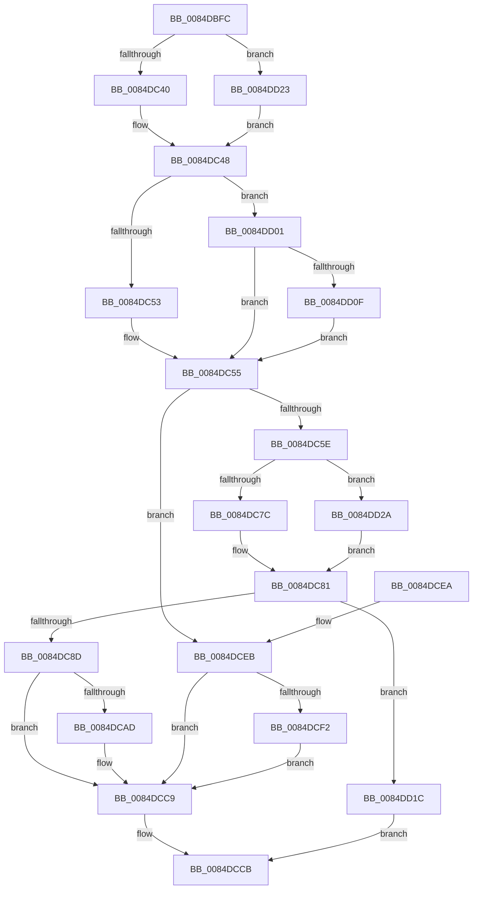

# HvpAdjustBitmap

- RVA: `0x0084DBFC`–`0x0084DD34` (길이 `312` bytes)
- VA: `0x000000014084DBFC`
- 실행 섹션: `PAGE`
- PDB 이름 있음: `예`; PDB Function 태그: `아니요`
- unwind 정보 RVA: `0x00069AE8`
- 디코드: `89`개 명령, `312/312` bytes 표시
- 미해석 바이트: `0` (있으면 어셈블리에 `.byte`로 보존)

> 이 문서는 커널 이미지의 기계어와 PDB 기호를 분석해 생성했습니다. 4번과 5번은 함수 원형과 자료형을 바이너리 사용 방식에서 추정한 C 해석이며 원본 소스 복구 결과는 아닙니다.

## 1. Dependencies

- 직접 호출 지점: **6**; 고유 호출 대상: **5**
- 직접 호출자로 확인된 함수: **1**
- RIP 상대 이미지 참조: **1**

### Outgoing calls
- `0x0084DC7C` → [CmpAllocate](CmpAllocate_function_0084DD40.md) (function, `0x0084DD40`)
- `0x0084DC9C` → [memset](../../text/6C/memset_function_006C6C40.md) (function, `0x006C6C40`)
- `0x0084DCB6` → [memcpy](../../text/6C/memcpy_function_006C6840.md) (function, `0x006C6840`)
- `0x0084DCC4` → [guard_dispatch_icall](../../text/6B/guard_dispatch_icall_function_006BAAD0.md) (function, `0x006BAAD0`)
- `0x0084DCFA` → [RtlClearBits](../../text/3E/RtlClearBits_function_003E1A90.md) (function, `0x003E1A90`)
- `0x0084DD2A` → [guard_dispatch_icall](../../text/6B/guard_dispatch_icall_function_006BAAD0.md) (function, `0x006BAAD0`)

### Direct callers
- [HvpAdjustHiveFreeDisplay](HvpAdjustHiveFreeDisplay_function_0084DB80.md) at `0x0084DBC8`

### Static image references
- `0x0084DC62` → RVA `0x0084DD40` (`CmpAllocate`; read)

## 2. Other-region calls and transfers

- 다른 실행 섹션으로 향하는 call: **5**
  - `0x0084DC9C` → [memset](../../text/6C/memset_function_006C6C40.md) (`PAGE` → `.text`)
  - `0x0084DCB6` → [memcpy](../../text/6C/memcpy_function_006C6840.md) (`PAGE` → `.text`)
  - `0x0084DCC4` → [guard_dispatch_icall](../../text/6B/guard_dispatch_icall_function_006BAAD0.md) (`PAGE` → `.text`)
  - `0x0084DCFA` → [RtlClearBits](../../text/3E/RtlClearBits_function_003E1A90.md) (`PAGE` → `.text`)
  - `0x0084DD2A` → [guard_dispatch_icall](../../text/6B/guard_dispatch_icall_function_006BAAD0.md) (`PAGE` → `.text`)
- 별도 외부 분기/꼬리 이동을 확인하지 못했습니다.

## 3. Assembly (complete function range)

```asm
0084DBFC  48 8B C4                        mov rax, rsp
0084DBFF  48 89 58 08                     mov qword ptr [rax + 8], rbx
0084DC03  48 89 68 10                     mov qword ptr [rax + 0x10], rbp
0084DC07  48 89 70 18                     mov qword ptr [rax + 0x18], rsi
0084DC0B  48 89 78 20                     mov qword ptr [rax + 0x20], rdi
0084DC0F  41 55                           push r13
0084DC11  41 56                           push r14
0084DC13  41 57                           push r15
0084DC15  48 83 EC 20                     sub rsp, 0x20
0084DC19  8B DA                           mov ebx, edx
0084DC1B  4D 8D 70 08                     lea r14, [r8 + 8]
0084DC1F  C1 EB 0C                        shr ebx, 0xc
0084DC22  4C 8B E9                        mov r13, rcx
0084DC25  4D 8B F8                        mov r15, r8
0084DC28  BE 00 01 00 00                  mov esi, 0x100
0084DC2D  B9 00 FF FF FF                  mov ecx, 0xffffff00
0084DC32  8D 7B 07                        lea edi, [rbx + 7]
0084DC35  C1 EF 03                        shr edi, 3
0084DC38  85 FF                           test edi, edi
0084DC3A  0F 84 E3 00 00 00               je 0x14084dd23
0084DC40  81 C7 FF 00 00 00               add edi, 0xff
0084DC46  23 F9                           and edi, ecx
0084DC48  41 8B 16                        mov edx, dword ptr [r14]
0084DC4B  85 D2                           test edx, edx
0084DC4D  0F 85 AE 00 00 00               jne 0x14084dd01
0084DC53  33 F6                           xor esi, esi
0084DC55  41 3B 38                        cmp edi, dword ptr [r8]
0084DC58  0F 86 8D 00 00 00               jbe 0x14084dceb
0084DC5E  49 8B 45 18                     mov rax, qword ptr [r13 + 0x18]
0084DC62  48 8D 0D D7 00 00 00            lea rcx, [rip + 0xd7]
0084DC69  48 3B C1                        cmp rax, rcx
0084DC6C  41 B8 43 4D 33 39               mov r8d, 0x39334d43
0084DC72  8B CF                           mov ecx, edi
0084DC74  B2 01                           mov dl, 1
0084DC76  0F 85 AE 00 00 00               jne 0x14084dd2a
0084DC7C  E8 BF 00 00 00                  call 0x14084dd40
0084DC81  48 8B E8                        mov rbp, rax
0084DC84  48 85 C0                        test rax, rax
0084DC87  0F 84 8F 00 00 00               je 0x14084dd1c
0084DC8D  41 89 3F                        mov dword ptr [r15], edi
0084DC90  33 D2                           xor edx, edx
0084DC92  4D 8B 7E 08                     mov r15, qword ptr [r14 + 8]
0084DC96  48 8B C8                        mov rcx, rax
0084DC99  44 8B C7                        mov r8d, edi
0084DC9C  E8 9F 8F E7 FF                  call 0x1406c6c40
0084DCA1  41 89 1E                        mov dword ptr [r14], ebx
0084DCA4  49 89 6E 08                     mov qword ptr [r14 + 8], rbp
0084DCA8  4D 85 FF                        test r15, r15
0084DCAB  74 1C                           je 0x14084dcc9
0084DCAD  44 8B C6                        mov r8d, esi
0084DCB0  49 8B D7                        mov rdx, r15
0084DCB3  48 8B CD                        mov rcx, rbp
0084DCB6  E8 85 8B E7 FF                  call 0x1406c6840
0084DCBB  49 8B 45 20                     mov rax, qword ptr [r13 + 0x20]
0084DCBF  8B D6                           mov edx, esi
0084DCC1  49 8B CF                        mov rcx, r15
0084DCC4  E8 07 CE E6 FF                  call 0x1406baad0
0084DCC9  33 C0                           xor eax, eax
0084DCCB  48 8B 5C 24 40                  mov rbx, qword ptr [rsp + 0x40]
0084DCD0  48 8B 6C 24 48                  mov rbp, qword ptr [rsp + 0x48]
0084DCD5  48 8B 74 24 50                  mov rsi, qword ptr [rsp + 0x50]
0084DCDA  48 8B 7C 24 58                  mov rdi, qword ptr [rsp + 0x58]
0084DCDF  48 83 C4 20                     add rsp, 0x20
0084DCE3  41 5F                           pop r15
0084DCE5  41 5E                           pop r14
0084DCE7  41 5D                           pop r13
0084DCE9  C3                              ret
0084DCEA  CC                              int3
0084DCEB  41 89 1E                        mov dword ptr [r14], ebx
0084DCEE  3B D3                           cmp edx, ebx
0084DCF0  73 D7                           jae 0x14084dcc9
0084DCF2  2B DA                           sub ebx, edx
0084DCF4  49 8B CE                        mov rcx, r14
0084DCF7  44 8B C3                        mov r8d, ebx
0084DCFA  E8 91 3D B9 FF                  call 0x1403e1a90
0084DCFF  EB C8                           jmp 0x14084dcc9
0084DD01  8D 42 07                        lea eax, [rdx + 7]
0084DD04  C1 E8 03                        shr eax, 3
0084DD07  85 C0                           test eax, eax
0084DD09  0F 84 46 FF FF FF               je 0x14084dc55
0084DD0F  8D B0 FF 00 00 00               lea esi, [rax + 0xff]
0084DD15  23 F1                           and esi, ecx
0084DD17  E9 39 FF FF FF                  jmp 0x14084dc55
0084DD1C  B8 9A 00 00 C0                  mov eax, 0xc000009a
0084DD21  EB A8                           jmp 0x14084dccb
0084DD23  8B FE                           mov edi, esi
0084DD25  E9 1E FF FF FF                  jmp 0x14084dc48
0084DD2A  E8 A1 CD E6 FF                  call 0x1406baad0
0084DD2F  E9 4D FF FF FF                  jmp 0x14084dc81
```

## 4. C-style interpretation (structured pseudocode)

```c
__int64 __fastcall HvpAdjustBitmap(__int64 a1, int a2, __int64 a3)
{
    __int64 result;
    __int64 v_rbx;
    __int64 v_rdi;
    __int64 v_rsi;
    __int64 v_rsp;
    unsigned __int64 v_stack_p10;
    unsigned __int64 v_stack_p18;
    unsigned __int64 v_stack_p20;
    unsigned __int64 v_stack_p8;

    *(unsigned __int64 *)(v_rsp + 8) = v_rbx;
    *(unsigned __int64 *)(v_rsp + 16) = v_rbp;
    *(unsigned __int64 *)(v_rsp + 24) = v_rsi;
    *(unsigned __int64 *)(v_rsp + 32) = v_rdi;
    v_rsp = (v_rsp) - (32);
    v_rbx = (unsigned int)(((unsigned int)(a2)) >> (12));
    v_rdi = (unsigned int)((v_rbx + 7) >> (3));
    if ((unsigned int)(v_rdi) == 0) goto loc_0084DD23;
    v_rdi = (unsigned int)((v_rdi) + (255));
    v_rdi = (unsigned int)((v_rdi) & ((unsigned int)((unsigned int)(0xFFFFFF00ULL))));
loc_0084DC48:
    if ((unsigned int)((unsigned int)(*(unsigned int *)(a3 + 8))) != 0) goto loc_0084DD01;
    v_rsi = 0;
loc_0084DC55:
    if (((unsigned int)(v_rdi)) <= (*(unsigned int *)(a3))) goto loc_0084DCEB;
    if ((*(unsigned __int64 *)(a1 + 24)) != (v_rip + 215)) goto loc_0084DD2A;
    result = CmpAllocate((unsigned int)((unsigned int)(v_rdi)), 1, (unsigned int)(0x39334D43ULL), a4);
loc_0084DC81:
    if (result == 0) goto loc_0084DD1C;
    *(unsigned int *)(a3) = (unsigned int)(v_rdi);
    a2 = 0;
    result = memset(result, a2, (unsigned int)((unsigned int)(v_rdi)), a4);
    *(unsigned int *)(a3 + 8) = (unsigned int)(v_rbx);
    *(unsigned __int64 *)(a3 + 8 + 8) = result;
    if (*(unsigned __int64 *)(a3 + 8 + 8) != 0) {
        a3 = 0;
        a2 = *(unsigned __int64 *)(a3 + 8 + 8);
        a1 = result;
        result = memcpy(a1, a2, a3, a4);
        result = *(unsigned __int64 *)(a1 + 32);
        a2 = 0;
        a1 = *(unsigned __int64 *)(a3 + 8 + 8);
        result = guard_dispatch_icall(a1, a2, a3, a4);
    }
    result = 0;
loc_0084DCCB:
    v_rsp = (v_rsp) + (32);
    return result;
loc_0084DCEB:
    *(unsigned int *)(a3 + 8) = (unsigned int)(v_stack_p8);
    if (a2 >= ((unsigned int)(v_stack_p8))) goto loc_0084DCC9;
    v_rbx = (unsigned int)((v_stack_p8) - (a2));
    result = RtlClearBits(a3 + 8, a2, (unsigned int)((unsigned int)(v_rbx)), a4);
    goto loc_0084DCC9;
loc_0084DD01:
    result = (unsigned int)((a2 + 7) >> (3));
    if ((unsigned int)(result) == 0) goto loc_0084DC55;
    v_rsi = (unsigned int)((result + 255) & ((unsigned int)(a3 + 8)));
    goto loc_0084DC55;
loc_0084DD1C:
    goto loc_0084DCCB;
loc_0084DD23:
    goto loc_0084DC48;
loc_0084DD2A:
    result = guard_dispatch_icall(a3 + 8, a2, (unsigned int)((unsigned int)(v_rbx)), a4);
    goto loc_0084DC81;
}
```

## 5. (Beta) C Style

```c
int64_t HvpAdjustBitmap(void *Arg1, int32_t Arg2, void *Arg3)
{
    uint8_t *arg1 = (uint8_t *)Arg1;
    uint8_t *arg3 = (uint8_t *)Arg3;

    int64_t result;
    int64_t local_rbx;
    int64_t local_rdi;
    int64_t local_rsi;
    int64_t local_rsp;
    uint64_t v_stack_p10;
    uint64_t v_stack_p18;
    uint64_t v_stack_p20;
    uint64_t v_stack_p8;

    *(uint64_t *)(local_rsp + 0x8) = local_rbx;
    *(uint64_t *)(local_rsp + 0x10) = local_rbp;
    *(uint64_t *)(local_rsp + 0x18) = local_rsi;
    *(uint64_t *)(local_rsp + 0x20) = local_rdi;
    local_rsp = (local_rsp) - (32);
    local_rbx = (uint32_t)(((uint32_t)(Arg2)) >> (12));
    local_rdi = (uint32_t)((local_rbx + 7) >> (3));
    if ((uint32_t)(local_rdi) == 0) goto loc_0084DD23;
    local_rdi = (uint32_t)((local_rdi) + (255));
    local_rdi = (uint32_t)((local_rdi) & ((uint32_t)((uint32_t)(0xFFFFFF00ULL))));
loc_0084DC48:
    if ((uint32_t)((uint32_t)(*(uint32_t *)(arg3 + 0x8))) != 0) goto loc_0084DD01;
    local_rsi = 0;
loc_0084DC55:
    if (((uint32_t)(local_rdi)) <= (*(uint32_t *)(arg3))) goto loc_0084DCEB;
    if ((*(uint64_t *)(arg1 + 0x18)) != (v_rip + 215)) goto loc_0084DD2A;
    result = CmpAllocate((uint32_t)((uint32_t)(local_rdi)), 1, (uint32_t)(0x39334D43ULL), a4);
loc_0084DC81:
    if (result == 0) goto loc_0084DD1C;
    *(uint32_t *)(arg3) = (uint32_t)(local_rdi);
    Arg2 = 0;
    result = memset(result, Arg2, (uint32_t)((uint32_t)(local_rdi)), a4);
    *(uint32_t *)(arg3 + 0x8) = (uint32_t)(local_rbx);
    *(uint64_t *)(arg3 + 0x8 + 0x8) = result;
    if (*(uint64_t *)(arg3 + 0x8 + 0x8) != 0) {
        Arg3 = 0;
        Arg2 = *(uint64_t *)(arg3 + 0x8 + 0x8);
        Arg1 = result;
        result = memcpy(Arg1, Arg2, Arg3, a4);
        result = *(uint64_t *)(arg1 + 0x20);
        Arg2 = 0;
        Arg1 = *(uint64_t *)(arg3 + 0x8 + 0x8);
        result = guard_dispatch_icall(Arg1, Arg2, Arg3, a4);
    }
    result = 0;
loc_0084DCCB:
    local_rsp = (local_rsp) + (32);
    return result;
loc_0084DCEB:
    *(uint32_t *)(arg3 + 0x8) = (uint32_t)(v_stack_p8);
    if (Arg2 >= ((uint32_t)(v_stack_p8))) goto loc_0084DCC9;
    local_rbx = (uint32_t)((v_stack_p8) - (Arg2));
    result = RtlClearBits(Arg3 + 8, Arg2, (uint32_t)((uint32_t)(local_rbx)), a4);
    goto loc_0084DCC9;
loc_0084DD01:
    result = (uint32_t)((Arg2 + 7) >> (3));
    if ((uint32_t)(result) == 0) goto loc_0084DC55;
    local_rsi = (uint32_t)((result + 255) & ((uint32_t)(Arg3 + 8)));
    goto loc_0084DC55;
loc_0084DD1C:
    goto loc_0084DCCB;
loc_0084DD23:
    goto loc_0084DC48;
loc_0084DD2A:
    result = guard_dispatch_icall(Arg3 + 8, Arg2, (uint32_t)((uint32_t)(local_rbx)), a4);
    goto loc_0084DC81;
}
```

### 관측된 메모리 오프셋

구조체 형식이 확인되지 않은 접근은 인자 기준의 오프셋으로만 기록했습니다.

| 기준 인자 | 오프셋 표현 | 폭 (bit) | 접근 |
|---|---:|---:|---|
| `Arg1` | `+ 0x18` | `64` | `R` |
| `Arg1` | `+ 0x20` | `64` | `R` |
| `Arg3` | `+ 0x0` | `32` | `R` |
| `Arg3` | `+ 0x0` | `32` | `W` |
| `Arg3` | `+ 0x8` | `64` | `R` |
| `Arg3` | `+ 0x8` | `64` | `W` |

## 6. Execution-region graph

[열기: 2D/3D 그래프와 함수 탐색 컨트롤 패널](../../../control-panel.html?section=page&rva=0x0084DBFC&view=graph)

- 2D 그래프는 위에서 아래로 흐르고, 3D 그래프는 빈 공간을 드래그해 회전합니다. Shift+드래그는 이동, 휠은 확대·축소, 함수 노드 선택은 대상 보고서 이동입니다.

### Static fallback


