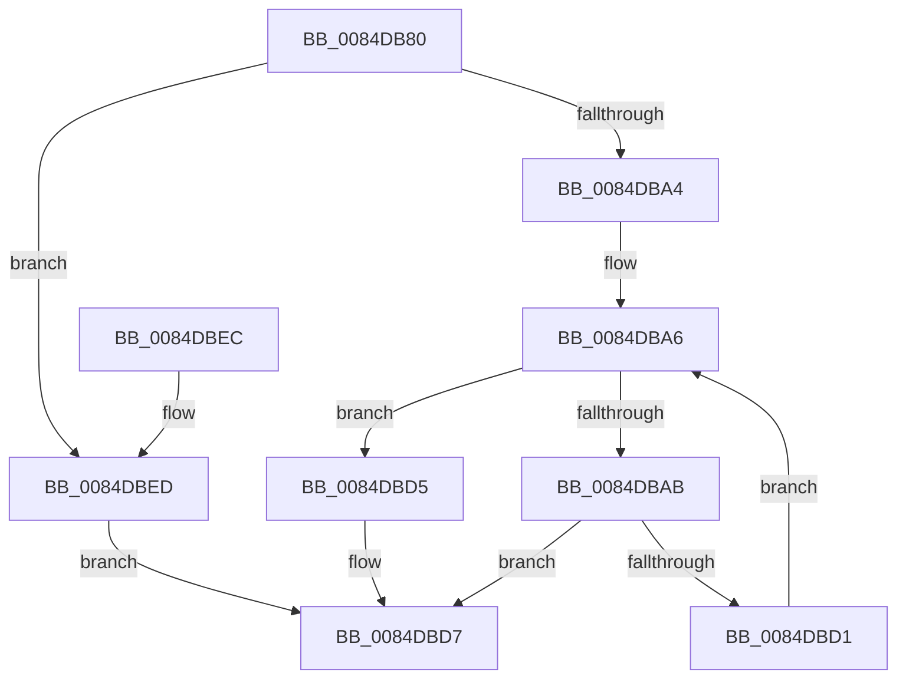

# HvpAdjustHiveFreeDisplay

- RVA: `0x0084DB80`–`0x0084DBF4` (길이 `116` bytes)
- VA: `0x000000014084DB80`
- 실행 섹션: `PAGE`
- PDB 이름 있음: `예`; PDB Function 태그: `아니요`
- unwind 정보 RVA: `0x00069AD0`
- 디코드: `36`개 명령, `116/116` bytes 표시
- 미해석 바이트: `0` (있으면 어셈블리에 `.byte`로 보존)

> 이 문서는 커널 이미지의 기계어와 PDB 기호를 분석해 생성했습니다. 4번과 5번은 함수 원형과 자료형을 바이너리 사용 방식에서 추정한 C 해석이며 원본 소스 복구 결과는 아닙니다.

## 1. Dependencies

- 직접 호출 지점: **1**; 고유 호출 대상: **1**
- 직접 호출자로 확인된 함수: **5**
- RIP 상대 이미지 참조: **0**

### Outgoing calls
- `0x0084DBC8` → [HvpAdjustBitmap](HvpAdjustBitmap_function_0084DBFC.md) (function, `0x0084DBFC`)

### Direct callers
- [HvHiveStartMemoryBacked](../87/HvHiveStartMemoryBacked_function_0087BF38.md) at `0x0087C322`
- [HvHiveStartMemoryBacked](../87/HvHiveStartMemoryBacked_function_0087BF38.md) at `0x0087C55E`
- [HvpPerformLogFileRecovery](../9B/HvpPerformLogFileRecovery_function_009B7994.md) at `0x009B7AA5`
- [HvLoadHive](../9B/HvLoadHive_function_009B8138.md) at `0x009B8363`
- [HvpAddBin](../AF/HvpAddBin_function_00AF7D48.md) at `0x00AF7EA3`
- [HvpAddBin](../AF/HvpAddBin_function_00AF7D48.md) at `0x00AF80B6`
- [sub_00B3E78C](../B3/Unknown_function_00B3E78C.md) at `0x00B3E958`

### Static image references
- 디코드된 RIP-relative 메모리 참조가 없습니다.

## 2. Other-region calls and transfers

- 다른 실행 섹션으로 향하는 call: **0**
- 별도 외부 분기/꼬리 이동을 확인하지 못했습니다.

## 3. Assembly (complete function range)

```asm
0084DB80  48 89 5C 24 08                  mov qword ptr [rsp + 8], rbx
0084DB85  48 89 6C 24 10                  mov qword ptr [rsp + 0x10], rbp
0084DB8A  48 89 74 24 18                  mov qword ptr [rsp + 0x18], rsi
0084DB8F  57                              push rdi
0084DB90  48 83 EC 20                     sub rsp, 0x20
0084DB94  49 63 E8                        movsxd rbp, r8d
0084DB97  8B FA                           mov edi, edx
0084DB99  48 8B F1                        mov rsi, rcx
0084DB9C  81 FA 00 E0 FF 7F               cmp edx, 0x7fffe000
0084DBA2  77 49                           ja 0x14084dbed
0084DBA4  33 DB                           xor ebx, ebx
0084DBA6  83 FB 18                        cmp ebx, 0x18
0084DBA9  73 2A                           jae 0x14084dbd5
0084DBAB  8B C3                           mov eax, ebx
0084DBAD  48 8B CE                        mov rcx, rsi
0084DBB0  48 83 C0 0D                     add rax, 0xd
0084DBB4  48 8D 14 40                     lea rdx, [rax + rax*2]
0084DBB8  48 69 C5 78 02 00 00            imul rax, rbp, 0x278
0084DBBF  48 03 C6                        add rax, rsi
0084DBC2  4C 8D 04 D0                     lea r8, [rax + rdx*8]
0084DBC6  8B D7                           mov edx, edi
0084DBC8  E8 2F 00 00 00                  call 0x14084dbfc
0084DBCD  85 C0                           test eax, eax
0084DBCF  78 06                           js 0x14084dbd7
0084DBD1  FF C3                           inc ebx
0084DBD3  EB D1                           jmp 0x14084dba6
0084DBD5  33 C0                           xor eax, eax
0084DBD7  48 8B 5C 24 30                  mov rbx, qword ptr [rsp + 0x30]
0084DBDC  48 8B 6C 24 38                  mov rbp, qword ptr [rsp + 0x38]
0084DBE1  48 8B 74 24 40                  mov rsi, qword ptr [rsp + 0x40]
0084DBE6  48 83 C4 20                     add rsp, 0x20
0084DBEA  5F                              pop rdi
0084DBEB  C3                              ret
0084DBEC  CC                              int3
0084DBED  B8 4C 01 00 C0                  mov eax, 0xc000014c
0084DBF2  EB E3                           jmp 0x14084dbd7
```

## 4. C-style interpretation (structured pseudocode)

```c
__int64 __fastcall HvpAdjustHiveFreeDisplay(__int64 a1, int a2, int a3)
{
    __int64 result;
    __int64 v_rbx;
    __int64 v_rsp;
    unsigned __int64 v_stack_p10;
    unsigned __int64 v_stack_p18;
    unsigned __int64 v_stack_p8;

    v_stack_p8 = v_rbx;
    v_stack_p10 = v_rbp;
    v_stack_p18 = v_rsi;
    v_rsp = (v_rsp) - (32);
    if (a2 > 0x7FFFE000ULL) goto loc_0084DBED;
    v_rbx = 0;
loc_0084DBA6:
    if (0 >= 24) goto loc_0084DBD5;
    result = (0) + (13);
    result = (result) * ((int)(a3));
    result = (result) + (a1);
    result = HvpAdjustBitmap(a1, (unsigned int)((unsigned int)((unsigned int)(a2))), result + result + result * 2 * 8, a4);
    if (sign_flag) goto loc_0084DBD7;
    v_rbx = (unsigned int)((v_rbx) + 1);
    goto loc_0084DBA6;
loc_0084DBD5:
    result = 0;
loc_0084DBD7:
    v_rsp = (v_rsp) + (32);
    return result;
loc_0084DBED:
    goto loc_0084DBD7;
}
```

## 5. (Beta) C Style

```c
int64_t HvpAdjustHiveFreeDisplay(int64_t Arg1, int32_t Arg2, int32_t Arg3)
{
    int64_t result;
    int64_t local_rbx;
    int64_t local_rsp;
    uint64_t v_stack_p10;
    uint64_t v_stack_p18;
    uint64_t v_stack_p8;

    v_stack_p8 = local_rbx;
    v_stack_p10 = local_rbp;
    v_stack_p18 = local_rsi;
    local_rsp = (local_rsp) - (32);
    if (Arg2 > 0x7FFFE000ULL) goto loc_0084DBED;
    local_rbx = 0;
loc_0084DBA6:
    if (0 >= 24) goto loc_0084DBD5;
    result = (0) + (13);
    result = (result) * ((int32_t)(Arg3));
    result = (result) + (Arg1);
    result = HvpAdjustBitmap(Arg1, (uint32_t)((uint32_t)((uint32_t)(Arg2))), result + result + result * 2 * 8, a4);
    if (sign_flag) goto loc_0084DBD7;
    local_rbx = (uint32_t)((local_rbx) + 1);
    goto loc_0084DBA6;
loc_0084DBD5:
    result = 0;
loc_0084DBD7:
    local_rsp = (local_rsp) + (32);
    return result;
loc_0084DBED:
    goto loc_0084DBD7;
}
```

## 6. Execution-region graph

[열기: 2D/3D 그래프와 함수 탐색 컨트롤 패널](../../../control-panel.html?section=page&rva=0x0084DB80&view=graph)

- 2D 그래프는 위에서 아래로 흐르고, 3D 그래프는 빈 공간을 드래그해 회전합니다. Shift+드래그는 이동, 휠은 확대·축소, 함수 노드 선택은 대상 보고서 이동입니다.

### Static fallback


