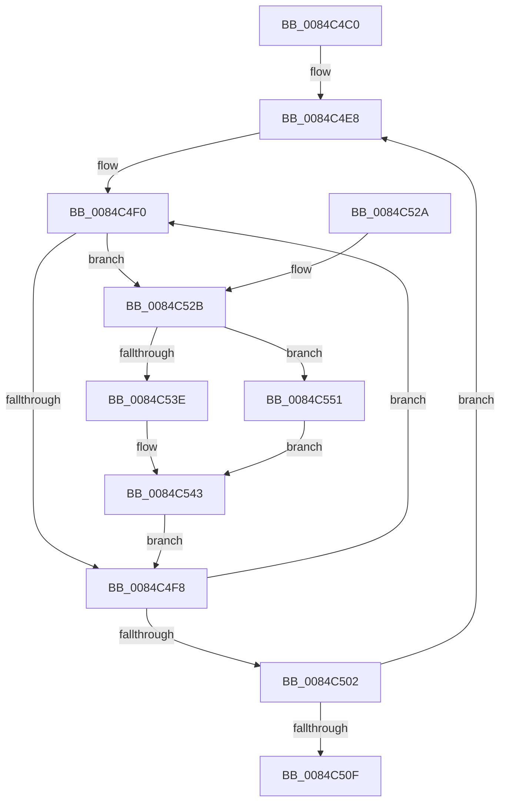

# HvpFreeHiveFreeDisplay

- RVA: `0x0084C4C0`–`0x0084C558` (길이 `152` bytes)
- VA: `0x000000014084C4C0`
- 실행 섹션: `PAGE`
- PDB 이름 있음: `예`; PDB Function 태그: `아니요`
- unwind 정보 RVA: `0x00069788`
- 디코드: `41`개 명령, `152/152` bytes 표시
- 미해석 바이트: `0` (있으면 어셈블리에 `.byte`로 보존)

> 이 문서는 커널 이미지의 기계어와 PDB 기호를 분석해 생성했습니다. 4번과 5번은 함수 원형과 자료형을 바이너리 사용 방식에서 추정한 C 해석이며 원본 소스 복구 결과는 아닙니다.

## 1. Dependencies

- 직접 호출 지점: **2**; 고유 호출 대상: **2**
- 직접 호출자로 확인된 함수: **1**
- RIP 상대 이미지 참조: **1**

### Outgoing calls
- `0x0084C53E` → [CmpFree](CmpFree_function_0084D8F0.md) (function, `0x0084D8F0`)
- `0x0084C551` → [guard_dispatch_icall](../../text/6B/guard_dispatch_icall_function_006BAAD0.md) (function, `0x006BAAD0`)

### Direct callers
- [HvHiveCleanup](HvHiveCleanup_function_0084D918.md) at `0x0084DAC8`

### Static image references
- `0x0084C52F` → RVA `0x0084D8F0` (`CmpFree`; read)

## 2. Other-region calls and transfers

- 다른 실행 섹션으로 향하는 call: **1**
  - `0x0084C551` → [guard_dispatch_icall](../../text/6B/guard_dispatch_icall_function_006BAAD0.md) (`PAGE` → `.text`)
- 별도 외부 분기/꼬리 이동을 확인하지 못했습니다.

## 3. Assembly (complete function range)

```asm
0084C4C0  48 8B C4                        mov rax, rsp
0084C4C3  48 89 58 08                     mov qword ptr [rax + 8], rbx
0084C4C7  48 89 68 10                     mov qword ptr [rax + 0x10], rbp
0084C4CB  48 89 70 18                     mov qword ptr [rax + 0x18], rsi
0084C4CF  48 89 78 20                     mov qword ptr [rax + 0x20], rdi
0084C4D3  41 56                           push r14
0084C4D5  48 83 EC 20                     sub rsp, 0x20
0084C4D9  4C 8B F1                        mov r14, rcx
0084C4DC  48 8D B9 48 01 00 00            lea rdi, [rcx + 0x148]
0084C4E3  BE 02 00 00 00                  mov esi, 2
0084C4E8  48 8B DF                        mov rbx, rdi
0084C4EB  BD 18 00 00 00                  mov ebp, 0x18
0084C4F0  48 8B 0B                        mov rcx, qword ptr [rbx]
0084C4F3  48 85 C9                        test rcx, rcx
0084C4F6  75 33                           jne 0x14084c52b
0084C4F8  48 83 C3 18                     add rbx, 0x18
0084C4FC  48 83 ED 01                     sub rbp, 1
0084C500  75 EE                           jne 0x14084c4f0
0084C502  48 81 C7 78 02 00 00            add rdi, 0x278
0084C509  48 83 EE 01                     sub rsi, 1
0084C50D  75 D9                           jne 0x14084c4e8
0084C50F  48 8B 5C 24 30                  mov rbx, qword ptr [rsp + 0x30]
0084C514  48 8B 6C 24 38                  mov rbp, qword ptr [rsp + 0x38]
0084C519  48 8B 74 24 40                  mov rsi, qword ptr [rsp + 0x40]
0084C51E  48 8B 7C 24 48                  mov rdi, qword ptr [rsp + 0x48]
0084C523  48 83 C4 20                     add rsp, 0x20
0084C527  41 5E                           pop r14
0084C529  C3                              ret
0084C52A  CC                              int3
0084C52B  49 8B 46 20                     mov rax, qword ptr [r14 + 0x20]
0084C52F  4C 8D 05 BA 13 00 00            lea r8, [rip + 0x13ba]
0084C536  8B 53 F0                        mov edx, dword ptr [rbx - 0x10]
0084C539  49 3B C0                        cmp rax, r8
0084C53C  75 13                           jne 0x14084c551
0084C53E  E8 AD 13 00 00                  call 0x14084d8f0
0084C543  83 63 F8 00                     and dword ptr [rbx - 8], 0
0084C547  48 83 23 00                     and qword ptr [rbx], 0
0084C54B  83 63 F0 00                     and dword ptr [rbx - 0x10], 0
0084C54F  EB A7                           jmp 0x14084c4f8
0084C551  E8 7A E5 E6 FF                  call 0x1406baad0
0084C556  EB EB                           jmp 0x14084c543
```

## 4. C-style interpretation (structured pseudocode)

```c
__int64 __fastcall HvpFreeHiveFreeDisplay(__int64 a1)
{
    __int64 result;
    __int64 v_rbp;
    __int64 v_rbx;
    __int64 v_rdi;
    __int64 v_rsi;
    __int64 v_rsp;
    unsigned __int64 v_stack_p10;
    unsigned __int64 v_stack_p18;
    unsigned __int64 v_stack_p20;
    unsigned __int64 v_stack_p8;

    *(unsigned __int64 *)(v_rsp + 8) = v_rbx;
    *(unsigned __int64 *)(v_rsp + 16) = v_rbp;
    *(unsigned __int64 *)(v_rsp + 24) = v_rsi;
    *(unsigned __int64 *)(v_rsp + 32) = v_rdi;
    v_rsp = (v_rsp) - (32);
loc_0084C4E8:
loc_0084C4F0:
    if (*(unsigned __int64 *)(a1 + 328) != 0) goto loc_0084C52B;
loc_0084C4F8:
    v_rbx = (a1 + 328) + (24);
    v_rbp = (24) - (1);
    if (condition_is_not_equal) goto loc_0084C4F0;
    v_rdi = (a1 + 328) + (632);
    v_rsi = (2) - (1);
    if (condition_is_not_equal) goto loc_0084C4E8;
    v_rsp = (v_rsp) + (32);
    return v_rsp;
loc_0084C52B:
    if ((*(unsigned __int64 *)(a1 + 32)) != (v_rip + 5050)) goto loc_0084C551;
    result = CmpFree(*(unsigned __int64 *)(a1 + 328), (unsigned int)(*(unsigned int *)(v_stack_p8 - 16)), v_rip + 5050, a4);
loc_0084C543:
    goto loc_0084C4F8;
loc_0084C551:
    result = guard_dispatch_icall(*(unsigned __int64 *)(a1 + 328), (unsigned int)(*(unsigned int *)(v_stack_p8 - 16)), v_rip + 5050, a4);
    goto loc_0084C543;
}
```

## 5. (Beta) C Style

```c
int64_t HvpFreeHiveFreeDisplay(void *Arg1)
{
    uint8_t *arg1 = (uint8_t *)Arg1;

    int64_t result;
    int64_t local_rbp;
    int64_t local_rbx;
    int64_t local_rdi;
    int64_t local_rsi;
    int64_t local_rsp;
    uint64_t v_stack_p10;
    uint64_t v_stack_p18;
    uint64_t v_stack_p20;
    uint64_t v_stack_p8;

    *(uint64_t *)(local_rsp + 0x8) = local_rbx;
    *(uint64_t *)(local_rsp + 0x10) = local_rbp;
    *(uint64_t *)(local_rsp + 0x18) = local_rsi;
    *(uint64_t *)(local_rsp + 0x20) = local_rdi;
    local_rsp = (local_rsp) - (32);
loc_0084C4E8:
loc_0084C4F0:
    if (*(uint64_t *)(arg1 + 0x148) != 0) goto loc_0084C52B;
loc_0084C4F8:
    local_rbx = (Arg1 + 328) + (24);
    local_rbp = (24) - (1);
    if (condition_is_not_equal) goto loc_0084C4F0;
    local_rdi = (Arg1 + 328) + (632);
    local_rsi = (2) - (1);
    if (condition_is_not_equal) goto loc_0084C4E8;
    local_rsp = (local_rsp) + (32);
    return local_rsp;
loc_0084C52B:
    if ((*(uint64_t *)(arg1 + 0x20)) != (v_rip + 5050)) goto loc_0084C551;
    result = CmpFree(*(uint64_t *)(arg1 + 0x148), (uint32_t)(*(uint32_t *)(v_stack_p8 - 0x10)), v_rip + 5050, a4);
loc_0084C543:
    goto loc_0084C4F8;
loc_0084C551:
    result = guard_dispatch_icall(*(uint64_t *)(arg1 + 0x148), (uint32_t)(*(uint32_t *)(v_stack_p8 - 0x10)), v_rip + 5050, a4);
    goto loc_0084C543;
}
```

### 관측된 메모리 오프셋

구조체 형식이 확인되지 않은 접근은 인자 기준의 오프셋으로만 기록했습니다.

| 기준 인자 | 오프셋 표현 | 폭 (bit) | 접근 |
|---|---:|---:|---|
| `Arg1` | `- 0x10` | `32` | `R` |
| `Arg1` | `- 0x10` | `32` | `R/W` |
| `Arg1` | `- 0x8` | `32` | `R/W` |
| `Arg1` | `+ 0x0` | `64` | `R` |
| `Arg1` | `+ 0x0` | `64` | `R/W` |
| `Arg1` | `+ 0x20` | `64` | `R` |
| `Arg1` | `+ 0x148` | `64` | `R` |

## 6. Execution-region graph

[열기: 2D/3D 그래프와 함수 탐색 컨트롤 패널](../../../control-panel.html?section=page&rva=0x0084C4C0&view=graph)

- 2D 그래프는 위에서 아래로 흐르고, 3D 그래프는 빈 공간을 드래그해 회전합니다. Shift+드래그는 이동, 휠은 확대·축소, 함수 노드 선택은 대상 보고서 이동입니다.

### Static fallback


