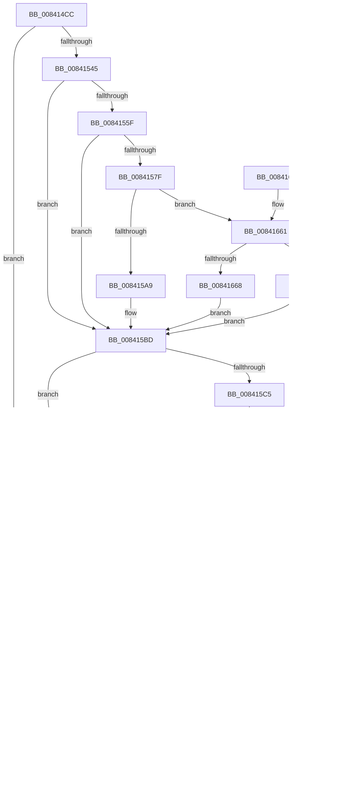

# LkmdTelCreateReport

- RVA: `0x008414CC`–`0x008416DE` (길이 `530` bytes)
- VA: `0x00000001408414CC`
- 실행 섹션: `PAGE`
- PDB 이름 있음: `예`; PDB Function 태그: `아니요`
- unwind 정보 RVA: `0x000DB6C4`
- 디코드: `123`개 명령, `530/530` bytes 표시
- 미해석 바이트: `0` (있으면 어셈블리에 `.byte`로 보존)

> 이 문서는 커널 이미지의 기계어와 PDB 기호를 분석해 생성했습니다. 4번과 5번은 함수 원형과 자료형을 바이너리 사용 방식에서 추정한 C 해석이며 원본 소스 복구 결과는 아닙니다.

## 1. Dependencies

- 직접 호출 지점: **16**; 고유 호출 대상: **11**
- 직접 호출자로 확인된 함수: **1**
- RIP 상대 이미지 참조: **9**

### Outgoing calls
- `0x00841512` → [memset](../../text/6C/memset_function_006C6C40.md) (function, `0x006C6C40`)
- `0x00841534` → [ExAllocatePoolWithTag](../../poolcode/B8/ExAllocatePoolWithTag_function_00B82010.md) (function, `0x00B82010`)
- `0x00841552` → [ExAllocatePoolWithTag](../../poolcode/B8/ExAllocatePoolWithTag_function_00B82010.md) (function, `0x00B82010`)
- `0x00841576` → [RtlStringCbPrintfW](../../text/40/RtlStringCbPrintfW_function_0040FB40.md) (function, `0x0040FB40`)
- `0x00841595` → `ext-ms-win-ntos-werkernel-l1-1-1.dll!WerLiveKernelCreateReport` (import, 간접 대상; import `ext-ms-win-ntos-werkernel-l1-1-1.dll!WerLiveKernelCreateReport`)
- `0x008415B8` → [DbgPrintEx](../../text/35/DbgPrintEx_function_00359290.md) (function, `0x00359290`)
- `0x008415C5` → [LkmdTelpFreeMem](LkmdTelpFreeMem_function_008417BC.md) (function, `0x008417BC`)
- `0x008415CD` → [LkmdTelpFreeMem](LkmdTelpFreeMem_function_008417BC.md) (function, `0x008417BC`)
- `0x008415DE` → `ext-ms-win-ntos-werkernel-l1-1-1.dll!WerLiveKernelCancelReport` (import, 간접 대상; import `ext-ms-win-ntos-werkernel-l1-1-1.dll!WerLiveKernelCancelReport`)
- `0x00841600` → [DbgPrintEx](../../text/35/DbgPrintEx_function_00359290.md) (function, `0x00359290`)
- `0x0084160A` → `ext-ms-win-ntos-werkernel-l1-1-1.dll!WerLiveKernelCloseHandle` (import, 간접 대상; import `ext-ms-win-ntos-werkernel-l1-1-1.dll!WerLiveKernelCloseHandle`)
- `0x0084162C` → [DbgPrintEx](../../text/35/DbgPrintEx_function_00359290.md) (function, `0x00359290`)
- `0x0084163E` → [_security_check_cookie](../../text/6A/_security_check_cookie_function_006AC640.md) (function, `0x006AC640`)
- `0x00841677` → [DbgPrintEx](../../text/35/DbgPrintEx_function_00359290.md) (function, `0x00359290`)
- `0x0084168F` → [RtlCaptureContext](../../text/4F/RtlCaptureContext_function_004FE570.md) (function, `0x004FE570`)
- `0x008416C9` → [KeCapturePersistentThreadState](../../text/43/KeCapturePersistentThreadState_function_00435D90.md) (function, `0x00435D90`)

### Direct callers
- [WheapReportLiveDump](../7D/WheapReportLiveDump_function_007D88E8.md) at `0x007D8959`

### Static image references
- `0x008414EE` → RVA `0x00E0A740` (`.data`; read)
- `0x0084155F` → RVA `0x00B08ED0` (` ?? ::NNGAKEGL::`string'`; read)
- `0x0084156B` → RVA `0x00042C38` (`.rdata`; read)
- `0x00841595` → RVA `0x00151648` (`ext-ms-win-ntos-werkernel-l1-1-1.dll!WerLiveKernelCreateReport (IAT)`; read)
- `0x008415AB` → RVA `0x00042BF8` (`.rdata`; read)
- `0x008415DE` → RVA `0x00151638` (`ext-ms-win-ntos-werkernel-l1-1-1.dll!WerLiveKernelCancelReport (IAT)`; read)
- `0x008415F3` → RVA `0x00042C40` (`.rdata`; read)
- `0x0084160A` → RVA `0x00151628` (`ext-ms-win-ntos-werkernel-l1-1-1.dll!WerLiveKernelCloseHandle (IAT)`; read)
- `0x0084166D` → RVA `0x00042C80` (`.rdata`; read)

## 2. Other-region calls and transfers

- 다른 실행 섹션으로 향하는 call: **11**
  - `0x00841512` → [memset](../../text/6C/memset_function_006C6C40.md) (`PAGE` → `.text`)
  - `0x00841534` → [ExAllocatePoolWithTag](../../poolcode/B8/ExAllocatePoolWithTag_function_00B82010.md) (`PAGE` → `POOLCODE`)
  - `0x00841552` → [ExAllocatePoolWithTag](../../poolcode/B8/ExAllocatePoolWithTag_function_00B82010.md) (`PAGE` → `POOLCODE`)
  - `0x00841576` → [RtlStringCbPrintfW](../../text/40/RtlStringCbPrintfW_function_0040FB40.md) (`PAGE` → `.text`)
  - `0x008415B8` → [DbgPrintEx](../../text/35/DbgPrintEx_function_00359290.md) (`PAGE` → `.text`)
  - `0x00841600` → [DbgPrintEx](../../text/35/DbgPrintEx_function_00359290.md) (`PAGE` → `.text`)
  - `0x0084162C` → [DbgPrintEx](../../text/35/DbgPrintEx_function_00359290.md) (`PAGE` → `.text`)
  - `0x0084163E` → [_security_check_cookie](../../text/6A/_security_check_cookie_function_006AC640.md) (`PAGE` → `.text`)
  - `0x00841677` → [DbgPrintEx](../../text/35/DbgPrintEx_function_00359290.md) (`PAGE` → `.text`)
  - `0x0084168F` → [RtlCaptureContext](../../text/4F/RtlCaptureContext_function_004FE570.md) (`PAGE` → `.text`)
  - `0x008416C9` → [KeCapturePersistentThreadState](../../text/43/KeCapturePersistentThreadState_function_00435D90.md) (`PAGE` → `.text`)
- 별도 외부 분기/꼬리 이동을 확인하지 못했습니다.

## 3. Assembly (complete function range)

```asm
008414CC  48 8B C4                        mov rax, rsp
008414CF  48 89 58 08                     mov qword ptr [rax + 8], rbx
008414D3  48 89 70 10                     mov qword ptr [rax + 0x10], rsi
008414D7  48 89 78 18                     mov qword ptr [rax + 0x18], rdi
008414DB  4C 89 70 20                     mov qword ptr [rax + 0x20], r14
008414DF  55                              push rbp
008414E0  48 8D A8 C8 FB FF FF            lea rbp, [rax - 0x438]
008414E7  48 81 EC 30 05 00 00            sub rsp, 0x530
008414EE  48 8B 05 4B 92 5C 00            mov rax, qword ptr [rip + 0x5c924b]
008414F5  48 33 C4                        xor rax, rsp
008414F8  48 89 85 20 04 00 00            mov qword ptr [rbp + 0x420], rax
008414FF  4D 8B F0                        mov r14, r8
00841502  48 8D 4C 24 50                  lea rcx, [rsp + 0x50]
00841507  41 B8 D0 04 00 00               mov r8d, 0x4d0
0084150D  33 D2                           xor edx, edx
0084150F  49 8B F1                        mov rsi, r9
00841512  E8 29 57 E8 FF                  call 0x1406c6c40
00841517  48 83 64 24 48 00               and qword ptr [rsp + 0x48], 0
0084151D  BF 54 44 61 74                  mov edi, 0x74614454
00841522  83 64 24 40 00                  and dword ptr [rsp + 0x40], 0
00841527  44 8B C7                        mov r8d, edi
0084152A  BA 88 00 00 00                  mov edx, 0x88
0084152F  B9 00 06 00 00                  mov ecx, 0x600
00841534  E8 D7 0A 34 00                  call 0x140b82010
00841539  48 8B D8                        mov rbx, rax
0084153C  48 85 C0                        test rax, rax
0084153F  0F 84 8F 00 00 00               je 0x1408415d4
00841545  44 8B C7                        mov r8d, edi
00841548  BA 00 00 04 00                  mov edx, 0x40000
0084154D  B9 00 06 00 00                  mov ecx, 0x600
00841552  E8 B9 0A 34 00                  call 0x140b82010
00841557  48 89 03                        mov qword ptr [rbx], rax
0084155A  48 85 C0                        test rax, rax
0084155D  74 5E                           je 0x1408415bd
0084155F  4C 8D 0D 6A 79 2C 00            lea r9, [rip + 0x2c796a]
00841566  BA 20 00 00 00                  mov edx, 0x20
0084156B  4C 8D 05 C6 16 80 FF            lea r8, [rip - 0x7fe93a]
00841572  48 8D 4B 68                     lea rcx, [rbx + 0x68]
00841576  E8 C5 E5 BC FF                  call 0x14040fb40
0084157B  85 C0                           test eax, eax
0084157D  78 3E                           js 0x1408415bd
0084157F  4C 8D 44 24 48                  lea r8, [rsp + 0x48]
00841584  C7 44 24 40 01 00 00 00         mov dword ptr [rsp + 0x40], 1
0084158C  48 8D 54 24 40                  lea rdx, [rsp + 0x40]
00841591  48 8D 4B 68                     lea rcx, [rbx + 0x68]
00841595  48 FF 15 AC 00 91 FF            call qword ptr [rip - 0x6eff54]
0084159C  0F 1F 44 00 00                  nop dword ptr [rax + rax]
008415A1  85 C0                           test eax, eax
008415A3  0F 89 B8 00 00 00               jns 0x140841661
008415A9  33 D2                           xor edx, edx
008415AB  4C 8D 05 46 16 80 FF            lea r8, [rip - 0x7fe9ba]
008415B2  44 8B C8                        mov r9d, eax
008415B5  8D 4A 05                        lea ecx, [rdx + 5]
008415B8  E8 D3 7C B1 FF                  call 0x140359290
008415BD  48 8B 0B                        mov rcx, qword ptr [rbx]
008415C0  48 85 C9                        test rcx, rcx
008415C3  74 05                           je 0x1408415ca
008415C5  E8 F2 01 00 00                  call 0x1408417bc
008415CA  48 8B CB                        mov rcx, rbx
008415CD  E8 EA 01 00 00                  call 0x1408417bc
008415D2  33 DB                           xor ebx, ebx
008415D4  48 8B 4C 24 48                  mov rcx, qword ptr [rsp + 0x48]
008415D9  48 85 C9                        test rcx, rcx
008415DC  74 53                           je 0x140841631
008415DE  48 FF 15 53 00 91 FF            call qword ptr [rip - 0x6effad]
008415E5  0F 1F 44 00 00                  nop dword ptr [rax + rax]
008415EA  85 C0                           test eax, eax
008415EC  79 17                           jns 0x140841605
008415EE  BA 01 00 00 00                  mov edx, 1
008415F3  4C 8D 05 46 16 80 FF            lea r8, [rip - 0x7fe9ba]
008415FA  44 8B C8                        mov r9d, eax
008415FD  8D 4A 04                        lea ecx, [rdx + 4]
00841600  E8 8B 7C B1 FF                  call 0x140359290
00841605  48 8B 4C 24 48                  mov rcx, qword ptr [rsp + 0x48]
0084160A  48 FF 15 17 00 91 FF            call qword ptr [rip - 0x6effe9]
00841611  0F 1F 44 00 00                  nop dword ptr [rax + rax]
00841616  85 C0                           test eax, eax
00841618  79 17                           jns 0x140841631
0084161A  BA 01 00 00 00                  mov edx, 1
0084161F  4C 8D 05 1A 16 80 FF            lea r8, [rip - 0x7fe9e6]
00841626  44 8B C8                        mov r9d, eax
00841629  8D 4A 04                        lea ecx, [rdx + 4]
0084162C  E8 5F 7C B1 FF                  call 0x140359290
00841631  48 8B C3                        mov rax, rbx
00841634  48 8B 8D 20 04 00 00            mov rcx, qword ptr [rbp + 0x420]
0084163B  48 33 CC                        xor rcx, rsp
0084163E  E8 FD AF E6 FF                  call 0x1406ac640
00841643  4C 8D 9C 24 30 05 00 00         lea r11, [rsp + 0x530]
0084164B  49 8B 5B 10                     mov rbx, qword ptr [r11 + 0x10]
0084164F  49 8B 73 18                     mov rsi, qword ptr [r11 + 0x18]
00841653  49 8B 7B 20                     mov rdi, qword ptr [r11 + 0x20]
00841657  4D 8B 73 28                     mov r14, qword ptr [r11 + 0x28]
0084165B  49 8B E3                        mov rsp, r11
0084165E  5D                              pop rbp
0084165F  C3                              ret
00841660  CC                              int3
00841661  83 7C 24 40 00                  cmp dword ptr [rsp + 0x40], 0
00841666  75 19                           jne 0x140841681
00841668  BA 01 00 00 00                  mov edx, 1
0084166D  4C 8D 05 0C 16 80 FF            lea r8, [rip - 0x7fe9f4]
00841674  8D 4A 04                        lea ecx, [rdx + 4]
00841677  E8 14 7C B1 FF                  call 0x140359290
0084167C  E9 3C FF FF FF                  jmp 0x1408415bd
00841681  48 8B 44 24 48                  mov rax, qword ptr [rsp + 0x48]
00841686  48 8D 4C 24 50                  lea rcx, [rsp + 0x50]
0084168B  48 89 43 60                     mov qword ptr [rbx + 0x60], rax
0084168F  E8 DC CE CB FF                  call 0x1404fe570
00841694  48 8B 03                        mov rax, qword ptr [rbx]
00841697  48 8D 4C 24 50                  lea rcx, [rsp + 0x50]
0084169C  48 89 44 24 38                  mov qword ptr [rsp + 0x38], rax
008416A1  4D 8B CE                        mov r9, r14
008416A4  48 8B 85 68 04 00 00            mov rax, qword ptr [rbp + 0x468]
008416AB  33 D2                           xor edx, edx
008416AD  48 89 44 24 30                  mov qword ptr [rsp + 0x30], rax
008416B2  41 B8 24 01 00 00               mov r8d, 0x124
008416B8  48 8B 85 60 04 00 00            mov rax, qword ptr [rbp + 0x460]
008416BF  48 89 44 24 28                  mov qword ptr [rsp + 0x28], rax
008416C4  48 89 74 24 20                  mov qword ptr [rsp + 0x20], rsi
008416C9  E8 C2 46 BF FF                  call 0x140435d90
008416CE  85 C0                           test eax, eax
008416D0  0F 84 E7 FE FF FF               je 0x1408415bd
008416D6  89 43 08                        mov dword ptr [rbx + 8], eax
008416D9  E9 53 FF FF FF                  jmp 0x140841631
```

## 4. C-style interpretation (structured pseudocode)

```c
__int64 __fastcall LkmdTelCreateReport(__int64 a1, int a2, __int64 a3, __int64 a4)
{
    __int64 result;
    __int64 v_rbx;
    __int64 v_rsp;
    unsigned __int64 v_stack_m4E0;
    unsigned __int64 v_stack_m4E8;
    unsigned __int64 v_stack_m4F0;
    unsigned int v_stack_m4F8;
    unsigned __int64 v_stack_m500;
    unsigned __int64 v_stack_m508;
    unsigned __int64 v_stack_m510;
    unsigned __int64 v_stack_m8;

    *(unsigned __int64 *)(v_rsp + 8) = v_rbx;
    *(unsigned __int64 *)(v_rsp + 16) = v_rsi;
    *(unsigned __int64 *)(v_rsp + 24) = v_rdi;
    *(unsigned __int64 *)(v_rsp + 32) = v_r14;
    v_rsp = (v_rsp) - (0x530ULL);
    result = (*(unsigned __int64 *)(v_rip + 6066763)) ^ (v_rsp);
    *(unsigned __int64 *)(v_rsp - 1080 + 1056) = result;
    a2 = 0;
    result = memset(v_stack_m4E8, a2, (unsigned int)(0x4D0ULL), a4);
    result = ExAllocatePoolWithTag((unsigned int)(0x600ULL), 136, (unsigned int)((unsigned int)((unsigned int)(0x74614454ULL))), a4);
    if (result == 0) goto loc_008415D4;
    result = ExAllocatePoolWithTag((unsigned int)(0x600ULL), (unsigned int)(0x40000ULL), (unsigned int)((unsigned int)((unsigned int)(0x74614454ULL))), a4);
    *(unsigned __int64 *)(result) = result;
    if (result == 0) goto loc_008415BD;
    result = RtlStringCbPrintfW(result + 104, 32, v_rip - 8382778, v_rip + 2914666);
    if (sign_flag) goto loc_008415BD;
    v_stack_m4F8 = 1;
    result = ext_ms_win_ntos_werkernel_l1_1_1_dll_WerLiveKernelCreateReport(result + 104, v_stack_m4F8, v_stack_m4F0, v_rip + 2914666);
    if (!sign_flag) goto loc_00841661;
    a2 = 0;
    result = DbgPrintEx(a2 + 5, a2, v_rip - 8382906, (unsigned int)((unsigned int)(result)));
loc_008415BD:
    if (*(unsigned __int64 *)(result) != 0) {
        result = LkmdTelpFreeMem(*(unsigned __int64 *)(result), a2, v_rip - 8382906, (unsigned int)((unsigned int)(result)));
    }
    result = LkmdTelpFreeMem(result, a2, v_rip - 8382906, (unsigned int)((unsigned int)(result)));
    v_rbx = 0;
loc_008415D4:
    if (v_stack_m4F0 == 0) goto loc_00841631;
    result = ext_ms_win_ntos_werkernel_l1_1_1_dll_WerLiveKernelCancelReport(v_stack_m4F0, a2, v_rip - 8382906, (unsigned int)((unsigned int)(result)));
    if (sign_flag) {
        a2 = 1;
        a3 = v_rip - 8382906;
        a4 = (unsigned int)(result);
        a1 = a2 + 4;
        result = DbgPrintEx(a1, a2, a3, a4);
    }
    result = ext_ms_win_ntos_werkernel_l1_1_1_dll_WerLiveKernelCloseHandle(v_stack_m4F0, a2, a3, a4);
    if (sign_flag) {
        a2 = 1;
        a3 = v_rip - 8382950;
        a4 = (unsigned int)(result);
        a1 = a2 + 4;
        result = DbgPrintEx(a1, a2, a3, a4);
    }
    a1 = (*(unsigned __int64 *)(v_rsp - 1080 + 1056)) ^ (v_rsp);
    result = _security_check_cookie(a1, a2, a3, a4);
    return result;
loc_00841661:
    if (v_stack_m4F0 != 0) goto loc_00841681;
    result = DbgPrintEx(1 + 4, 1, v_rip - 8382964, a4);
    goto loc_008415BD;
loc_00841681:
    *(unsigned __int64 *)(*(unsigned __int64 *)(v_stack_m8 + 16) + 96) = v_stack_m4E8;
    result = RtlCaptureContext(v_stack_m4E0, 1, v_rip - 8382964, a4);
    v_stack_m4F8 = *(unsigned __int64 *)(*(unsigned __int64 *)(v_stack_m8 + 16));
    a2 = 0;
    v_stack_m500 = *(unsigned __int64 *)(v_rsp - 1080 + 1128);
    v_stack_m508 = *(unsigned __int64 *)(v_rsp - 1080 + 1120);
    v_stack_m510 = *(unsigned __int64 *)(v_stack_m8 + 24);
    result = KeCapturePersistentThreadState(v_stack_m4E0, a2, 292, *(unsigned __int64 *)(v_stack_m8 + 40));
    if ((unsigned int)(result) == 0) goto loc_008415BD;
    *(unsigned int *)(*(unsigned __int64 *)(v_stack_m8 + 16) + 8) = (unsigned int)(result);
    goto loc_00841631;
}
```

## 5. (Beta) C Style

```c
int64_t LkmdTelCreateReport(int64_t Arg1, int32_t Arg2, int64_t Arg3, int64_t Arg4)
{
    int64_t result;
    int64_t local_rbx;
    int64_t local_rsp;
    uint64_t v_stack_m4E0;
    uint64_t v_stack_m4E8;
    uint64_t v_stack_m4F0;
    uint32_t v_stack_m4F8;
    uint64_t v_stack_m500;
    uint64_t v_stack_m508;
    uint64_t v_stack_m510;
    uint64_t v_stack_m8;

    *(uint64_t *)(local_rsp + 0x8) = local_rbx;
    *(uint64_t *)(local_rsp + 0x10) = local_rsi;
    *(uint64_t *)(local_rsp + 0x18) = local_rdi;
    *(uint64_t *)(local_rsp + 0x20) = local_r14;
    local_rsp = (local_rsp) - (0x530ULL);
    result = (*(uint64_t *)(v_rip + 0x5C924B)) ^ (local_rsp);
    *(uint64_t *)(local_rsp - 0x438 + 0x420) = result;
    Arg2 = 0;
    result = memset(v_stack_m4E8, Arg2, (uint32_t)(0x4D0ULL), Arg4);
    result = ExAllocatePoolWithTag((uint32_t)(0x600ULL), 136, (uint32_t)((uint32_t)((uint32_t)(0x74614454ULL))), Arg4);
    if (result == 0) goto loc_008415D4;
    result = ExAllocatePoolWithTag((uint32_t)(0x600ULL), (uint32_t)(0x40000ULL), (uint32_t)((uint32_t)((uint32_t)(0x74614454ULL))), Arg4);
    *(uint64_t *)(result) = result;
    if (result == 0) goto loc_008415BD;
    result = RtlStringCbPrintfW(result + 104, 32, v_rip - 8382778, v_rip + 2914666);
    if (sign_flag) goto loc_008415BD;
    v_stack_m4F8 = 1;
    result = kernel_indirect_call(result + 104, v_stack_m4F8, v_stack_m4F0, v_rip + 2914666);
    if (!sign_flag) goto loc_00841661;
    Arg2 = 0;
    result = DbgPrintEx(Arg2 + 5, Arg2, v_rip - 8382906, (uint32_t)((uint32_t)(result)));
loc_008415BD:
    if (*(uint64_t *)(result) != 0) {
        result = LkmdTelpFreeMem(*(uint64_t *)(result), Arg2, v_rip - 8382906, (uint32_t)((uint32_t)(result)));
    }
    result = LkmdTelpFreeMem(result, Arg2, v_rip - 8382906, (uint32_t)((uint32_t)(result)));
    local_rbx = 0;
loc_008415D4:
    if (v_stack_m4F0 == 0) goto loc_00841631;
    result = kernel_indirect_call(v_stack_m4F0, Arg2, v_rip - 8382906, (uint32_t)((uint32_t)(result)));
    if (sign_flag) {
        Arg2 = 1;
        Arg3 = v_rip - 8382906;
        Arg4 = (uint32_t)(result);
        Arg1 = Arg2 + 4;
        result = DbgPrintEx(Arg1, Arg2, Arg3, Arg4);
    }
    result = kernel_indirect_call(v_stack_m4F0, Arg2, Arg3, Arg4);
    if (sign_flag) {
        Arg2 = 1;
        Arg3 = v_rip - 8382950;
        Arg4 = (uint32_t)(result);
        Arg1 = Arg2 + 4;
        result = DbgPrintEx(Arg1, Arg2, Arg3, Arg4);
    }
    Arg1 = (*(uint64_t *)(local_rsp - 0x438 + 0x420)) ^ (local_rsp);
    result = _security_check_cookie(Arg1, Arg2, Arg3, Arg4);
    return result;
loc_00841661:
    if (v_stack_m4F0 != 0) goto loc_00841681;
    result = DbgPrintEx(1 + 4, 1, v_rip - 8382964, Arg4);
    goto loc_008415BD;
loc_00841681:
    *(uint64_t *)(*(uint64_t *)(v_stack_m8 + 0x10) + 0x60) = v_stack_m4E8;
    result = RtlCaptureContext(v_stack_m4E0, 1, v_rip - 8382964, Arg4);
    v_stack_m4F8 = *(uint64_t *)(*(uint64_t *)(v_stack_m8 + 0x10));
    Arg2 = 0;
    v_stack_m500 = *(uint64_t *)(local_rsp - 0x438 + 0x468);
    v_stack_m508 = *(uint64_t *)(local_rsp - 0x438 + 0x460);
    v_stack_m510 = *(uint64_t *)(v_stack_m8 + 0x18);
    result = KeCapturePersistentThreadState(v_stack_m4E0, Arg2, 292, *(uint64_t *)(v_stack_m8 + 0x28));
    if ((uint32_t)(result) == 0) goto loc_008415BD;
    *(uint32_t *)(*(uint64_t *)(v_stack_m8 + 0x10) + 0x8) = (uint32_t)(result);
    goto loc_00841631;
}
```

## 6. Execution-region graph

[열기: 2D/3D 그래프와 함수 탐색 컨트롤 패널](../../../control-panel.html?section=page&rva=0x008414CC&view=graph)

- 2D 그래프는 위에서 아래로 흐르고, 3D 그래프는 빈 공간을 드래그해 회전합니다. Shift+드래그는 이동, 휠은 확대·축소, 함수 노드 선택은 대상 보고서 이동입니다.

### Static fallback


