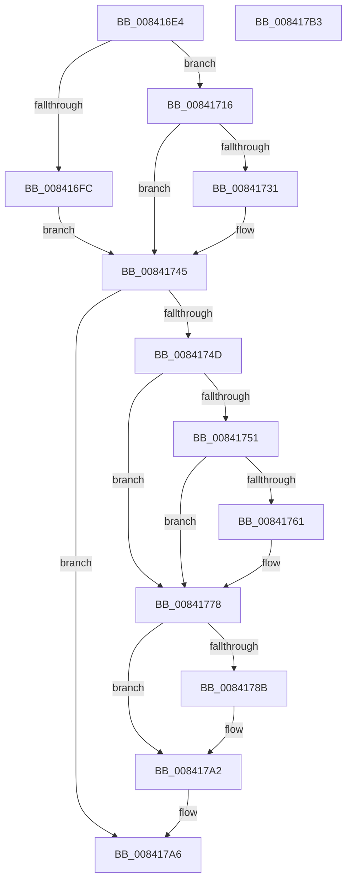

# LkmdTelSubmitReport

- RVA: `0x008416E4`–`0x008417B4` (길이 `208` bytes)
- VA: `0x00000001408416E4`
- 실행 섹션: `PAGE`
- PDB 이름 있음: `예`; PDB Function 태그: `아니요`
- unwind 정보 RVA: `0x0005CAAC`
- 디코드: `59`개 명령, `208/208` bytes 표시
- 미해석 바이트: `0` (있으면 어셈블리에 `.byte`로 보존)

> 이 문서는 커널 이미지의 기계어와 PDB 기호를 분석해 생성했습니다. 4번과 5번은 함수 원형과 자료형을 바이너리 사용 방식에서 추정한 C 해석이며 원본 소스 복구 결과는 아닙니다.

## 1. Dependencies

- 직접 호출 지점: **8**; 고유 호출 대상: **5**
- 직접 호출자로 확인된 함수: **1**
- RIP 상대 이미지 참조: **7**

### Outgoing calls
- `0x008416F1` → [LkmdTelpWriteDumpFile](LkmdTelpWriteDumpFile_function_008417DC.md) (function, `0x008417DC`)
- `0x0084170B` → [DbgPrintEx](../../text/35/DbgPrintEx_function_00359290.md) (function, `0x00359290`)
- `0x0084171F` → `ext-ms-win-ntos-werkernel-l1-1-1.dll!WerLiveKernelSubmitReport` (import, 간접 대상; import `ext-ms-win-ntos-werkernel-l1-1-1.dll!WerLiveKernelSubmitReport`)
- `0x00841740` → [DbgPrintEx](../../text/35/DbgPrintEx_function_00359290.md) (function, `0x00359290`)
- `0x00841751` → `ext-ms-win-ntos-werkernel-l1-1-1.dll!WerLiveKernelCancelReport` (import, 간접 대상; import `ext-ms-win-ntos-werkernel-l1-1-1.dll!WerLiveKernelCancelReport`)
- `0x00841773` → [DbgPrintEx](../../text/35/DbgPrintEx_function_00359290.md) (function, `0x00359290`)
- `0x0084177B` → `ext-ms-win-ntos-werkernel-l1-1-1.dll!WerLiveKernelCloseHandle` (import, 간접 대상; import `ext-ms-win-ntos-werkernel-l1-1-1.dll!WerLiveKernelCloseHandle`)
- `0x0084179D` → [DbgPrintEx](../../text/35/DbgPrintEx_function_00359290.md) (function, `0x00359290`)

### Direct callers
- [WheapReportLiveDump](../7D/WheapReportLiveDump_function_007D88E8.md) at `0x007D8985`

### Static image references
- `0x008416FE` → RVA `0x00042D20` (`.rdata`; read)
- `0x0084171F` → RVA `0x00151640` (`ext-ms-win-ntos-werkernel-l1-1-1.dll!WerLiveKernelSubmitReport (IAT)`; read)
- `0x00841733` → RVA `0x00042CD0` (`.rdata`; read)
- `0x00841751` → RVA `0x00151638` (`ext-ms-win-ntos-werkernel-l1-1-1.dll!WerLiveKernelCancelReport (IAT)`; read)
- `0x00841766` → RVA `0x00042E10` (`.rdata`; read)
- `0x0084177B` → RVA `0x00151628` (`ext-ms-win-ntos-werkernel-l1-1-1.dll!WerLiveKernelCloseHandle (IAT)`; read)
- `0x00841790` → RVA `0x00042DC0` (`.rdata`; read)

## 2. Other-region calls and transfers

- 다른 실행 섹션으로 향하는 call: **4**
  - `0x0084170B` → [DbgPrintEx](../../text/35/DbgPrintEx_function_00359290.md) (`PAGE` → `.text`)
  - `0x00841740` → [DbgPrintEx](../../text/35/DbgPrintEx_function_00359290.md) (`PAGE` → `.text`)
  - `0x00841773` → [DbgPrintEx](../../text/35/DbgPrintEx_function_00359290.md) (`PAGE` → `.text`)
  - `0x0084179D` → [DbgPrintEx](../../text/35/DbgPrintEx_function_00359290.md) (`PAGE` → `.text`)
- 별도 외부 분기/꼬리 이동을 확인하지 못했습니다.

## 3. Assembly (complete function range)

```asm
008416E4  48 89 5C 24 08                  mov qword ptr [rsp + 8], rbx
008416E9  57                              push rdi
008416EA  48 83 EC 20                     sub rsp, 0x20
008416EE  48 8B F9                        mov rdi, rcx
008416F1  E8 E6 00 00 00                  call 0x1408417dc
008416F6  8B D8                           mov ebx, eax
008416F8  85 C0                           test eax, eax
008416FA  79 1A                           jns 0x140841716
008416FC  33 D2                           xor edx, edx
008416FE  4C 8D 05 1B 16 80 FF            lea r8, [rip - 0x7fe9e5]
00841705  44 8B C8                        mov r9d, eax
00841708  8D 4A 05                        lea ecx, [rdx + 5]
0084170B  E8 80 7B B1 FF                  call 0x140359290
00841710  48 83 C7 60                     add rdi, 0x60
00841714  EB 2F                           jmp 0x140841745
00841716  48 83 C7 60                     add rdi, 0x60
0084171A  33 D2                           xor edx, edx
0084171C  48 8B 0F                        mov rcx, qword ptr [rdi]
0084171F  48 FF 15 1A FF 90 FF            call qword ptr [rip - 0x6f00e6]
00841726  0F 1F 44 00 00                  nop dword ptr [rax + rax]
0084172B  8B D8                           mov ebx, eax
0084172D  85 C0                           test eax, eax
0084172F  79 14                           jns 0x140841745
00841731  33 D2                           xor edx, edx
00841733  4C 8D 05 96 15 80 FF            lea r8, [rip - 0x7fea6a]
0084173A  44 8B C8                        mov r9d, eax
0084173D  8D 4A 05                        lea ecx, [rdx + 5]
00841740  E8 4B 7B B1 FF                  call 0x140359290
00841745  48 8B 0F                        mov rcx, qword ptr [rdi]
00841748  48 85 C9                        test rcx, rcx
0084174B  74 59                           je 0x1408417a6
0084174D  85 DB                           test ebx, ebx
0084174F  79 27                           jns 0x140841778
00841751  48 FF 15 E0 FE 90 FF            call qword ptr [rip - 0x6f0120]
00841758  0F 1F 44 00 00                  nop dword ptr [rax + rax]
0084175D  85 C0                           test eax, eax
0084175F  79 17                           jns 0x140841778
00841761  BA 01 00 00 00                  mov edx, 1
00841766  4C 8D 05 A3 16 80 FF            lea r8, [rip - 0x7fe95d]
0084176D  44 8B C8                        mov r9d, eax
00841770  8D 4A 04                        lea ecx, [rdx + 4]
00841773  E8 18 7B B1 FF                  call 0x140359290
00841778  48 8B 0F                        mov rcx, qword ptr [rdi]
0084177B  48 FF 15 A6 FE 90 FF            call qword ptr [rip - 0x6f015a]
00841782  0F 1F 44 00 00                  nop dword ptr [rax + rax]
00841787  85 C0                           test eax, eax
00841789  79 17                           jns 0x1408417a2
0084178B  BA 01 00 00 00                  mov edx, 1
00841790  4C 8D 05 29 16 80 FF            lea r8, [rip - 0x7fe9d7]
00841797  44 8B C8                        mov r9d, eax
0084179A  8D 4A 04                        lea ecx, [rdx + 4]
0084179D  E8 EE 7A B1 FF                  call 0x140359290
008417A2  48 83 27 00                     and qword ptr [rdi], 0
008417A6  8B C3                           mov eax, ebx
008417A8  48 8B 5C 24 30                  mov rbx, qword ptr [rsp + 0x30]
008417AD  48 83 C4 20                     add rsp, 0x20
008417B1  5F                              pop rdi
008417B2  C3                              ret
008417B3  CC                              int3
```

## 4. C-style interpretation (structured pseudocode)

```c
__int64 __fastcall LkmdTelSubmitReport(__int64 a1, int a2)
{
    __int64 result;
    __int64 v_rdi;
    __int64 v_rsp;
    unsigned __int64 v_stack_p8;

    v_stack_p8 = v_rbx;
    v_rsp = (v_rsp) - (32);
    result = LkmdTelpWriteDumpFile(a1, a2, a3, a4);
    if (!sign_flag) goto loc_00841716;
    a2 = 0;
    result = DbgPrintEx(a2 + 5, a2, v_rip - 8382949, (unsigned int)((unsigned int)(result)));
    v_rdi = (a1) + (96);
    goto loc_00841745;
loc_00841716:
    v_rdi = (v_rdi) + (96);
    a2 = 0;
    result = ext_ms_win_ntos_werkernel_l1_1_1_dll_WerLiveKernelSubmitReport(*(unsigned __int64 *)(v_rdi), a2, v_rip - 8382949, (unsigned int)((unsigned int)(result)));
    if (sign_flag) {
        a2 = 0;
        a3 = v_rip - 8383082;
        a4 = (unsigned int)(result);
        a1 = a2 + 5;
        result = DbgPrintEx(a1, a2, a3, a4);
    }
    if (*(unsigned __int64 *)(v_rdi) == 0) goto loc_008417A6;
    if (!sign_flag) goto loc_00841778;
    result = ext_ms_win_ntos_werkernel_l1_1_1_dll_WerLiveKernelCancelReport(*(unsigned __int64 *)(v_rdi), a2, a3, a4);
    if (sign_flag) {
        a2 = 1;
        a3 = v_rip - 8382813;
        a4 = (unsigned int)(result);
        a1 = a2 + 4;
        result = DbgPrintEx(a1, a2, a3, a4);
    }
    result = ext_ms_win_ntos_werkernel_l1_1_1_dll_WerLiveKernelCloseHandle(*(unsigned __int64 *)(v_rdi), a2, a3, a4);
    if (sign_flag) {
        a2 = 1;
        a3 = v_rip - 8382935;
        a4 = (unsigned int)(result);
        a1 = a2 + 4;
        result = DbgPrintEx(a1, a2, a3, a4);
    }
loc_008417A6:
    v_rsp = (v_rsp) + (32);
    return (unsigned int)((unsigned int)((unsigned int)((unsigned int)(result))));
}
```

## 5. (Beta) C Style

```c
int64_t LkmdTelSubmitReport(void *Arg1, int32_t Arg2)
{
    uint8_t *arg1 = (uint8_t *)Arg1;

    int64_t result;
    int64_t local_rdi;
    int64_t local_rsp;
    uint64_t v_stack_p8;

    v_stack_p8 = local_rbx;
    local_rsp = (local_rsp) - (32);
    result = LkmdTelpWriteDumpFile(Arg1, Arg2, a3, a4);
    if (!sign_flag) goto loc_00841716;
    Arg2 = 0;
    result = DbgPrintEx(Arg2 + 5, Arg2, v_rip - 8382949, (uint32_t)((uint32_t)(result)));
    local_rdi = (Arg1) + (96);
    goto loc_00841745;
loc_00841716:
    local_rdi = (local_rdi) + (96);
    Arg2 = 0;
    result = kernel_indirect_call(*(uint64_t *)(local_rdi), Arg2, v_rip - 8382949, (uint32_t)((uint32_t)(result)));
    if (sign_flag) {
        Arg2 = 0;
        a3 = v_rip - 8383082;
        a4 = (uint32_t)(result);
        Arg1 = Arg2 + 5;
        result = DbgPrintEx(Arg1, Arg2, a3, a4);
    }
    if (*(uint64_t *)(local_rdi) == 0) goto loc_008417A6;
    if (!sign_flag) goto loc_00841778;
    result = kernel_indirect_call(*(uint64_t *)(local_rdi), Arg2, a3, a4);
    if (sign_flag) {
        Arg2 = 1;
        a3 = v_rip - 8382813;
        a4 = (uint32_t)(result);
        Arg1 = Arg2 + 4;
        result = DbgPrintEx(Arg1, Arg2, a3, a4);
    }
    result = kernel_indirect_call(*(uint64_t *)(local_rdi), Arg2, a3, a4);
    if (sign_flag) {
        Arg2 = 1;
        a3 = v_rip - 8382935;
        a4 = (uint32_t)(result);
        Arg1 = Arg2 + 4;
        result = DbgPrintEx(Arg1, Arg2, a3, a4);
    }
loc_008417A6:
    local_rsp = (local_rsp) + (32);
    return (uint32_t)((uint32_t)((uint32_t)((uint32_t)(result))));
}
```

### 관측된 메모리 오프셋

구조체 형식이 확인되지 않은 접근은 인자 기준의 오프셋으로만 기록했습니다.

| 기준 인자 | 오프셋 표현 | 폭 (bit) | 접근 |
|---|---:|---:|---|
| `Arg1` | `+ 0x0` | `64` | `R` |
| `Arg1` | `+ 0x0` | `64` | `R/W` |

## 6. Execution-region graph

[열기: 2D/3D 그래프와 함수 탐색 컨트롤 패널](../../../control-panel.html?section=page&rva=0x008416E4&view=graph)

- 2D 그래프는 위에서 아래로 흐르고, 3D 그래프는 빈 공간을 드래그해 회전합니다. Shift+드래그는 이동, 휠은 확대·축소, 함수 노드 선택은 대상 보고서 이동입니다.

### Static fallback


