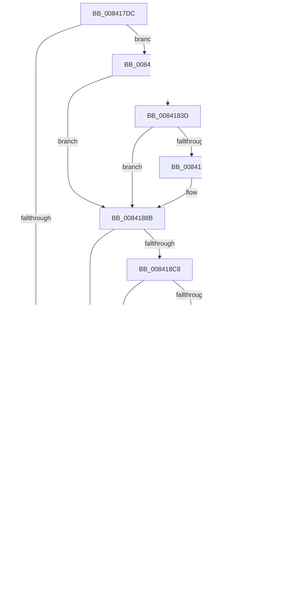

# LkmdTelpWriteDumpFile

- RVA: `0x008417DC`–`0x008419A4` (길이 `456` bytes)
- VA: `0x00000001408417DC`
- 실행 섹션: `PAGE`
- PDB 이름 있음: `예`; PDB Function 태그: `아니요`
- unwind 정보 RVA: `0x00093744`
- 디코드: `118`개 명령, `456/456` bytes 표시
- 미해석 바이트: `0` (있으면 어셈블리에 `.byte`로 보존)

> 이 문서는 커널 이미지의 기계어와 PDB 기호를 분석해 생성했습니다. 4번과 5번은 함수 원형과 자료형을 바이너리 사용 방식에서 추정한 C 해석이며 원본 소스 복구 결과는 아닙니다.

## 1. Dependencies

- 직접 호출 지점: **7**; 고유 호출 대상: **4**
- 직접 호출자로 확인된 함수: **1**
- RIP 상대 이미지 참조: **3**

### Outgoing calls
- `0x0084180B` → `ext-ms-win-ntos-werkernel-l1-1-1.dll!WerLiveKernelOpenDumpFile` (import, 간접 대상; import `ext-ms-win-ntos-werkernel-l1-1-1.dll!WerLiveKernelOpenDumpFile`)
- `0x0084182C` → [DbgPrintEx](../../text/35/DbgPrintEx_function_00359290.md) (function, `0x00359290`)
- `0x008418B9` → [ZwWriteFile](../../text/6A/ZwWriteFile_function_006AD1D0.md) (function, `0x006AD1D0`)
- `0x00841901` → [ZwWriteFile](../../text/6A/ZwWriteFile_function_006AD1D0.md) (function, `0x006AD1D0`)
- `0x0084193C` → [ZwWriteFile](../../text/6A/ZwWriteFile_function_006AD1D0.md) (function, `0x006AD1D0`)
- `0x00841976` → [ZwWriteFile](../../text/6A/ZwWriteFile_function_006AD1D0.md) (function, `0x006AD1D0`)
- `0x00841986` → [ZwClose](../../text/6A/ZwClose_function_006AD2B0.md) (function, `0x006AD2B0`)

### Direct callers
- [LkmdTelSubmitReport](LkmdTelSubmitReport_function_008416E4.md) at `0x008416F1`

### Static image references
- `0x0084180B` → RVA `0x00151620` (`ext-ms-win-ntos-werkernel-l1-1-1.dll!WerLiveKernelOpenDumpFile (IAT)`; read)
- `0x00841820` → RVA `0x00042D70` (`.rdata`; read)
- `0x00841868` → RVA `0x00E0A74C` (`.data`; read)

## 2. Other-region calls and transfers

- 다른 실행 섹션으로 향하는 call: **6**
  - `0x0084182C` → [DbgPrintEx](../../text/35/DbgPrintEx_function_00359290.md) (`PAGE` → `.text`)
  - `0x008418B9` → [ZwWriteFile](../../text/6A/ZwWriteFile_function_006AD1D0.md) (`PAGE` → `.text`)
  - `0x00841901` → [ZwWriteFile](../../text/6A/ZwWriteFile_function_006AD1D0.md) (`PAGE` → `.text`)
  - `0x0084193C` → [ZwWriteFile](../../text/6A/ZwWriteFile_function_006AD1D0.md) (`PAGE` → `.text`)
  - `0x00841976` → [ZwWriteFile](../../text/6A/ZwWriteFile_function_006AD1D0.md) (`PAGE` → `.text`)
  - `0x00841986` → [ZwClose](../../text/6A/ZwClose_function_006AD2B0.md) (`PAGE` → `.text`)
- 별도 외부 분기/꼬리 이동을 확인하지 못했습니다.

## 3. Assembly (complete function range)

```asm
008417DC  48 89 5C 24 10                  mov qword ptr [rsp + 0x10], rbx
008417E1  48 89 74 24 18                  mov qword ptr [rsp + 0x18], rsi
008417E6  48 89 7C 24 20                  mov qword ptr [rsp + 0x20], rdi
008417EB  55                              push rbp
008417EC  48 8B EC                        mov rbp, rsp
008417EF  48 83 EC 60                     sub rsp, 0x60
008417F3  48 8B D9                        mov rbx, rcx
008417F6  48 8D 55 10                     lea rdx, [rbp + 0x10]
008417FA  48 8B 49 60                     mov rcx, qword ptr [rcx + 0x60]
008417FE  0F 57 C0                        xorps xmm0, xmm0
00841801  33 F6                           xor esi, esi
00841803  0F 11 45 F0                     movups xmmword ptr [rbp - 0x10], xmm0
00841807  48 89 75 10                     mov qword ptr [rbp + 0x10], rsi
0084180B  48 FF 15 0E FE 90 FF            call qword ptr [rip - 0x6f01f2]
00841812  0F 1F 44 00 00                  nop dword ptr [rax + rax]
00841817  8B F8                           mov edi, eax
00841819  85 C0                           test eax, eax
0084181B  79 19                           jns 0x140841836
0084181D  44 8B C8                        mov r9d, eax
00841820  4C 8D 05 49 15 80 FF            lea r8, [rip - 0x7feab7]
00841827  33 D2                           xor edx, edx
00841829  8D 4E 05                        lea ecx, [rsi + 5]
0084182C  E8 5F 7A B1 FF                  call 0x140359290
00841831  E9 47 01 00 00                  jmp 0x14084197d
00841836  8B 43 18                        mov eax, dword ptr [rbx + 0x18]
00841839  85 C0                           test eax, eax
0084183B  74 4E                           je 0x14084188b
0084183D  48 39 73 10                     cmp qword ptr [rbx + 0x10], rsi
00841841  74 48                           je 0x14084188b
00841843  8D 88 30 00 04 00               lea ecx, [rax + 0x40030]
00841849  48 8B 03                        mov rax, qword ptr [rbx]
0084184C  48 89 88 A0 0F 00 00            mov qword ptr [rax + 0xfa0], rcx
00841853  C7 43 2C 44 75 6D 70            mov dword ptr [rbx + 0x2c], 0x706d7544
0084185A  C7 43 30 42 6C 6F 62            mov dword ptr [rbx + 0x30], 0x626f6c42
00841861  C7 43 34 10 00 00 00            mov dword ptr [rbx + 0x34], 0x10
00841868  8B 05 DE 8E 5C 00               mov eax, dword ptr [rip + 0x5c8ede]
0084186E  89 43 38                        mov dword ptr [rbx + 0x38], eax
00841871  C7 43 3C 20 00 00 00            mov dword ptr [rbx + 0x3c], 0x20
00841878  0F 10 43 1C                     movups xmm0, xmmword ptr [rbx + 0x1c]
0084187C  48 89 73 54                     mov qword ptr [rbx + 0x54], rsi
00841880  F3 0F 7F 43 40                  movdqu xmmword ptr [rbx + 0x40], xmm0
00841885  8B 43 18                        mov eax, dword ptr [rbx + 0x18]
00841888  89 43 50                        mov dword ptr [rbx + 0x50], eax
0084188B  8B 43 08                        mov eax, dword ptr [rbx + 8]
0084188E  45 33 C9                        xor r9d, r9d
00841891  48 8B 4D 10                     mov rcx, qword ptr [rbp + 0x10]
00841895  45 33 C0                        xor r8d, r8d
00841898  48 89 74 24 40                  mov qword ptr [rsp + 0x40], rsi
0084189D  33 D2                           xor edx, edx
0084189F  48 89 74 24 38                  mov qword ptr [rsp + 0x38], rsi
008418A4  89 44 24 30                     mov dword ptr [rsp + 0x30], eax
008418A8  48 8B 03                        mov rax, qword ptr [rbx]
008418AB  48 89 44 24 28                  mov qword ptr [rsp + 0x28], rax
008418B0  48 8D 45 F0                     lea rax, [rbp - 0x10]
008418B4  48 89 44 24 20                  mov qword ptr [rsp + 0x20], rax
008418B9  E8 12 B9 E6 FF                  call 0x1406ad1d0
008418BE  8B F8                           mov edi, eax
008418C0  85 C0                           test eax, eax
008418C2  0F 88 B5 00 00 00               js 0x14084197d
008418C8  39 73 18                        cmp dword ptr [rbx + 0x18], esi
008418CB  0F 86 AC 00 00 00               jbe 0x14084197d
008418D1  48 8B 4D 10                     mov rcx, qword ptr [rbp + 0x10]
008418D5  48 8D 43 2C                     lea rax, [rbx + 0x2c]
008418D9  48 89 74 24 40                  mov qword ptr [rsp + 0x40], rsi
008418DE  45 33 C9                        xor r9d, r9d
008418E1  48 89 74 24 38                  mov qword ptr [rsp + 0x38], rsi
008418E6  45 33 C0                        xor r8d, r8d
008418E9  C7 44 24 30 10 00 00 00         mov dword ptr [rsp + 0x30], 0x10
008418F1  33 D2                           xor edx, edx
008418F3  48 89 44 24 28                  mov qword ptr [rsp + 0x28], rax
008418F8  48 8D 45 F0                     lea rax, [rbp - 0x10]
008418FC  48 89 44 24 20                  mov qword ptr [rsp + 0x20], rax
00841901  E8 CA B8 E6 FF                  call 0x1406ad1d0
00841906  8B F8                           mov edi, eax
00841908  85 C0                           test eax, eax
0084190A  78 71                           js 0x14084197d
0084190C  48 8B 4D 10                     mov rcx, qword ptr [rbp + 0x10]
00841910  48 8D 43 3C                     lea rax, [rbx + 0x3c]
00841914  48 89 74 24 40                  mov qword ptr [rsp + 0x40], rsi
00841919  45 33 C9                        xor r9d, r9d
0084191C  48 89 74 24 38                  mov qword ptr [rsp + 0x38], rsi
00841921  45 33 C0                        xor r8d, r8d
00841924  C7 44 24 30 20 00 00 00         mov dword ptr [rsp + 0x30], 0x20
0084192C  33 D2                           xor edx, edx
0084192E  48 89 44 24 28                  mov qword ptr [rsp + 0x28], rax
00841933  48 8D 45 F0                     lea rax, [rbp - 0x10]
00841937  48 89 44 24 20                  mov qword ptr [rsp + 0x20], rax
0084193C  E8 8F B8 E6 FF                  call 0x1406ad1d0
00841941  8B F8                           mov edi, eax
00841943  85 C0                           test eax, eax
00841945  78 36                           js 0x14084197d
00841947  8B 43 18                        mov eax, dword ptr [rbx + 0x18]
0084194A  45 33 C9                        xor r9d, r9d
0084194D  48 8B 4D 10                     mov rcx, qword ptr [rbp + 0x10]
00841951  45 33 C0                        xor r8d, r8d
00841954  48 89 74 24 40                  mov qword ptr [rsp + 0x40], rsi
00841959  33 D2                           xor edx, edx
0084195B  48 89 74 24 38                  mov qword ptr [rsp + 0x38], rsi
00841960  89 44 24 30                     mov dword ptr [rsp + 0x30], eax
00841964  48 8B 43 10                     mov rax, qword ptr [rbx + 0x10]
00841968  48 89 44 24 28                  mov qword ptr [rsp + 0x28], rax
0084196D  48 8D 45 F0                     lea rax, [rbp - 0x10]
00841971  48 89 44 24 20                  mov qword ptr [rsp + 0x20], rax
00841976  E8 55 B8 E6 FF                  call 0x1406ad1d0
0084197B  8B F8                           mov edi, eax
0084197D  48 8B 4D 10                     mov rcx, qword ptr [rbp + 0x10]
00841981  48 85 C9                        test rcx, rcx
00841984  74 05                           je 0x14084198b
00841986  E8 25 B9 E6 FF                  call 0x1406ad2b0
0084198B  4C 8D 5C 24 60                  lea r11, [rsp + 0x60]
00841990  8B C7                           mov eax, edi
00841992  49 8B 5B 18                     mov rbx, qword ptr [r11 + 0x18]
00841996  49 8B 73 20                     mov rsi, qword ptr [r11 + 0x20]
0084199A  49 8B 7B 28                     mov rdi, qword ptr [r11 + 0x28]
0084199E  49 8B E3                        mov rsp, r11
008419A1  5D                              pop rbp
008419A2  C3                              ret
008419A3  CC                              int3
```

## 4. C-style interpretation (structured pseudocode)

```c
__int64 __fastcall LkmdTelpWriteDumpFile(__int64 a1)
{
    __int64 result;
    __int64 v_rdi;
    __int64 v_rsi;
    __int64 v_rsp;
    unsigned __int64 v_stack_m18;
    unsigned __int64 v_stack_m28;
    unsigned __int64 v_stack_m30;
    unsigned int v_stack_m38;
    unsigned __int64 v_stack_m40;
    unsigned __int64 v_stack_m48;
    unsigned __int64 v_stack_m8;
    unsigned __int64 v_stack_p10;
    unsigned __int64 v_stack_p18;
    unsigned __int64 v_stack_p20;
    unsigned __int64 v_stack_p8;

    v_stack_p10 = v_rbx;
    v_stack_p18 = v_rsi;
    v_stack_p20 = v_rdi;
    v_rsp = (v_rsp) - (96);
    v_rsi = 0;
    v_stack_m18 = v_xmm0;
    v_stack_p8 = 0;
    result = ext_ms_win_ntos_werkernel_l1_1_1_dll_WerLiveKernelOpenDumpFile(*(unsigned __int64 *)(a1 + 96), v_stack_p8, a3, a4);
    if (!sign_flag) goto loc_00841836;
    a2 = 0;
    result = DbgPrintEx(v_rsi + 5, a2, v_rip - 8383159, (unsigned int)((unsigned int)(result)));
    goto loc_0084197D;
loc_00841836:
    if ((unsigned int)((unsigned int)(*(unsigned int *)(a1 + 24))) == 0) goto loc_0084188B;
    result = (unsigned int)(*(unsigned int *)(a1 + 24));
    if ((*(unsigned __int64 *)(a1 + 16)) != 0) {
        a1 = (unsigned int)(*(unsigned int *)(a1 + 24)) + 262192;
        result = *(unsigned __int64 *)(a1);
        *(unsigned __int64 *)(result + 4000) = a1;
        *(unsigned int *)(a1 + 44) = 0x706D7544ULL;
        *(unsigned int *)(a1 + 48) = 0x626F6C42ULL;
        *(unsigned int *)(a1 + 52) = 16;
        result = *(unsigned int *)(v_rip + 6065886);
        *(unsigned int *)(a1 + 56) = (unsigned int)(result);
        *(unsigned int *)(a1 + 60) = 32;
        *(unsigned __int64 *)(a1 + 84) = 0;
        *(unsigned __int64 *)(a1 + 64) = v_xmm0;
        result = *(unsigned int *)(a1 + 24);
        *(unsigned int *)(a1 + 80) = (unsigned int)(result);
    }
    a4 = 0;
    a3 = 0;
    v_stack_m28 = 0;
    a2 = 0;
    v_stack_m30 = 0;
    v_stack_m38 = (unsigned int)((unsigned int)(*(unsigned int *)(a1 + 8)));
    v_stack_m40 = *(unsigned __int64 *)(a1);
    v_stack_m48 = v_stack_m18;
    result = ZwWriteFile(v_stack_p8, a2, a3, a4);
    if (sign_flag) goto loc_0084197D;
    if ((*(unsigned int *)(a1 + 24)) <= 0) goto loc_0084197D;
    v_stack_m28 = 0;
    a4 = 0;
    v_stack_m30 = 0;
    a3 = 0;
    v_stack_m38 = 16;
    a2 = 0;
    v_stack_m40 = a1 + 44;
    v_stack_m48 = v_stack_m18;
    result = ZwWriteFile(v_stack_p8, a2, a3, a4);
    if (sign_flag) goto loc_0084197D;
    v_stack_m28 = 0;
    a4 = 0;
    v_stack_m30 = 0;
    a3 = 0;
    v_stack_m38 = 32;
    a2 = 0;
    v_stack_m40 = a1 + 60;
    v_stack_m48 = v_stack_m18;
    result = ZwWriteFile(v_stack_p8, a2, a3, a4);
    v_rdi = (unsigned int)((unsigned int)(result));
    if (!(sign_flag)) {
        result = *(unsigned int *)(a1 + 24);
        a4 = 0;
        a1 = v_stack_p8;
        a3 = 0;
        v_stack_m28 = 0;
        a2 = 0;
        v_stack_m30 = 0;
        v_stack_m38 = (unsigned int)(result);
        result = *(unsigned __int64 *)(a1 + 16);
        v_stack_m40 = result;
        result = v_stack_m18;
        v_stack_m48 = result;
        result = ZwWriteFile(a1, a2, a3, a4);
        v_rdi = (unsigned int)(result);
    }
    if (v_stack_p8 != 0) {
        result = ZwClose(v_stack_p8, a2, a3, a4);
    }
    return (unsigned int)((unsigned int)(v_rdi));
}
```

## 5. (Beta) C Style

```c
int64_t LkmdTelpWriteDumpFile(void *Arg1)
{
    uint8_t *arg1 = (uint8_t *)Arg1;

    int64_t result;
    int64_t local_rdi;
    int64_t local_rsi;
    int64_t local_rsp;
    uint64_t v_stack_m18;
    uint64_t v_stack_m28;
    uint64_t v_stack_m30;
    uint32_t v_stack_m38;
    uint64_t v_stack_m40;
    uint64_t v_stack_m48;
    uint64_t v_stack_m8;
    uint64_t v_stack_p10;
    uint64_t v_stack_p18;
    uint64_t v_stack_p20;
    uint64_t v_stack_p8;

    v_stack_p10 = local_rbx;
    v_stack_p18 = local_rsi;
    v_stack_p20 = local_rdi;
    local_rsp = (local_rsp) - (96);
    local_rsi = 0;
    v_stack_m18 = v_xmm0;
    v_stack_p8 = 0;
    result = kernel_indirect_call(*(uint64_t *)(arg1 + 0x60), v_stack_p8, a3, a4);
    if (!sign_flag) goto loc_00841836;
    a2 = 0;
    result = DbgPrintEx(local_rsi + 5, a2, v_rip - 8383159, (uint32_t)((uint32_t)(result)));
    goto loc_0084197D;
loc_00841836:
    if ((uint32_t)((uint32_t)(*(uint32_t *)(arg1 + 0x18))) == 0) goto loc_0084188B;
    result = (uint32_t)(*(uint32_t *)(arg1 + 0x18));
    if ((*(uint64_t *)(arg1 + 0x10)) != 0) {
        Arg1 = (uint32_t)(*(uint32_t *)(arg1 + 0x18)) + 262192;
        result = *(uint64_t *)(arg1);
        *(void **)(result + 0xFA0) = Arg1;
        *(uint32_t *)(arg1 + 0x2C) = 0x706D7544ULL;
        *(uint32_t *)(arg1 + 0x30) = 0x626F6C42ULL;
        *(uint32_t *)(arg1 + 0x34) = 16;
        result = *(uint32_t *)(v_rip + 0x5C8EDE);
        *(uint32_t *)(arg1 + 0x38) = (uint32_t)(result);
        *(uint32_t *)(arg1 + 0x3C) = 32;
        *(uint64_t *)(arg1 + 0x54) = 0;
        *(uint64_t *)(arg1 + 0x40) = v_xmm0;
        result = *(uint32_t *)(arg1 + 0x18);
        *(uint32_t *)(arg1 + 0x50) = (uint32_t)(result);
    }
    a4 = 0;
    a3 = 0;
    v_stack_m28 = 0;
    a2 = 0;
    v_stack_m30 = 0;
    v_stack_m38 = (uint32_t)((uint32_t)(*(uint32_t *)(arg1 + 0x8)));
    v_stack_m40 = *(uint64_t *)(arg1);
    v_stack_m48 = v_stack_m18;
    result = ZwWriteFile(v_stack_p8, a2, a3, a4);
    if (sign_flag) goto loc_0084197D;
    if ((*(uint32_t *)(arg1 + 0x18)) <= 0) goto loc_0084197D;
    v_stack_m28 = 0;
    a4 = 0;
    v_stack_m30 = 0;
    a3 = 0;
    v_stack_m38 = 16;
    a2 = 0;
    v_stack_m40 = Arg1 + 44;
    v_stack_m48 = v_stack_m18;
    result = ZwWriteFile(v_stack_p8, a2, a3, a4);
    if (sign_flag) goto loc_0084197D;
    v_stack_m28 = 0;
    a4 = 0;
    v_stack_m30 = 0;
    a3 = 0;
    v_stack_m38 = 32;
    a2 = 0;
    v_stack_m40 = Arg1 + 60;
    v_stack_m48 = v_stack_m18;
    result = ZwWriteFile(v_stack_p8, a2, a3, a4);
    local_rdi = (uint32_t)((uint32_t)(result));
    if (!(sign_flag)) {
        result = *(uint32_t *)(arg1 + 0x18);
        a4 = 0;
        Arg1 = v_stack_p8;
        a3 = 0;
        v_stack_m28 = 0;
        a2 = 0;
        v_stack_m30 = 0;
        v_stack_m38 = (uint32_t)(result);
        result = *(uint64_t *)(arg1 + 0x10);
        v_stack_m40 = result;
        result = v_stack_m18;
        v_stack_m48 = result;
        result = ZwWriteFile(Arg1, a2, a3, a4);
        local_rdi = (uint32_t)(result);
    }
    if (v_stack_p8 != 0) {
        result = ZwClose(v_stack_p8, a2, a3, a4);
    }
    return (uint32_t)((uint32_t)(local_rdi));
}
```

### 관측된 메모리 오프셋

구조체 형식이 확인되지 않은 접근은 인자 기준의 오프셋으로만 기록했습니다.

| 기준 인자 | 오프셋 표현 | 폭 (bit) | 접근 |
|---|---:|---:|---|
| `Arg1` | `+ 0x0` | `64` | `R` |
| `Arg1` | `+ 0x8` | `32` | `R` |
| `Arg1` | `+ 0x10` | `64` | `R` |
| `Arg1` | `+ 0x18` | `32` | `R` |
| `Arg1` | `+ 0x1C` | `128` | `R` |
| `Arg1` | `+ 0x2C` | `32` | `W` |
| `Arg1` | `+ 0x2C` | `64` | `R` |
| `Arg1` | `+ 0x30` | `32` | `W` |
| `Arg1` | `+ 0x34` | `32` | `W` |
| `Arg1` | `+ 0x38` | `32` | `W` |
| `Arg1` | `+ 0x3C` | `32` | `W` |
| `Arg1` | `+ 0x3C` | `64` | `R` |
| `Arg1` | `+ 0x40` | `128` | `W` |
| `Arg1` | `+ 0x50` | `32` | `W` |
| `Arg1` | `+ 0x54` | `64` | `W` |
| `Arg1` | `+ 0x60` | `64` | `R` |

## 6. Execution-region graph

[열기: 2D/3D 그래프와 함수 탐색 컨트롤 패널](../../../control-panel.html?section=page&rva=0x008417DC&view=graph)

- 2D 그래프는 위에서 아래로 흐르고, 3D 그래프는 빈 공간을 드래그해 회전합니다. Shift+드래그는 이동, 휠은 확대·축소, 함수 노드 선택은 대상 보고서 이동입니다.

### Static fallback


