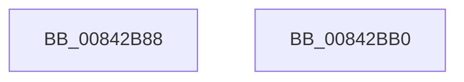

# LockRMLog

- RVA: `0x00842B88`–`0x00842BB1` (길이 `41` bytes)
- VA: `0x0000000140842B88`
- 실행 섹션: `PAGE`
- PDB 이름 있음: `예`; PDB Function 태그: `아니요`
- unwind 정보 RVA: `0x0005C788`
- 디코드: `10`개 명령, `41/41` bytes 표시
- 미해석 바이트: `0` (있으면 어셈블리에 `.byte`로 보존)

> 이 문서는 커널 이미지의 기계어와 PDB 기호를 분석해 생성했습니다. 4번과 5번은 함수 원형과 자료형을 바이너리 사용 방식에서 추정한 C 해석이며 원본 소스 복구 결과는 아닙니다.

## 1. Dependencies

- 직접 호출 지점: **1**; 고유 호출 대상: **1**
- 직접 호출자로 확인된 함수: **5**
- RIP 상대 이미지 참조: **0**

### Outgoing calls
- `0x00842BA6` → [ExAcquireResourceExclusiveLite](../../text/21/ExAcquireResourceExclusiveLite_function_00214E20.md) (function, `0x00214E20`)

### Direct callers
- [CmpStartRMLog](../7F/CmpStartRMLog_function_007F0AFC.md) at `0x007F0B5D`
- [CmpStopRMLog](CmpStopRMLog_function_008427AC.md) at `0x008427BD`
- [CmpAccountForLogReservation](CmpAccountForLogReservation_function_00842850.md) at `0x0084286E`
- [CmpCleanupTransactionState](CmpCleanupTransactionState_function_008428E0.md) at `0x008429A5`
- [CmpTransWriteLog](CmpTransWriteLog_function_00842A7C.md) at `0x00842ABC`

### Static image references
- 디코드된 RIP-relative 메모리 참조가 없습니다.

## 2. Other-region calls and transfers

- 다른 실행 섹션으로 향하는 call: **1**
  - `0x00842BA6` → [ExAcquireResourceExclusiveLite](../../text/21/ExAcquireResourceExclusiveLite_function_00214E20.md) (`PAGE` → `.text`)
- 별도 외부 분기/꼬리 이동을 확인하지 못했습니다.

## 3. Assembly (complete function range)

```asm
00842B88  48 83 EC 28                     sub rsp, 0x28
00842B8C  65 48 8B 04 25 88 01 00 00      mov rax, qword ptr gs:[0x188]
00842B95  B2 01                           mov dl, 1
00842B97  66 FF 88 E4 01 00 00            dec word ptr [rax + 0x1e4]
00842B9E  90                              nop
00842B9F  48 8B 89 80 00 00 00            mov rcx, qword ptr [rcx + 0x80]
00842BA6  E8 75 22 9D FF                  call 0x140214e20
00842BAB  48 83 C4 28                     add rsp, 0x28
00842BAF  C3                              ret
00842BB0  CC                              int3
```

## 4. C-style interpretation (structured pseudocode)

```c
__int64 __fastcall LockRMLog(__int64 a1)
{
    __int64 result;
    __int64 v_rsp;

    v_rsp = (v_rsp) - (40);
    result = ExAcquireResourceExclusiveLite(*(unsigned __int64 *)(a1 + 128), 1, a3, a4);
    v_rsp = (v_rsp) + (40);
    return result;
}
```

## 5. (Beta) C Style

```c
int64_t LockRMLog(void *Arg1)
{
    uint8_t *arg1 = (uint8_t *)Arg1;

    int64_t result;
    int64_t local_rsp;

    local_rsp = (local_rsp) - (40);
    result = ExAcquireResourceExclusiveLite(*(uint64_t *)(arg1 + 0x80), 1, a3, a4);
    local_rsp = (local_rsp) + (40);
    return result;
}
```

### 관측된 메모리 오프셋

구조체 형식이 확인되지 않은 접근은 인자 기준의 오프셋으로만 기록했습니다.

| 기준 인자 | 오프셋 표현 | 폭 (bit) | 접근 |
|---|---:|---:|---|
| `Arg1` | `+ 0x80` | `64` | `R` |

## 6. Execution-region graph

[열기: 2D/3D 그래프와 함수 탐색 컨트롤 패널](../../../control-panel.html?section=page&rva=0x00842B88&view=graph)

- 2D 그래프는 위에서 아래로 흐르고, 3D 그래프는 빈 공간을 드래그해 회전합니다. Shift+드래그는 이동, 휠은 확대·축소, 함수 노드 선택은 대상 보고서 이동입니다.

### Static fallback


