# NtDeleteKey

- RVA: `0x00849920`–`0x00849D6D` (길이 `1,101` bytes)
- VA: `0x0000000140849920`
- 실행 섹션: `PAGE`
- PDB 이름 있음: `예`; PDB Function 태그: `예`
- unwind 정보 RVA: `0x00069438`
- 디코드: `276`개 명령, `1,101/1,101` bytes 표시
- 미해석 바이트: `0` (있으면 어셈블리에 `.byte`로 보존)

> 이 문서는 커널 이미지의 기계어와 PDB 기호를 분석해 생성했습니다. 4번과 5번은 함수 원형과 자료형을 바이너리 사용 방식에서 추정한 C 해석이며 원본 소스 복구 결과는 아닙니다.

## 1. Dependencies

- 직접 호출 지점: **23**; 고유 호출 대상: **20**
- 직접 호출자로 확인된 함수: **0**
- RIP 상대 이미지 참조: **6**

### Outgoing calls
- `0x0084999D` → [EtwGetKernelTraceTimestamp](../../text/39/EtwGetKernelTraceTimestamp_function_0039FC50.md) (function, `0x0039FC50`)
- `0x008499A6` → [CmpInitializeThreadInfo](../../text/3F/CmpInitializeThreadInfo_function_003FBE70.md) (function, `0x003FBE70`)
- `0x008499E5` → [CmpAcquireShutdownRundown](../../pagecmrc/BC/CmpAcquireShutdownRundown_function_00BC9400.md) (function, `0x00BC9400`)
- `0x00849A18` → [CmObReferenceObjectByHandle](../../pagecmrc/BC/CmObReferenceObjectByHandle_function_00BC9350.md) (function, `0x00BC9350`)
- `0x00849A59` → [CmpIsRegistryLockAcquired](../../text/45/CmpIsRegistryLockAcquired_function_00456A7C.md) (function, `0x00456A7C`)
- `0x00849A89` → [CmpCallCallBacksEx](../86/CmpCallCallBacksEx_function_00865F40.md) (function, `0x00865F40`)
- `0x00849AB6` → [KeAbPreAcquire](../../text/21/KeAbPreAcquire_function_00210230.md) (function, `0x00210230`)
- `0x00849ADA` → [ExfAcquirePushLockSharedEx](../../text/21/ExfAcquirePushLockSharedEx_function_0021044C.md) (function, `0x0021044C`)
- `0x00849B3E` → [KeAbPostRelease](../../text/2E/KeAbPostRelease_function_002E1600.md) (function, `0x002E1600`)
- `0x00849B7A` → [CmDeleteKey](CmDeleteKey_function_00848E5C.md) (function, `0x00848E5C`)
- `0x00849BA7` → [CmpIsRegistryLockAcquired](../../text/45/CmpIsRegistryLockAcquired_function_00456A7C.md) (function, `0x00456A7C`)
- `0x00849C07` → [CmpCallCallBacksEx](../86/CmpCallCallBacksEx_function_00865F40.md) (function, `0x00865F40`)
- `0x00849C14` → [KeLeaveCriticalRegion](../../text/25/KeLeaveCriticalRegion_function_0025D8B0.md) (function, `0x0025D8B0`)
- `0x00849C21` → [ObfDereferenceObject](../../text/2F/ObfDereferenceObject_function_002F9350.md) (function, `0x002F9350`)
- `0x00849C41` → [CmpReleaseShutdownRundown](../../pagecmrc/BC/CmpReleaseShutdownRundown_function_00BC9880.md) (function, `0x00BC9880`)
- `0x00849C4A` → [CmCleanupThreadInfo](../../text/41/CmCleanupThreadInfo_function_0041FD50.md) (function, `0x0041FD50`)
- `0x00849C58` → [_security_check_cookie](../../text/6A/_security_check_cookie_function_006AC640.md) (function, `0x006AC640`)
- `0x00849C9F` → [guard_dispatch_icall](../../text/6B/guard_dispatch_icall_function_006BAAD0.md) (function, `0x006BAAD0`)
- `0x00849CED` → [ExfReleasePushLockShared](../../text/26/ExfReleasePushLockShared_function_00263440.md) (function, `0x00263440`)
- `0x00849CFB` → [SeCaptureSubjectContext](../86/SeCaptureSubjectContext_function_0086B820.md) (function, `0x0086B820`)
- `0x00849D09` → [CmDoVirtualTest](../../text/4A/CmDoVirtualTest_function_004AB560.md) (function, `0x004AB560`)
- `0x00849D38` → [ExfReleasePushLockShared](../../text/26/ExfReleasePushLockShared_function_00263440.md) (function, `0x00263440`)
- `0x00849D63` → [SeReleaseSubjectContext](../86/SeReleaseSubjectContext_function_0086B710.md) (function, `0x0086B710`)

### Direct callers
- 이 함수 시작 RVA로 연결되는 직접 call은 확인되지 않았습니다. 간접 호출은 완전히 역산할 수 없습니다.

### Static image references
- `0x00849943` → RVA `0x00E0A740` (`.data`; read)
- `0x0084995D` → RVA `0x00FD8008` (`PAGEDATA`; read)
- `0x00849A50` → RVA `0x00EEFB88` (`.data`; read)
- `0x00849AA7` → RVA `0x00EFEE30` (`.data`; read)
- `0x00849AEE` → RVA `0x00EFEE20` (`.data`; read)
- `0x00849B0F` → RVA `0x00EFEE28` (`.data`; read)

## 2. Other-region calls and transfers

- 다른 실행 섹션으로 향하는 call: **18**
  - `0x0084999D` → [EtwGetKernelTraceTimestamp](../../text/39/EtwGetKernelTraceTimestamp_function_0039FC50.md) (`PAGE` → `.text`)
  - `0x008499A6` → [CmpInitializeThreadInfo](../../text/3F/CmpInitializeThreadInfo_function_003FBE70.md) (`PAGE` → `.text`)
  - `0x008499E5` → [CmpAcquireShutdownRundown](../../pagecmrc/BC/CmpAcquireShutdownRundown_function_00BC9400.md) (`PAGE` → `PAGECMRC`)
  - `0x00849A18` → [CmObReferenceObjectByHandle](../../pagecmrc/BC/CmObReferenceObjectByHandle_function_00BC9350.md) (`PAGE` → `PAGECMRC`)
  - `0x00849A59` → [CmpIsRegistryLockAcquired](../../text/45/CmpIsRegistryLockAcquired_function_00456A7C.md) (`PAGE` → `.text`)
  - `0x00849AB6` → [KeAbPreAcquire](../../text/21/KeAbPreAcquire_function_00210230.md) (`PAGE` → `.text`)
  - `0x00849ADA` → [ExfAcquirePushLockSharedEx](../../text/21/ExfAcquirePushLockSharedEx_function_0021044C.md) (`PAGE` → `.text`)
  - `0x00849B3E` → [KeAbPostRelease](../../text/2E/KeAbPostRelease_function_002E1600.md) (`PAGE` → `.text`)
  - `0x00849BA7` → [CmpIsRegistryLockAcquired](../../text/45/CmpIsRegistryLockAcquired_function_00456A7C.md) (`PAGE` → `.text`)
  - `0x00849C14` → [KeLeaveCriticalRegion](../../text/25/KeLeaveCriticalRegion_function_0025D8B0.md) (`PAGE` → `.text`)
  - `0x00849C21` → [ObfDereferenceObject](../../text/2F/ObfDereferenceObject_function_002F9350.md) (`PAGE` → `.text`)
  - `0x00849C41` → [CmpReleaseShutdownRundown](../../pagecmrc/BC/CmpReleaseShutdownRundown_function_00BC9880.md) (`PAGE` → `PAGECMRC`)
  - `0x00849C4A` → [CmCleanupThreadInfo](../../text/41/CmCleanupThreadInfo_function_0041FD50.md) (`PAGE` → `.text`)
  - `0x00849C58` → [_security_check_cookie](../../text/6A/_security_check_cookie_function_006AC640.md) (`PAGE` → `.text`)
  - `0x00849C9F` → [guard_dispatch_icall](../../text/6B/guard_dispatch_icall_function_006BAAD0.md) (`PAGE` → `.text`)
  - `0x00849CED` → [ExfReleasePushLockShared](../../text/26/ExfReleasePushLockShared_function_00263440.md) (`PAGE` → `.text`)
  - `0x00849D09` → [CmDoVirtualTest](../../text/4A/CmDoVirtualTest_function_004AB560.md) (`PAGE` → `.text`)
  - `0x00849D38` → [ExfReleasePushLockShared](../../text/26/ExfReleasePushLockShared_function_00263440.md) (`PAGE` → `.text`)
- call이 아닌 외부 분기/꼬리 이동: **8**
  - `0x00849B6E` → [sub_00B1664A + 0x63](../B1/Unknown_function_00B1664A.md) (`tail-transfer`)
  - `0x00849D10` → [sub_00B1664A + 0xA](../B1/Unknown_function_00B1664A.md) (`tail-transfer`)
  - `0x00849D1B` → [sub_00B1664A](../B1/Unknown_function_00B1664A.md) (`tail-transfer`)
  - `0x00849D2F` → [sub_00B1664A + 0x51](../B1/Unknown_function_00B1664A.md) (`tail-transfer`)
  - `0x00849D3E` → [sub_00B1664A + 0x51](../B1/Unknown_function_00B1664A.md) (`tail-transfer`)
  - `0x00849D47` → [sub_00B1664A + 0xEE](../B1/Unknown_function_00B1664A.md) (`tail-transfer`)
  - `0x00849D51` → [sub_00B1664A + 0xEE](../B1/Unknown_function_00B1664A.md) (`tail-transfer`)
  - `0x00849D5A` → [sub_00B1664A + 0xDD](../B1/Unknown_function_00B1664A.md) (`tail-transfer`)

## 3. Assembly (complete function range)

```asm
00849920  48 8B C4                        mov rax, rsp
00849923  48 89 58 10                     mov qword ptr [rax + 0x10], rbx
00849927  48 89 70 18                     mov qword ptr [rax + 0x18], rsi
0084992B  48 89 78 20                     mov qword ptr [rax + 0x20], rdi
0084992F  55                              push rbp
00849930  41 54                           push r12
00849932  41 55                           push r13
00849934  41 56                           push r14
00849936  41 57                           push r15
00849938  48 8D 68 88                     lea rbp, [rax - 0x78]
0084993C  48 81 EC 50 01 00 00            sub rsp, 0x150
00849943  48 8B 05 F6 0D 5C 00            mov rax, qword ptr [rip + 0x5c0df6]
0084994A  48 33 C4                        xor rax, rsp
0084994D  48 89 45 48                     mov qword ptr [rbp + 0x48], rax
00849951  33 DB                           xor ebx, ebx
00849953  0F 57 C0                        xorps xmm0, xmm0
00849956  33 C0                           xor eax, eax
00849958  48 89 5C 24 58                  mov qword ptr [rsp + 0x58], rbx
0084995D  48 39 1D A4 E6 78 00            cmp qword ptr [rip + 0x78e6a4], rbx
00849964  0F 57 C9                        xorps xmm1, xmm1
00849967  4C 8B F1                        mov r14, rcx
0084996A  48 89 45 F0                     mov qword ptr [rbp - 0x10], rax
0084996E  0F 11 45 E0                     movups xmmword ptr [rbp - 0x20], xmm0
00849972  89 5C 24 50                     mov dword ptr [rsp + 0x50], ebx
00849976  8B F3                           mov esi, ebx
00849978  0F 11 45 F8                     movups xmmword ptr [rbp - 8], xmm0
0084997C  48 89 5C 24 78                  mov qword ptr [rsp + 0x78], rbx
00849981  0F 11 45 08                     movups xmmword ptr [rbp + 8], xmm0
00849985  48 89 5C 24 60                  mov qword ptr [rsp + 0x60], rbx
0084998A  0F 11 4D 28                     movups xmmword ptr [rbp + 0x28], xmm1
0084998E  0F 11 4D 38                     movups xmmword ptr [rbp + 0x38], xmm1
00849992  74 0E                           je 0x1408499a2
00849994  BA 00 00 02 00                  mov edx, 0x20000
00849999  48 8D 4D 28                     lea rcx, [rbp + 0x28]
0084999D  E8 AE 62 B5 FF                  call 0x14039fc50
008499A2  48 8D 4D E0                     lea rcx, [rbp - 0x20]
008499A6  E8 C5 24 BB FF                  call 0x1403fbe70
008499AB  0F 57 C0                        xorps xmm0, xmm0
008499AE  48 89 5C 24 48                  mov qword ptr [rsp + 0x48], rbx
008499B3  48 8D 44 24 68                  lea rax, [rsp + 0x68]
008499B8  44 8A E3                        mov r12b, bl
008499BB  48 89 44 24 70                  mov qword ptr [rsp + 0x70], rax
008499C0  44 8A EB                        mov r13b, bl
008499C3  48 8D 44 24 68                  lea rax, [rsp + 0x68]
008499C8  48 89 44 24 68                  mov qword ptr [rsp + 0x68], rax
008499CD  65 48 8B 04 25 88 01 00 00      mov rax, qword ptr gs:[0x188]
008499D6  0F 11 45 88                     movups xmmword ptr [rbp - 0x78], xmm0
008499DA  0F 11 45 98                     movups xmmword ptr [rbp - 0x68], xmm0
008499DE  44 8A B8 32 02 00 00            mov r15b, byte ptr [rax + 0x232]
008499E5  E8 16 FA 37 00                  call 0x140bc9400
008499EA  88 44 24 40                     mov byte ptr [rsp + 0x40], al
008499EE  40 8A F8                        mov dil, al
008499F1  84 C0                           test al, al
008499F3  0F 84 E4 02 00 00               je 0x140849cdd
008499F9  48 8D 44 24 58                  lea rax, [rsp + 0x58]
008499FE  45 8A CF                        mov r9b, r15b
00849A01  48 89 44 24 28                  mov qword ptr [rsp + 0x28], rax
00849A06  BA 00 00 01 00                  mov edx, 0x10000
00849A0B  48 8D 44 24 48                  lea rax, [rsp + 0x48]
00849A10  49 8B CE                        mov rcx, r14
00849A13  48 89 44 24 20                  mov qword ptr [rsp + 0x20], rax
00849A18  E8 33 F9 37 00                  call 0x140bc9350
00849A1D  BE 22 00 00 C0                  mov esi, 0xc0000022
00849A22  8B D8                           mov ebx, eax
00849A24  3B C6                           cmp eax, esi
00849A26  0F 84 CB 02 00 00               je 0x140849cf7
00849A2C  40 32 F6                        xor sil, sil
00849A2F  85 C0                           test eax, eax
00849A31  0F 88 48 02 00 00               js 0x140849c7f
00849A37  65 48 8B 04 25 88 01 00 00      mov rax, qword ptr gs:[0x188]
00849A40  41 B5 01                        mov r13b, 1
00849A43  48 8B 7C 24 48                  mov rdi, qword ptr [rsp + 0x48]
00849A48  66 FF 88 E4 01 00 00            dec word ptr [rax + 0x1e4]
00849A4F  90                              nop
00849A50  83 3D 31 61 6A 00 00            cmp dword ptr [rip + 0x6a6131], 0
00849A57  74 40                           je 0x140849a99
00849A59  E8 1E D0 C0 FF                  call 0x140456a7c
00849A5E  85 C0                           test eax, eax
00849A60  75 37                           jne 0x140849a99
00849A62  48 8D 44 24 68                  lea rax, [rsp + 0x68]
00849A67  48 89 7D F8                     mov qword ptr [rbp - 8], rdi
00849A6B  48 89 44 24 30                  mov qword ptr [rsp + 0x30], rax
00849A70  48 8D 55 F8                     lea rdx, [rbp - 8]
00849A74  48 89 7C 24 28                  mov qword ptr [rsp + 0x28], rdi
00849A79  45 8A CD                        mov r9b, r13b
00849A7C  45 33 C0                        xor r8d, r8d
00849A7F  C7 44 24 20 0F 00 00 00         mov dword ptr [rsp + 0x20], 0xf
00849A87  33 C9                           xor ecx, ecx
00849A89  E8 B2 C4 01 00                  call 0x140865f40
00849A8E  85 C0                           test eax, eax
00849A90  0F 88 34 02 00 00               js 0x140849cca
00849A96  45 8A E5                        mov r12b, r13b
00849A99  48 83 3D 67 E5 78 00 00         cmp qword ptr [rip + 0x78e567], 0
00849AA1  0F 85 FF 01 00 00               jne 0x140849ca6
00849AA7  48 8D 3D 82 53 6B 00            lea rdi, [rip + 0x6b5382]
00849AAE  45 33 C0                        xor r8d, r8d
00849AB1  48 8B CF                        mov rcx, rdi
00849AB4  33 D2                           xor edx, edx
00849AB6  E8 75 67 9C FF                  call 0x140210230
00849ABB  48 8B D8                        mov rbx, rax
00849ABE  33 C0                           xor eax, eax
00849AC0  44 8D 40 11                     lea r8d, [rax + 0x11]
00849AC4  F0 4C 0F B1 05 63 53 6B 00      lock cmpxchg qword ptr [rip + 0x6b5363], r8
00849ACD  74 16                           je 0x140849ae5
00849ACF  4C 8B CF                        mov r9, rdi
00849AD2  4C 8B C3                        mov r8, rbx
00849AD5  33 D2                           xor edx, edx
00849AD7  48 8B CF                        mov rcx, rdi
00849ADA  E8 6D 69 9C FF                  call 0x14021044c
00849ADF  41 B8 11 00 00 00               mov r8d, 0x11
00849AE5  48 85 DB                        test rbx, rbx
00849AE8  74 04                           je 0x140849aee
00849AEA  44 88 6B 0A                     mov byte ptr [rbx + 0xa], r13b
00849AEE  48 8B 05 2B 53 6B 00            mov rax, qword ptr [rip + 0x6b532b]
00849AF5  33 DB                           xor ebx, ebx
00849AF7  48 8B 54 24 48                  mov rdx, qword ptr [rsp + 0x48]
00849AFC  48 85 C0                        test rax, rax
00849AFF  74 0E                           je 0x140849b0f
00849B01  48 8B 40 08                     mov rax, qword ptr [rax + 8]
00849B05  48 39 42 08                     cmp qword ptr [rdx + 8], rax
00849B09  0F 84 11 02 00 00               je 0x140849d20
00849B0F  48 8B 0D 12 53 6B 00            mov rcx, qword ptr [rip + 0x6b5312]
00849B16  48 85 C9                        test rcx, rcx
00849B19  74 0E                           je 0x140849b29
00849B1B  48 8B 49 08                     mov rcx, qword ptr [rcx + 8]
00849B1F  48 39 4A 08                     cmp qword ptr [rdx + 8], rcx
00849B23  0F 84 F7 01 00 00               je 0x140849d20
00849B29  49 8B C0                        mov rax, r8
00849B2C  F0 48 0F B1 1D FB 52 6B 00      lock cmpxchg qword ptr [rip + 0x6b52fb], rbx
00849B35  0F 85 AF 01 00 00               jne 0x140849cea
00849B3B  48 8B CF                        mov rcx, rdi
00849B3E  E8 BD 7A A9 FF                  call 0x1402e1600
00849B43  48 8B 7C 24 48                  mov rdi, qword ptr [rsp + 0x48]
00849B48  48 8B 4F 08                     mov rcx, qword ptr [rdi + 8]
00849B4C  8B 41 08                        mov eax, dword ptr [rcx + 8]
00849B4F  84 C0                           test al, al
00849B51  0F 88 66 01 00 00               js 0x140849cbd
00849B57  48 8B 41 48                     mov rax, qword ptr [rcx + 0x48]
00849B5B  48 85 C0                        test rax, rax
00849B5E  74 0B                           je 0x140849b6b
00849B60  8B 40 08                        mov eax, dword ptr [rax + 8]
00849B63  84 C0                           test al, al
00849B65  0F 88 52 01 00 00               js 0x140849cbd
00849B6B  40 84 F6                        test sil, sil
00849B6E  0F 85 39 CB 2C 00               jne 0x140b166ad
00849B74  45 33 FF                        xor r15d, r15d
00849B77  48 8B CF                        mov rcx, rdi
00849B7A  E8 DD F2 FF FF                  call 0x140848e5c
00849B7F  8B D8                           mov ebx, eax
00849B81  85 C0                           test eax, eax
00849B83  78 0B                           js 0x140849b90
00849B85  F6 44 24 58 04                  test byte ptr [rsp + 0x58], 4
00849B8A  0F 85 B3 01 00 00               jne 0x140849d43
00849B90  40 84 F6                        test sil, sil
00849B93  0F 85 C6 01 00 00               jne 0x140849d5f
00849B99  45 84 E4                        test r12b, r12b
00849B9C  74 71                           je 0x140849c0f
00849B9E  44 39 3D E3 5F 6A 00            cmp dword ptr [rip + 0x6a5fe3], r15d
00849BA5  74 68                           je 0x140849c0f
00849BA7  E8 D0 CE C0 FF                  call 0x140456a7c
00849BAC  85 C0                           test eax, eax
00849BAE  75 5F                           jne 0x140849c0f
00849BB0  48 8D 44 24 68                  lea rax, [rsp + 0x68]
00849BB5  48 39 44 24 68                  cmp qword ptr [rsp + 0x68], rax
00849BBA  74 53                           je 0x140849c0f
00849BBC  33 C0                           xor eax, eax
00849BBE  48 8D 55 A8                     lea rdx, [rbp - 0x58]
00849BC2  48 89 45 D8                     mov qword ptr [rbp - 0x28], rax
00849BC6  0F 57 C0                        xorps xmm0, xmm0
00849BC9  0F 11 45 B8                     movups xmmword ptr [rbp - 0x48], xmm0
00849BCD  48 8D 45 F8                     lea rax, [rbp - 8]
00849BD1  45 33 C9                        xor r9d, r9d
00849BD4  48 89 45 B8                     mov qword ptr [rbp - 0x48], rax
00849BD8  45 33 C0                        xor r8d, r8d
00849BDB  48 8D 44 24 68                  lea rax, [rsp + 0x68]
00849BE0  89 5D C0                        mov dword ptr [rbp - 0x40], ebx
00849BE3  48 89 44 24 30                  mov qword ptr [rsp + 0x30], rax
00849BE8  B8 0F 00 00 00                  mov eax, 0xf
00849BED  0F 11 45 A8                     movups xmmword ptr [rbp - 0x58], xmm0
00849BF1  8B C8                           mov ecx, eax
00849BF3  48 89 7C 24 28                  mov qword ptr [rsp + 0x28], rdi
00849BF8  0F 11 45 C8                     movups xmmword ptr [rbp - 0x38], xmm0
00849BFC  48 89 7D A8                     mov qword ptr [rbp - 0x58], rdi
00849C00  89 5D B0                        mov dword ptr [rbp - 0x50], ebx
00849C03  89 44 24 20                     mov dword ptr [rsp + 0x20], eax
00849C07  E8 34 C3 01 00                  call 0x140865f40
00849C0C  8B 5D C0                        mov ebx, dword ptr [rbp - 0x40]
00849C0F  45 84 ED                        test r13b, r13b
00849C12  74 05                           je 0x140849c19
00849C14  E8 97 3C A1 FF                  call 0x14025d8b0
00849C19  48 85 FF                        test rdi, rdi
00849C1C  74 08                           je 0x140849c26
00849C1E  48 8B CF                        mov rcx, rdi
00849C21  E8 2A F7 AA FF                  call 0x1402f9350
00849C26  48 8B 74 24 60                  mov rsi, qword ptr [rsp + 0x60]
00849C2B  40 8A 7C 24 40                  mov dil, byte ptr [rsp + 0x40]
00849C30  48 8B 05 D1 E3 78 00            mov rax, qword ptr [rip + 0x78e3d1]
00849C37  48 85 C0                        test rax, rax
00849C3A  75 4D                           jne 0x140849c89
00849C3C  40 84 FF                        test dil, dil
00849C3F  74 05                           je 0x140849c46
00849C41  E8 3A FC 37 00                  call 0x140bc9880
00849C46  48 8D 4D E0                     lea rcx, [rbp - 0x20]
00849C4A  E8 01 61 BD FF                  call 0x14041fd50
00849C4F  8B C3                           mov eax, ebx
00849C51  48 8B 4D 48                     mov rcx, qword ptr [rbp + 0x48]
00849C55  48 33 CC                        xor rcx, rsp
00849C58  E8 E3 29 E6 FF                  call 0x1406ac640
00849C5D  4C 8D 9C 24 50 01 00 00         lea r11, [rsp + 0x150]
00849C65  49 8B 5B 38                     mov rbx, qword ptr [r11 + 0x38]
00849C69  49 8B 73 40                     mov rsi, qword ptr [r11 + 0x40]
00849C6D  49 8B 7B 48                     mov rdi, qword ptr [r11 + 0x48]
00849C71  49 8B E3                        mov rsp, r11
00849C74  41 5F                           pop r15
00849C76  41 5E                           pop r14
00849C78  41 5D                           pop r13
00849C7A  41 5C                           pop r12
00849C7C  5D                              pop rbp
00849C7D  C3                              ret
00849C7E  CC                              int3
00849C7F  48 8B 7C 24 48                  mov rdi, qword ptr [rsp + 0x48]
00849C84  45 33 FF                        xor r15d, r15d
00849C87  EB 90                           jmp 0x140849c19
00849C89  4C 89 7C 24 28                  mov qword ptr [rsp + 0x28], r15
00849C8E  48 8D 55 28                     lea rdx, [rbp + 0x28]
00849C92  45 33 C9                        xor r9d, r9d
00849C95  48 89 74 24 20                  mov qword ptr [rsp + 0x20], rsi
00849C9A  44 8B C3                        mov r8d, ebx
00849C9D  B1 0C                           mov cl, 0xc
00849C9F  E8 2C 0E E7 FF                  call 0x1406baad0
00849CA4  EB 96                           jmp 0x140849c3c
00849CA6  48 85 FF                        test rdi, rdi
00849CA9  0F 84 F8 FD FF FF               je 0x140849aa7
00849CAF  48 8B 47 08                     mov rax, qword ptr [rdi + 8]
00849CB3  48 89 44 24 60                  mov qword ptr [rsp + 0x60], rax
00849CB8  E9 EA FD FF FF                  jmp 0x140849aa7
00849CBD  BB 22 00 00 C0                  mov ebx, 0xc0000022
00849CC2  45 33 FF                        xor r15d, r15d
00849CC5  E9 C6 FE FF FF                  jmp 0x140849b90
00849CCA  45 33 FF                        xor r15d, r15d
00849CCD  3D 03 05 00 C0                  cmp eax, 0xc0000503
00849CD2  41 8B DF                        mov ebx, r15d
00849CD5  0F 45 D8                        cmovne ebx, eax
00849CD8  E9 B3 FE FF FF                  jmp 0x140849b90
00849CDD  BB 89 01 00 C0                  mov ebx, 0xc0000189
00849CE2  45 33 FF                        xor r15d, r15d
00849CE5  E9 46 FF FF FF                  jmp 0x140849c30
00849CEA  48 8B CF                        mov rcx, rdi
00849CED  E8 4E 97 A1 FF                  call 0x140263440
00849CF2  E9 44 FE FF FF                  jmp 0x140849b3b
00849CF7  48 8D 4D 88                     lea rcx, [rbp - 0x78]
00849CFB  E8 20 1B 02 00                  call 0x14086b820
00849D00  48 8D 54 24 50                  lea rdx, [rsp + 0x50]
00849D05  48 8D 4D 88                     lea rcx, [rbp - 0x78]
00849D09  E8 52 18 C6 FF                  call 0x1404ab560
00849D0E  84 C0                           test al, al
00849D10  0F 85 3E C9 2C 00               jne 0x140b16654
00849D16  48 8B 7C 24 48                  mov rdi, qword ptr [rsp + 0x48]
00849D1B  E9 2A C9 2C 00                  jmp 0x140b1664a
00849D20  45 33 FF                        xor r15d, r15d
00849D23  49 8B C0                        mov rax, r8
00849D26  F0 4C 0F B1 3D 01 51 6B 00      lock cmpxchg qword ptr [rip + 0x6b5101], r15
00849D2F  0F 84 66 C9 2C 00               je 0x140b1669b
00849D35  48 8B CF                        mov rcx, rdi
00849D38  E8 03 97 A1 FF                  call 0x140263440
00849D3D  90                              nop
00849D3E  E9 58 C9 2C 00                  jmp 0x140b1669b
00849D43  4C 39 7F 38                     cmp qword ptr [rdi + 0x38], r15
00849D47  0F 85 EB C9 2C 00               jne 0x140b16738
00849D4D  4C 39 7F 40                     cmp qword ptr [rdi + 0x40], r15
00849D51  0F 85 E1 C9 2C 00               jne 0x140b16738
00849D57  45 33 C0                        xor r8d, r8d
00849D5A  E9 C8 C9 2C 00                  jmp 0x140b16727
00849D5F  48 8D 4D 88                     lea rcx, [rbp - 0x78]
00849D63  E8 A8 19 02 00                  call 0x14086b710
00849D68  E9 2C FE FF FF                  jmp 0x140849b99
```

## 4. C-style interpretation (structured pseudocode)

```c
__int64 __fastcall NtDeleteKey(__int64 a1, __int64 a2, int a3)
{
    __int64 result;
    __int64 v_r15;
    __int64 v_rbx;
    __int64 v_rsi;
    __int64 v_rsp;
    unsigned __int64 v_stack_m100;
    unsigned __int64 v_stack_m108;
    unsigned __int64 v_stack_m110;
    unsigned __int64 v_stack_m118;
    unsigned __int64 v_stack_m120;
    unsigned int v_stack_m128;
    unsigned __int64 v_stack_m130;
    unsigned __int8 v_stack_m138;
    unsigned __int64 v_stack_m148;
    unsigned __int64 v_stack_m150;
    unsigned __int64 v_stack_m158;
    unsigned __int64 v_stack_m28;
    unsigned __int64 v_stack_mF0;

    *(unsigned __int64 *)(v_rsp + 16) = v_rbx;
    *(unsigned __int64 *)(v_rsp + 24) = v_rsi;
    *(unsigned __int64 *)(v_rsp + 32) = v_rdi;
    v_rsp = (v_rsp) - (336);
    result = (*(unsigned __int64 *)(v_rip + 6032886)) ^ (v_rsp);
    *(unsigned __int64 *)(v_rsp - 120 + 72) = result;
    v_rbx = 0;
    result = 0;
    v_stack_m120 = 0;
    *(unsigned __int64 *)(v_rsp - 120 - 16) = 0;
    *(unsigned __int64 *)(v_rsp - 120 - 32) = v_xmm0;
    v_stack_m128 = 0;
    *(unsigned __int64 *)(v_rsp - 120 - 8) = v_xmm0;
    v_stack_m100 = 0;
    *(unsigned __int64 *)(v_rsp - 120 + 8) = v_xmm0;
    v_stack_m118 = 0;
    *(unsigned __int64 *)(v_rsp - 120 + 40) = v_xmm1;
    *(unsigned __int64 *)(v_rsp - 120 + 56) = v_xmm1;
    if ((*(unsigned __int64 *)(v_rip + 7923364)) != 0) {
        a2 = 0x20000ULL;
        a1 = v_rsp - 120 + 40;
        result = EtwGetKernelTraceTimestamp(a1, a2, a3, a4);
    }
    result = CmpInitializeThreadInfo(v_rsp - 120 - 32, a2, a3, a4);
    v_stack_m130 = 0;
    v_stack_m108 = v_stack_m110;
    v_stack_m110 = v_stack_m110;
    *(unsigned __int64 *)(v_rsp - 120 - 120) = v_xmm0;
    *(unsigned __int64 *)(v_rsp - 120 - 104) = v_xmm0;
    result = CmpAcquireShutdownRundown(v_rsp - 120 - 32, a2, a3, a4);
    v_stack_m138 = (unsigned __int8)(result);
    if ((unsigned __int8)(result) == 0) goto loc_00849CDD;
    v_stack_m150 = v_stack_m120;
    v_stack_m158 = v_stack_m130;
    result = CmObReferenceObjectByHandle(a1, (unsigned int)(0x10000ULL), a3, (unsigned __int8)(*(unsigned __int8 *)(*(unsigned __int64 *)(gs_base + (0 + 392)) + 562)));
    if (((unsigned int)(result)) == ((unsigned int)((unsigned int)(0xC0000022ULL)))) goto loc_00849CF7;
    v_rsi = 0;
    if (sign_flag) goto loc_00849C7F;
    if ((*(unsigned int *)(v_rip + 6971697)) == 0) goto loc_00849A99;
    result = CmpIsRegistryLockAcquired(a1, (unsigned int)(0x10000ULL), a3, (unsigned __int8)(*(unsigned __int8 *)(*(unsigned __int64 *)(gs_base + (0 + 392)) + 562)));
    if ((unsigned int)(result) != 0) goto loc_00849A99;
    *(unsigned __int64 *)(v_rsp - 120 - 8) = v_stack_m130;
    v_stack_m148 = v_stack_m110;
    v_stack_m150 = v_stack_m130;
    a3 = 0;
    v_stack_m158 = 15;
    a1 = 0;
    result = CmpCallCallBacksEx(a1, v_rsp - 120 - 8, a3, 1);
    if (sign_flag) goto loc_00849CCA;
loc_00849A99:
    if ((*(unsigned __int64 *)(v_rip + 7923047)) != 0) goto loc_00849CA6;
loc_00849AA7:
    a3 = 0;
    a2 = 0;
    result = KeAbPreAcquire(v_rip + 7033730, a2, a3, 1);
    result = 0;
    if (!(condition_is_equal)) {
        a4 = v_rip + 7033730;
        a3 = 0;
        a2 = 0;
        a1 = v_rip + 7033730;
        result = ExfAcquirePushLockSharedEx(a1, a2, a3, a4);
        a3 = 17;
    }
    if (result != 0) {
        *(unsigned __int8 *)(result + 10) = 1;
    }
    v_rbx = 0;
    if (*(unsigned __int64 *)(v_rip + 7033643) == 0) goto loc_00849B0F;
    if ((*(unsigned __int64 *)(v_stack_m130 + 8)) == (*(unsigned __int64 *)(*(unsigned __int64 *)(v_rip + 7033643) + 8))) goto loc_00849D20;
loc_00849B0F:
    if (*(unsigned __int64 *)(v_rip + 7033618) == 0) goto loc_00849B29;
    if ((*(unsigned __int64 *)(v_stack_m130 + 8)) == (*(unsigned __int64 *)(*(unsigned __int64 *)(v_rip + 7033618) + 8))) goto loc_00849D20;
loc_00849B29:
    if ((*(unsigned __int64 *)(v_stack_m130 + 8)) != (*(unsigned __int64 *)(*(unsigned __int64 *)(v_rip + 7033618) + 8))) goto loc_00849CEA;
loc_00849B3B:
    result = KeAbPostRelease(v_rip + 7033730, v_stack_m130, a3, a4);
    if (sign_flag) goto loc_00849CBD;
    if (*(unsigned __int64 *)(*(unsigned __int64 *)(v_stack_m130 + 8) + 72) == 0) goto loc_00849B6B;
    if (sign_flag) goto loc_00849CBD;
loc_00849B6B:
    v_r15 = 0;
    result = CmDeleteKey(v_stack_m130, v_stack_m130, a3, a4);
    if (sign_flag) goto loc_00849B90;
    if (((v_stack_m120) & (4)) != 0) goto loc_00849D43;
loc_00849B90:
    if (0 != 0) goto loc_00849D5F;
loc_00849B99:
    if (1 == 0) goto loc_00849C0F;
    if ((*(unsigned int *)(v_rip + 6971363)) == 0) goto loc_00849C0F;
    result = CmpIsRegistryLockAcquired(v_stack_m130, v_stack_m130, a3, a4);
    if ((unsigned int)(result) != 0) goto loc_00849C0F;
    result = v_stack_m110;
    v_rbx = (unsigned int)((unsigned int)(result));
    if (v_stack_m110 != v_stack_m110) {
        result = 0;
        a2 = v_rsp - 120 - 88;
        *(unsigned __int64 *)(v_rsp - 120 - 40) = 0;
        *(unsigned __int64 *)(v_rsp - 120 - 72) = v_xmm0;
        result = v_rsp - 120 - 8;
        a4 = 0;
        *(unsigned __int64 *)(v_rsp - 120 - 72) = result;
        a3 = 0;
        result = v_stack_m110;
        *(unsigned int *)(v_rsp - 120 - 64) = (unsigned int)((unsigned int)((unsigned int)(result)));
        v_stack_m148 = result;
        result = 15;
        *(unsigned __int64 *)(v_rsp - 120 - 88) = v_xmm0;
        a1 = (unsigned int)(result);
        v_stack_m150 = v_stack_m130;
        *(unsigned __int64 *)(v_rsp - 120 - 56) = v_xmm0;
        *(unsigned __int64 *)(v_rsp - 120 - 88) = v_stack_m130;
        *(unsigned int *)(v_rsp - 120 - 80) = (unsigned int)((unsigned int)((unsigned int)(result)));
        v_stack_m158 = (unsigned int)(result);
        result = CmpCallCallBacksEx(a1, a2, a3, a4);
        v_rbx = *(unsigned int *)(v_rsp - 120 - 64);
    }
    if (1 != 0) {
        result = KeLeaveCriticalRegion(a1, a2, a3, a4);
    }
    if (v_stack_m130 != 0) {
        a1 = v_stack_m130;
        result = ObfDereferenceObject(a1, a2, a3, a4);
    }
loc_00849C30:
    if (*(unsigned __int64 *)(v_rip + 7922641) != 0) goto loc_00849C89;
loc_00849C3C:
    result = *(unsigned __int64 *)(v_rip + 7922641);
    if ((unsigned __int8)(v_stack_m138) != 0) {
        result = CmpReleaseShutdownRundown(a1, a2, a3, a4);
    }
    result = CmCleanupThreadInfo(v_rsp - 120 - 32, a2, a3, a4);
    a1 = (*(unsigned __int64 *)(v_rsp - 120 + 72)) ^ (v_rsp);
    result = _security_check_cookie(a1, a2, a3, a4);
    return result;
loc_00849C7F:
    v_r15 = 0;
    goto loc_00849C19;
loc_00849C89:
    v_stack_m128 = 0;
    a4 = 0;
    v_stack_m130 = *(unsigned __int64 *)(v_stack_m28 + 64);
    result = guard_dispatch_icall(12, v_rsp - 120 + 40, (unsigned int)((unsigned int)(*(unsigned __int64 *)(v_stack_m28 + 56))), a4);
    goto loc_00849C3C;
loc_00849CA6:
    if (v_stack_m108 == 0) goto loc_00849AA7;
    v_stack_mF0 = *(unsigned __int64 *)(v_stack_m108 + 8);
    goto loc_00849AA7;
loc_00849CBD:
    v_r15 = 0;
    goto loc_00849B90;
loc_00849CCA:
    v_r15 = 0;
    v_rbx = 0;
    if (((unsigned int)(*(unsigned __int64 *)(v_stack_m108 + 8))) != 0xC0000503ULL) { v_rbx = (unsigned int)(*(unsigned __int64 *)(v_stack_m108 + 8)); }
    goto loc_00849B90;
loc_00849CDD:
    v_r15 = 0;
    goto loc_00849C30;
loc_00849CEA:
    result = ExfReleasePushLockShared(v_stack_m108, v_rsp - 120 + 40, (unsigned int)((unsigned int)(*(unsigned __int64 *)(v_stack_m28 + 56))), a4);
    goto loc_00849B3B;
loc_00849CF7:
    result = SeCaptureSubjectContext(v_rsp - 120 - 120, v_rsp - 120 + 40, (unsigned int)((unsigned int)(*(unsigned __int64 *)(v_stack_m28 + 56))), a4);
    result = CmDoVirtualTest(v_rsp - 120 - 120, v_stack_m100, (unsigned int)((unsigned int)(*(unsigned __int64 *)(v_stack_m28 + 56))), a4);
loc_00849D20:
    v_r15 = 0;
    result = ExfReleasePushLockShared(v_stack_m108, v_stack_m100, (unsigned int)((unsigned int)(*(unsigned __int64 *)(v_stack_m28 + 56))), a4);
loc_00849D43:
    a3 = 0;
loc_00849D5F:
    result = SeReleaseSubjectContext(v_rsp - 120 - 120, v_stack_m100, a3, a4);
    goto loc_00849B99;
}
```

## 5. (Beta) C Style

```c
int64_t NtDeleteKey(int64_t Arg1, int64_t Arg2, int32_t Arg3)
{
    int64_t result;
    int64_t local_r15;
    int64_t local_rbx;
    int64_t local_rsi;
    int64_t local_rsp;
    uint64_t v_stack_m100;
    uint64_t v_stack_m108;
    uint64_t v_stack_m110;
    uint64_t v_stack_m118;
    uint64_t v_stack_m120;
    uint32_t v_stack_m128;
    uint64_t v_stack_m130;
    uint8_t v_stack_m138;
    uint64_t v_stack_m148;
    uint64_t v_stack_m150;
    uint64_t v_stack_m158;
    uint64_t v_stack_m28;
    uint64_t v_stack_mF0;

    *(uint64_t *)(local_rsp + 0x10) = local_rbx;
    *(uint64_t *)(local_rsp + 0x18) = local_rsi;
    *(uint64_t *)(local_rsp + 0x20) = local_rdi;
    local_rsp = (local_rsp) - (336);
    result = (*(uint64_t *)(v_rip + 0x5C0DF6)) ^ (local_rsp);
    *(uint64_t *)(local_rsp - 0x78 + 0x48) = result;
    local_rbx = 0;
    result = 0;
    v_stack_m120 = 0;
    *(uint64_t *)(local_rsp - 0x78 - 0x10) = 0;
    *(uint64_t *)(local_rsp - 0x78 - 0x20) = v_xmm0;
    v_stack_m128 = 0;
    *(uint64_t *)(local_rsp - 0x78 - 0x8) = v_xmm0;
    v_stack_m100 = 0;
    *(uint64_t *)(local_rsp - 0x78 + 0x8) = v_xmm0;
    v_stack_m118 = 0;
    *(uint64_t *)(local_rsp - 0x78 + 0x28) = v_xmm1;
    *(uint64_t *)(local_rsp - 0x78 + 0x38) = v_xmm1;
    if ((*(uint64_t *)(v_rip + 0x78E6A4)) != 0) {
        Arg2 = 0x20000ULL;
        Arg1 = local_rsp - 120 + 40;
        result = EtwGetKernelTraceTimestamp(Arg1, Arg2, Arg3, a4);
    }
    result = CmpInitializeThreadInfo(local_rsp - 120 - 32, Arg2, Arg3, a4);
    v_stack_m130 = 0;
    v_stack_m108 = v_stack_m110;
    v_stack_m110 = v_stack_m110;
    *(uint64_t *)(local_rsp - 0x78 - 0x78) = v_xmm0;
    *(uint64_t *)(local_rsp - 0x78 - 0x68) = v_xmm0;
    result = CmpAcquireShutdownRundown(local_rsp - 120 - 32, Arg2, Arg3, a4);
    v_stack_m138 = (uint8_t)(result);
    if ((uint8_t)(result) == 0) goto loc_00849CDD;
    v_stack_m150 = v_stack_m120;
    v_stack_m158 = v_stack_m130;
    result = CmObReferenceObjectByHandle(Arg1, (uint32_t)(0x10000ULL), Arg3, (uint8_t)(*(uint8_t *)(*(uint64_t *)(gs_base + (0 + 0x188)) + 0x232)));
    if (((uint32_t)(result)) == ((uint32_t)((uint32_t)(0xC0000022ULL)))) goto loc_00849CF7;
    local_rsi = 0;
    if (sign_flag) goto loc_00849C7F;
    if ((*(uint32_t *)(v_rip + 0x6A6131)) == 0) goto loc_00849A99;
    result = CmpIsRegistryLockAcquired(Arg1, (uint32_t)(0x10000ULL), Arg3, (uint8_t)(*(uint8_t *)(*(uint64_t *)(gs_base + (0 + 0x188)) + 0x232)));
    if ((uint32_t)(result) != 0) goto loc_00849A99;
    *(uint64_t *)(local_rsp - 0x78 - 0x8) = v_stack_m130;
    v_stack_m148 = v_stack_m110;
    v_stack_m150 = v_stack_m130;
    Arg3 = 0;
    v_stack_m158 = 15;
    Arg1 = 0;
    result = CmpCallCallBacksEx(Arg1, local_rsp - 120 - 8, Arg3, 1);
    if (sign_flag) goto loc_00849CCA;
loc_00849A99:
    if ((*(uint64_t *)(v_rip + 0x78E567)) != 0) goto loc_00849CA6;
loc_00849AA7:
    Arg3 = 0;
    Arg2 = 0;
    result = KeAbPreAcquire(v_rip + 7033730, Arg2, Arg3, 1);
    result = 0;
    if (!(condition_is_equal)) {
        a4 = v_rip + 7033730;
        Arg3 = 0;
        Arg2 = 0;
        Arg1 = v_rip + 7033730;
        result = ExfAcquirePushLockSharedEx(Arg1, Arg2, Arg3, a4);
        Arg3 = 17;
    }
    if (result != 0) {
        *(uint8_t *)(result + 0xA) = 1;
    }
    local_rbx = 0;
    if (*(uint64_t *)(v_rip + 0x6B532B) == 0) goto loc_00849B0F;
    if ((*(uint64_t *)(v_stack_m130 + 0x8)) == (*(uint64_t *)(*(uint64_t *)(v_rip + 0x6B532B) + 0x8))) goto loc_00849D20;
loc_00849B0F:
    if (*(uint64_t *)(v_rip + 0x6B5312) == 0) goto loc_00849B29;
    if ((*(uint64_t *)(v_stack_m130 + 0x8)) == (*(uint64_t *)(*(uint64_t *)(v_rip + 0x6B5312) + 0x8))) goto loc_00849D20;
loc_00849B29:
    if ((*(uint64_t *)(v_stack_m130 + 0x8)) != (*(uint64_t *)(*(uint64_t *)(v_rip + 0x6B5312) + 0x8))) goto loc_00849CEA;
loc_00849B3B:
    result = KeAbPostRelease(v_rip + 7033730, v_stack_m130, Arg3, a4);
    if (sign_flag) goto loc_00849CBD;
    if (*(uint64_t *)(*(uint64_t *)(v_stack_m130 + 0x8) + 0x48) == 0) goto loc_00849B6B;
    if (sign_flag) goto loc_00849CBD;
loc_00849B6B:
    local_r15 = 0;
    result = CmDeleteKey(v_stack_m130, v_stack_m130, Arg3, a4);
    if (sign_flag) goto loc_00849B90;
    if (((v_stack_m120) & (4)) != 0) goto loc_00849D43;
loc_00849B90:
    if (0 != 0) goto loc_00849D5F;
loc_00849B99:
    if (1 == 0) goto loc_00849C0F;
    if ((*(uint32_t *)(v_rip + 0x6A5FE3)) == 0) goto loc_00849C0F;
    result = CmpIsRegistryLockAcquired(v_stack_m130, v_stack_m130, Arg3, a4);
    if ((uint32_t)(result) != 0) goto loc_00849C0F;
    result = v_stack_m110;
    local_rbx = (uint32_t)((uint32_t)(result));
    if (v_stack_m110 != v_stack_m110) {
        result = 0;
        Arg2 = local_rsp - 120 - 88;
        *(uint64_t *)(local_rsp - 0x78 - 0x28) = 0;
        *(uint64_t *)(local_rsp - 0x78 - 0x48) = v_xmm0;
        result = local_rsp - 120 - 8;
        a4 = 0;
        *(uint64_t *)(local_rsp - 0x78 - 0x48) = result;
        Arg3 = 0;
        result = v_stack_m110;
        *(uint32_t *)(local_rsp - 0x78 - 0x40) = (uint32_t)((uint32_t)((uint32_t)(result)));
        v_stack_m148 = result;
        result = 15;
        *(uint64_t *)(local_rsp - 0x78 - 0x58) = v_xmm0;
        Arg1 = (uint32_t)(result);
        v_stack_m150 = v_stack_m130;
        *(uint64_t *)(local_rsp - 0x78 - 0x38) = v_xmm0;
        *(uint64_t *)(local_rsp - 0x78 - 0x58) = v_stack_m130;
        *(uint32_t *)(local_rsp - 0x78 - 0x50) = (uint32_t)((uint32_t)((uint32_t)(result)));
        v_stack_m158 = (uint32_t)(result);
        result = CmpCallCallBacksEx(Arg1, Arg2, Arg3, a4);
        local_rbx = *(uint32_t *)(local_rsp - 0x78 - 0x40);
    }
    if (1 != 0) {
        result = KeLeaveCriticalRegion(Arg1, Arg2, Arg3, a4);
    }
    if (v_stack_m130 != 0) {
        Arg1 = v_stack_m130;
        result = ObfDereferenceObject(Arg1, Arg2, Arg3, a4);
    }
loc_00849C30:
    if (*(uint64_t *)(v_rip + 0x78E3D1) != 0) goto loc_00849C89;
loc_00849C3C:
    result = *(uint64_t *)(v_rip + 0x78E3D1);
    if ((uint8_t)(v_stack_m138) != 0) {
        result = CmpReleaseShutdownRundown(Arg1, Arg2, Arg3, a4);
    }
    result = CmCleanupThreadInfo(local_rsp - 120 - 32, Arg2, Arg3, a4);
    Arg1 = (*(uint64_t *)(local_rsp - 0x78 + 0x48)) ^ (local_rsp);
    result = _security_check_cookie(Arg1, Arg2, Arg3, a4);
    return result;
loc_00849C7F:
    local_r15 = 0;
    goto loc_00849C19;
loc_00849C89:
    v_stack_m128 = 0;
    a4 = 0;
    v_stack_m130 = *(uint64_t *)(v_stack_m28 + 0x40);
    result = guard_dispatch_icall(12, local_rsp - 120 + 40, (uint32_t)((uint32_t)(*(uint64_t *)(v_stack_m28 + 0x38))), a4);
    goto loc_00849C3C;
loc_00849CA6:
    if (v_stack_m108 == 0) goto loc_00849AA7;
    v_stack_mF0 = *(uint64_t *)(v_stack_m108 + 0x8);
    goto loc_00849AA7;
loc_00849CBD:
    local_r15 = 0;
    goto loc_00849B90;
loc_00849CCA:
    local_r15 = 0;
    local_rbx = 0;
    if (((uint32_t)(*(uint64_t *)(v_stack_m108 + 0x8))) != 0xC0000503ULL) { local_rbx = (uint32_t)(*(uint64_t *)(v_stack_m108 + 0x8)); }
    goto loc_00849B90;
loc_00849CDD:
    local_r15 = 0;
    goto loc_00849C30;
loc_00849CEA:
    result = ExfReleasePushLockShared(v_stack_m108, local_rsp - 120 + 40, (uint32_t)((uint32_t)(*(uint64_t *)(v_stack_m28 + 0x38))), a4);
    goto loc_00849B3B;
loc_00849CF7:
    result = SeCaptureSubjectContext(local_rsp - 120 - 120, local_rsp - 120 + 40, (uint32_t)((uint32_t)(*(uint64_t *)(v_stack_m28 + 0x38))), a4);
    result = CmDoVirtualTest(local_rsp - 120 - 120, v_stack_m100, (uint32_t)((uint32_t)(*(uint64_t *)(v_stack_m28 + 0x38))), a4);
loc_00849D20:
    local_r15 = 0;
    result = ExfReleasePushLockShared(v_stack_m108, v_stack_m100, (uint32_t)((uint32_t)(*(uint64_t *)(v_stack_m28 + 0x38))), a4);
loc_00849D43:
    Arg3 = 0;
loc_00849D5F:
    result = SeReleaseSubjectContext(local_rsp - 120 - 120, v_stack_m100, Arg3, a4);
    goto loc_00849B99;
}
```

## 6. Execution-region graph

[열기: 2D/3D 그래프와 함수 탐색 컨트롤 패널](../../../control-panel.html?section=page&rva=0x00849920&view=graph)

- 2D 그래프는 위에서 아래로 흐르고, 3D 그래프는 빈 공간을 드래그해 회전합니다. Shift+드래그는 이동, 휠은 확대·축소, 함수 노드 선택은 대상 보고서 이동입니다.

### Static fallback

```mermaid
flowchart TD
  bb_00849920[BB_00849920]
  bb_00849994[BB_00849994]
  bb_008499A2[BB_008499A2]
  bb_008499F9[BB_008499F9]
  bb_00849A2C[BB_00849A2C]
  bb_00849A37[BB_00849A37]
  bb_00849A59[BB_00849A59]
  bb_00849A62[BB_00849A62]
  bb_00849A96[BB_00849A96]
  bb_00849A99[BB_00849A99]
  bb_00849AA7[BB_00849AA7]
  bb_00849ACF[BB_00849ACF]
  bb_00849AE5[BB_00849AE5]
  bb_00849AEA[BB_00849AEA]
  bb_00849AEE[BB_00849AEE]
  bb_00849B01[BB_00849B01]
  bb_00849B0F[BB_00849B0F]
  bb_00849B1B[BB_00849B1B]
  bb_00849B29[BB_00849B29]
  bb_00849B3B[BB_00849B3B]
  bb_00849B57[BB_00849B57]
  bb_00849B60[BB_00849B60]
  bb_00849B6B[BB_00849B6B]
  bb_00849B74[BB_00849B74]
  bb_00849B85[BB_00849B85]
  bb_00849B90[BB_00849B90]
  bb_00849B99[BB_00849B99]
  bb_00849B9E[BB_00849B9E]
  bb_00849BA7[BB_00849BA7]
  bb_00849BB0[BB_00849BB0]
  bb_00849BBC[BB_00849BBC]
  bb_00849C0F[BB_00849C0F]
  bb_00849C14[BB_00849C14]
  bb_00849C19[BB_00849C19]
  bb_00849C1E[BB_00849C1E]
  bb_00849C26[BB_00849C26]
  bb_00849C30[BB_00849C30]
  bb_00849C3C[BB_00849C3C]
  bb_00849C41[BB_00849C41]
  bb_00849C46[BB_00849C46]
  bb_00849C7E[BB_00849C7E]
  bb_00849C7F[BB_00849C7F]
  bb_00849C89[BB_00849C89]
  bb_00849CA6[BB_00849CA6]
  bb_00849CAF[BB_00849CAF]
  bb_00849CBD[BB_00849CBD]
  bb_00849CCA[BB_00849CCA]
  bb_00849CDD[BB_00849CDD]
  bb_00849CEA[BB_00849CEA]
  bb_00849CF7[BB_00849CF7]
  bb_00849D16[BB_00849D16]
  bb_00849D20[BB_00849D20]
  bb_00849D35[BB_00849D35]
  bb_00849D43[BB_00849D43]
  bb_00849D4D[BB_00849D4D]
  bb_00849D57[BB_00849D57]
  bb_00849D5F[BB_00849D5F]
  bb_00849920 -->|branch| bb_008499A2
  bb_00849920 -->|fallthrough| bb_00849994
  bb_00849994 -->|flow| bb_008499A2
  bb_008499A2 -->|branch| bb_00849CDD
  bb_008499A2 -->|fallthrough| bb_008499F9
  bb_008499F9 -->|branch| bb_00849CF7
  bb_008499F9 -->|fallthrough| bb_00849A2C
  bb_00849A2C -->|branch| bb_00849C7F
  bb_00849A2C -->|fallthrough| bb_00849A37
  bb_00849A37 -->|branch| bb_00849A99
  bb_00849A37 -->|fallthrough| bb_00849A59
  bb_00849A59 -->|branch| bb_00849A99
  bb_00849A59 -->|fallthrough| bb_00849A62
  bb_00849A62 -->|branch| bb_00849CCA
  bb_00849A62 -->|fallthrough| bb_00849A96
  bb_00849A96 -->|flow| bb_00849A99
  bb_00849A99 -->|branch| bb_00849CA6
  bb_00849A99 -->|fallthrough| bb_00849AA7
  bb_00849AA7 -->|branch| bb_00849AE5
  bb_00849AA7 -->|fallthrough| bb_00849ACF
  bb_00849ACF -->|flow| bb_00849AE5
  bb_00849AE5 -->|branch| bb_00849AEE
  bb_00849AE5 -->|fallthrough| bb_00849AEA
  bb_00849AEA -->|flow| bb_00849AEE
  bb_00849AEE -->|branch| bb_00849B0F
  bb_00849AEE -->|fallthrough| bb_00849B01
  bb_00849B01 -->|branch| bb_00849D20
  bb_00849B01 -->|fallthrough| bb_00849B0F
  bb_00849B0F -->|branch| bb_00849B29
  bb_00849B0F -->|fallthrough| bb_00849B1B
  bb_00849B1B -->|branch| bb_00849D20
  bb_00849B1B -->|fallthrough| bb_00849B29
  bb_00849B29 -->|branch| bb_00849CEA
  bb_00849B29 -->|fallthrough| bb_00849B3B
  bb_00849B3B -->|branch| bb_00849CBD
  bb_00849B3B -->|fallthrough| bb_00849B57
  bb_00849B57 -->|branch| bb_00849B6B
  bb_00849B57 -->|fallthrough| bb_00849B60
  bb_00849B60 -->|branch| bb_00849CBD
  bb_00849B60 -->|fallthrough| bb_00849B6B
  bb_00849B6B -->|fallthrough| bb_00849B74
  bb_00849B74 -->|branch| bb_00849B90
  bb_00849B74 -->|fallthrough| bb_00849B85
  bb_00849B85 -->|branch| bb_00849D43
  bb_00849B85 -->|fallthrough| bb_00849B90
  bb_00849B90 -->|branch| bb_00849D5F
  bb_00849B90 -->|fallthrough| bb_00849B99
  bb_00849B99 -->|branch| bb_00849C0F
  bb_00849B99 -->|fallthrough| bb_00849B9E
  bb_00849B9E -->|branch| bb_00849C0F
  bb_00849B9E -->|fallthrough| bb_00849BA7
  bb_00849BA7 -->|branch| bb_00849C0F
  bb_00849BA7 -->|fallthrough| bb_00849BB0
  bb_00849BB0 -->|branch| bb_00849C0F
  bb_00849BB0 -->|fallthrough| bb_00849BBC
  bb_00849BBC -->|flow| bb_00849C0F
  bb_00849C0F -->|branch| bb_00849C19
  bb_00849C0F -->|fallthrough| bb_00849C14
  bb_00849C14 -->|flow| bb_00849C19
  bb_00849C19 -->|branch| bb_00849C26
  bb_00849C19 -->|fallthrough| bb_00849C1E
  bb_00849C1E -->|flow| bb_00849C26
  bb_00849C26 -->|flow| bb_00849C30
  bb_00849C30 -->|branch| bb_00849C89
  bb_00849C30 -->|fallthrough| bb_00849C3C
  bb_00849C3C -->|branch| bb_00849C46
  bb_00849C3C -->|fallthrough| bb_00849C41
  bb_00849C41 -->|flow| bb_00849C46
  bb_00849C7E -->|flow| bb_00849C7F
  bb_00849C7F -->|branch| bb_00849C19
  bb_00849C89 -->|branch| bb_00849C3C
  bb_00849CA6 -->|branch| bb_00849AA7
  bb_00849CA6 -->|fallthrough| bb_00849CAF
  bb_00849CAF -->|branch| bb_00849AA7
  bb_00849CBD -->|branch| bb_00849B90
  bb_00849CCA -->|branch| bb_00849B90
  bb_00849CDD -->|branch| bb_00849C30
  bb_00849CEA -->|branch| bb_00849B3B
  bb_00849CF7 -->|fallthrough| bb_00849D16
  bb_00849D20 -->|fallthrough| bb_00849D35
  bb_00849D43 -->|fallthrough| bb_00849D4D
  bb_00849D4D -->|fallthrough| bb_00849D57
  bb_00849D5F -->|branch| bb_00849B99
```


