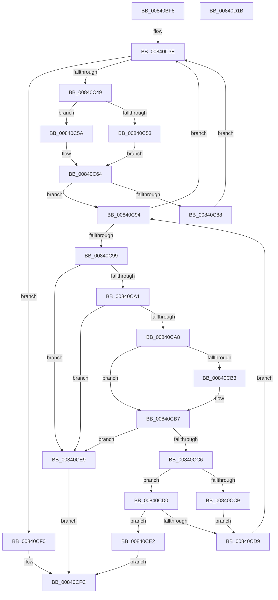

# RtlCountRequiredHotPatchAddressTableEntries

- RVA: `0x00840BF8`–`0x00840D1C` (길이 `292` bytes)
- VA: `0x0000000140840BF8`
- 실행 섹션: `PAGE`
- PDB 이름 있음: `예`; PDB Function 태그: `아니요`
- unwind 정보 RVA: `0x0008A668`
- 디코드: `86`개 명령, `292/292` bytes 표시
- 미해석 바이트: `0` (있으면 어셈블리에 `.byte`로 보존)

> 이 문서는 커널 이미지의 기계어와 PDB 기호를 분석해 생성했습니다. 4번과 5번은 함수 원형과 자료형을 바이너리 사용 방식에서 추정한 C 해석이며 원본 소스 복구 결과는 아닙니다.

## 1. Dependencies

- 직접 호출 지점: **2**; 고유 호출 대상: **2**
- 직접 호출자로 확인된 함수: **1**
- RIP 상대 이미지 참조: **0**

### Outgoing calls
- `0x00840C2B` → [RtlGetHotPatchSize](../../text/6A/RtlGetHotPatchSize_function_006AA1D0.md) (function, `0x006AA1D0`)
- `0x00840CBC` → [RtlpCheckFunctionPatchAppliedInOriginalImage](../../text/6A/RtlpCheckFunctionPatchAppliedInOriginalImage_function_006AA408.md) (function, `0x006AA408`)

### Direct callers
- [MiPrepareToHotPatchImage](../80/MiPrepareToHotPatchImage_function_00806820.md) at `0x008069CE`

### Static image references
- 디코드된 RIP-relative 메모리 참조가 없습니다.

## 2. Other-region calls and transfers

- 다른 실행 섹션으로 향하는 call: **2**
  - `0x00840C2B` → [RtlGetHotPatchSize](../../text/6A/RtlGetHotPatchSize_function_006AA1D0.md) (`PAGE` → `.text`)
  - `0x00840CBC` → [RtlpCheckFunctionPatchAppliedInOriginalImage](../../text/6A/RtlpCheckFunctionPatchAppliedInOriginalImage_function_006AA408.md) (`PAGE` → `.text`)
- 별도 외부 분기/꼬리 이동을 확인하지 못했습니다.

## 3. Assembly (complete function range)

```asm
00840BF8  48 8B C4                        mov rax, rsp
00840BFB  48 89 58 08                     mov qword ptr [rax + 8], rbx
00840BFF  48 89 68 10                     mov qword ptr [rax + 0x10], rbp
00840C03  48 89 70 18                     mov qword ptr [rax + 0x18], rsi
00840C07  48 89 78 20                     mov qword ptr [rax + 0x20], rdi
00840C0B  41 54                           push r12
00840C0D  41 56                           push r14
00840C0F  41 57                           push r15
00840C11  48 83 EC 40                     sub rsp, 0x40
00840C15  45 33 FF                        xor r15d, r15d
00840C18  48 8B E9                        mov rbp, rcx
00840C1B  48 8B 8C 24 88 00 00 00         mov rcx, qword ptr [rsp + 0x88]
00840C23  41 8B DF                        mov ebx, r15d
00840C26  4D 8B F1                        mov r14, r9
00840C29  8B F2                           mov esi, edx
00840C2B  E8 A0 95 E6 FF                  call 0x1406aa1d0
00840C30  4C 8B 94 24 90 00 00 00         mov r10, qword ptr [rsp + 0x90]
00840C38  45 8D 67 01                     lea r12d, [r15 + 1]
00840C3C  8B F8                           mov edi, eax
00840C3E  41 8B 12                        mov edx, dword ptr [r10]
00840C41  85 D2                           test edx, edx
00840C43  0F 84 A7 00 00 00               je 0x140840cf0
00840C49  44 38 BC 24 98 00 00 00         cmp byte ptr [rsp + 0x98], r15b
00840C51  74 07                           je 0x140840c5a
00840C53  85 D2                           test edx, edx
00840C55  0F 98 C0                        sets al
00840C58  EB 0A                           jmp 0x140840c64
00840C5A  85 D2                           test edx, edx
00840C5C  41 0F B6 C7                     movzx eax, r15b
00840C60  41 0F 49 C4                     cmovns eax, r12d
00840C64  44 8B DA                        mov r11d, edx
00840C67  49 83 C2 04                     add r10, 4
00840C6B  41 81 E3 FF 0F 00 00            and r11d, 0xfff
00840C72  81 E2 00 C0 0F 00               and edx, 0xfc000
00840C78  81 FA 00 C0 01 00               cmp edx, 0x1c000
00840C7E  41 8B CF                        mov ecx, r15d
00840C81  0F 44 C8                        cmove ecx, eax
00840C84  84 C9                           test cl, cl
00840C86  75 0C                           jne 0x140840c94
00840C88  8B C7                           mov eax, edi
00840C8A  41 0F AF C3                     imul eax, r11d
00840C8E  4D 8D 14 82                     lea r10, [r10 + rax*4]
00840C92  EB AA                           jmp 0x140840c3e
00840C94  45 85 DB                        test r11d, r11d
00840C97  74 A5                           je 0x140840c3e
00840C99  41 8B 0A                        mov ecx, dword ptr [r10]
00840C9C  83 F9 10                        cmp ecx, 0x10
00840C9F  72 48                           jb 0x140840ce9
00840CA1  8D 41 02                        lea eax, [rcx + 2]
00840CA4  3B C6                           cmp eax, esi
00840CA6  77 41                           ja 0x140840ce9
00840CA8  48 03 CD                        add rcx, rbp
00840CAB  49 8B D7                        mov rdx, r15
00840CAE  83 FF 02                        cmp edi, 2
00840CB1  74 04                           je 0x140840cb7
00840CB3  49 8D 52 08                     lea rdx, [r10 + 8]
00840CB7  4C 89 74 24 20                  mov qword ptr [rsp + 0x20], r14
00840CBC  E8 47 97 E6 FF                  call 0x1406aa408
00840CC1  83 F8 FF                        cmp eax, -1
00840CC4  74 23                           je 0x140840ce9
00840CC6  83 F8 FE                        cmp eax, -2
00840CC9  75 05                           jne 0x140840cd0
00840CCB  41 03 DC                        add ebx, r12d
00840CCE  EB 09                           jmp 0x140840cd9
00840CD0  3B 84 24 80 00 00 00            cmp eax, dword ptr [rsp + 0x80]
00840CD7  73 09                           jae 0x140840ce2
00840CD9  4D 8D 14 BA                     lea r10, [r10 + rdi*4]
00840CDD  41 FF CB                        dec r11d
00840CE0  EB B2                           jmp 0x140840c94
00840CE2  B8 23 00 00 C0                  mov eax, 0xc0000023
00840CE7  EB 13                           jmp 0x140840cfc
00840CE9  B8 7B 00 00 C0                  mov eax, 0xc000007b
00840CEE  EB 0C                           jmp 0x140840cfc
00840CF0  48 8B 84 24 D0 00 00 00         mov rax, qword ptr [rsp + 0xd0]
00840CF8  89 18                           mov dword ptr [rax], ebx
00840CFA  33 C0                           xor eax, eax
00840CFC  48 8B 5C 24 60                  mov rbx, qword ptr [rsp + 0x60]
00840D01  48 8B 6C 24 68                  mov rbp, qword ptr [rsp + 0x68]
00840D06  48 8B 74 24 70                  mov rsi, qword ptr [rsp + 0x70]
00840D0B  48 8B 7C 24 78                  mov rdi, qword ptr [rsp + 0x78]
00840D10  48 83 C4 40                     add rsp, 0x40
00840D14  41 5F                           pop r15
00840D16  41 5E                           pop r14
00840D18  41 5C                           pop r12
00840D1A  C3                              ret
00840D1B  CC                              int3
```

## 4. C-style interpretation (structured pseudocode)

```c
__int64 __fastcall RtlCountRequiredHotPatchAddressTableEntries(__int64 a1, int a2, __int64 a3, __int64 a4, unsigned int a5, __int64 a6, __int64 a7, unsigned __int8 a8, __int64 a9, __int64 a10, __int64 a11, __int64 a12, __int64 a13, __int64 a14, __int64 a15)
{
    __int64 result;
    __int64 v_r10;
    __int64 v_r11;
    __int64 v_r15;
    __int64 v_rbx;
    __int64 v_rsp;
    unsigned __int64 v_stack_m38;
    unsigned __int64 v_stack_p10;
    unsigned __int64 v_stack_p18;
    unsigned __int64 v_stack_p20;
    unsigned __int64 v_stack_p8;

    *(unsigned __int64 *)(v_rsp + 8) = v_rbx;
    *(unsigned __int64 *)(v_rsp + 16) = v_rbp;
    *(unsigned __int64 *)(v_rsp + 24) = v_rsi;
    *(unsigned __int64 *)(v_rsp + 32) = v_rdi;
    v_rsp = (v_rsp) - (64);
    v_r15 = 0;
    result = RtlGetHotPatchSize(a6, a2, a3, a4);
loc_00840C3E:
    if ((unsigned int)((unsigned int)(*(unsigned int *)(a7))) == 0) goto loc_00840CF0;
    if (a8 == 0) goto loc_00840C5A;
    result = (sign_flag) ? 1 : 0;
    goto loc_00840C64;
loc_00840C5A:
    result = 0;
    if (!sign_flag) { result = (unsigned int)(v_r15 + 1); }
loc_00840C64:
    v_r10 = (a7) + (4);
    v_r11 = (unsigned int)(((unsigned int)((unsigned int)((unsigned int)(*(unsigned int *)(a7))))) & (0xFFFULL));
    a2 = (unsigned int)(((unsigned int)(*(unsigned int *)(a7))) & (0xFC000ULL));
    a1 = 0;
    if (a2 == 0x1C000ULL) { a1 = (unsigned int)(result); }
    if ((unsigned __int8)(a1) != 0) goto loc_00840C94;
    result = (unsigned int)(((unsigned int)((unsigned int)((unsigned int)((unsigned int)(result))))) * ((unsigned int)(v_r11)));
    goto loc_00840C3E;
loc_00840C94:
    if ((unsigned int)(v_r11) == 0) goto loc_00840C3E;
    if (((unsigned int)((unsigned int)(*(unsigned int *)(v_r10 + result * 4)))) < 16) goto loc_00840CE9;
    if (((unsigned int)((unsigned int)(*(unsigned int *)(v_r10 + result * 4)) + 2)) > ((unsigned int)((unsigned int)(a2)))) goto loc_00840CE9;
    a1 = ((unsigned int)(*(unsigned int *)(v_r10 + result * 4))) + (a1);
    if (((unsigned int)((unsigned int)((unsigned int)(result)))) != 2) {
        a2 = v_r10 + result * 4 + 8;
    }
    v_stack_m38 = a4;
    result = RtlpCheckFunctionPatchAppliedInOriginalImage(a1, a2, a3, a4);
    if (((unsigned int)(result)) == -1) goto loc_00840CE9;
    if (((unsigned int)(result)) != -2) goto loc_00840CD0;
    v_rbx = (unsigned int)((0) + ((unsigned int)(v_r15 + 1)));
    goto loc_00840CD9;
loc_00840CD0:
    if (((unsigned int)(result)) >= a5) goto loc_00840CE2;
loc_00840CD9:
    v_r11 = (unsigned int)((v_r11) - 1);
    goto loc_00840C94;
loc_00840CE2:
    goto loc_00840CFC;
loc_00840CE9:
    goto loc_00840CFC;
loc_00840CF0:
    *(unsigned int *)(a15) = (unsigned int)(v_rbx);
    result = 0;
loc_00840CFC:
    v_rsp = (v_rsp) + (64);
    return result;
}
```

## 5. (Beta) C Style

```c
int64_t RtlCountRequiredHotPatchAddressTableEntries(int64_t Arg1, int32_t Arg2, int64_t Arg3, int64_t Arg4, uint32_t Arg5, int64_t Arg6, int64_t Arg7, uint8_t Arg8, uint64_t Arg9, uint64_t Arg10, uint64_t Arg11, uint64_t Arg12, uint64_t Arg13, uint64_t Arg14, void *Arg15)
{
    uint8_t *arg15 = (uint8_t *)Arg15;

    int64_t result;
    int64_t local_r10;
    int64_t local_r11;
    int64_t local_r15;
    int64_t local_rbx;
    int64_t local_rsp;
    uint64_t v_stack_m38;
    uint64_t v_stack_p10;
    uint64_t v_stack_p18;
    uint64_t v_stack_p20;
    uint64_t v_stack_p8;

    *(uint64_t *)(local_rsp + 0x8) = local_rbx;
    *(uint64_t *)(local_rsp + 0x10) = local_rbp;
    *(uint64_t *)(local_rsp + 0x18) = local_rsi;
    *(uint64_t *)(local_rsp + 0x20) = local_rdi;
    local_rsp = (local_rsp) - (64);
    local_r15 = 0;
    result = RtlGetHotPatchSize(Arg6, Arg2, Arg3, Arg4);
loc_00840C3E:
    if ((uint32_t)((uint32_t)(*(uint32_t *)(Arg7))) == 0) goto loc_00840CF0;
    if (Arg8 == 0) goto loc_00840C5A;
    result = (sign_flag) ? 1 : 0;
    goto loc_00840C64;
loc_00840C5A:
    result = 0;
    if (!sign_flag) { result = (uint32_t)(local_r15 + 1); }
loc_00840C64:
    local_r10 = (Arg7) + (4);
    local_r11 = (uint32_t)(((uint32_t)((uint32_t)((uint32_t)(*(uint32_t *)(Arg7))))) & (0xFFFULL));
    Arg2 = (uint32_t)(((uint32_t)(*(uint32_t *)(Arg7))) & (0xFC000ULL));
    Arg1 = 0;
    if (Arg2 == 0x1C000ULL) { Arg1 = (uint32_t)(result); }
    if ((uint8_t)(Arg1) != 0) goto loc_00840C94;
    result = (uint32_t)(((uint32_t)((uint32_t)((uint32_t)((uint32_t)(result))))) * ((uint32_t)(local_r11)));
    goto loc_00840C3E;
loc_00840C94:
    if ((uint32_t)(local_r11) == 0) goto loc_00840C3E;
    if (((uint32_t)((uint32_t)(*(uint32_t *)(local_r10 + result * 4)))) < 16) goto loc_00840CE9;
    if (((uint32_t)((uint32_t)(*(uint32_t *)(local_r10 + result * 4)) + 2)) > ((uint32_t)((uint32_t)(Arg2)))) goto loc_00840CE9;
    Arg1 = ((uint32_t)(*(uint32_t *)(local_r10 + result * 4))) + (Arg1);
    if (((uint32_t)((uint32_t)((uint32_t)(result)))) != 2) {
        Arg2 = local_r10 + result * 4 + 8;
    }
    v_stack_m38 = Arg4;
    result = RtlpCheckFunctionPatchAppliedInOriginalImage(Arg1, Arg2, Arg3, Arg4);
    if (((uint32_t)(result)) == -1) goto loc_00840CE9;
    if (((uint32_t)(result)) != -2) goto loc_00840CD0;
    local_rbx = (uint32_t)((0) + ((uint32_t)(local_r15 + 1)));
    goto loc_00840CD9;
loc_00840CD0:
    if (((uint32_t)(result)) >= Arg5) goto loc_00840CE2;
loc_00840CD9:
    local_r11 = (uint32_t)((local_r11) - 1);
    goto loc_00840C94;
loc_00840CE2:
    goto loc_00840CFC;
loc_00840CE9:
    goto loc_00840CFC;
loc_00840CF0:
    *(uint32_t *)(arg15) = (uint32_t)(local_rbx);
    result = 0;
loc_00840CFC:
    local_rsp = (local_rsp) + (64);
    return result;
}
```

### 관측된 메모리 오프셋

구조체 형식이 확인되지 않은 접근은 인자 기준의 오프셋으로만 기록했습니다.

| 기준 인자 | 오프셋 표현 | 폭 (bit) | 접근 |
|---|---:|---:|---|
| `Arg15` | `+ 0x0` | `32` | `W` |

## 6. Execution-region graph

[열기: 2D/3D 그래프와 함수 탐색 컨트롤 패널](../../../control-panel.html?section=page&rva=0x00840BF8&view=graph)

- 2D 그래프는 위에서 아래로 흐르고, 3D 그래프는 빈 공간을 드래그해 회전합니다. Shift+드래그는 이동, 휠은 확대·축소, 함수 노드 선택은 대상 보고서 이동입니다.

### Static fallback


