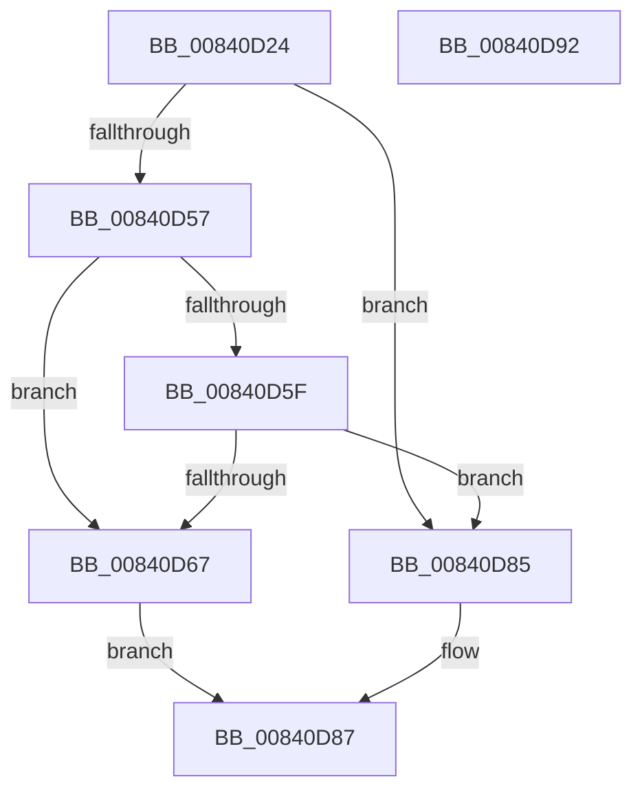

# RtlDetermineHotPatchExtent

- RVA: `0x00840D24`–`0x00840D93` (길이 `111` bytes)
- VA: `0x0000000140840D24`
- 실행 섹션: `PAGE`
- PDB 이름 있음: `예`; PDB Function 태그: `아니요`
- unwind 정보 RVA: `0x0006E5F8`
- 디코드: `38`개 명령, `111/111` bytes 표시
- 미해석 바이트: `0` (있으면 어셈블리에 `.byte`로 보존)

> 이 문서는 커널 이미지의 기계어와 PDB 기호를 분석해 생성했습니다. 4번과 5번은 함수 원형과 자료형을 바이너리 사용 방식에서 추정한 C 해석이며 원본 소스 복구 결과는 아닙니다.

## 1. Dependencies

- 직접 호출 지점: **1**; 고유 호출 대상: **1**
- 직접 호출자로 확인된 함수: **3**
- RIP 상대 이미지 참조: **0**

### Outgoing calls
- `0x00840D4E` → [RtlpDetermineHotPatchExtent](../../pagelk/B7/RtlpDetermineHotPatchExtent_function_00B75844.md) (function, `0x00B75844`)

### Direct callers
- [MiLockHotPatchPages](../80/MiLockHotPatchPages_function_00804620.md) at `0x0080466C`
- [MiPrepareToHotPatchImagePatchCallback](../80/MiPrepareToHotPatchImagePatchCallback_function_00806DC0.md) at `0x00806E38`
- [RtlValidateHotPatchBase](RtlValidateHotPatchBase_function_008411D0.md) at `0x00841310`

### Static image references
- 디코드된 RIP-relative 메모리 참조가 없습니다.

## 2. Other-region calls and transfers

- 다른 실행 섹션으로 향하는 call: **1**
  - `0x00840D4E` → [RtlpDetermineHotPatchExtent](../../pagelk/B7/RtlpDetermineHotPatchExtent_function_00B75844.md) (`PAGE` → `PAGELK`)
- 별도 외부 분기/꼬리 이동을 확인하지 못했습니다.

## 3. Assembly (complete function range)

```asm
00840D24  48 89 5C 24 08                  mov qword ptr [rsp + 8], rbx
00840D29  57                              push rdi
00840D2A  48 83 EC 30                     sub rsp, 0x30
00840D2E  83 64 24 24 00                  and dword ptr [rsp + 0x24], 0
00840D33  41 0F B7 C0                     movzx eax, r8w
00840D37  83 64 24 20 00                  and dword ptr [rsp + 0x20], 0
00840D3C  4C 8D 44 24 20                  lea r8, [rsp + 0x20]
00840D41  8B DA                           mov ebx, edx
00840D43  49 8B F9                        mov rdi, r9
00840D46  0F B7 D0                        movzx edx, ax
00840D49  4C 8D 4C 24 24                  lea r9, [rsp + 0x24]
00840D4E  E8 F1 4A 33 00                  call 0x140b75844
00840D53  84 C0                           test al, al
00840D55  74 2E                           je 0x140840d85
00840D57  8B 4C 24 20                     mov ecx, dword ptr [rsp + 0x20]
00840D5B  85 C9                           test ecx, ecx
00840D5D  79 08                           jns 0x140840d67
00840D5F  8B C1                           mov eax, ecx
00840D61  F7 D8                           neg eax
00840D63  3B C3                           cmp eax, ebx
00840D65  77 1E                           ja 0x140840d85
00840D67  8D 04 19                        lea eax, [rcx + rbx]
00840D6A  8B 4C 24 24                     mov ecx, dword ptr [rsp + 0x24]
00840D6E  C1 E8 0C                        shr eax, 0xc
00840D71  FF C9                           dec ecx
00840D73  89 07                           mov dword ptr [rdi], eax
00840D75  03 CB                           add ecx, ebx
00840D77  48 8B 44 24 60                  mov rax, qword ptr [rsp + 0x60]
00840D7C  C1 E9 0C                        shr ecx, 0xc
00840D7F  89 08                           mov dword ptr [rax], ecx
00840D81  B0 01                           mov al, 1
00840D83  EB 02                           jmp 0x140840d87
00840D85  32 C0                           xor al, al
00840D87  48 8B 5C 24 40                  mov rbx, qword ptr [rsp + 0x40]
00840D8C  48 83 C4 30                     add rsp, 0x30
00840D90  5F                              pop rdi
00840D91  C3                              ret
00840D92  CC                              int3
```

## 4. C-style interpretation (structured pseudocode)

```c
__int64 __fastcall RtlDetermineHotPatchExtent(__int64 a1, int a2, unsigned __int16 a3, __int64 a4, __int64 a5)
{
    __int64 result;
    __int64 v_rsp;
    unsigned int v_stack_m14;
    unsigned int v_stack_m18;
    unsigned __int64 v_stack_p8;

    v_stack_p8 = v_rbx;
    v_rsp = (v_rsp) - (48);
    result = RtlpDetermineHotPatchExtent(a1, a3, v_stack_m18, v_stack_m14);
    if ((unsigned __int8)(result) == 0) goto loc_00840D85;
    if (!sign_flag) goto loc_00840D67;
    result = (unsigned int)(-((unsigned int)((unsigned int)((unsigned int)(v_stack_m18)))));
    if (((unsigned int)(result)) > ((unsigned int)((unsigned int)(a2)))) goto loc_00840D85;
loc_00840D67:
    result = (unsigned int)(((unsigned int)(v_stack_m18) + (unsigned int)(a2) * 1) >> (12));
    a1 = (unsigned int)(((unsigned int)(v_stack_m14)) - 1);
    *(unsigned int *)(a4) = (unsigned int)(result);
    a1 = (unsigned int)((a1) + ((unsigned int)((unsigned int)(a2))));
    a1 = (unsigned int)((a1) >> (12));
    *(unsigned int *)(a5) = (unsigned int)(a1);
    goto loc_00840D87;
loc_00840D85:
    result = 0;
loc_00840D87:
    v_rsp = (v_rsp) + (48);
    return result;
}
```

## 5. (Beta) C Style

```c
int64_t RtlDetermineHotPatchExtent(int64_t Arg1, int32_t Arg2, uint16_t Arg3, void *Arg4, void *Arg5)
{
    uint8_t *arg4 = (uint8_t *)Arg4;
    uint8_t *arg5 = (uint8_t *)Arg5;

    int64_t result;
    int64_t local_rsp;
    uint32_t v_stack_m14;
    uint32_t v_stack_m18;
    uint64_t v_stack_p8;

    v_stack_p8 = local_rbx;
    local_rsp = (local_rsp) - (48);
    result = RtlpDetermineHotPatchExtent(Arg1, Arg3, v_stack_m18, v_stack_m14);
    if ((uint8_t)(result) == 0) goto loc_00840D85;
    if (!sign_flag) goto loc_00840D67;
    result = (uint32_t)(-((uint32_t)((uint32_t)((uint32_t)(v_stack_m18)))));
    if (((uint32_t)(result)) > ((uint32_t)((uint32_t)(Arg2)))) goto loc_00840D85;
loc_00840D67:
    result = (uint32_t)(((uint32_t)(v_stack_m18) + (uint32_t)(Arg2) * 1) >> (12));
    Arg1 = (uint32_t)(((uint32_t)(v_stack_m14)) - 1);
    *(uint32_t *)(arg4) = (uint32_t)(result);
    Arg1 = (uint32_t)((Arg1) + ((uint32_t)((uint32_t)(Arg2))));
    Arg1 = (uint32_t)((Arg1) >> (12));
    *(uint32_t *)(arg5) = (uint32_t)(Arg1);
    goto loc_00840D87;
loc_00840D85:
    result = 0;
loc_00840D87:
    local_rsp = (local_rsp) + (48);
    return result;
}
```

### 관측된 메모리 오프셋

구조체 형식이 확인되지 않은 접근은 인자 기준의 오프셋으로만 기록했습니다.

| 기준 인자 | 오프셋 표현 | 폭 (bit) | 접근 |
|---|---:|---:|---|
| `Arg4` | `+ 0x0` | `32` | `W` |
| `Arg5` | `+ 0x0` | `32` | `W` |

## 6. Execution-region graph

[열기: 2D/3D 그래프와 함수 탐색 컨트롤 패널](../../../control-panel.html?section=page&rva=0x00840D24&view=graph)

- 2D 그래프는 위에서 아래로 흐르고, 3D 그래프는 빈 공간을 드래그해 회전합니다. Shift+드래그는 이동, 휠은 확대·축소, 함수 노드 선택은 대상 보고서 이동입니다.

### Static fallback


