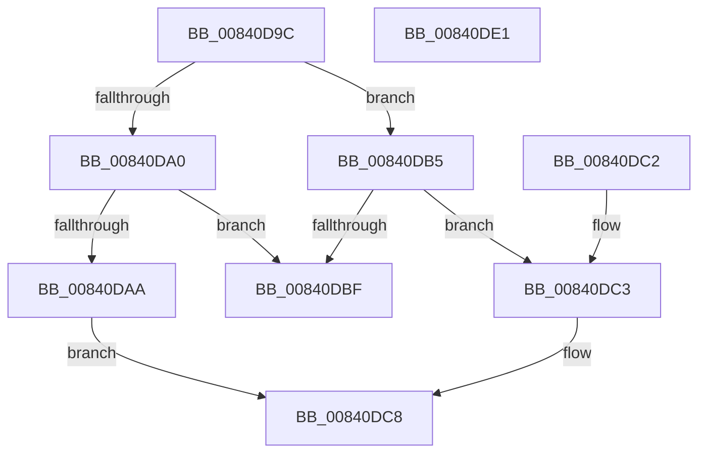

# RtlDetermineHotPatchUndoExtent

- RVA: `0x00840D9C`–`0x00840DE2` (길이 `70` bytes)
- VA: `0x0000000140840D9C`
- 실행 섹션: `PAGE`
- PDB 이름 있음: `예`; PDB Function 태그: `아니요`
- unwind 정보 RVA: `0x000DB714`
- 디코드: `27`개 명령, `70/70` bytes 표시
- 미해석 바이트: `0` (있으면 어셈블리에 `.byte`로 보존)

> 이 문서는 커널 이미지의 기계어와 PDB 기호를 분석해 생성했습니다. 4번과 5번은 함수 원형과 자료형을 바이너리 사용 방식에서 추정한 C 해석이며 원본 소스 복구 결과는 아닙니다.

## 1. Dependencies

- 직접 호출 지점: **0**; 고유 호출 대상: **0**
- 직접 호출자로 확인된 함수: **2**
- RIP 상대 이미지 참조: **0**

### Outgoing calls
- 직접 디코드된 call 명령이 없습니다.

### Direct callers
- [MiPrepareDriverForHotPatch](../80/MiPrepareDriverForHotPatch_function_008066F4.md) at `0x008067D8`
- [MiProcessHotPatchUndoTable](../80/MiProcessHotPatchUndoTable_function_00806F20.md) at `0x00806F5D`

### Static image references
- 디코드된 RIP-relative 메모리 참조가 없습니다.

## 2. Other-region calls and transfers

- 다른 실행 섹션으로 향하는 call: **0**
- 별도 외부 분기/꼬리 이동을 확인하지 못했습니다.

## 3. Assembly (complete function range)

```asm
00840D9C  85 D2                           test edx, edx
00840D9E  74 15                           je 0x140840db5
00840DA0  43 8D 04 00                     lea eax, [r8 + r8]
00840DA4  83 3C 81 00                     cmp dword ptr [rcx + rax*4], 0
00840DA8  74 15                           je 0x140840dbf
00840DAA  8B 4C 81 04                     mov ecx, dword ptr [rcx + rax*4 + 4]
00840DAE  BA 02 00 00 00                  mov edx, 2
00840DB3  EB 13                           jmp 0x140840dc8
00840DB5  41 8B C0                        mov eax, r8d
00840DB8  8B 0C C1                        mov ecx, dword ptr [rcx + rax*8]
00840DBB  85 C9                           test ecx, ecx
00840DBD  75 04                           jne 0x140840dc3
00840DBF  32 C0                           xor al, al
00840DC1  C3                              ret
00840DC2  CC                              int3
00840DC3  BA 04 00 00 00                  mov edx, 4
00840DC8  8B C1                           mov eax, ecx
00840DCA  FF C9                           dec ecx
00840DCC  C1 F8 0C                        sar eax, 0xc
00840DCF  03 CA                           add ecx, edx
00840DD1  41 89 01                        mov dword ptr [r9], eax
00840DD4  48 8B 44 24 28                  mov rax, qword ptr [rsp + 0x28]
00840DD9  C1 E9 0C                        shr ecx, 0xc
00840DDC  89 08                           mov dword ptr [rax], ecx
00840DDE  B0 01                           mov al, 1
00840DE0  C3                              ret
00840DE1  CC                              int3
```

## 4. C-style interpretation (structured pseudocode)

```c
__int64 __fastcall RtlDetermineHotPatchUndoExtent(__int64 a1, int a2, __int64 a3, __int64 a4, __int64 a5)
{
    __int64 result;

    if (a2 == 0) goto loc_00840DB5;
    if ((*(unsigned int *)(a1 + a3 + a3 * 1 * 4)) == 0) goto loc_00840DBF;
    goto loc_00840DC8;
loc_00840DB5:
    if ((unsigned int)((unsigned int)(*(unsigned int *)((unsigned int)(*(unsigned int *)(a1 + a3 + a3 * 1 * 4 + 4)) + (unsigned int)((unsigned int)(a3)) * 8))) != 0) goto loc_00840DC3;
loc_00840DBF:
    result = 0;
    return result;
loc_00840DC3:
loc_00840DC8:
    a1 = (unsigned int)(((unsigned int)(*(unsigned int *)((unsigned int)(*(unsigned int *)(a1 + a3 + a3 * 1 * 4 + 4)) + (unsigned int)((unsigned int)(a3)) * 8))) - 1);
    result = (unsigned int)(((unsigned int)((unsigned int)((unsigned int)(*(unsigned int *)((unsigned int)(*(unsigned int *)(a1 + a3 + a3 * 1 * 4 + 4)) + (unsigned int)((unsigned int)(a3)) * 8))))) >> (12));
    a1 = (unsigned int)((a1) + (4));
    *(unsigned int *)(a4) = (unsigned int)(result);
    a1 = (unsigned int)((a1) >> (12));
    *(unsigned int *)(a5) = (unsigned int)(a1);
    return 1;
}
```

## 5. (Beta) C Style

```c
int64_t RtlDetermineHotPatchUndoExtent(void *Arg1, int32_t Arg2, void *Arg3, void *Arg4, void *Arg5)
{
    uint8_t *arg1 = (uint8_t *)Arg1;
    uint8_t *arg3 = (uint8_t *)Arg3;
    uint8_t *arg4 = (uint8_t *)Arg4;
    uint8_t *arg5 = (uint8_t *)Arg5;

    int64_t result;

    if (Arg2 == 0) goto loc_00840DB5;
    if ((*(uint32_t *)(arg1 + arg3 + arg3 * 1 * 4)) == 0) goto loc_00840DBF;
    goto loc_00840DC8;
loc_00840DB5:
    if ((uint32_t)((uint32_t)(*(uint32_t *)((uint32_t)(*(uint32_t *)(arg1 + arg3 + arg3 * 1 * 4 + 0x4)) + (uint32_t)((uint32_t)(arg3)) * 8))) != 0) goto loc_00840DC3;
loc_00840DBF:
    result = 0;
    return result;
loc_00840DC3:
loc_00840DC8:
    Arg1 = (uint32_t)(((uint32_t)(*(uint32_t *)((uint32_t)(*(uint32_t *)(arg1 + arg3 + arg3 * 1 * 4 + 0x4)) + (uint32_t)((uint32_t)(arg3)) * 8))) - 1);
    result = (uint32_t)(((uint32_t)((uint32_t)((uint32_t)(*(uint32_t *)((uint32_t)(*(uint32_t *)(arg1 + arg3 + arg3 * 1 * 4 + 0x4)) + (uint32_t)((uint32_t)(arg3)) * 8))))) >> (12));
    Arg1 = (uint32_t)((Arg1) + (4));
    *(uint32_t *)(arg4) = (uint32_t)(result);
    Arg1 = (uint32_t)((Arg1) >> (12));
    *(uint32_t *)(arg5) = (uint32_t)(Arg1);
    return 1;
}
```

### 관측된 메모리 오프셋

구조체 형식이 확인되지 않은 접근은 인자 기준의 오프셋으로만 기록했습니다.

| 기준 인자 | 오프셋 표현 | 폭 (bit) | 접근 |
|---|---:|---:|---|
| `Arg1` | `+ 0x0 + rax*4` | `32` | `R` |
| `Arg1` | `+ 0x0 + rax*8` | `32` | `R` |
| `Arg1` | `+ 0x4 + rax*4` | `32` | `R` |
| `Arg3` | `+ 0x0 + r8*1` | `32` | `R` |
| `Arg4` | `+ 0x0` | `32` | `W` |
| `Arg5` | `+ 0x0` | `32` | `W` |

## 6. Execution-region graph

[열기: 2D/3D 그래프와 함수 탐색 컨트롤 패널](../../../control-panel.html?section=page&rva=0x00840D9C&view=graph)

- 2D 그래프는 위에서 아래로 흐르고, 3D 그래프는 빈 공간을 드래그해 회전합니다. Shift+드래그는 이동, 휠은 확대·축소, 함수 노드 선택은 대상 보고서 이동입니다.

### Static fallback


