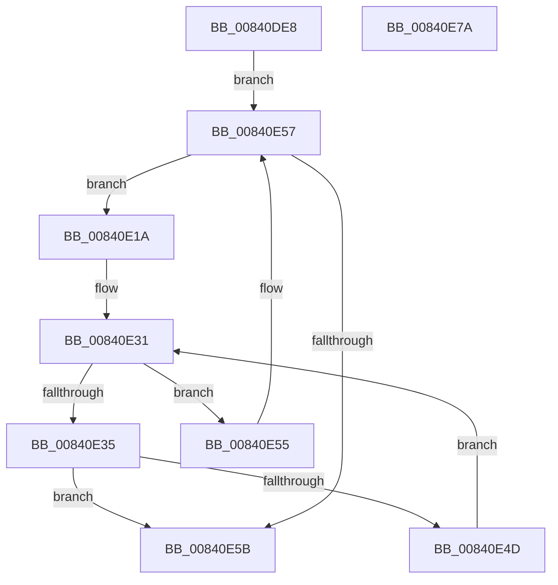

# RtlEnumerateHotPatchPatches

- RVA: `0x00840DE8`–`0x00840E7B` (길이 `147` bytes)
- VA: `0x0000000140840DE8`
- 실행 섹션: `PAGE`
- PDB 이름 있음: `예`; PDB Function 태그: `아니요`
- unwind 정보 RVA: `0x000847EC`
- 디코드: `48`개 명령, `147/147` bytes 표시
- 미해석 바이트: `0` (있으면 어셈블리에 `.byte`로 보존)

> 이 문서는 커널 이미지의 기계어와 PDB 기호를 분석해 생성했습니다. 4번과 5번은 함수 원형과 자료형을 바이너리 사용 방식에서 추정한 C 해석이며 원본 소스 복구 결과는 아닙니다.

## 1. Dependencies

- 직접 호출 지점: **2**; 고유 호출 대상: **2**
- 직접 호출자로 확인된 함수: **2**
- RIP 상대 이미지 참조: **0**

### Outgoing calls
- `0x00840E0E` → [RtlGetHotPatchSize](../../text/6A/RtlGetHotPatchSize_function_006AA1D0.md) (function, `0x006AA1D0`)
- `0x00840E44` → [guard_dispatch_icall](../../text/6B/guard_dispatch_icall_function_006BAAD0.md) (function, `0x006BAAD0`)

### Direct callers
- [MiPrepareToHotPatchImage](../80/MiPrepareToHotPatchImage_function_00806820.md) at `0x00806BF5`
- [MiProcessPatchImageCfg](../80/MiProcessPatchImageCfg_function_00806F9C.md) at `0x0080700A`
- [MiProcessPatchImageCfg](../80/MiProcessPatchImageCfg_function_00806F9C.md) at `0x00807057`

### Static image references
- 디코드된 RIP-relative 메모리 참조가 없습니다.

## 2. Other-region calls and transfers

- 다른 실행 섹션으로 향하는 call: **2**
  - `0x00840E0E` → [RtlGetHotPatchSize](../../text/6A/RtlGetHotPatchSize_function_006AA1D0.md) (`PAGE` → `.text`)
  - `0x00840E44` → [guard_dispatch_icall](../../text/6B/guard_dispatch_icall_function_006BAAD0.md) (`PAGE` → `.text`)
- 별도 외부 분기/꼬리 이동을 확인하지 못했습니다.

## 3. Assembly (complete function range)

```asm
00840DE8  48 8B C4                        mov rax, rsp
00840DEB  48 89 58 08                     mov qword ptr [rax + 8], rbx
00840DEF  48 89 68 10                     mov qword ptr [rax + 0x10], rbp
00840DF3  48 89 70 18                     mov qword ptr [rax + 0x18], rsi
00840DF7  48 89 78 20                     mov qword ptr [rax + 0x20], rdi
00840DFB  41 54                           push r12
00840DFD  41 56                           push r14
00840DFF  41 57                           push r15
00840E01  48 83 EC 30                     sub rsp, 0x30
00840E05  4D 8B F9                        mov r15, r9
00840E08  4D 8B E0                        mov r12, r8
00840E0B  48 8B FA                        mov rdi, rdx
00840E0E  E8 BD 93 E6 FF                  call 0x1406aa1d0
00840E13  8B 1A                           mov ebx, dword ptr [rdx]
00840E15  44 8B F0                        mov r14d, eax
00840E18  EB 3D                           jmp 0x140840e57
00840E1A  8B F3                           mov esi, ebx
00840E1C  8B EB                           mov ebp, ebx
00840E1E  C1 EE 1F                        shr esi, 0x1f
00840E21  81 E5 00 C0 0F 00               and ebp, 0xfc000
00840E27  81 E3 FF 0F 00 00               and ebx, 0xfff
00840E2D  48 83 C7 04                     add rdi, 4
00840E31  85 DB                           test ebx, ebx
00840E33  74 20                           je 0x140840e55
00840E35  44 8A CE                        mov r9b, sil
00840E38  44 8B C5                        mov r8d, ebp
00840E3B  48 8B D7                        mov rdx, rdi
00840E3E  49 8B CF                        mov rcx, r15
00840E41  49 8B C4                        mov rax, r12
00840E44  E8 87 9C E7 FF                  call 0x1406baad0
00840E49  84 C0                           test al, al
00840E4B  75 0E                           jne 0x140840e5b
00840E4D  4A 8D 3C B7                     lea rdi, [rdi + r14*4]
00840E51  FF CB                           dec ebx
00840E53  EB DC                           jmp 0x140840e31
00840E55  8B 1F                           mov ebx, dword ptr [rdi]
00840E57  85 DB                           test ebx, ebx
00840E59  75 BF                           jne 0x140840e1a
00840E5B  48 8B 5C 24 50                  mov rbx, qword ptr [rsp + 0x50]
00840E60  48 8B 6C 24 58                  mov rbp, qword ptr [rsp + 0x58]
00840E65  48 8B 74 24 60                  mov rsi, qword ptr [rsp + 0x60]
00840E6A  48 8B 7C 24 68                  mov rdi, qword ptr [rsp + 0x68]
00840E6F  48 83 C4 30                     add rsp, 0x30
00840E73  41 5F                           pop r15
00840E75  41 5E                           pop r14
00840E77  41 5C                           pop r12
00840E79  C3                              ret
00840E7A  CC                              int3
```

## 4. C-style interpretation (structured pseudocode)

```c
__int64 __fastcall RtlEnumerateHotPatchPatches(__int64 a1, __int64 a2, __int64 a3, __int64 a4)
{
    __int64 result;
    __int64 v_rbp;
    __int64 v_rbx;
    __int64 v_rdi;
    __int64 v_rsi;
    __int64 v_rsp;
    unsigned __int64 v_stack_p10;
    unsigned __int64 v_stack_p18;
    unsigned __int64 v_stack_p20;
    unsigned __int64 v_stack_p8;

    *(unsigned __int64 *)(v_rsp + 8) = v_rbx;
    *(unsigned __int64 *)(v_rsp + 16) = v_rbp;
    *(unsigned __int64 *)(v_rsp + 24) = v_rsi;
    *(unsigned __int64 *)(v_rsp + 32) = v_rdi;
    v_rsp = (v_rsp) - (48);
    result = RtlGetHotPatchSize(a1, a2, a3, a4);
    goto loc_00840E57;
loc_00840E1A:
    v_rsi = (unsigned int)(((unsigned int)((unsigned int)((unsigned int)(*(unsigned int *)(a2))))) >> (31));
    v_rbp = (unsigned int)(((unsigned int)((unsigned int)((unsigned int)(*(unsigned int *)(a2))))) & (0xFC000ULL));
    v_rbx = (unsigned int)(((unsigned int)(*(unsigned int *)(a2))) & (0xFFFULL));
    v_rdi = (a2) + (4);
loc_00840E31:
    if ((unsigned int)(v_rbx) == 0) goto loc_00840E55;
    result = guard_dispatch_icall(a4, v_rdi, (unsigned int)((unsigned int)(v_rbp)), (unsigned __int8)(v_rsi));
    if ((unsigned __int8)(result) != 0) goto loc_00840E5B;
    v_rbx = (unsigned int)((v_rbx) - 1);
    goto loc_00840E31;
loc_00840E55:
loc_00840E57:
    if ((unsigned int)((unsigned int)(*(unsigned int *)(v_rdi + (unsigned int)((unsigned int)(result)) * 4))) != 0) goto loc_00840E1A;
loc_00840E5B:
    v_rsp = (v_rsp) + (48);
    return result;
}
```

## 5. (Beta) C Style

```c
int64_t RtlEnumerateHotPatchPatches(int64_t Arg1, void *Arg2, int64_t Arg3, int64_t Arg4)
{
    uint8_t *arg2 = (uint8_t *)Arg2;

    int64_t result;
    int64_t local_rbp;
    int64_t local_rbx;
    int64_t local_rdi;
    int64_t local_rsi;
    int64_t local_rsp;
    uint64_t v_stack_p10;
    uint64_t v_stack_p18;
    uint64_t v_stack_p20;
    uint64_t v_stack_p8;

    *(uint64_t *)(local_rsp + 0x8) = local_rbx;
    *(uint64_t *)(local_rsp + 0x10) = local_rbp;
    *(uint64_t *)(local_rsp + 0x18) = local_rsi;
    *(uint64_t *)(local_rsp + 0x20) = local_rdi;
    local_rsp = (local_rsp) - (48);
    result = RtlGetHotPatchSize(Arg1, Arg2, Arg3, Arg4);
    goto loc_00840E57;
loc_00840E1A:
    local_rsi = (uint32_t)(((uint32_t)((uint32_t)((uint32_t)(*(uint32_t *)(arg2))))) >> (31));
    local_rbp = (uint32_t)(((uint32_t)((uint32_t)((uint32_t)(*(uint32_t *)(arg2))))) & (0xFC000ULL));
    local_rbx = (uint32_t)(((uint32_t)(*(uint32_t *)(arg2))) & (0xFFFULL));
    local_rdi = (Arg2) + (4);
loc_00840E31:
    if ((uint32_t)(local_rbx) == 0) goto loc_00840E55;
    result = guard_dispatch_icall(Arg4, local_rdi, (uint32_t)((uint32_t)(local_rbp)), (uint8_t)(local_rsi));
    if ((uint8_t)(result) != 0) goto loc_00840E5B;
    local_rbx = (uint32_t)((local_rbx) - 1);
    goto loc_00840E31;
loc_00840E55:
loc_00840E57:
    if ((uint32_t)((uint32_t)(*(uint32_t *)(local_rdi + (uint32_t)((uint32_t)(result)) * 4))) != 0) goto loc_00840E1A;
loc_00840E5B:
    local_rsp = (local_rsp) + (48);
    return result;
}
```

### 관측된 메모리 오프셋

구조체 형식이 확인되지 않은 접근은 인자 기준의 오프셋으로만 기록했습니다.

| 기준 인자 | 오프셋 표현 | 폭 (bit) | 접근 |
|---|---:|---:|---|
| `Arg2` | `+ 0x0` | `32` | `R` |
| `Arg2` | `+ 0x0 + r14*4` | `64` | `R` |

## 6. Execution-region graph

[열기: 2D/3D 그래프와 함수 탐색 컨트롤 패널](../../../control-panel.html?section=page&rva=0x00840DE8&view=graph)

- 2D 그래프는 위에서 아래로 흐르고, 3D 그래프는 빈 공간을 드래그해 회전합니다. Shift+드래그는 이동, 휠은 확대·축소, 함수 노드 선택은 대상 보고서 이동입니다.

### Static fallback


