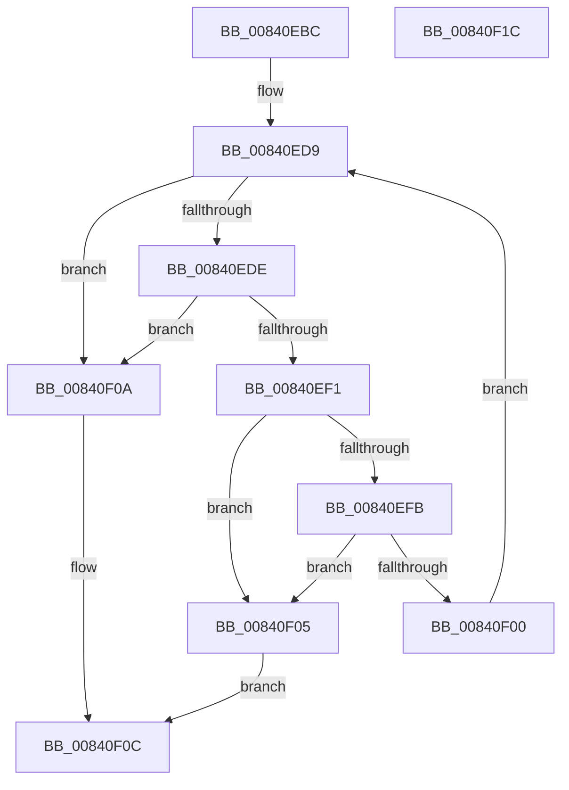

# RtlFindHotPatchBaseMachine

- RVA: `0x00840EBC`–`0x00840F1D` (길이 `97` bytes)
- VA: `0x0000000140840EBC`
- 실행 섹션: `PAGE`
- PDB 이름 있음: `예`; PDB Function 태그: `아니요`
- unwind 정보 RVA: `0x00060BC4`
- 디코드: `33`개 명령, `97/97` bytes 표시
- 미해석 바이트: `0` (있으면 어셈블리에 `.byte`로 보존)

> 이 문서는 커널 이미지의 기계어와 PDB 기호를 분석해 생성했습니다. 4번과 5번은 함수 원형과 자료형을 바이너리 사용 방식에서 추정한 C 해석이며 원본 소스 복구 결과는 아닙니다.

## 1. Dependencies

- 직접 호출 지점: **2**; 고유 호출 대상: **2**
- 직접 호출자로 확인된 함수: **3**
- RIP 상대 이미지 참조: **0**

### Outgoing calls
- `0x00840EE4` → [RtlFindHotPatchBase](RtlFindHotPatchBase_function_00840E84.md) (function, `0x00840E84`)
- `0x00840EF1` → [RtlGetHotPatchBaseMachine](RtlGetHotPatchBaseMachine_function_00841168.md) (function, `0x00841168`)

### Direct callers
- [MiApplyDriverHotPatch](../80/MiApplyDriverHotPatch_function_008018EC.md) at `0x00801995`
- [MiCaptureHotPatchInfo](../80/MiCaptureHotPatchInfo_function_00802F98.md) at `0x00803070`
- [MiPrepareToHotPatchImage](../80/MiPrepareToHotPatchImage_function_00806820.md) at `0x00806985`

### Static image references
- 디코드된 RIP-relative 메모리 참조가 없습니다.

## 2. Other-region calls and transfers

- 다른 실행 섹션으로 향하는 call: **0**
- 별도 외부 분기/꼬리 이동을 확인하지 못했습니다.

## 3. Assembly (complete function range)

```asm
00840EBC  48 89 5C 24 08                  mov qword ptr [rsp + 8], rbx
00840EC1  48 89 74 24 10                  mov qword ptr [rsp + 0x10], rsi
00840EC6  57                              push rdi
00840EC7  48 83 EC 20                     sub rsp, 0x20
00840ECB  8B 59 10                        mov ebx, dword ptr [rcx + 0x10]
00840ECE  33 F6                           xor esi, esi
00840ED0  44 8B D6                        mov r10d, esi
00840ED3  0F B7 FA                        movzx edi, dx
00840ED6  4C 8B D9                        mov r11, rcx
00840ED9  44 3B D3                        cmp r10d, ebx
00840EDC  73 2C                           jae 0x140840f0a
00840EDE  41 8B D2                        mov edx, r10d
00840EE1  49 8B CB                        mov rcx, r11
00840EE4  E8 9B FF FF FF                  call 0x140840e84
00840EE9  48 8B C8                        mov rcx, rax
00840EEC  48 85 C0                        test rax, rax
00840EEF  74 19                           je 0x140840f0a
00840EF1  E8 72 02 00 00                  call 0x140841168
00840EF6  66 85 C0                        test ax, ax
00840EF9  74 0A                           je 0x140840f05
00840EFB  66 3B C7                        cmp ax, di
00840EFE  74 05                           je 0x140840f05
00840F00  41 FF C2                        inc r10d
00840F03  EB D4                           jmp 0x140840ed9
00840F05  48 8B C1                        mov rax, rcx
00840F08  EB 02                           jmp 0x140840f0c
00840F0A  33 C0                           xor eax, eax
00840F0C  48 8B 5C 24 30                  mov rbx, qword ptr [rsp + 0x30]
00840F11  48 8B 74 24 38                  mov rsi, qword ptr [rsp + 0x38]
00840F16  48 83 C4 20                     add rsp, 0x20
00840F1A  5F                              pop rdi
00840F1B  C3                              ret
00840F1C  CC                              int3
```

## 4. C-style interpretation (structured pseudocode)

```c
__int64 __fastcall RtlFindHotPatchBaseMachine(__int64 a1, unsigned __int16 a2)
{
    __int64 result;
    __int64 v_r10;
    __int64 v_rsi;
    __int64 v_rsp;
    unsigned __int64 v_stack_p10;
    unsigned __int64 v_stack_p8;

    v_stack_p8 = v_rbx;
    v_stack_p10 = v_rsi;
    v_rsp = (v_rsp) - (32);
    v_rsi = 0;
loc_00840ED9:
    if (0 >= ((unsigned int)((unsigned int)(*(unsigned int *)(a1 + 16))))) goto loc_00840F0A;
    result = RtlFindHotPatchBase(a1, 0, a3, a4);
    if (result == 0) goto loc_00840F0A;
    result = RtlGetHotPatchBaseMachine(result, 0, a3, a4);
    if ((unsigned __int16)(result) == 0) goto loc_00840F05;
    if (((unsigned __int16)(result)) == a2) goto loc_00840F05;
    v_r10 = (unsigned int)((0) + 1);
    goto loc_00840ED9;
loc_00840F05:
    goto loc_00840F0C;
loc_00840F0A:
    result = 0;
loc_00840F0C:
    v_rsp = (v_rsp) + (32);
    return result;
}
```

## 5. (Beta) C Style

```c
int64_t RtlFindHotPatchBaseMachine(void *Arg1, uint16_t Arg2)
{
    uint8_t *arg1 = (uint8_t *)Arg1;

    int64_t result;
    int64_t local_r10;
    int64_t local_rsi;
    int64_t local_rsp;
    uint64_t v_stack_p10;
    uint64_t v_stack_p8;

    v_stack_p8 = local_rbx;
    v_stack_p10 = local_rsi;
    local_rsp = (local_rsp) - (32);
    local_rsi = 0;
loc_00840ED9:
    if (0 >= ((uint32_t)((uint32_t)(*(uint32_t *)(arg1 + 0x10))))) goto loc_00840F0A;
    result = RtlFindHotPatchBase(Arg1, 0, a3, a4);
    if (result == 0) goto loc_00840F0A;
    result = RtlGetHotPatchBaseMachine(result, 0, a3, a4);
    if ((uint16_t)(result) == 0) goto loc_00840F05;
    if (((uint16_t)(result)) == Arg2) goto loc_00840F05;
    local_r10 = (uint32_t)((0) + 1);
    goto loc_00840ED9;
loc_00840F05:
    goto loc_00840F0C;
loc_00840F0A:
    result = 0;
loc_00840F0C:
    local_rsp = (local_rsp) + (32);
    return result;
}
```

### 관측된 메모리 오프셋

구조체 형식이 확인되지 않은 접근은 인자 기준의 오프셋으로만 기록했습니다.

| 기준 인자 | 오프셋 표현 | 폭 (bit) | 접근 |
|---|---:|---:|---|
| `Arg1` | `+ 0x10` | `32` | `R` |

## 6. Execution-region graph

[열기: 2D/3D 그래프와 함수 탐색 컨트롤 패널](../../../control-panel.html?section=page&rva=0x00840EBC&view=graph)

- 2D 그래프는 위에서 아래로 흐르고, 3D 그래프는 빈 공간을 드래그해 회전합니다. Shift+드래그는 이동, 휠은 확대·축소, 함수 노드 선택은 대상 보고서 이동입니다.

### Static fallback


