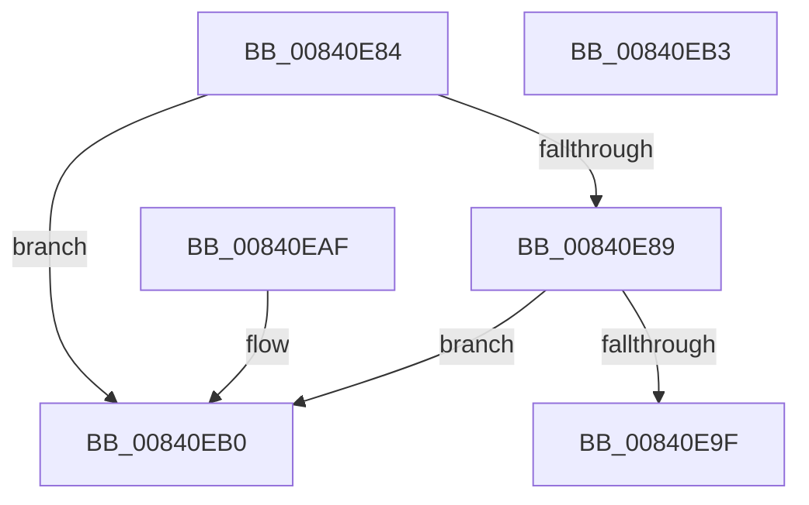

# RtlFindHotPatchBase

- RVA: `0x00840E84`–`0x00840EB4` (길이 `48` bytes)
- VA: `0x0000000140840E84`
- 실행 섹션: `PAGE`
- PDB 이름 있음: `예`; PDB Function 태그: `아니요`
- unwind 정보 RVA: `0x000DB714`
- 디코드: `19`개 명령, `48/48` bytes 표시
- 미해석 바이트: `0` (있으면 어셈블리에 `.byte`로 보존)

> 이 문서는 커널 이미지의 기계어와 PDB 기호를 분석해 생성했습니다. 4번과 5번은 함수 원형과 자료형을 바이너리 사용 방식에서 추정한 C 해석이며 원본 소스 복구 결과는 아닙니다.

## 1. Dependencies

- 직접 호출 지점: **0**; 고유 호출 대상: **0**
- 직접 호출자로 확인된 함수: **3**
- RIP 상대 이미지 참조: **0**

### Outgoing calls
- 직접 디코드된 call 명령이 없습니다.

### Direct callers
- [RtlFindHotPatchBaseMachine](RtlFindHotPatchBaseMachine_function_00840EBC.md) at `0x00840EE4`
- [RtlFindHotPatchInformation](RtlFindHotPatchInformation_function_00840F24.md) at `0x00841102`
- [MiOpenHotPatchFile](../AB/MiOpenHotPatchFile_function_00AB5684.md) at `0x00AB5A38`

### Static image references
- 디코드된 RIP-relative 메모리 참조가 없습니다.

## 2. Other-region calls and transfers

- 다른 실행 섹션으로 향하는 call: **0**
- 별도 외부 분기/꼬리 이동을 확인하지 못했습니다.

## 3. Assembly (complete function range)

```asm
00840E84  3B 51 10                        cmp edx, dword ptr [rcx + 0x10]
00840E87  73 27                           jae 0x140840eb0
00840E89  8B 41 0C                        mov eax, dword ptr [rcx + 0xc]
00840E8C  48 03 C1                        add rax, rcx
00840E8F  8B D2                           mov edx, edx
00840E91  44 8B 04 90                     mov r8d, dword ptr [rax + rdx*4]
00840E95  4D 8D 48 20                     lea r9, [r8 + 0x20]
00840E99  49 83 F9 20                     cmp r9, 0x20
00840E9D  76 11                           jbe 0x140840eb0
00840E9F  8B 51 04                        mov edx, dword ptr [rcx + 4]
00840EA2  33 C0                           xor eax, eax
00840EA4  49 03 C8                        add rcx, r8
00840EA7  4C 3B CA                        cmp r9, rdx
00840EAA  48 0F 46 C1                     cmovbe rax, rcx
00840EAE  C3                              ret
00840EAF  CC                              int3
00840EB0  33 C0                           xor eax, eax
00840EB2  C3                              ret
00840EB3  CC                              int3
```

## 4. C-style interpretation (structured pseudocode)

```c
__int64 __fastcall RtlFindHotPatchBase(__int64 a1, int a2)
{
    __int64 result;

    if (a2 >= (*(unsigned int *)(a1 + 16))) goto loc_00840EB0;
    result = ((unsigned int)(*(unsigned int *)(a1 + 12))) + (a1);
    if (((unsigned int)(*(unsigned int *)(result + (unsigned int)(a2) * 4)) + 32) <= 32) goto loc_00840EB0;
    result = 0;
    a1 = (a1) + ((unsigned int)(*(unsigned int *)(result + (unsigned int)(a2) * 4)));
    if (((unsigned int)(*(unsigned int *)(result + (unsigned int)(a2) * 4)) + 32) <= ((unsigned int)(*(unsigned int *)(a1 + 4)))) { result = a1; }
    return result;
loc_00840EB0:
    result = 0;
    return result;
}
```

## 5. (Beta) C Style

```c
int64_t RtlFindHotPatchBase(void *Arg1, int32_t Arg2)
{
    uint8_t *arg1 = (uint8_t *)Arg1;

    int64_t result;

    if (Arg2 >= (*(uint32_t *)(arg1 + 0x10))) goto loc_00840EB0;
    result = ((uint32_t)(*(uint32_t *)(arg1 + 0xC))) + (Arg1);
    if (((uint32_t)(*(uint32_t *)(result + (uint32_t)(Arg2) * 4)) + 32) <= 32) goto loc_00840EB0;
    result = 0;
    Arg1 = (Arg1) + ((uint32_t)(*(uint32_t *)(result + (uint32_t)(Arg2) * 4)));
    if (((uint32_t)(*(uint32_t *)(result + (uint32_t)(Arg2) * 4)) + 32) <= ((uint32_t)(*(uint32_t *)(arg1 + 0x4)))) { result = Arg1; }
    return result;
loc_00840EB0:
    result = 0;
    return result;
}
```

### 관측된 메모리 오프셋

구조체 형식이 확인되지 않은 접근은 인자 기준의 오프셋으로만 기록했습니다.

| 기준 인자 | 오프셋 표현 | 폭 (bit) | 접근 |
|---|---:|---:|---|
| `Arg1` | `+ 0x4` | `32` | `R` |
| `Arg1` | `+ 0xC` | `32` | `R` |
| `Arg1` | `+ 0x10` | `32` | `R` |

## 6. Execution-region graph

[열기: 2D/3D 그래프와 함수 탐색 컨트롤 패널](../../../control-panel.html?section=page&rva=0x00840E84&view=graph)

- 2D 그래프는 위에서 아래로 흐르고, 3D 그래프는 빈 공간을 드래그해 회전합니다. Shift+드래그는 이동, 휠은 확대·축소, 함수 노드 선택은 대상 보고서 이동입니다.

### Static fallback


