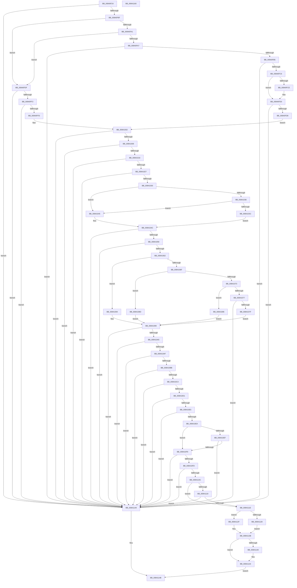

# RtlFindHotPatchInformation

- RVA: `0x00840F24`–`0x00841161` (길이 `573` bytes)
- VA: `0x0000000140840F24`
- 실행 섹션: `PAGE`
- PDB 이름 있음: `예`; PDB Function 태그: `아니요`
- unwind 정보 RVA: `0x000DB624`
- 디코드: `165`개 명령, `573/573` bytes 표시
- 미해석 바이트: `0` (있으면 어셈블리에 `.byte`로 보존)

> 이 문서는 커널 이미지의 기계어와 PDB 기호를 분석해 생성했습니다. 4번과 5번은 함수 원형과 자료형을 바이너리 사용 방식에서 추정한 C 해석이며 원본 소스 복구 결과는 아닙니다.

## 1. Dependencies

- 직접 호출 지점: **4**; 고유 호출 대상: **4**
- 직접 호출자로 확인된 함수: **3**
- RIP 상대 이미지 참조: **0**

### Outgoing calls
- `0x00840F61` → [RtlImageNtHeaderEx](../../text/41/RtlImageNtHeaderEx_function_0041EAA0.md) (function, `0x0041EAA0`)
- `0x00840F7E` → [RtlImageDirectoryEntryToData](../../text/43/RtlImageDirectoryEntryToData_function_004328D0.md) (function, `0x004328D0`)
- `0x00841102` → [RtlFindHotPatchBase](RtlFindHotPatchBase_function_00840E84.md) (function, `0x00840E84`)
- `0x0084110F` → [RtlGetHotPatchBaseMachine](RtlGetHotPatchBaseMachine_function_00841168.md) (function, `0x00841168`)

### Direct callers
- [MiApplyDriverHotPatch](../80/MiApplyDriverHotPatch_function_008018EC.md) at `0x00801977`
- [MiCaptureHotPatchInfo](../80/MiCaptureHotPatchInfo_function_00802F98.md) at `0x00802FFC`
- [MiOpenHotPatchFile](../AB/MiOpenHotPatchFile_function_00AB5684.md) at `0x00AB5A10`

### Static image references
- 디코드된 RIP-relative 메모리 참조가 없습니다.

## 2. Other-region calls and transfers

- 다른 실행 섹션으로 향하는 call: **2**
  - `0x00840F61` → [RtlImageNtHeaderEx](../../text/41/RtlImageNtHeaderEx_function_0041EAA0.md) (`PAGE` → `.text`)
  - `0x00840F7E` → [RtlImageDirectoryEntryToData](../../text/43/RtlImageDirectoryEntryToData_function_004328D0.md) (`PAGE` → `.text`)
- 별도 외부 분기/꼬리 이동을 확인하지 못했습니다.

## 3. Assembly (complete function range)

```asm
00840F24  48 8B C4                        mov rax, rsp
00840F27  48 89 58 08                     mov qword ptr [rax + 8], rbx
00840F2B  55                              push rbp
00840F2C  56                              push rsi
00840F2D  57                              push rdi
00840F2E  41 54                           push r12
00840F30  41 55                           push r13
00840F32  41 56                           push r14
00840F34  41 57                           push r15
00840F36  48 83 EC 20                     sub rsp, 0x20
00840F3A  45 33 ED                        xor r13d, r13d
00840F3D  4C 8D 48 20                     lea r9, [rax + 0x20]
00840F41  4C 8B E2                        mov r12, rdx
00840F44  44 89 68 18                     mov dword ptr [rax + 0x18], r13d
00840F48  4C 8B F1                        mov r14, rcx
00840F4B  4C 89 68 20                     mov qword ptr [rax + 0x20], r13
00840F4F  48 8B D1                        mov rdx, rcx
00840F52  45 33 C0                        xor r8d, r8d
00840F55  41 8D 5D 01                     lea ebx, [r13 + 1]
00840F59  41 8B ED                        mov ebp, r13d
00840F5C  8B CB                           mov ecx, ebx
00840F5E  41 8B F5                        mov esi, r13d
00840F61  E8 3A DB BD FF                  call 0x14041eaa0
00840F66  4C 8B 7C 24 78                  mov r15, qword ptr [rsp + 0x78]
00840F6B  45 8D 45 0A                     lea r8d, [r13 + 0xa]
00840F6F  4C 8D 4C 24 70                  lea r9, [rsp + 0x70]
00840F74  8A D3                           mov dl, bl
00840F76  49 8B CE                        mov rcx, r14
00840F79  41 0F B7 7F 04                  movzx edi, word ptr [r15 + 4]
00840F7E  E8 4D 19 BF FF                  call 0x1404328d0
00840F83  48 8B C8                        mov rcx, rax
00840F86  48 85 C0                        test rax, rax
00840F89  0F 84 BA 01 00 00               je 0x140841149
00840F8F  41 B8 64 86 00 00               mov r8d, 0x8664
00840F95  41 BA 64 AA 00 00               mov r10d, 0xaa64
00840F9B  66 41 3B F8                     cmp di, r8w
00840F9F  74 3E                           je 0x140840fdf
00840FA1  66 41 3B FA                     cmp di, r10w
00840FA5  74 38                           je 0x140840fdf
00840FA7  B8 4C 01 00 00                  mov eax, 0x14c
00840FAC  66 3B F8                        cmp di, ax
00840FAF  0F 85 94 01 00 00               jne 0x140841149
00840FB5  8B 44 24 70                     mov eax, dword ptr [rsp + 0x70]
00840FB9  45 8D 5D 04                     lea r11d, [r13 + 4]
00840FBD  41 3B C3                        cmp eax, r11d
00840FC0  0F 86 83 01 00 00               jbe 0x140841149
00840FC6  48 8B E9                        mov rbp, rcx
00840FC9  83 F8 40                        cmp eax, 0x40
00840FCC  75 02                           jne 0x140840fd0
00840FCE  8B 01                           mov eax, dword ptr [rcx]
00840FD0  3B 01                           cmp eax, dword ptr [rcx]
00840FD2  0F 85 71 01 00 00               jne 0x140841149
00840FD8  3D 98 00 00 00                  cmp eax, 0x98
00840FDD  EB 23                           jmp 0x140841002
00840FDF  8B 44 24 70                     mov eax, dword ptr [rsp + 0x70]
00840FE3  41 BB 04 00 00 00               mov r11d, 4
00840FE9  41 3B C3                        cmp eax, r11d
00840FEC  0F 86 57 01 00 00               jbe 0x140841149
00840FF2  48 8B F1                        mov rsi, rcx
00840FF5  3B 01                           cmp eax, dword ptr [rcx]
00840FF7  0F 85 4C 01 00 00               jne 0x140841149
00840FFD  3D F4 00 00 00                  cmp eax, 0xf4
00841002  0F 82 41 01 00 00               jb 0x140841149
00841008  8B D0                           mov edx, eax
0084100A  48 03 D1                        add rdx, rcx
0084100D  48 3B D1                        cmp rdx, rcx
00841010  0F 82 33 01 00 00               jb 0x140841149
00841016  45 8B 4F 50                     mov r9d, dword ptr [r15 + 0x50]
0084101A  4B 8D 04 0E                     lea rax, [r14 + r9]
0084101E  48 3B C8                        cmp rcx, rax
00841021  0F 83 22 01 00 00               jae 0x140841149
00841027  48 3B D0                        cmp rdx, rax
0084102A  0F 87 19 01 00 00               ja 0x140841149
00841030  66 41 3B F8                     cmp di, r8w
00841034  74 0F                           je 0x140841045
00841036  66 41 3B FA                     cmp di, r10w
0084103A  74 09                           je 0x140841045
0084103C  44 8B 85 94 00 00 00            mov r8d, dword ptr [rbp + 0x94]
00841043  EB 07                           jmp 0x14084104c
00841045  44 8B 86 F0 00 00 00            mov r8d, dword ptr [rsi + 0xf0]
0084104C  41 8D 40 08                     lea eax, [r8 + 8]
00841050  83 F8 08                        cmp eax, 8
00841053  0F 86 F0 00 00 00               jbe 0x140841149
00841059  41 3B C1                        cmp eax, r9d
0084105C  0F 87 E7 00 00 00               ja 0x140841149
00841062  45 8B D0                        mov r10d, r8d
00841065  4D 03 D6                        add r10, r14
00841068  41 8B 0A                        mov ecx, dword ptr [r10]
0084106B  2B CB                           sub ecx, ebx
0084106D  74 25                           je 0x140841094
0084106F  2B CB                           sub ecx, ebx
00841071  74 1A                           je 0x14084108d
00841073  2B CB                           sub ecx, ebx
00841075  74 0F                           je 0x140841086
00841077  3B CB                           cmp ecx, ebx
00841079  0F 85 CA 00 00 00               jne 0x140841149
0084107F  B8 24 00 00 00                  mov eax, 0x24
00841084  EB 13                           jmp 0x140841099
00841086  B8 1C 00 00 00                  mov eax, 0x1c
0084108B  EB 0C                           jmp 0x140841099
0084108D  B8 18 00 00 00                  mov eax, 0x18
00841092  EB 05                           jmp 0x140841099
00841094  B8 14 00 00 00                  mov eax, 0x14
00841099  41 8B 52 04                     mov edx, dword ptr [r10 + 4]
0084109D  3B D0                           cmp edx, eax
0084109F  0F 82 A4 00 00 00               jb 0x140841149
008410A5  45 39 6A 08                     cmp dword ptr [r10 + 8], r13d
008410A9  0F 84 9A 00 00 00               je 0x140841149
008410AF  42 8D 04 02                     lea eax, [rdx + r8]
008410B3  3B C2                           cmp eax, edx
008410B5  0F 86 8E 00 00 00               jbe 0x140841149
008410BB  41 3B C1                        cmp eax, r9d
008410BE  0F 87 85 00 00 00               ja 0x140841149
008410C4  45 8B 42 10                     mov r8d, dword ptr [r10 + 0x10]
008410C8  41 81 F8 F7 FF FF 3F            cmp r8d, 0x3ffffff7
008410CF  77 78                           ja 0x140841149
008410D1  45 8B 4A 0C                     mov r9d, dword ptr [r10 + 0xc]
008410D5  42 8D 0C 85 00 00 00 00         lea ecx, [r8*4]
008410DD  44 03 C9                        add r9d, ecx
008410E0  44 3B C9                        cmp r9d, ecx
008410E3  76 64                           jbe 0x140841149
008410E5  44 3B CA                        cmp r9d, edx
008410E8  77 5F                           ja 0x140841149
008410EA  48 85 F6                        test rsi, rsi
008410ED  74 09                           je 0x1408410f8
008410EF  4C 39 AE C8 00 00 00            cmp qword ptr [rsi + 0xc8], r13
008410F6  75 51                           jne 0x140841149
008410F8  44 3B C3                        cmp r8d, ebx
008410FB  75 4C                           jne 0x140841149
008410FD  33 D2                           xor edx, edx
008410FF  49 8B CA                        mov rcx, r10
00841102  E8 7D FD FF FF                  call 0x140840e84
00841107  48 85 C0                        test rax, rax
0084110A  74 3D                           je 0x140841149
0084110C  48 8B C8                        mov rcx, rax
0084110F  E8 54 00 00 00                  call 0x140841168
00841114  66 85 C0                        test ax, ax
00841117  74 05                           je 0x14084111e
00841119  66 3B C7                        cmp ax, di
0084111C  75 2B                           jne 0x140841149
0084111E  B8 64 86 00 00                  mov eax, 0x8664
00841123  66 3B F8                        cmp di, ax
00841126  75 07                           jne 0x14084112f
00841128  BB 02 00 00 00                  mov ebx, 2
0084112D  EB 0C                           jmp 0x14084113b
0084112F  B8 64 AA 00 00                  mov eax, 0xaa64
00841134  66 3B F8                        cmp di, ax
00841137  41 0F 44 DB                     cmove ebx, r11d
0084113B  4D 85 E4                        test r12, r12
0084113E  74 04                           je 0x140841144
00841140  41 89 1C 24                     mov dword ptr [r12], ebx
00841144  49 8B C2                        mov rax, r10
00841147  EB 02                           jmp 0x14084114b
00841149  33 C0                           xor eax, eax
0084114B  48 8B 5C 24 60                  mov rbx, qword ptr [rsp + 0x60]
00841150  48 83 C4 20                     add rsp, 0x20
00841154  41 5F                           pop r15
00841156  41 5E                           pop r14
00841158  41 5D                           pop r13
0084115A  41 5C                           pop r12
0084115C  5F                              pop rdi
0084115D  5E                              pop rsi
0084115E  5D                              pop rbp
0084115F  C3                              ret
00841160  CC                              int3
```

## 4. C-style interpretation (structured pseudocode)

```c
__int64 __fastcall RtlFindHotPatchInformation(__int64 a1, __int64 a2, int a3)
{
    __int64 result;
    __int64 v_r10;
    __int64 v_r13;
    __int64 v_rbx;
    __int64 v_rsp;
    unsigned __int64 v_stack_p18;
    unsigned __int64 v_stack_p20;
    unsigned __int64 v_stack_p8;

    *(unsigned __int64 *)(v_rsp + 8) = v_rbx;
    v_rsp = (v_rsp) - (32);
    v_r13 = 0;
    *(unsigned int *)(v_rsp + 24) = 0;
    *(unsigned __int64 *)(v_rsp + 32) = 0;
    a3 = 0;
    result = RtlImageNtHeaderEx((unsigned int)((unsigned int)(v_r13 + 1)), a1, a3, v_rsp + 32);
    result = RtlImageDirectoryEntryToData(a1, (unsigned __int8)(v_r13 + 1), v_r13 + 10, v_stack_p18);
    if (result == 0) goto loc_00841149;
    if (((unsigned __int16)(*(unsigned __int16 *)(v_stack_p20 + 4))) == ((unsigned __int16)((unsigned int)(0x8664ULL)))) goto loc_00840FDF;
    if (((unsigned __int16)(*(unsigned __int16 *)(v_stack_p20 + 4))) == ((unsigned __int16)((unsigned int)(0xAA64ULL)))) goto loc_00840FDF;
    if (((unsigned __int16)(*(unsigned __int16 *)(v_stack_p20 + 4))) != 332) goto loc_00841149;
    if (((unsigned int)((unsigned int)(v_stack_p18))) <= ((unsigned int)(v_r13 + 4))) goto loc_00841149;
    result = (unsigned int)(v_stack_p18);
    if (((unsigned int)((unsigned int)(v_stack_p18))) == 64) {
        result = *(unsigned int *)(result);
    }
    if (((unsigned int)(result)) != (*(unsigned int *)(result))) goto loc_00841149;
    goto loc_00841002;
loc_00840FDF:
    if (((unsigned int)((unsigned int)(v_stack_p18))) <= 4) goto loc_00841149;
    if (((unsigned int)((unsigned int)(v_stack_p18))) != (*(unsigned int *)(result))) goto loc_00841149;
loc_00841002:
    if (((unsigned int)((unsigned int)(v_stack_p18))) < 244) goto loc_00841149;
    a2 = ((unsigned int)((unsigned int)((unsigned int)(v_stack_p18)))) + (result);
    if (a2 < result) goto loc_00841149;
    if (result >= (a1 + (unsigned int)(*(unsigned int *)(v_stack_p20 + 80)) * 1)) goto loc_00841149;
    if (a2 > (a1 + (unsigned int)(*(unsigned int *)(v_stack_p20 + 80)) * 1)) goto loc_00841149;
    if (((unsigned __int16)(*(unsigned __int16 *)(v_stack_p20 + 4))) == ((unsigned __int16)((unsigned int)(0x8664ULL)))) goto loc_00841045;
    if (((unsigned __int16)(*(unsigned __int16 *)(v_stack_p20 + 4))) == ((unsigned __int16)((unsigned int)(0xAA64ULL)))) goto loc_00841045;
    goto loc_0084104C;
loc_00841045:
loc_0084104C:
    if (((unsigned int)((unsigned int)(*(unsigned int *)(result + 240)) + 8)) <= 8) goto loc_00841149;
    if (((unsigned int)((unsigned int)(*(unsigned int *)(result + 240)) + 8)) > ((unsigned int)((unsigned int)(*(unsigned int *)(v_stack_p20 + 80))))) goto loc_00841149;
    v_r10 = ((unsigned int)((unsigned int)((unsigned int)(*(unsigned int *)(result + 240))))) + (a1);
    a1 = (unsigned int)(((unsigned int)(*(unsigned int *)(v_r10))) - ((unsigned int)(v_r13 + 1)));
    if (condition_is_equal) goto loc_00841094;
    a1 = (unsigned int)((a1) - ((unsigned int)(v_r13 + 1)));
    if (condition_is_equal) goto loc_0084108D;
    a1 = (unsigned int)((a1) - ((unsigned int)(v_r13 + 1)));
    if (condition_is_equal) goto loc_00841086;
    if (((unsigned int)(a1)) != ((unsigned int)(v_r13 + 1))) goto loc_00841149;
    goto loc_00841099;
loc_00841086:
    goto loc_00841099;
loc_0084108D:
    goto loc_00841099;
loc_00841094:
loc_00841099:
    if (((unsigned int)((unsigned int)(*(unsigned int *)(v_r10 + 4)))) < 20) goto loc_00841149;
    if ((*(unsigned int *)(v_r10 + 8)) == 0) goto loc_00841149;
    if (((unsigned int)((unsigned int)(*(unsigned int *)(v_r10 + 4)) + (unsigned int)(*(unsigned int *)(result + 240)) * 1)) <= ((unsigned int)((unsigned int)(*(unsigned int *)(v_r10 + 4))))) goto loc_00841149;
    if (((unsigned int)((unsigned int)(*(unsigned int *)(v_r10 + 4)) + (unsigned int)(*(unsigned int *)(result + 240)) * 1)) > ((unsigned int)((unsigned int)(*(unsigned int *)(v_stack_p20 + 80))))) goto loc_00841149;
    if (((unsigned int)((unsigned int)(*(unsigned int *)(v_r10 + 16)))) > 0x3FFFFFF7ULL) goto loc_00841149;
    a4 = (unsigned int)(((unsigned int)(*(unsigned int *)(v_r10 + 12))) + ((unsigned int)((unsigned int)(*(unsigned int *)(v_r10 + 16)) * 4)));
    if (((unsigned int)(a4)) <= ((unsigned int)((unsigned int)(*(unsigned int *)(v_r10 + 16)) * 4))) goto loc_00841149;
    if (((unsigned int)(a4)) > ((unsigned int)((unsigned int)(*(unsigned int *)(v_r10 + 4))))) goto loc_00841149;
    if (result == 0) goto loc_008410F8;
    if ((*(unsigned __int64 *)(result + 200)) != 0) goto loc_00841149;
loc_008410F8:
    if (((unsigned int)((unsigned int)(*(unsigned int *)(v_r10 + 16)))) != ((unsigned int)(v_r13 + 1))) goto loc_00841149;
    a2 = 0;
    result = RtlFindHotPatchBase(v_r10, a2, (unsigned int)(*(unsigned int *)(v_r10 + 16)), a4);
    if (result == 0) goto loc_00841149;
    result = RtlGetHotPatchBaseMachine(result, a2, (unsigned int)(*(unsigned int *)(v_r10 + 16)), a4);
    if ((unsigned __int16)(result) == 0) goto loc_0084111E;
    if (((unsigned __int16)(result)) != ((unsigned __int16)(*(unsigned __int16 *)(v_stack_p20 + 4)))) goto loc_00841149;
loc_0084111E:
    if (((unsigned __int16)(*(unsigned __int16 *)(v_stack_p20 + 4))) != ((unsigned __int16)((unsigned int)(0x8664ULL)))) goto loc_0084112F;
    goto loc_0084113B;
loc_0084112F:
    v_rbx = 2;
    if (((unsigned __int16)(*(unsigned __int16 *)(v_stack_p20 + 4))) == ((unsigned __int16)((unsigned int)(0xAA64ULL)))) { v_rbx = 4; }
loc_0084113B:
    if (0 != 0) {
        *(unsigned int *)(a2) = (unsigned int)(v_rbx);
    }
    goto loc_0084114B;
loc_00841149:
    result = 0;
loc_0084114B:
    v_rsp = (v_rsp) + (32);
    return result;
}
```

## 5. (Beta) C Style

```c
int64_t RtlFindHotPatchInformation(void *Arg1, int64_t Arg2, int32_t Arg3)
{
    uint8_t *arg1 = (uint8_t *)Arg1;

    int64_t result;
    int64_t local_r10;
    int64_t local_r13;
    int64_t local_rbx;
    int64_t local_rsp;
    uint64_t v_stack_p18;
    uint64_t v_stack_p20;
    uint64_t v_stack_p8;

    *(uint64_t *)(local_rsp + 0x8) = local_rbx;
    local_rsp = (local_rsp) - (32);
    local_r13 = 0;
    *(uint32_t *)(local_rsp + 0x18) = 0;
    *(uint64_t *)(local_rsp + 0x20) = 0;
    Arg3 = 0;
    result = RtlImageNtHeaderEx((uint32_t)((uint32_t)(local_r13 + 1)), Arg1, Arg3, local_rsp + 32);
    result = RtlImageDirectoryEntryToData(Arg1, (uint8_t)(local_r13 + 1), local_r13 + 10, v_stack_p18);
    if (result == 0) goto loc_00841149;
    if (((uint16_t)(*(uint16_t *)(v_stack_p20 + 0x4))) == ((uint16_t)((uint32_t)(0x8664ULL)))) goto loc_00840FDF;
    if (((uint16_t)(*(uint16_t *)(v_stack_p20 + 0x4))) == ((uint16_t)((uint32_t)(0xAA64ULL)))) goto loc_00840FDF;
    if (((uint16_t)(*(uint16_t *)(v_stack_p20 + 0x4))) != 332) goto loc_00841149;
    if (((uint32_t)((uint32_t)(v_stack_p18))) <= ((uint32_t)(local_r13 + 4))) goto loc_00841149;
    result = (uint32_t)(v_stack_p18);
    if (((uint32_t)((uint32_t)(v_stack_p18))) == 64) {
        result = *(uint32_t *)(result);
    }
    if (((uint32_t)(result)) != (*(uint32_t *)(result))) goto loc_00841149;
    goto loc_00841002;
loc_00840FDF:
    if (((uint32_t)((uint32_t)(v_stack_p18))) <= 4) goto loc_00841149;
    if (((uint32_t)((uint32_t)(v_stack_p18))) != (*(uint32_t *)(result))) goto loc_00841149;
loc_00841002:
    if (((uint32_t)((uint32_t)(v_stack_p18))) < 244) goto loc_00841149;
    Arg2 = ((uint32_t)((uint32_t)((uint32_t)(v_stack_p18)))) + (result);
    if (Arg2 < result) goto loc_00841149;
    if (result >= (Arg1 + (uint32_t)(*(uint32_t *)(v_stack_p20 + 0x50)) * 1)) goto loc_00841149;
    if (Arg2 > (Arg1 + (uint32_t)(*(uint32_t *)(v_stack_p20 + 0x50)) * 1)) goto loc_00841149;
    if (((uint16_t)(*(uint16_t *)(v_stack_p20 + 0x4))) == ((uint16_t)((uint32_t)(0x8664ULL)))) goto loc_00841045;
    if (((uint16_t)(*(uint16_t *)(v_stack_p20 + 0x4))) == ((uint16_t)((uint32_t)(0xAA64ULL)))) goto loc_00841045;
    goto loc_0084104C;
loc_00841045:
loc_0084104C:
    if (((uint32_t)((uint32_t)(*(uint32_t *)(result + 0xF0)) + 8)) <= 8) goto loc_00841149;
    if (((uint32_t)((uint32_t)(*(uint32_t *)(result + 0xF0)) + 8)) > ((uint32_t)((uint32_t)(*(uint32_t *)(v_stack_p20 + 0x50))))) goto loc_00841149;
    local_r10 = ((uint32_t)((uint32_t)((uint32_t)(*(uint32_t *)(result + 0xF0))))) + (Arg1);
    Arg1 = (uint32_t)(((uint32_t)(*(uint32_t *)(local_r10))) - ((uint32_t)(local_r13 + 1)));
    if (condition_is_equal) goto loc_00841094;
    Arg1 = (uint32_t)((Arg1) - ((uint32_t)(local_r13 + 1)));
    if (condition_is_equal) goto loc_0084108D;
    Arg1 = (uint32_t)((Arg1) - ((uint32_t)(local_r13 + 1)));
    if (condition_is_equal) goto loc_00841086;
    if (((uint32_t)(Arg1)) != ((uint32_t)(local_r13 + 1))) goto loc_00841149;
    goto loc_00841099;
loc_00841086:
    goto loc_00841099;
loc_0084108D:
    goto loc_00841099;
loc_00841094:
loc_00841099:
    if (((uint32_t)((uint32_t)(*(uint32_t *)(local_r10 + 0x4)))) < 20) goto loc_00841149;
    if ((*(uint32_t *)(local_r10 + 0x8)) == 0) goto loc_00841149;
    if (((uint32_t)((uint32_t)(*(uint32_t *)(local_r10 + 0x4)) + (uint32_t)(*(uint32_t *)(result + 0xF0)) * 1)) <= ((uint32_t)((uint32_t)(*(uint32_t *)(local_r10 + 0x4))))) goto loc_00841149;
    if (((uint32_t)((uint32_t)(*(uint32_t *)(local_r10 + 0x4)) + (uint32_t)(*(uint32_t *)(result + 0xF0)) * 1)) > ((uint32_t)((uint32_t)(*(uint32_t *)(v_stack_p20 + 0x50))))) goto loc_00841149;
    if (((uint32_t)((uint32_t)(*(uint32_t *)(local_r10 + 0x10)))) > 0x3FFFFFF7ULL) goto loc_00841149;
    a4 = (uint32_t)(((uint32_t)(*(uint32_t *)(local_r10 + 0xC))) + ((uint32_t)((uint32_t)(*(uint32_t *)(local_r10 + 0x10)) * 4)));
    if (((uint32_t)(a4)) <= ((uint32_t)((uint32_t)(*(uint32_t *)(local_r10 + 0x10)) * 4))) goto loc_00841149;
    if (((uint32_t)(a4)) > ((uint32_t)((uint32_t)(*(uint32_t *)(local_r10 + 0x4))))) goto loc_00841149;
    if (result == 0) goto loc_008410F8;
    if ((*(uint64_t *)(result + 0xC8)) != 0) goto loc_00841149;
loc_008410F8:
    if (((uint32_t)((uint32_t)(*(uint32_t *)(local_r10 + 0x10)))) != ((uint32_t)(local_r13 + 1))) goto loc_00841149;
    Arg2 = 0;
    result = RtlFindHotPatchBase(local_r10, Arg2, (uint32_t)(*(uint32_t *)(local_r10 + 0x10)), a4);
    if (result == 0) goto loc_00841149;
    result = RtlGetHotPatchBaseMachine(result, Arg2, (uint32_t)(*(uint32_t *)(local_r10 + 0x10)), a4);
    if ((uint16_t)(result) == 0) goto loc_0084111E;
    if (((uint16_t)(result)) != ((uint16_t)(*(uint16_t *)(v_stack_p20 + 0x4)))) goto loc_00841149;
loc_0084111E:
    if (((uint16_t)(*(uint16_t *)(v_stack_p20 + 0x4))) != ((uint16_t)((uint32_t)(0x8664ULL)))) goto loc_0084112F;
    goto loc_0084113B;
loc_0084112F:
    local_rbx = 2;
    if (((uint16_t)(*(uint16_t *)(v_stack_p20 + 0x4))) == ((uint16_t)((uint32_t)(0xAA64ULL)))) { local_rbx = 4; }
loc_0084113B:
    if (0 != 0) {
        *(uint32_t *)(Arg2) = (uint32_t)(local_rbx);
    }
    goto loc_0084114B;
loc_00841149:
    result = 0;
loc_0084114B:
    local_rsp = (local_rsp) + (32);
    return result;
}
```

### 관측된 메모리 오프셋

구조체 형식이 확인되지 않은 접근은 인자 기준의 오프셋으로만 기록했습니다.

| 기준 인자 | 오프셋 표현 | 폭 (bit) | 접근 |
|---|---:|---:|---|
| `Arg1` | `+ 0x0 + r9*1` | `64` | `R` |

## 6. Execution-region graph

[열기: 2D/3D 그래프와 함수 탐색 컨트롤 패널](../../../control-panel.html?section=page&rva=0x00840F24&view=graph)

- 2D 그래프는 위에서 아래로 흐르고, 3D 그래프는 빈 공간을 드래그해 회전합니다. Shift+드래그는 이동, 휠은 확대·축소, 함수 노드 선택은 대상 보고서 이동입니다.

### Static fallback


