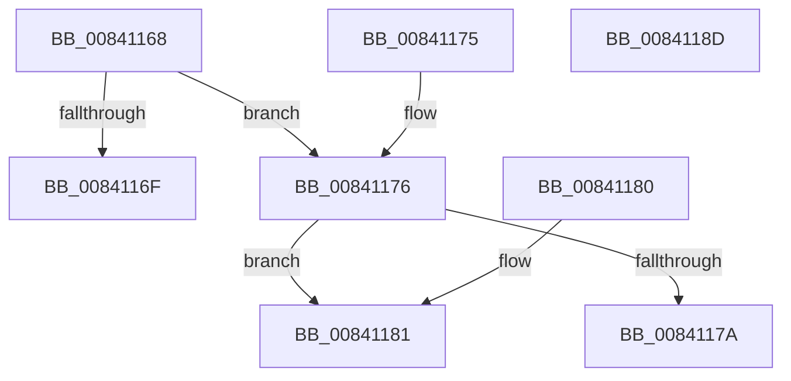

# RtlGetHotPatchBaseMachine

- RVA: `0x00841168`–`0x0084118E` (길이 `38` bytes)
- VA: `0x0000000140841168`
- 실행 섹션: `PAGE`
- PDB 이름 있음: `예`; PDB Function 태그: `아니요`
- unwind 정보 RVA: `0x000DB714`
- 디코드: `17`개 명령, `38/38` bytes 표시
- 미해석 바이트: `0` (있으면 어셈블리에 `.byte`로 보존)

> 이 문서는 커널 이미지의 기계어와 PDB 기호를 분석해 생성했습니다. 4번과 5번은 함수 원형과 자료형을 바이너리 사용 방식에서 추정한 C 해석이며 원본 소스 복구 결과는 아닙니다.

## 1. Dependencies

- 직접 호출 지점: **0**; 고유 호출 대상: **0**
- 직접 호출자로 확인된 함수: **2**
- RIP 상대 이미지 참조: **0**

### Outgoing calls
- 직접 디코드된 call 명령이 없습니다.

### Direct callers
- [RtlFindHotPatchBaseMachine](RtlFindHotPatchBaseMachine_function_00840EBC.md) at `0x00840EF1`
- [RtlFindHotPatchInformation](RtlFindHotPatchInformation_function_00840F24.md) at `0x0084110F`

### Static image references
- 디코드된 RIP-relative 메모리 참조가 없습니다.

## 2. Other-region calls and transfers

- 다른 실행 섹션으로 향하는 call: **0**
- 별도 외부 분기/꼬리 이동을 확인하지 못했습니다.

## 3. Assembly (complete function range)

```asm
00841168  8B 41 04                        mov eax, dword ptr [rcx + 4]
0084116B  A8 04                           test al, 4
0084116D  74 07                           je 0x140841176
0084116F  B8 4C 01 00 00                  mov eax, 0x14c
00841174  C3                              ret
00841175  CC                              int3
00841176  A8 10                           test al, 0x10
00841178  74 07                           je 0x140841181
0084117A  B8 64 86 00 00                  mov eax, 0x8664
0084117F  C3                              ret
00841180  CC                              int3
00841181  24 08                           and al, 8
00841183  F6 D8                           neg al
00841185  66 1B C0                        sbb ax, ax
00841188  66 25 64 AA                     and ax, 0xaa64
0084118C  C3                              ret
0084118D  CC                              int3
```

## 4. C-style interpretation (structured pseudocode)

```c
__int64 __fastcall RtlGetHotPatchBaseMachine(__int64 a1)
{
    __int64 result;

    if ((((unsigned __int8)((unsigned int)(*(unsigned int *)(a1 + 4)))) & (4)) == 0) goto loc_00841176;
    return 332;
loc_00841176:
    if (((332) & (16)) == 0) goto loc_00841181;
    return (unsigned int)(0x8664ULL);
loc_00841181:
    result = (unsigned __int8)(((unsigned int)(0x8664ULL)) & (8));
    result = (unsigned __int8)(-(result));
    result = (unsigned __int16)((result) & (0xAA64ULL));
    return result;
}
```

## 5. (Beta) C Style

```c
int64_t RtlGetHotPatchBaseMachine(void *Arg1)
{
    uint8_t *arg1 = (uint8_t *)Arg1;

    int64_t result;

    if ((((uint8_t)((uint32_t)(*(uint32_t *)(arg1 + 0x4)))) & (4)) == 0) goto loc_00841176;
    return 332;
loc_00841176:
    if (((332) & (16)) == 0) goto loc_00841181;
    return (uint32_t)(0x8664ULL);
loc_00841181:
    result = (uint8_t)(((uint32_t)(0x8664ULL)) & (8));
    result = (uint8_t)(-(result));
    result = (uint16_t)((result) & (0xAA64ULL));
    return result;
}
```

### 관측된 메모리 오프셋

구조체 형식이 확인되지 않은 접근은 인자 기준의 오프셋으로만 기록했습니다.

| 기준 인자 | 오프셋 표현 | 폭 (bit) | 접근 |
|---|---:|---:|---|
| `Arg1` | `+ 0x4` | `32` | `R` |

## 6. Execution-region graph

[열기: 2D/3D 그래프와 함수 탐색 컨트롤 패널](../../../control-panel.html?section=page&rva=0x00841168&view=graph)

- 2D 그래프는 위에서 아래로 흐르고, 3D 그래프는 빈 공간을 드래그해 회전합니다. Shift+드래그는 이동, 휠은 확대·축소, 함수 노드 선택은 대상 보고서 이동입니다.

### Static fallback


