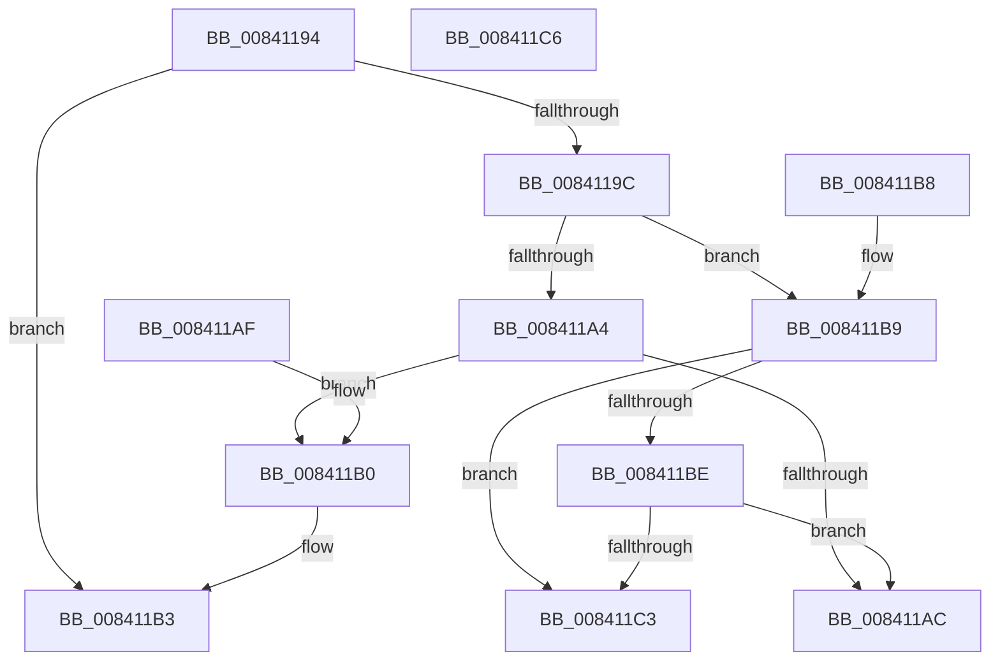

# RtlIsPatchMachineApplicable

- RVA: `0x00841194`–`0x008411C7` (길이 `51` bytes)
- VA: `0x0000000140841194`
- 실행 섹션: `PAGE`
- PDB 이름 있음: `예`; PDB Function 태그: `아니요`
- unwind 정보 RVA: `0x000DB714`
- 디코드: `21`개 명령, `51/51` bytes 표시
- 미해석 바이트: `0` (있으면 어셈블리에 `.byte`로 보존)

> 이 문서는 커널 이미지의 기계어와 PDB 기호를 분석해 생성했습니다. 4번과 5번은 함수 원형과 자료형을 바이너리 사용 방식에서 추정한 C 해석이며 원본 소스 복구 결과는 아닙니다.

## 1. Dependencies

- 직접 호출 지점: **0**; 고유 호출 대상: **0**
- 직접 호출자로 확인된 함수: **4**
- RIP 상대 이미지 참조: **0**

### Outgoing calls
- 직접 디코드된 call 명령이 없습니다.

### Direct callers
- [MiApplyHotPatchToDriver](../80/MiApplyHotPatchToDriver_function_00801E64.md) at `0x00801EA6`
- [MiHotPatchProcess](../80/MiHotPatchProcess_function_00803B78.md) at `0x00803C4C`
- [MiFindProcessImageHotPatchRecord](../A4/MiFindProcessImageHotPatchRecord_function_00A4206C.md) at `0x00A42236`
- [MiFindHotPatchRecord](../A6/MiFindHotPatchRecord_function_00A6E618.md) at `0x00A6E724`

### Static image references
- 디코드된 RIP-relative 메모리 참조가 없습니다.

## 2. Other-region calls and transfers

- 다른 실행 섹션으로 향하는 call: **0**
- 별도 외부 분기/꼬리 이동을 확인하지 못했습니다.

## 3. Assembly (complete function range)

```asm
00841194  81 F9 4C 01 00 00               cmp ecx, 0x14c
0084119A  74 17                           je 0x1408411b3
0084119C  81 F9 64 86 00 00               cmp ecx, 0x8664
008411A2  74 15                           je 0x1408411b9
008411A4  81 F9 64 AA 00 00               cmp ecx, 0xaa64
008411AA  74 04                           je 0x1408411b0
008411AC  32 C0                           xor al, al
008411AE  C3                              ret
008411AF  CC                              int3
008411B0  C1 EA 02                        shr edx, 2
008411B3  B0 01                           mov al, 1
008411B5  22 C2                           and al, dl
008411B7  C3                              ret
008411B8  CC                              int3
008411B9  F6 C2 02                        test dl, 2
008411BC  75 05                           jne 0x1408411c3
008411BE  F6 C2 08                        test dl, 8
008411C1  74 E9                           je 0x1408411ac
008411C3  B0 01                           mov al, 1
008411C5  C3                              ret
008411C6  CC                              int3
```

## 4. C-style interpretation (structured pseudocode)

```c
__int64 __fastcall RtlIsPatchMachineApplicable(int a1, int a2)
{
    __int64 result;

    if (a1 == 332) goto loc_008411B3;
    if (a1 == 0x8664ULL) goto loc_008411B9;
    if (a1 == 0xAA64ULL) goto loc_008411B0;
loc_008411AC:
    result = 0;
    return result;
loc_008411B0:
    a2 = (unsigned int)((a2) >> (2));
loc_008411B3:
    result = (unsigned __int8)((1) & ((unsigned __int8)(a2)));
    return result;
loc_008411B9:
    if ((((unsigned __int8)(a2)) & (2)) != 0) goto loc_008411C3;
    if ((((unsigned __int8)(a2)) & (8)) == 0) goto loc_008411AC;
loc_008411C3:
    return 1;
}
```

## 5. (Beta) C Style

```c
int64_t RtlIsPatchMachineApplicable(int32_t Arg1, int32_t Arg2)
{
    int64_t result;

    if (Arg1 == 332) goto loc_008411B3;
    if (Arg1 == 0x8664ULL) goto loc_008411B9;
    if (Arg1 == 0xAA64ULL) goto loc_008411B0;
loc_008411AC:
    result = 0;
    return result;
loc_008411B0:
    Arg2 = (uint32_t)((Arg2) >> (2));
loc_008411B3:
    result = (uint8_t)((1) & ((uint8_t)(Arg2)));
    return result;
loc_008411B9:
    if ((((uint8_t)(Arg2)) & (2)) != 0) goto loc_008411C3;
    if ((((uint8_t)(Arg2)) & (8)) == 0) goto loc_008411AC;
loc_008411C3:
    return 1;
}
```

## 6. Execution-region graph

[열기: 2D/3D 그래프와 함수 탐색 컨트롤 패널](../../../control-panel.html?section=page&rva=0x00841194&view=graph)

- 2D 그래프는 위에서 아래로 흐르고, 3D 그래프는 빈 공간을 드래그해 회전합니다. Shift+드래그는 이동, 휠은 확대·축소, 함수 노드 선택은 대상 보고서 이동입니다.

### Static fallback


