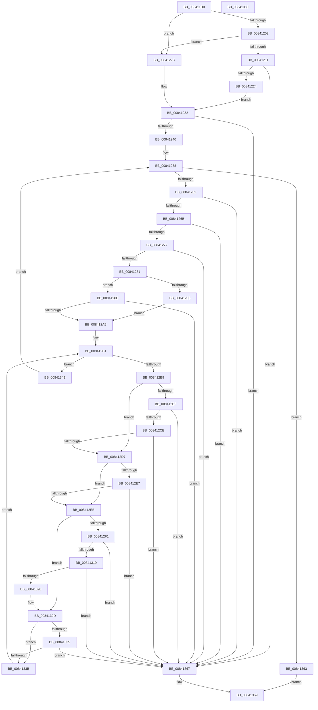

# RtlValidateHotPatchBase

- RVA: `0x008411D0`–`0x00841381` (길이 `433` bytes)
- VA: `0x00000001408411D0`
- 실행 섹션: `PAGE`
- PDB 이름 있음: `예`; PDB Function 태그: `아니요`
- unwind 정보 RVA: `0x000DB65C`
- 디코드: `114`개 명령, `433/433` bytes 표시
- 미해석 바이트: `0` (있으면 어셈블리에 `.byte`로 보존)

> 이 문서는 커널 이미지의 기계어와 PDB 기호를 분석해 생성했습니다. 4번과 5번은 함수 원형과 자료형을 바이너리 사용 방식에서 추정한 C 해석이며 원본 소스 복구 결과는 아닙니다.

## 1. Dependencies

- 직접 호출 지점: **2**; 고유 호출 대상: **2**
- 직접 호출자로 확인된 함수: **2**
- RIP 상대 이미지 참조: **0**

### Outgoing calls
- `0x0084124C` → [RtlGetHotPatchSize](../../text/6A/RtlGetHotPatchSize_function_006AA1D0.md) (function, `0x006AA1D0`)
- `0x00841310` → [RtlDetermineHotPatchExtent](RtlDetermineHotPatchExtent_function_00840D24.md) (function, `0x00840D24`)

### Direct callers
- [MiApplyDriverHotPatch](../80/MiApplyDriverHotPatch_function_008018EC.md) at `0x008019B7`
- [MiCaptureHotPatchInfo](../80/MiCaptureHotPatchInfo_function_00802F98.md) at `0x0080308B`

### Static image references
- 디코드된 RIP-relative 메모리 참조가 없습니다.

## 2. Other-region calls and transfers

- 다른 실행 섹션으로 향하는 call: **1**
  - `0x0084124C` → [RtlGetHotPatchSize](../../text/6A/RtlGetHotPatchSize_function_006AA1D0.md) (`PAGE` → `.text`)
- 별도 외부 분기/꼬리 이동을 확인하지 못했습니다.

## 3. Assembly (complete function range)

```asm
008411D0  48 8B C4                        mov rax, rsp
008411D3  48 89 58 08                     mov qword ptr [rax + 8], rbx
008411D7  48 89 68 10                     mov qword ptr [rax + 0x10], rbp
008411DB  44 89 48 20                     mov dword ptr [rax + 0x20], r9d
008411DF  44 89 40 18                     mov dword ptr [rax + 0x18], r8d
008411E3  56                              push rsi
008411E4  57                              push rdi
008411E5  41 54                           push r12
008411E7  41 55                           push r13
008411E9  41 57                           push r15
008411EB  48 83 EC 40                     sub rsp, 0x40
008411EF  83 60 28 00                     and dword ptr [rax + 0x28], 0
008411F3  B8 64 86 00 00                  mov eax, 0x8664
008411F8  66 39 84 24 98 00 00 00         cmp word ptr [rsp + 0x98], ax
00841200  74 2A                           je 0x14084122c
00841202  B8 64 AA 00 00                  mov eax, 0xaa64
00841207  66 39 84 24 98 00 00 00         cmp word ptr [rsp + 0x98], ax
0084120F  74 1B                           je 0x14084122c
00841211  B8 4C 01 00 00                  mov eax, 0x14c
00841216  66 39 84 24 98 00 00 00         cmp word ptr [rsp + 0x98], ax
0084121E  0F 85 43 01 00 00               jne 0x140841367
00841224  41 BF 04 00 00 00               mov r15d, 4
0084122A  EB 06                           jmp 0x140841232
0084122C  41 BF 08 00 00 00               mov r15d, 8
00841232  8B 42 18                        mov eax, dword ptr [rdx + 0x18]
00841235  8B 51 04                        mov edx, dword ptr [rcx + 4]
00841238  3B C2                           cmp eax, edx
0084123A  0F 83 27 01 00 00               jae 0x140841367
00841240  48 03 D1                        add rdx, rcx
00841243  48 8D 3C 01                     lea rdi, [rcx + rax]
00841247  48 89 54 24 38                  mov qword ptr [rsp + 0x38], rdx
0084124C  E8 7F 8F E6 FF                  call 0x1406aa1d0
00841251  44 8B D0                        mov r10d, eax
00841254  89 44 24 30                     mov dword ptr [rsp + 0x30], eax
00841258  8B 1F                           mov ebx, dword ptr [rdi]
0084125A  85 DB                           test ebx, ebx
0084125C  0F 84 01 01 00 00               je 0x140841363
00841262  48 3B FA                        cmp rdi, rdx
00841265  0F 83 FC 00 00 00               jae 0x140841367
0084126B  F7 C3 00 30 F0 3F               test ebx, 0x3ff03000
00841271  0F 85 F0 00 00 00               jne 0x140841367
00841277  0F BA E3 1E                     bt ebx, 0x1e
0084127B  0F 82 E6 00 00 00               jb 0x140841367
00841281  85 DB                           test ebx, ebx
00841283  79 08                           jns 0x14084128d
00841285  45 8B E9                        mov r13d, r9d
00841288  45 8B E0                        mov r12d, r8d
0084128B  EB 18                           jmp 0x1408412a5
0084128D  8B C3                           mov eax, ebx
0084128F  45 8B E8                        mov r13d, r8d
00841292  25 00 C0 0F 00                  and eax, 0xfc000
00841297  45 8B E1                        mov r12d, r9d
0084129A  3D 00 C0 01 00                  cmp eax, 0x1c000
0084129F  0F 85 C2 00 00 00               jne 0x140841367
008412A5  8B F3                           mov esi, ebx
008412A7  81 E6 FF 0F 00 00               and esi, 0xfff
008412AD  48 83 C7 04                     add rdi, 4
008412B1  85 F6                           test esi, esi
008412B3  0F 84 90 00 00 00               je 0x140841349
008412B9  0F BA E3 0E                     bt ebx, 0xe
008412BD  73 18                           jae 0x1408412d7
008412BF  8B 4F 04                        mov ecx, dword ptr [rdi + 4]
008412C2  41 03 CF                        add ecx, r15d
008412C5  41 3B CF                        cmp ecx, r15d
008412C8  0F 82 99 00 00 00               jb 0x140841367
008412CE  41 3B CC                        cmp ecx, r12d
008412D1  0F 87 90 00 00 00               ja 0x140841367
008412D7  8B EB                           mov ebp, ebx
008412D9  81 E5 00 C0 0F 00               and ebp, 0xfc000
008412DF  81 FD 00 C0 05 00               cmp ebp, 0x5c000
008412E5  75 04                           jne 0x1408412eb
008412E7  85 DB                           test ebx, ebx
008412E9  79 7C                           jns 0x140841367
008412EB  0F BA E3 0F                     bt ebx, 0xf
008412EF  73 3C                           jae 0x14084132d
008412F1  44 0F B7 84 24 98 00 00 00      movzx r8d, word ptr [rsp + 0x98]
008412FA  48 8D 84 24 90 00 00 00         lea rax, [rsp + 0x90]
00841302  8B 17                           mov edx, dword ptr [rdi]
00841304  4C 8D 4C 24 34                  lea r9, [rsp + 0x34]
00841309  8B CB                           mov ecx, ebx
0084130B  48 89 44 24 20                  mov qword ptr [rsp + 0x20], rax
00841310  E8 0F FA FF FF                  call 0x140840d24
00841315  84 C0                           test al, al
00841317  74 4E                           je 0x140841367
00841319  41 8B C5                        mov eax, r13d
0084131C  C1 E8 0C                        shr eax, 0xc
0084131F  39 84 24 90 00 00 00            cmp dword ptr [rsp + 0x90], eax
00841326  77 3F                           ja 0x140841367
00841328  44 8B 54 24 30                  mov r10d, dword ptr [rsp + 0x30]
0084132D  81 FD 00 80 07 00               cmp ebp, 0x78000
00841333  75 06                           jne 0x14084133b
00841335  83 7F 04 FF                     cmp dword ptr [rdi + 4], -1
00841339  73 2C                           jae 0x140841367
0084133B  41 8B C2                        mov eax, r10d
0084133E  FF CE                           dec esi
00841340  48 8D 3C 87                     lea rdi, [rdi + rax*4]
00841344  E9 68 FF FF FF                  jmp 0x1408412b1
00841349  48 8B 54 24 38                  mov rdx, qword ptr [rsp + 0x38]
0084134E  44 8B 8C 24 88 00 00 00         mov r9d, dword ptr [rsp + 0x88]
00841356  44 8B 84 24 80 00 00 00         mov r8d, dword ptr [rsp + 0x80]
0084135E  E9 F5 FE FF FF                  jmp 0x140841258
00841363  B0 01                           mov al, 1
00841365  EB 02                           jmp 0x140841369
00841367  32 C0                           xor al, al
00841369  48 8B 5C 24 70                  mov rbx, qword ptr [rsp + 0x70]
0084136E  48 8B 6C 24 78                  mov rbp, qword ptr [rsp + 0x78]
00841373  48 83 C4 40                     add rsp, 0x40
00841377  41 5F                           pop r15
00841379  41 5D                           pop r13
0084137B  41 5C                           pop r12
0084137D  5F                              pop rdi
0084137E  5E                              pop rsi
0084137F  C3                              ret
00841380  CC                              int3
```

## 4. C-style interpretation (structured pseudocode)

```c
__int64 __fastcall RtlValidateHotPatchBase(__int64 a1, __int64 a2, int a3, int a4, unsigned int a5, unsigned __int16 a6)
{
    __int64 result;
    __int64 v_rbp;
    __int64 v_rdi;
    __int64 v_rsi;
    __int64 v_rsp;
    unsigned __int64 v_stack_m30;
    unsigned __int64 v_stack_m34;
    unsigned int v_stack_m38;
    unsigned __int64 v_stack_m48;
    unsigned __int64 v_stack_p10;
    unsigned int v_stack_p18;
    unsigned int v_stack_p20;
    unsigned __int64 v_stack_p8;

    *(unsigned __int64 *)(v_rsp + 8) = v_rbx;
    *(unsigned __int64 *)(v_rsp + 16) = v_rbp;
    *(unsigned int *)(v_rsp + 32) = a4;
    *(unsigned int *)(v_rsp + 24) = a3;
    v_rsp = (v_rsp) - (64);
    if (a6 == ((unsigned __int16)((unsigned int)(0x8664ULL)))) goto loc_0084122C;
    if (a6 == ((unsigned __int16)((unsigned int)(0xAA64ULL)))) goto loc_0084122C;
    if (a6 != 332) goto loc_00841367;
    goto loc_00841232;
loc_0084122C:
loc_00841232:
    if (((unsigned int)((unsigned int)(*(unsigned int *)(a2 + 24)))) >= ((unsigned int)((unsigned int)(*(unsigned int *)(a1 + 4))))) goto loc_00841367;
    a2 = ((unsigned int)(*(unsigned int *)(a1 + 4))) + (a1);
    v_stack_m30 = a2;
    result = RtlGetHotPatchSize(a1, a2, a3, a4);
    v_stack_m38 = (unsigned int)(result);
loc_00841258:
    if ((unsigned int)((unsigned int)(*(unsigned int *)(a1 + (unsigned int)(*(unsigned int *)(a2 + 24)) * 1))) == 0) goto loc_00841363;
    if ((a1 + (unsigned int)(*(unsigned int *)(a2 + 24)) * 1) >= a2) goto loc_00841367;
    if ((((unsigned int)((unsigned int)(*(unsigned int *)(a1 + (unsigned int)(*(unsigned int *)(a2 + 24)) * 1)))) & (0x3FF03000ULL)) != 0) goto loc_00841367;
    if (condition_is_below) goto loc_00841367;
    if (!sign_flag) goto loc_0084128D;
    goto loc_008412A5;
loc_0084128D:
    result = (unsigned int)(((unsigned int)((unsigned int)((unsigned int)(*(unsigned int *)(a1 + (unsigned int)(*(unsigned int *)(a2 + 24)) * 1))))) & (0xFC000ULL));
    if (((unsigned int)(result)) != 0x1C000ULL) goto loc_00841367;
loc_008412A5:
    v_rsi = (unsigned int)(((unsigned int)((unsigned int)((unsigned int)(*(unsigned int *)(a1 + (unsigned int)(*(unsigned int *)(a2 + 24)) * 1))))) & (0xFFFULL));
    v_rdi = (a1 + (unsigned int)(*(unsigned int *)(a2 + 24)) * 1) + (4);
loc_008412B1:
    if ((unsigned int)(v_rsi) == 0) goto loc_00841349;
    if (condition_is_above_or_equal) goto loc_008412D7;
    a1 = (unsigned int)(((unsigned int)(*(unsigned int *)(v_rdi + 4))) + (8));
    if (((unsigned int)(a1)) < 8) goto loc_00841367;
    if (((unsigned int)(a1)) > ((unsigned int)((unsigned int)(a4)))) goto loc_00841367;
loc_008412D7:
    v_rbp = (unsigned int)(((unsigned int)((unsigned int)((unsigned int)(*(unsigned int *)(a1 + (unsigned int)(*(unsigned int *)(a2 + 24)) * 1))))) & (0xFC000ULL));
    if (((unsigned int)(v_rbp)) != 0x5C000ULL) goto loc_008412EB;
    if (!sign_flag) goto loc_00841367;
loc_008412EB:
    if (condition_is_above_or_equal) goto loc_0084132D;
    v_stack_m48 = a5;
    result = RtlDetermineHotPatchExtent((unsigned int)((unsigned int)((unsigned int)(*(unsigned int *)(a1 + (unsigned int)(*(unsigned int *)(a2 + 24)) * 1)))), (unsigned int)(*(unsigned int *)(v_rdi)), a6, v_stack_m34);
    if ((unsigned __int8)(result) == 0) goto loc_00841367;
    result = (unsigned int)(((unsigned int)((unsigned int)((unsigned int)(a3)))) >> (12));
    if (a5 > ((unsigned int)(result))) goto loc_00841367;
loc_0084132D:
    if (((unsigned int)(v_rbp)) != 0x78000ULL) goto loc_0084133B;
    if ((*(unsigned int *)(v_rdi + 4)) >= -1) goto loc_00841367;
loc_0084133B:
    v_rsi = (unsigned int)((v_rsi) - 1);
    goto loc_008412B1;
loc_00841349:
    goto loc_00841258;
loc_00841363:
    goto loc_00841369;
loc_00841367:
    result = 0;
loc_00841369:
    v_rsp = (v_rsp) + (64);
    return result;
}
```

## 5. (Beta) C Style

```c
int64_t RtlValidateHotPatchBase(void *Arg1, void *Arg2, int32_t Arg3, int32_t Arg4, uint32_t Arg5, uint16_t Arg6)
{
    uint8_t *arg1 = (uint8_t *)Arg1;
    uint8_t *arg2 = (uint8_t *)Arg2;

    int64_t result;
    int64_t local_rbp;
    int64_t local_rdi;
    int64_t local_rsi;
    int64_t local_rsp;
    uint64_t v_stack_m30;
    uint64_t v_stack_m34;
    uint32_t v_stack_m38;
    uint64_t v_stack_m48;
    uint64_t v_stack_p10;
    uint32_t v_stack_p18;
    uint32_t v_stack_p20;
    uint64_t v_stack_p8;

    *(uint64_t *)(local_rsp + 0x8) = local_rbx;
    *(uint64_t *)(local_rsp + 0x10) = local_rbp;
    *(uint32_t *)(local_rsp + 0x20) = Arg4;
    *(uint32_t *)(local_rsp + 0x18) = Arg3;
    local_rsp = (local_rsp) - (64);
    if (Arg6 == ((uint16_t)((uint32_t)(0x8664ULL)))) goto loc_0084122C;
    if (Arg6 == ((uint16_t)((uint32_t)(0xAA64ULL)))) goto loc_0084122C;
    if (Arg6 != 332) goto loc_00841367;
    goto loc_00841232;
loc_0084122C:
loc_00841232:
    if (((uint32_t)((uint32_t)(*(uint32_t *)(arg2 + 0x18)))) >= ((uint32_t)((uint32_t)(*(uint32_t *)(arg1 + 0x4))))) goto loc_00841367;
    Arg2 = ((uint32_t)(*(uint32_t *)(arg1 + 0x4))) + (Arg1);
    v_stack_m30 = Arg2;
    result = RtlGetHotPatchSize(Arg1, Arg2, Arg3, Arg4);
    v_stack_m38 = (uint32_t)(result);
loc_00841258:
    if ((uint32_t)((uint32_t)(*(uint32_t *)(arg1 + (uint32_t)(*(uint32_t *)(arg2 + 0x18)) * 1))) == 0) goto loc_00841363;
    if ((Arg1 + (uint32_t)(*(uint32_t *)(arg2 + 0x18)) * 1) >= Arg2) goto loc_00841367;
    if ((((uint32_t)((uint32_t)(*(uint32_t *)(arg1 + (uint32_t)(*(uint32_t *)(arg2 + 0x18)) * 1)))) & (0x3FF03000ULL)) != 0) goto loc_00841367;
    if (condition_is_below) goto loc_00841367;
    if (!sign_flag) goto loc_0084128D;
    goto loc_008412A5;
loc_0084128D:
    result = (uint32_t)(((uint32_t)((uint32_t)((uint32_t)(*(uint32_t *)(arg1 + (uint32_t)(*(uint32_t *)(arg2 + 0x18)) * 1))))) & (0xFC000ULL));
    if (((uint32_t)(result)) != 0x1C000ULL) goto loc_00841367;
loc_008412A5:
    local_rsi = (uint32_t)(((uint32_t)((uint32_t)((uint32_t)(*(uint32_t *)(arg1 + (uint32_t)(*(uint32_t *)(arg2 + 0x18)) * 1))))) & (0xFFFULL));
    local_rdi = (Arg1 + (uint32_t)(*(uint32_t *)(arg2 + 0x18)) * 1) + (4);
loc_008412B1:
    if ((uint32_t)(local_rsi) == 0) goto loc_00841349;
    if (condition_is_above_or_equal) goto loc_008412D7;
    Arg1 = (uint32_t)(((uint32_t)(*(uint32_t *)(local_rdi + 0x4))) + (8));
    if (((uint32_t)(Arg1)) < 8) goto loc_00841367;
    if (((uint32_t)(Arg1)) > ((uint32_t)((uint32_t)(Arg4)))) goto loc_00841367;
loc_008412D7:
    local_rbp = (uint32_t)(((uint32_t)((uint32_t)((uint32_t)(*(uint32_t *)(arg1 + (uint32_t)(*(uint32_t *)(arg2 + 0x18)) * 1))))) & (0xFC000ULL));
    if (((uint32_t)(local_rbp)) != 0x5C000ULL) goto loc_008412EB;
    if (!sign_flag) goto loc_00841367;
loc_008412EB:
    if (condition_is_above_or_equal) goto loc_0084132D;
    v_stack_m48 = Arg5;
    result = RtlDetermineHotPatchExtent((uint32_t)((uint32_t)((uint32_t)(*(uint32_t *)(arg1 + (uint32_t)(*(uint32_t *)(arg2 + 0x18)) * 1)))), (uint32_t)(*(uint32_t *)(local_rdi)), Arg6, v_stack_m34);
    if ((uint8_t)(result) == 0) goto loc_00841367;
    result = (uint32_t)(((uint32_t)((uint32_t)((uint32_t)(Arg3)))) >> (12));
    if (Arg5 > ((uint32_t)(result))) goto loc_00841367;
loc_0084132D:
    if (((uint32_t)(local_rbp)) != 0x78000ULL) goto loc_0084133B;
    if ((*(uint32_t *)(local_rdi + 0x4)) >= -1) goto loc_00841367;
loc_0084133B:
    local_rsi = (uint32_t)((local_rsi) - 1);
    goto loc_008412B1;
loc_00841349:
    goto loc_00841258;
loc_00841363:
    goto loc_00841369;
loc_00841367:
    result = 0;
loc_00841369:
    local_rsp = (local_rsp) + (64);
    return result;
}
```

### 관측된 메모리 오프셋

구조체 형식이 확인되지 않은 접근은 인자 기준의 오프셋으로만 기록했습니다.

| 기준 인자 | 오프셋 표현 | 폭 (bit) | 접근 |
|---|---:|---:|---|
| `Arg1` | `+ 0x0 + rax*1` | `64` | `R` |
| `Arg1` | `+ 0x4` | `32` | `R` |
| `Arg2` | `+ 0x18` | `32` | `R` |

## 6. Execution-region graph

[열기: 2D/3D 그래프와 함수 탐색 컨트롤 패널](../../../control-panel.html?section=page&rva=0x008411D0&view=graph)

- 2D 그래프는 위에서 아래로 흐르고, 3D 그래프는 빈 공간을 드래그해 회전합니다. Shift+드래그는 이동, 휠은 확대·축소, 함수 노드 선택은 대상 보고서 이동입니다.

### Static fallback


