# RtlpMuiRegSerializeRegistryInfo

- RVA: `0x00840088`–`0x00840426` (길이 `926` bytes)
- VA: `0x0000000140840088`
- 실행 섹션: `PAGE`
- PDB 이름 있음: `예`; PDB Function 태그: `아니요`
- unwind 정보 RVA: `0x00075C18`
- 디코드: `265`개 명령, `926/926` bytes 표시
- 미해석 바이트: `0` (있으면 어셈블리에 `.byte`로 보존)

> 이 문서는 커널 이미지의 기계어와 PDB 기호를 분석해 생성했습니다. 4번과 5번은 함수 원형과 자료형을 바이너리 사용 방식에서 추정한 C 해석이며 원본 소스 복구 결과는 아닙니다.

## 1. Dependencies

- 직접 호출 지점: **8**; 고유 호출 대상: **2**
- 직접 호출자로 확인된 함수: **1**
- RIP 상대 이미지 참조: **0**

### Outgoing calls
- `0x008401E9` → [memset](../../text/6C/memset_function_006C6C40.md) (function, `0x006C6C40`)
- `0x0084026D` → [memcpy](../../text/6C/memcpy_function_006C6840.md) (function, `0x006C6840`)
- `0x008402A0` → [memcpy](../../text/6C/memcpy_function_006C6840.md) (function, `0x006C6840`)
- `0x008402DA` → [memcpy](../../text/6C/memcpy_function_006C6840.md) (function, `0x006C6840`)
- `0x00840310` → [memcpy](../../text/6C/memcpy_function_006C6840.md) (function, `0x006C6840`)
- `0x0084034F` → [memcpy](../../text/6C/memcpy_function_006C6840.md) (function, `0x006C6840`)
- `0x00840391` → [memcpy](../../text/6C/memcpy_function_006C6840.md) (function, `0x006C6840`)
- `0x008403CE` → [memcpy](../../text/6C/memcpy_function_006C6840.md) (function, `0x006C6840`)

### Direct callers
- [RtlpMuiRegCreateKernelRegistryInfo](../../text/6A/RtlpMuiRegCreateKernelRegistryInfo_function_006A908C.md) at `0x006A91B2`
- [RtlpMuiRegCreateKernelRegistryInfo](../../text/6A/RtlpMuiRegCreateKernelRegistryInfo_function_006A908C.md) at `0x006A91EA`

### Static image references
- 디코드된 RIP-relative 메모리 참조가 없습니다.

## 2. Other-region calls and transfers

- 다른 실행 섹션으로 향하는 call: **8**
  - `0x008401E9` → [memset](../../text/6C/memset_function_006C6C40.md) (`PAGE` → `.text`)
  - `0x0084026D` → [memcpy](../../text/6C/memcpy_function_006C6840.md) (`PAGE` → `.text`)
  - `0x008402A0` → [memcpy](../../text/6C/memcpy_function_006C6840.md) (`PAGE` → `.text`)
  - `0x008402DA` → [memcpy](../../text/6C/memcpy_function_006C6840.md) (`PAGE` → `.text`)
  - `0x00840310` → [memcpy](../../text/6C/memcpy_function_006C6840.md) (`PAGE` → `.text`)
  - `0x0084034F` → [memcpy](../../text/6C/memcpy_function_006C6840.md) (`PAGE` → `.text`)
  - `0x00840391` → [memcpy](../../text/6C/memcpy_function_006C6840.md) (`PAGE` → `.text`)
  - `0x008403CE` → [memcpy](../../text/6C/memcpy_function_006C6840.md) (`PAGE` → `.text`)
- 별도 외부 분기/꼬리 이동을 확인하지 못했습니다.

## 3. Assembly (complete function range)

```asm
00840088  48 89 5C 24 08                  mov qword ptr [rsp + 8], rbx
0084008D  48 89 6C 24 10                  mov qword ptr [rsp + 0x10], rbp
00840092  48 89 74 24 18                  mov qword ptr [rsp + 0x18], rsi
00840097  57                              push rdi
00840098  41 54                           push r12
0084009A  41 55                           push r13
0084009C  41 56                           push r14
0084009E  41 57                           push r15
008400A0  48 83 EC 20                     sub rsp, 0x20
008400A4  33 DB                           xor ebx, ebx
008400A6  4D 8B E0                        mov r12, r8
008400A9  4C 8B F2                        mov r14, rdx
008400AC  48 8B E9                        mov rbp, rcx
008400AF  48 85 C9                        test rcx, rcx
008400B2  0F 84 49 03 00 00               je 0x140840401
008400B8  4D 85 C0                        test r8, r8
008400BB  0F 84 40 03 00 00               je 0x140840401
008400C1  41 8B 10                        mov edx, dword ptr [r8]
008400C4  85 D2                           test edx, edx
008400C6  74 0E                           je 0x1408400d6
008400C8  4D 85 F6                        test r14, r14
008400CB  0F 84 30 03 00 00               je 0x140840401
008400D1  41 B0 01                        mov r8b, 1
008400D4  EB 0C                           jmp 0x1408400e2
008400D6  4D 85 F6                        test r14, r14
008400D9  0F 85 22 03 00 00               jne 0x140840401
008400DF  44 8A C3                        mov r8b, bl
008400E2  48 8B 41 18                     mov rax, qword ptr [rcx + 0x18]
008400E6  41 BF A8 00 00 00               mov r15d, 0xa8
008400EC  41 8B FF                        mov edi, r15d
008400EF  41 BD F8 FF FF FF               mov r13d, 0xfffffff8
008400F5  48 85 C0                        test rax, rax
008400F8  74 14                           je 0x14084010e
008400FA  8B 38                           mov edi, dword ptr [rax]
008400FC  41 03 FF                        add edi, r15d
008400FF  41 3B FF                        cmp edi, r15d
00840102  0F 82 F9 02 00 00               jb 0x140840401
00840108  83 C7 07                        add edi, 7
0084010B  41 23 FD                        and edi, r13d
0084010E  48 8B 41 20                     mov rax, qword ptr [rcx + 0x20]
00840112  48 85 C0                        test rax, rax
00840115  74 12                           je 0x140840129
00840117  8B 08                           mov ecx, dword ptr [rax]
00840119  03 CF                           add ecx, edi
0084011B  3B CF                           cmp ecx, edi
0084011D  0F 82 DE 02 00 00               jb 0x140840401
00840123  8D 79 07                        lea edi, [rcx + 7]
00840126  41 23 FD                        and edi, r13d
00840129  48 8B 45 28                     mov rax, qword ptr [rbp + 0x28]
0084012D  48 85 C0                        test rax, rax
00840130  74 12                           je 0x140840144
00840132  8B 08                           mov ecx, dword ptr [rax]
00840134  03 CF                           add ecx, edi
00840136  3B CF                           cmp ecx, edi
00840138  0F 82 C3 02 00 00               jb 0x140840401
0084013E  8D 79 07                        lea edi, [rcx + 7]
00840141  41 23 FD                        and edi, r13d
00840144  48 8B 45 38                     mov rax, qword ptr [rbp + 0x38]
00840148  48 85 C0                        test rax, rax
0084014B  74 12                           je 0x14084015f
0084014D  8B 08                           mov ecx, dword ptr [rax]
0084014F  03 CF                           add ecx, edi
00840151  3B CF                           cmp ecx, edi
00840153  0F 82 A8 02 00 00               jb 0x140840401
00840159  8D 79 07                        lea edi, [rcx + 7]
0084015C  41 23 FD                        and edi, r13d
0084015F  8B 85 94 00 00 00               mov eax, dword ptr [rbp + 0x94]
00840165  85 C0                           test eax, eax
00840167  74 19                           je 0x140840182
00840169  48 39 9D 80 00 00 00            cmp qword ptr [rbp + 0x80], rbx
00840170  74 10                           je 0x140840182
00840172  03 C7                           add eax, edi
00840174  3B C7                           cmp eax, edi
00840176  0F 82 85 02 00 00               jb 0x140840401
0084017C  8D 78 07                        lea edi, [rax + 7]
0084017F  41 23 FD                        and edi, r13d
00840182  8B 85 A0 00 00 00               mov eax, dword ptr [rbp + 0xa0]
00840188  85 C0                           test eax, eax
0084018A  74 19                           je 0x1408401a5
0084018C  48 39 9D 98 00 00 00            cmp qword ptr [rbp + 0x98], rbx
00840193  74 10                           je 0x1408401a5
00840195  03 C7                           add eax, edi
00840197  3B C7                           cmp eax, edi
00840199  0F 82 62 02 00 00               jb 0x140840401
0084019F  8D 78 07                        lea edi, [rax + 7]
008401A2  41 23 FD                        and edi, r13d
008401A5  8B 85 90 00 00 00               mov eax, dword ptr [rbp + 0x90]
008401AB  85 C0                           test eax, eax
008401AD  74 19                           je 0x1408401c8
008401AF  48 39 9D 88 00 00 00            cmp qword ptr [rbp + 0x88], rbx
008401B6  74 10                           je 0x1408401c8
008401B8  03 C7                           add eax, edi
008401BA  3B C7                           cmp eax, edi
008401BC  0F 82 3F 02 00 00               jb 0x140840401
008401C2  8D 78 07                        lea edi, [rax + 7]
008401C5  41 23 FD                        and edi, r13d
008401C8  45 84 C0                        test r8b, r8b
008401CB  75 09                           jne 0x1408401d6
008401CD  41 89 3C 24                     mov dword ptr [r12], edi
008401D1  E9 30 02 00 00                  jmp 0x140840406
008401D6  3B D7                           cmp edx, edi
008401D8  73 07                           jae 0x1408401e1
008401DA  BB 23 00 00 C0                  mov ebx, 0xc0000023
008401DF  EB EC                           jmp 0x1408401cd
008401E1  4C 8B C2                        mov r8, rdx
008401E4  49 8B CE                        mov rcx, r14
008401E7  33 D2                           xor edx, edx
008401E9  E8 52 6A E8 FF                  call 0x1406c6c40
008401EE  0F 10 45 00                     movups xmm0, xmmword ptr [rbp]
008401F2  BA 80 00 00 00                  mov edx, 0x80
008401F7  49 8D B6 A8 00 00 00            lea rsi, [r14 + 0xa8]
008401FE  41 0F 11 06                     movups xmmword ptr [r14], xmm0
00840202  0F 10 4D 10                     movups xmm1, xmmword ptr [rbp + 0x10]
00840206  4A 8D 0C 32                     lea rcx, [rdx + r14]
0084020A  41 0F 11 4E 10                  movups xmmword ptr [r14 + 0x10], xmm1
0084020F  0F 10 45 20                     movups xmm0, xmmword ptr [rbp + 0x20]
00840213  41 0F 11 46 20                  movups xmmword ptr [r14 + 0x20], xmm0
00840218  0F 10 4D 30                     movups xmm1, xmmword ptr [rbp + 0x30]
0084021C  41 0F 11 4E 30                  movups xmmword ptr [r14 + 0x30], xmm1
00840221  0F 10 45 40                     movups xmm0, xmmword ptr [rbp + 0x40]
00840225  41 0F 11 46 40                  movups xmmword ptr [r14 + 0x40], xmm0
0084022A  0F 10 4D 50                     movups xmm1, xmmword ptr [rbp + 0x50]
0084022E  41 0F 11 4E 50                  movups xmmword ptr [r14 + 0x50], xmm1
00840233  0F 10 45 60                     movups xmm0, xmmword ptr [rbp + 0x60]
00840237  41 0F 11 46 60                  movups xmmword ptr [r14 + 0x60], xmm0
0084023C  0F 10 45 70                     movups xmm0, xmmword ptr [rbp + 0x70]
00840240  0F 11 41 F0                     movups xmmword ptr [rcx - 0x10], xmm0
00840244  0F 10 4C 15 00                  movups xmm1, xmmword ptr [rbp + rdx]
00840249  0F 11 09                        movups xmmword ptr [rcx], xmm1
0084024C  0F 10 44 15 10                  movups xmm0, xmmword ptr [rbp + rdx + 0x10]
00840251  0F 11 41 10                     movups xmmword ptr [rcx + 0x10], xmm0
00840255  48 8B 44 15 20                  mov rax, qword ptr [rbp + rdx + 0x20]
0084025A  48 89 41 20                     mov qword ptr [rcx + 0x20], rax
0084025E  48 8B 55 18                     mov rdx, qword ptr [rbp + 0x18]
00840262  48 85 D2                        test rdx, rdx
00840265  74 2A                           je 0x140840291
00840267  44 8B 02                        mov r8d, dword ptr [rdx]
0084026A  48 8B CE                        mov rcx, rsi
0084026D  E8 CE 65 E8 FF                  call 0x1406c6840
00840272  48 89 5E 10                     mov qword ptr [rsi + 0x10], rbx
00840276  4D 89 7E 18                     mov qword ptr [r14 + 0x18], r15
0084027A  48 8B 45 18                     mov rax, qword ptr [rbp + 0x18]
0084027E  8B 08                           mov ecx, dword ptr [rax]
00840280  81 C1 AF 00 00 00               add ecx, 0xaf
00840286  41 23 CD                        and ecx, r13d
00840289  8B F1                           mov esi, ecx
0084028B  49 03 F6                        add rsi, r14
0084028E  44 8B F9                        mov r15d, ecx
00840291  48 8B 55 20                     mov rdx, qword ptr [rbp + 0x20]
00840295  48 85 D2                        test rdx, rdx
00840298  74 31                           je 0x1408402cb
0084029A  44 8B 02                        mov r8d, dword ptr [rdx]
0084029D  48 8B CE                        mov rcx, rsi
008402A0  E8 9B 65 E8 FF                  call 0x1406c6840
008402A5  48 89 5E 10                     mov qword ptr [rsi + 0x10], rbx
008402A9  48 89 5E 18                     mov qword ptr [rsi + 0x18], rbx
008402AD  49 2B F6                        sub rsi, r14
008402B0  49 89 76 20                     mov qword ptr [r14 + 0x20], rsi
008402B4  48 8B 45 20                     mov rax, qword ptr [rbp + 0x20]
008402B8  8B 00                           mov eax, dword ptr [rax]
008402BA  83 C0 07                        add eax, 7
008402BD  41 03 C7                        add eax, r15d
008402C0  41 23 C5                        and eax, r13d
008402C3  8B F0                           mov esi, eax
008402C5  49 03 F6                        add rsi, r14
008402C8  44 8B F8                        mov r15d, eax
008402CB  48 8B 55 28                     mov rdx, qword ptr [rbp + 0x28]
008402CF  48 85 D2                        test rdx, rdx
008402D2  74 2D                           je 0x140840301
008402D4  44 8B 02                        mov r8d, dword ptr [rdx]
008402D7  48 8B CE                        mov rcx, rsi
008402DA  E8 61 65 E8 FF                  call 0x1406c6840
008402DF  48 89 5E 08                     mov qword ptr [rsi + 8], rbx
008402E3  49 2B F6                        sub rsi, r14
008402E6  49 89 76 28                     mov qword ptr [r14 + 0x28], rsi
008402EA  48 8B 45 28                     mov rax, qword ptr [rbp + 0x28]
008402EE  8B 00                           mov eax, dword ptr [rax]
008402F0  83 C0 07                        add eax, 7
008402F3  41 03 C7                        add eax, r15d
008402F6  41 23 C5                        and eax, r13d
008402F9  8B F0                           mov esi, eax
008402FB  49 03 F6                        add rsi, r14
008402FE  44 8B F8                        mov r15d, eax
00840301  48 8B 55 38                     mov rdx, qword ptr [rbp + 0x38]
00840305  48 85 D2                        test rdx, rdx
00840308  74 29                           je 0x140840333
0084030A  44 8B 02                        mov r8d, dword ptr [rdx]
0084030D  48 8B CE                        mov rcx, rsi
00840310  E8 2B 65 E8 FF                  call 0x1406c6840
00840315  49 2B F6                        sub rsi, r14
00840318  49 89 76 38                     mov qword ptr [r14 + 0x38], rsi
0084031C  48 8B 45 38                     mov rax, qword ptr [rbp + 0x38]
00840320  8B 00                           mov eax, dword ptr [rax]
00840322  83 C0 07                        add eax, 7
00840325  41 03 C7                        add eax, r15d
00840328  41 23 C5                        and eax, r13d
0084032B  8B F0                           mov esi, eax
0084032D  49 03 F6                        add rsi, r14
00840330  44 8B F8                        mov r15d, eax
00840333  8B 85 94 00 00 00               mov eax, dword ptr [rbp + 0x94]
00840339  85 C0                           test eax, eax
0084033B  74 38                           je 0x140840375
0084033D  48 8B 95 80 00 00 00            mov rdx, qword ptr [rbp + 0x80]
00840344  48 85 D2                        test rdx, rdx
00840347  74 2C                           je 0x140840375
00840349  44 8B C0                        mov r8d, eax
0084034C  48 8B CE                        mov rcx, rsi
0084034F  E8 EC 64 E8 FF                  call 0x1406c6840
00840354  49 2B F6                        sub rsi, r14
00840357  49 89 B6 80 00 00 00            mov qword ptr [r14 + 0x80], rsi
0084035E  8B 8D 94 00 00 00               mov ecx, dword ptr [rbp + 0x94]
00840364  83 C1 07                        add ecx, 7
00840367  41 03 CF                        add ecx, r15d
0084036A  41 23 CD                        and ecx, r13d
0084036D  8B F1                           mov esi, ecx
0084036F  49 03 F6                        add rsi, r14
00840372  44 8B F9                        mov r15d, ecx
00840375  8B 85 A0 00 00 00               mov eax, dword ptr [rbp + 0xa0]
0084037B  85 C0                           test eax, eax
0084037D  74 33                           je 0x1408403b2
0084037F  48 8B 95 98 00 00 00            mov rdx, qword ptr [rbp + 0x98]
00840386  48 85 D2                        test rdx, rdx
00840389  74 27                           je 0x1408403b2
0084038B  44 8B C0                        mov r8d, eax
0084038E  48 8B CE                        mov rcx, rsi
00840391  E8 AA 64 E8 FF                  call 0x1406c6840
00840396  49 2B F6                        sub rsi, r14
00840399  49 89 B6 98 00 00 00            mov qword ptr [r14 + 0x98], rsi
008403A0  8B B5 A0 00 00 00               mov esi, dword ptr [rbp + 0xa0]
008403A6  83 C6 07                        add esi, 7
008403A9  41 03 F7                        add esi, r15d
008403AC  49 23 F5                        and rsi, r13
008403AF  49 03 F6                        add rsi, r14
008403B2  8B 85 90 00 00 00               mov eax, dword ptr [rbp + 0x90]
008403B8  85 C0                           test eax, eax
008403BA  74 21                           je 0x1408403dd
008403BC  48 8B 95 88 00 00 00            mov rdx, qword ptr [rbp + 0x88]
008403C3  48 85 D2                        test rdx, rdx
008403C6  74 15                           je 0x1408403dd
008403C8  44 8B C0                        mov r8d, eax
008403CB  48 8B CE                        mov rcx, rsi
008403CE  E8 6D 64 E8 FF                  call 0x1406c6840
008403D3  49 2B F6                        sub rsi, r14
008403D6  49 89 B6 88 00 00 00            mov qword ptr [r14 + 0x88], rsi
008403DD  49 89 5E 30                     mov qword ptr [r14 + 0x30], rbx
008403E1  49 89 5E 40                     mov qword ptr [r14 + 0x40], rbx
008403E5  49 89 5E 50                     mov qword ptr [r14 + 0x50], rbx
008403E9  49 89 5E 58                     mov qword ptr [r14 + 0x58], rbx
008403ED  49 89 5E 60                     mov qword ptr [r14 + 0x60], rbx
008403F1  49 89 5E 68                     mov qword ptr [r14 + 0x68], rbx
008403F5  41 C7 06 00 04 00 00            mov dword ptr [r14], 0x400
008403FC  E9 CC FD FF FF                  jmp 0x1408401cd
00840401  BB 0D 00 00 C0                  mov ebx, 0xc000000d
00840406  48 8B 6C 24 58                  mov rbp, qword ptr [rsp + 0x58]
0084040B  8B C3                           mov eax, ebx
0084040D  48 8B 5C 24 50                  mov rbx, qword ptr [rsp + 0x50]
00840412  48 8B 74 24 60                  mov rsi, qword ptr [rsp + 0x60]
00840417  48 83 C4 20                     add rsp, 0x20
0084041B  41 5F                           pop r15
0084041D  41 5E                           pop r14
0084041F  41 5D                           pop r13
00840421  41 5C                           pop r12
00840423  5F                              pop rdi
00840424  C3                              ret
00840425  CC                              int3
```

## 4. C-style interpretation (structured pseudocode)

```c
__int64 __fastcall RtlpMuiRegSerializeRegistryInfo(__int64 a1, __int64 a2, __int64 a3)
{
    __int64 result;
    __int64 v_r15;
    __int64 v_rbx;
    __int64 v_rdi;
    __int64 v_rsi;
    __int64 v_rsp;
    unsigned __int64 v_stack_p10;
    unsigned __int64 v_stack_p18;
    unsigned __int64 v_stack_p8;

    v_stack_p8 = v_rbx;
    v_stack_p10 = v_rbp;
    v_stack_p18 = v_rsi;
    v_rsp = (v_rsp) - (32);
    v_rbx = 0;
    if (a1 == 0) goto loc_00840401;
    if (a3 == 0) goto loc_00840401;
    if ((unsigned int)((unsigned int)(*(unsigned int *)(a3))) == 0) goto loc_008400D6;
    if (a2 == 0) goto loc_00840401;
    goto loc_008400E2;
loc_008400D6:
    if (a2 != 0) goto loc_00840401;
loc_008400E2:
    if (*(unsigned __int64 *)(a1 + 24) == 0) goto loc_0084010E;
    v_rdi = (unsigned int)(((unsigned int)(*(unsigned int *)(*(unsigned __int64 *)(a1 + 24)))) + (168));
    if (((unsigned int)(v_rdi)) < 168) goto loc_00840401;
    v_rdi = (unsigned int)((v_rdi) + (7));
    v_rdi = (unsigned int)((v_rdi) & ((unsigned int)((unsigned int)(0xFFFFFFF8ULL))));
loc_0084010E:
    if (*(unsigned __int64 *)(a1 + 32) == 0) goto loc_00840129;
    a1 = (unsigned int)(((unsigned int)(*(unsigned int *)(*(unsigned __int64 *)(a1 + 32)))) + ((unsigned int)(v_rdi)));
    if (((unsigned int)(a1)) < ((unsigned int)(v_rdi))) goto loc_00840401;
    v_rdi = (unsigned int)((a1 + 7) & ((unsigned int)((unsigned int)(0xFFFFFFF8ULL))));
loc_00840129:
    if (*(unsigned __int64 *)(a1 + 40) == 0) goto loc_00840144;
    a1 = (unsigned int)(((unsigned int)(*(unsigned int *)(*(unsigned __int64 *)(a1 + 40)))) + ((unsigned int)(v_rdi)));
    if (((unsigned int)(a1)) < ((unsigned int)(v_rdi))) goto loc_00840401;
    v_rdi = (unsigned int)((a1 + 7) & ((unsigned int)((unsigned int)(0xFFFFFFF8ULL))));
loc_00840144:
    if (*(unsigned __int64 *)(a1 + 56) == 0) goto loc_0084015F;
    a1 = (unsigned int)(((unsigned int)(*(unsigned int *)(*(unsigned __int64 *)(a1 + 56)))) + ((unsigned int)(v_rdi)));
    if (((unsigned int)(a1)) < ((unsigned int)(v_rdi))) goto loc_00840401;
    v_rdi = (unsigned int)((a1 + 7) & ((unsigned int)((unsigned int)(0xFFFFFFF8ULL))));
loc_0084015F:
    if ((unsigned int)((unsigned int)(*(unsigned int *)(a1 + 148))) == 0) goto loc_00840182;
    if ((*(unsigned __int64 *)(a1 + 128)) == 0) goto loc_00840182;
    result = (unsigned int)(((unsigned int)(*(unsigned int *)(a1 + 148))) + ((unsigned int)(v_rdi)));
    if (((unsigned int)(result)) < ((unsigned int)(v_rdi))) goto loc_00840401;
    v_rdi = (unsigned int)((result + 7) & ((unsigned int)((unsigned int)(0xFFFFFFF8ULL))));
loc_00840182:
    if ((unsigned int)((unsigned int)(*(unsigned int *)(a1 + 160))) == 0) goto loc_008401A5;
    if ((*(unsigned __int64 *)(a1 + 152)) == 0) goto loc_008401A5;
    result = (unsigned int)(((unsigned int)(*(unsigned int *)(a1 + 160))) + ((unsigned int)(v_rdi)));
    if (((unsigned int)(result)) < ((unsigned int)(v_rdi))) goto loc_00840401;
    v_rdi = (unsigned int)((result + 7) & ((unsigned int)((unsigned int)(0xFFFFFFF8ULL))));
loc_008401A5:
    if ((unsigned int)((unsigned int)(*(unsigned int *)(a1 + 144))) == 0) goto loc_008401C8;
    if ((*(unsigned __int64 *)(a1 + 136)) == 0) goto loc_008401C8;
    result = (unsigned int)(((unsigned int)(*(unsigned int *)(a1 + 144))) + ((unsigned int)(v_rdi)));
    if (((unsigned int)(result)) < ((unsigned int)(v_rdi))) goto loc_00840401;
    v_rdi = (unsigned int)((result + 7) & ((unsigned int)((unsigned int)(0xFFFFFFF8ULL))));
loc_008401C8:
    if (0 != 0) goto loc_008401D6;
loc_008401CD:
    *(unsigned int *)(a3) = (unsigned int)(v_rdi);
    goto loc_00840406;
loc_008401D6:
    if (((unsigned int)((unsigned int)(*(unsigned int *)(a3)))) >= ((unsigned int)(v_rdi))) goto loc_008401E1;
    goto loc_008401CD;
loc_008401E1:
    a2 = 0;
    result = memset(a2, a2, (unsigned int)(*(unsigned int *)(a3)), a4);
    *(unsigned __int64 *)(a2) = v_xmm0;
    *(unsigned __int64 *)(a2 + 16) = v_xmm1;
    *(unsigned __int64 *)(a2 + 32) = v_xmm0;
    *(unsigned __int64 *)(a2 + 48) = v_xmm1;
    *(unsigned __int64 *)(a2 + 64) = v_xmm0;
    *(unsigned __int64 *)(a2 + 80) = v_xmm1;
    *(unsigned __int64 *)(a2 + 96) = v_xmm0;
    *(unsigned __int64 *)(128 + a2 * 1 - 16) = v_xmm0;
    *(unsigned __int64 *)(128 + a2 * 1) = v_xmm1;
    *(unsigned __int64 *)(128 + a2 * 1 + 16) = v_xmm0;
    *(unsigned __int64 *)(128 + a2 * 1 + 32) = *(unsigned __int64 *)(a1 + 128 * 1 + 32);
    result = *(unsigned __int64 *)(a1 + 128 * 1 + 32);
    v_rsi = a2 + 168;
    v_r15 = 168;
    if (*(unsigned __int64 *)(a1 + 24) != 0) {
        a3 = *(unsigned int *)(*(unsigned __int64 *)(a1 + 24));
        a1 = a2 + 168;
        result = memcpy(a1, *(unsigned __int64 *)(a1 + 24), a3, a4);
        *(unsigned __int64 *)(a2 + 168 + 16) = (unsigned int)(0xC0000023ULL);
        *(unsigned __int64 *)(a2 + 24) = 168;
        result = *(unsigned __int64 *)(a1 + 24);
        a1 = *(unsigned int *)(result);
        a1 = (unsigned int)((a1) + (175));
        a1 = (unsigned int)((a1) & ((unsigned int)((unsigned int)(0xFFFFFFF8ULL))));
        v_rsi = (unsigned int)(a1);
        v_rsi = (v_rsi) + (0);
        v_r15 = (unsigned int)(a1);
    }
    if (*(unsigned __int64 *)(a1 + 32) != 0) {
        a3 = *(unsigned int *)(*(unsigned __int64 *)(a1 + 32));
        a1 = v_rsi;
        result = memcpy(a1, *(unsigned __int64 *)(a1 + 32), a3, a4);
        *(unsigned __int64 *)(v_rsi + 16) = (unsigned int)(0xC0000023ULL);
        *(unsigned __int64 *)(v_rsi + 24) = (unsigned int)(0xC0000023ULL);
        v_rsi = (v_rsi) - (0);
        *(unsigned __int64 *)(a2 + 32) = v_rsi;
        result = *(unsigned __int64 *)(a1 + 32);
        result = *(unsigned int *)(result);
        result = (unsigned int)((result) + (7));
        result = (unsigned int)((result) + ((unsigned int)(v_r15)));
        result = (unsigned int)((result) & ((unsigned int)((unsigned int)(0xFFFFFFF8ULL))));
        v_rsi = (unsigned int)(result);
        v_rsi = (v_rsi) + (0);
        v_r15 = (unsigned int)(result);
    }
    if (*(unsigned __int64 *)(a1 + 40) != 0) {
        a3 = *(unsigned int *)(*(unsigned __int64 *)(a1 + 40));
        a1 = v_rsi;
        result = memcpy(a1, *(unsigned __int64 *)(a1 + 40), a3, a4);
        *(unsigned __int64 *)(v_rsi + 8) = (unsigned int)(0xC0000023ULL);
        v_rsi = (v_rsi) - (0);
        *(unsigned __int64 *)(a2 + 40) = v_rsi;
        result = *(unsigned __int64 *)(a1 + 40);
        result = *(unsigned int *)(result);
        result = (unsigned int)((result) + (7));
        result = (unsigned int)((result) + ((unsigned int)(v_r15)));
        result = (unsigned int)((result) & ((unsigned int)((unsigned int)(0xFFFFFFF8ULL))));
        v_rsi = (unsigned int)(result);
        v_rsi = (v_rsi) + (0);
        v_r15 = (unsigned int)(result);
    }
    if (*(unsigned __int64 *)(a1 + 56) != 0) {
        a3 = *(unsigned int *)(*(unsigned __int64 *)(a1 + 56));
        a1 = v_rsi;
        result = memcpy(a1, *(unsigned __int64 *)(a1 + 56), a3, a4);
        v_rsi = (v_rsi) - (0);
        *(unsigned __int64 *)(a2 + 56) = v_rsi;
        result = *(unsigned __int64 *)(a1 + 56);
        result = *(unsigned int *)(result);
        result = (unsigned int)((result) + (7));
        result = (unsigned int)((result) + ((unsigned int)(v_r15)));
        result = (unsigned int)((result) & ((unsigned int)((unsigned int)(0xFFFFFFF8ULL))));
        v_rsi = (unsigned int)(result);
        v_rsi = (v_rsi) + (0);
        v_r15 = (unsigned int)(result);
    }
    if ((unsigned int)((unsigned int)(*(unsigned int *)(a1 + 148))) == 0) goto loc_00840375;
    result = (unsigned int)(*(unsigned int *)(a1 + 148));
    if (*(unsigned __int64 *)(a1 + 128) != 0) {
        a3 = (unsigned int)((unsigned int)(*(unsigned int *)(a1 + 148)));
        a1 = v_rsi;
        result = memcpy(a1, *(unsigned __int64 *)(a1 + 128), a3, a4);
        v_rsi = (v_rsi) - (0);
        *(unsigned __int64 *)(a2 + 128) = v_rsi;
        a1 = *(unsigned int *)(a1 + 148);
        a1 = (unsigned int)((a1) + (7));
        a1 = (unsigned int)((a1) + ((unsigned int)(v_r15)));
        a1 = (unsigned int)((a1) & ((unsigned int)((unsigned int)(0xFFFFFFF8ULL))));
        v_rsi = (unsigned int)(a1);
        v_rsi = (v_rsi) + (0);
        v_r15 = (unsigned int)(a1);
    }
    if ((unsigned int)((unsigned int)(*(unsigned int *)(a1 + 160))) == 0) goto loc_008403B2;
    result = (unsigned int)(*(unsigned int *)(a1 + 160));
    if (*(unsigned __int64 *)(a1 + 152) != 0) {
        a3 = (unsigned int)((unsigned int)(*(unsigned int *)(a1 + 160)));
        a1 = v_rsi;
        result = memcpy(a1, *(unsigned __int64 *)(a1 + 152), a3, a4);
        v_rsi = (v_rsi) - (0);
        *(unsigned __int64 *)(a2 + 152) = v_rsi;
        v_rsi = *(unsigned int *)(a1 + 160);
        v_rsi = (unsigned int)((v_rsi) + (7));
        v_rsi = (unsigned int)((v_rsi) + ((unsigned int)(v_r15)));
        v_rsi = (v_rsi) & ((unsigned int)(0xFFFFFFF8ULL));
        v_rsi = (v_rsi) + (0);
    }
    if ((unsigned int)((unsigned int)(*(unsigned int *)(a1 + 144))) == 0) goto loc_008403DD;
    result = (unsigned int)(*(unsigned int *)(a1 + 144));
    if (*(unsigned __int64 *)(a1 + 136) != 0) {
        a3 = (unsigned int)((unsigned int)(*(unsigned int *)(a1 + 144)));
        a1 = v_rsi;
        result = memcpy(a1, *(unsigned __int64 *)(a1 + 136), a3, a4);
        v_rsi = (v_rsi) - (0);
        *(unsigned __int64 *)(a2 + 136) = v_rsi;
    }
    *(unsigned __int64 *)(a2 + 48) = (unsigned int)(0xC0000023ULL);
    *(unsigned __int64 *)(a2 + 64) = (unsigned int)(0xC0000023ULL);
    *(unsigned __int64 *)(a2 + 80) = (unsigned int)(0xC0000023ULL);
    *(unsigned __int64 *)(a2 + 88) = (unsigned int)(0xC0000023ULL);
    *(unsigned __int64 *)(a2 + 96) = (unsigned int)(0xC0000023ULL);
    *(unsigned __int64 *)(a2 + 104) = (unsigned int)(0xC0000023ULL);
    *(unsigned int *)(a2) = 0x400ULL;
    goto loc_008401CD;
loc_00840401:
loc_00840406:
    v_rsp = (v_rsp) + (32);
    return (unsigned int)((unsigned int)((unsigned int)(0xC000000DULL)));
}
```

## 5. (Beta) C Style

```c
int64_t RtlpMuiRegSerializeRegistryInfo(void *Arg1, int64_t Arg2, void *Arg3)
{
    uint8_t *arg1 = (uint8_t *)Arg1;
    uint8_t *arg3 = (uint8_t *)Arg3;

    int64_t result;
    int64_t local_r15;
    int64_t local_rbx;
    int64_t local_rdi;
    int64_t local_rsi;
    int64_t local_rsp;
    uint64_t v_stack_p10;
    uint64_t v_stack_p18;
    uint64_t v_stack_p8;

    v_stack_p8 = local_rbx;
    v_stack_p10 = local_rbp;
    v_stack_p18 = local_rsi;
    local_rsp = (local_rsp) - (32);
    local_rbx = 0;
    if (Arg1 == NULL) goto loc_00840401;
    if (Arg3 == NULL) goto loc_00840401;
    if ((uint32_t)((uint32_t)(*(uint32_t *)(arg3))) == 0) goto loc_008400D6;
    if (Arg2 == 0) goto loc_00840401;
    goto loc_008400E2;
loc_008400D6:
    if (Arg2 != 0) goto loc_00840401;
loc_008400E2:
    if (*(uint64_t *)(arg1 + 0x18) == 0) goto loc_0084010E;
    local_rdi = (uint32_t)(((uint32_t)(*(uint32_t *)(*(uint64_t *)(arg1 + 0x18)))) + (168));
    if (((uint32_t)(local_rdi)) < 168) goto loc_00840401;
    local_rdi = (uint32_t)((local_rdi) + (7));
    local_rdi = (uint32_t)((local_rdi) & ((uint32_t)((uint32_t)(0xFFFFFFF8ULL))));
loc_0084010E:
    if (*(uint64_t *)(arg1 + 0x20) == 0) goto loc_00840129;
    Arg1 = (uint32_t)(((uint32_t)(*(uint32_t *)(*(uint64_t *)(arg1 + 0x20)))) + ((uint32_t)(local_rdi)));
    if (((uint32_t)(Arg1)) < ((uint32_t)(local_rdi))) goto loc_00840401;
    local_rdi = (uint32_t)((Arg1 + 7) & ((uint32_t)((uint32_t)(0xFFFFFFF8ULL))));
loc_00840129:
    if (*(uint64_t *)(arg1 + 0x28) == 0) goto loc_00840144;
    Arg1 = (uint32_t)(((uint32_t)(*(uint32_t *)(*(uint64_t *)(arg1 + 0x28)))) + ((uint32_t)(local_rdi)));
    if (((uint32_t)(Arg1)) < ((uint32_t)(local_rdi))) goto loc_00840401;
    local_rdi = (uint32_t)((Arg1 + 7) & ((uint32_t)((uint32_t)(0xFFFFFFF8ULL))));
loc_00840144:
    if (*(uint64_t *)(arg1 + 0x38) == 0) goto loc_0084015F;
    Arg1 = (uint32_t)(((uint32_t)(*(uint32_t *)(*(uint64_t *)(arg1 + 0x38)))) + ((uint32_t)(local_rdi)));
    if (((uint32_t)(Arg1)) < ((uint32_t)(local_rdi))) goto loc_00840401;
    local_rdi = (uint32_t)((Arg1 + 7) & ((uint32_t)((uint32_t)(0xFFFFFFF8ULL))));
loc_0084015F:
    if ((uint32_t)((uint32_t)(*(uint32_t *)(arg1 + 0x94))) == 0) goto loc_00840182;
    if ((*(uint64_t *)(arg1 + 0x80)) == 0) goto loc_00840182;
    result = (uint32_t)(((uint32_t)(*(uint32_t *)(arg1 + 0x94))) + ((uint32_t)(local_rdi)));
    if (((uint32_t)(result)) < ((uint32_t)(local_rdi))) goto loc_00840401;
    local_rdi = (uint32_t)((result + 7) & ((uint32_t)((uint32_t)(0xFFFFFFF8ULL))));
loc_00840182:
    if ((uint32_t)((uint32_t)(*(uint32_t *)(arg1 + 0xA0))) == 0) goto loc_008401A5;
    if ((*(uint64_t *)(arg1 + 0x98)) == 0) goto loc_008401A5;
    result = (uint32_t)(((uint32_t)(*(uint32_t *)(arg1 + 0xA0))) + ((uint32_t)(local_rdi)));
    if (((uint32_t)(result)) < ((uint32_t)(local_rdi))) goto loc_00840401;
    local_rdi = (uint32_t)((result + 7) & ((uint32_t)((uint32_t)(0xFFFFFFF8ULL))));
loc_008401A5:
    if ((uint32_t)((uint32_t)(*(uint32_t *)(arg1 + 0x90))) == 0) goto loc_008401C8;
    if ((*(uint64_t *)(arg1 + 0x88)) == 0) goto loc_008401C8;
    result = (uint32_t)(((uint32_t)(*(uint32_t *)(arg1 + 0x90))) + ((uint32_t)(local_rdi)));
    if (((uint32_t)(result)) < ((uint32_t)(local_rdi))) goto loc_00840401;
    local_rdi = (uint32_t)((result + 7) & ((uint32_t)((uint32_t)(0xFFFFFFF8ULL))));
loc_008401C8:
    if (0 != 0) goto loc_008401D6;
loc_008401CD:
    *(uint32_t *)(arg3) = (uint32_t)(local_rdi);
    goto loc_00840406;
loc_008401D6:
    if (((uint32_t)((uint32_t)(*(uint32_t *)(arg3)))) >= ((uint32_t)(local_rdi))) goto loc_008401E1;
    goto loc_008401CD;
loc_008401E1:
    Arg2 = 0;
    result = memset(Arg2, Arg2, (uint32_t)(*(uint32_t *)(arg3)), a4);
    *(uint64_t *)(Arg2) = v_xmm0;
    *(uint64_t *)(Arg2 + 0x10) = v_xmm1;
    *(uint64_t *)(Arg2 + 0x20) = v_xmm0;
    *(uint64_t *)(Arg2 + 0x30) = v_xmm1;
    *(uint64_t *)(Arg2 + 0x40) = v_xmm0;
    *(uint64_t *)(Arg2 + 0x50) = v_xmm1;
    *(uint64_t *)(Arg2 + 0x60) = v_xmm0;
    *(uint64_t *)(128 + Arg2 * 1 - 0x10) = v_xmm0;
    *(uint64_t *)(128 + Arg2 * 1) = v_xmm1;
    *(uint64_t *)(128 + Arg2 * 1 + 0x10) = v_xmm0;
    *(uint64_t *)(128 + Arg2 * 1 + 0x20) = *(uint64_t *)(arg1 + 0x80 * 1 + 0x20);
    result = *(uint64_t *)(arg1 + 0x80 * 1 + 0x20);
    local_rsi = Arg2 + 168;
    local_r15 = 168;
    if (*(uint64_t *)(arg1 + 0x18) != 0) {
        Arg3 = *(uint32_t *)(*(uint64_t *)(arg1 + 0x18));
        Arg1 = Arg2 + 168;
        result = memcpy(Arg1, *(uint64_t *)(arg1 + 0x18), Arg3, a4);
        *(uint64_t *)(Arg2 + 0xA8 + 0x10) = (uint32_t)(0xC0000023ULL);
        *(uint64_t *)(Arg2 + 0x18) = 168;
        result = *(uint64_t *)(arg1 + 0x18);
        Arg1 = *(uint32_t *)(result);
        Arg1 = (uint32_t)((Arg1) + (175));
        Arg1 = (uint32_t)((Arg1) & ((uint32_t)((uint32_t)(0xFFFFFFF8ULL))));
        local_rsi = (uint32_t)(Arg1);
        local_rsi = (local_rsi) + (0);
        local_r15 = (uint32_t)(Arg1);
    }
    if (*(uint64_t *)(arg1 + 0x20) != 0) {
        Arg3 = *(uint32_t *)(*(uint64_t *)(arg1 + 0x20));
        Arg1 = local_rsi;
        result = memcpy(Arg1, *(uint64_t *)(arg1 + 0x20), Arg3, a4);
        *(uint64_t *)(local_rsi + 0x10) = (uint32_t)(0xC0000023ULL);
        *(uint64_t *)(local_rsi + 0x18) = (uint32_t)(0xC0000023ULL);
        local_rsi = (local_rsi) - (0);
        *(uint64_t *)(Arg2 + 0x20) = local_rsi;
        result = *(uint64_t *)(arg1 + 0x20);
        result = *(uint32_t *)(result);
        result = (uint32_t)((result) + (7));
        result = (uint32_t)((result) + ((uint32_t)(local_r15)));
        result = (uint32_t)((result) & ((uint32_t)((uint32_t)(0xFFFFFFF8ULL))));
        local_rsi = (uint32_t)(result);
        local_rsi = (local_rsi) + (0);
        local_r15 = (uint32_t)(result);
    }
    if (*(uint64_t *)(arg1 + 0x28) != 0) {
        Arg3 = *(uint32_t *)(*(uint64_t *)(arg1 + 0x28));
        Arg1 = local_rsi;
        result = memcpy(Arg1, *(uint64_t *)(arg1 + 0x28), Arg3, a4);
        *(uint64_t *)(local_rsi + 0x8) = (uint32_t)(0xC0000023ULL);
        local_rsi = (local_rsi) - (0);
        *(uint64_t *)(Arg2 + 0x28) = local_rsi;
        result = *(uint64_t *)(arg1 + 0x28);
        result = *(uint32_t *)(result);
        result = (uint32_t)((result) + (7));
        result = (uint32_t)((result) + ((uint32_t)(local_r15)));
        result = (uint32_t)((result) & ((uint32_t)((uint32_t)(0xFFFFFFF8ULL))));
        local_rsi = (uint32_t)(result);
        local_rsi = (local_rsi) + (0);
        local_r15 = (uint32_t)(result);
    }
    if (*(uint64_t *)(arg1 + 0x38) != 0) {
        Arg3 = *(uint32_t *)(*(uint64_t *)(arg1 + 0x38));
        Arg1 = local_rsi;
        result = memcpy(Arg1, *(uint64_t *)(arg1 + 0x38), Arg3, a4);
        local_rsi = (local_rsi) - (0);
        *(uint64_t *)(Arg2 + 0x38) = local_rsi;
        result = *(uint64_t *)(arg1 + 0x38);
        result = *(uint32_t *)(result);
        result = (uint32_t)((result) + (7));
        result = (uint32_t)((result) + ((uint32_t)(local_r15)));
        result = (uint32_t)((result) & ((uint32_t)((uint32_t)(0xFFFFFFF8ULL))));
        local_rsi = (uint32_t)(result);
        local_rsi = (local_rsi) + (0);
        local_r15 = (uint32_t)(result);
    }
    if ((uint32_t)((uint32_t)(*(uint32_t *)(arg1 + 0x94))) == 0) goto loc_00840375;
    result = (uint32_t)(*(uint32_t *)(arg1 + 0x94));
    if (*(uint64_t *)(arg1 + 0x80) != 0) {
        Arg3 = (uint32_t)((uint32_t)(*(uint32_t *)(arg1 + 0x94)));
        Arg1 = local_rsi;
        result = memcpy(Arg1, *(uint64_t *)(arg1 + 0x80), Arg3, a4);
        local_rsi = (local_rsi) - (0);
        *(uint64_t *)(Arg2 + 0x80) = local_rsi;
        Arg1 = *(uint32_t *)(arg1 + 0x94);
        Arg1 = (uint32_t)((Arg1) + (7));
        Arg1 = (uint32_t)((Arg1) + ((uint32_t)(local_r15)));
        Arg1 = (uint32_t)((Arg1) & ((uint32_t)((uint32_t)(0xFFFFFFF8ULL))));
        local_rsi = (uint32_t)(Arg1);
        local_rsi = (local_rsi) + (0);
        local_r15 = (uint32_t)(Arg1);
    }
    if ((uint32_t)((uint32_t)(*(uint32_t *)(arg1 + 0xA0))) == 0) goto loc_008403B2;
    result = (uint32_t)(*(uint32_t *)(arg1 + 0xA0));
    if (*(uint64_t *)(arg1 + 0x98) != 0) {
        Arg3 = (uint32_t)((uint32_t)(*(uint32_t *)(arg1 + 0xA0)));
        Arg1 = local_rsi;
        result = memcpy(Arg1, *(uint64_t *)(arg1 + 0x98), Arg3, a4);
        local_rsi = (local_rsi) - (0);
        *(uint64_t *)(Arg2 + 0x98) = local_rsi;
        local_rsi = *(uint32_t *)(arg1 + 0xA0);
        local_rsi = (uint32_t)((local_rsi) + (7));
        local_rsi = (uint32_t)((local_rsi) + ((uint32_t)(local_r15)));
        local_rsi = (local_rsi) & ((uint32_t)(0xFFFFFFF8ULL));
        local_rsi = (local_rsi) + (0);
    }
    if ((uint32_t)((uint32_t)(*(uint32_t *)(arg1 + 0x90))) == 0) goto loc_008403DD;
    result = (uint32_t)(*(uint32_t *)(arg1 + 0x90));
    if (*(uint64_t *)(arg1 + 0x88) != 0) {
        Arg3 = (uint32_t)((uint32_t)(*(uint32_t *)(arg1 + 0x90)));
        Arg1 = local_rsi;
        result = memcpy(Arg1, *(uint64_t *)(arg1 + 0x88), Arg3, a4);
        local_rsi = (local_rsi) - (0);
        *(uint64_t *)(Arg2 + 0x88) = local_rsi;
    }
    *(uint64_t *)(Arg2 + 0x30) = (uint32_t)(0xC0000023ULL);
    *(uint64_t *)(Arg2 + 0x40) = (uint32_t)(0xC0000023ULL);
    *(uint64_t *)(Arg2 + 0x50) = (uint32_t)(0xC0000023ULL);
    *(uint64_t *)(Arg2 + 0x58) = (uint32_t)(0xC0000023ULL);
    *(uint64_t *)(Arg2 + 0x60) = (uint32_t)(0xC0000023ULL);
    *(uint64_t *)(Arg2 + 0x68) = (uint32_t)(0xC0000023ULL);
    *(uint32_t *)(Arg2) = 0x400ULL;
    goto loc_008401CD;
loc_00840401:
loc_00840406:
    local_rsp = (local_rsp) + (32);
    return (uint32_t)((uint32_t)((uint32_t)(0xC000000DULL)));
}
```

### 관측된 메모리 오프셋

구조체 형식이 확인되지 않은 접근은 인자 기준의 오프셋으로만 기록했습니다.

| 기준 인자 | 오프셋 표현 | 폭 (bit) | 접근 |
|---|---:|---:|---|
| `Arg1` | `+ 0x0` | `128` | `R` |
| `Arg1` | `+ 0x0 + rdx*1` | `128` | `R` |
| `Arg1` | `+ 0x10` | `128` | `R` |
| `Arg1` | `+ 0x10 + rdx*1` | `128` | `R` |
| `Arg1` | `+ 0x18` | `64` | `R` |
| `Arg1` | `+ 0x20` | `64` | `R` |
| `Arg1` | `+ 0x20` | `128` | `R` |
| `Arg1` | `+ 0x20 + rdx*1` | `64` | `R` |
| `Arg1` | `+ 0x28` | `64` | `R` |
| `Arg1` | `+ 0x30` | `128` | `R` |
| `Arg1` | `+ 0x38` | `64` | `R` |
| `Arg1` | `+ 0x40` | `128` | `R` |
| `Arg1` | `+ 0x50` | `128` | `R` |
| `Arg1` | `+ 0x60` | `128` | `R` |
| `Arg1` | `+ 0x70` | `128` | `R` |
| `Arg1` | `+ 0x80` | `64` | `R` |
| `Arg1` | `+ 0x88` | `64` | `R` |
| `Arg1` | `+ 0x90` | `32` | `R` |
| `Arg1` | `+ 0x94` | `32` | `R` |
| `Arg1` | `+ 0x98` | `64` | `R` |
| `Arg1` | `+ 0xA0` | `32` | `R` |
| `Arg3` | `+ 0x0` | `32` | `W` |

## 6. Execution-region graph

[열기: 2D/3D 그래프와 함수 탐색 컨트롤 패널](../../../control-panel.html?section=page&rva=0x00840088&view=graph)

- 2D 그래프는 위에서 아래로 흐르고, 3D 그래프는 빈 공간을 드래그해 회전합니다. Shift+드래그는 이동, 휠은 확대·축소, 함수 노드 선택은 대상 보고서 이동입니다.

### Static fallback

```mermaid
flowchart TD
  bb_00840088[BB_00840088]
  bb_008400B8[BB_008400B8]
  bb_008400C1[BB_008400C1]
  bb_008400C8[BB_008400C8]
  bb_008400D1[BB_008400D1]
  bb_008400D6[BB_008400D6]
  bb_008400DF[BB_008400DF]
  bb_008400E2[BB_008400E2]
  bb_008400FA[BB_008400FA]
  bb_00840108[BB_00840108]
  bb_0084010E[BB_0084010E]
  bb_00840117[BB_00840117]
  bb_00840123[BB_00840123]
  bb_00840129[BB_00840129]
  bb_00840132[BB_00840132]
  bb_0084013E[BB_0084013E]
  bb_00840144[BB_00840144]
  bb_0084014D[BB_0084014D]
  bb_00840159[BB_00840159]
  bb_0084015F[BB_0084015F]
  bb_00840169[BB_00840169]
  bb_00840172[BB_00840172]
  bb_0084017C[BB_0084017C]
  bb_00840182[BB_00840182]
  bb_0084018C[BB_0084018C]
  bb_00840195[BB_00840195]
  bb_0084019F[BB_0084019F]
  bb_008401A5[BB_008401A5]
  bb_008401AF[BB_008401AF]
  bb_008401B8[BB_008401B8]
  bb_008401C2[BB_008401C2]
  bb_008401C8[BB_008401C8]
  bb_008401CD[BB_008401CD]
  bb_008401D6[BB_008401D6]
  bb_008401DA[BB_008401DA]
  bb_008401E1[BB_008401E1]
  bb_00840267[BB_00840267]
  bb_00840291[BB_00840291]
  bb_0084029A[BB_0084029A]
  bb_008402CB[BB_008402CB]
  bb_008402D4[BB_008402D4]
  bb_00840301[BB_00840301]
  bb_0084030A[BB_0084030A]
  bb_00840333[BB_00840333]
  bb_0084033D[BB_0084033D]
  bb_00840349[BB_00840349]
  bb_00840375[BB_00840375]
  bb_0084037F[BB_0084037F]
  bb_0084038B[BB_0084038B]
  bb_008403B2[BB_008403B2]
  bb_008403BC[BB_008403BC]
  bb_008403C8[BB_008403C8]
  bb_008403DD[BB_008403DD]
  bb_00840401[BB_00840401]
  bb_00840406[BB_00840406]
  bb_00840425[BB_00840425]
  bb_00840088 -->|branch| bb_00840401
  bb_00840088 -->|fallthrough| bb_008400B8
  bb_008400B8 -->|branch| bb_00840401
  bb_008400B8 -->|fallthrough| bb_008400C1
  bb_008400C1 -->|branch| bb_008400D6
  bb_008400C1 -->|fallthrough| bb_008400C8
  bb_008400C8 -->|branch| bb_00840401
  bb_008400C8 -->|fallthrough| bb_008400D1
  bb_008400D1 -->|branch| bb_008400E2
  bb_008400D6 -->|branch| bb_00840401
  bb_008400D6 -->|fallthrough| bb_008400DF
  bb_008400DF -->|flow| bb_008400E2
  bb_008400E2 -->|branch| bb_0084010E
  bb_008400E2 -->|fallthrough| bb_008400FA
  bb_008400FA -->|branch| bb_00840401
  bb_008400FA -->|fallthrough| bb_00840108
  bb_00840108 -->|flow| bb_0084010E
  bb_0084010E -->|branch| bb_00840129
  bb_0084010E -->|fallthrough| bb_00840117
  bb_00840117 -->|branch| bb_00840401
  bb_00840117 -->|fallthrough| bb_00840123
  bb_00840123 -->|flow| bb_00840129
  bb_00840129 -->|branch| bb_00840144
  bb_00840129 -->|fallthrough| bb_00840132
  bb_00840132 -->|branch| bb_00840401
  bb_00840132 -->|fallthrough| bb_0084013E
  bb_0084013E -->|flow| bb_00840144
  bb_00840144 -->|branch| bb_0084015F
  bb_00840144 -->|fallthrough| bb_0084014D
  bb_0084014D -->|branch| bb_00840401
  bb_0084014D -->|fallthrough| bb_00840159
  bb_00840159 -->|flow| bb_0084015F
  bb_0084015F -->|branch| bb_00840182
  bb_0084015F -->|fallthrough| bb_00840169
  bb_00840169 -->|branch| bb_00840182
  bb_00840169 -->|fallthrough| bb_00840172
  bb_00840172 -->|branch| bb_00840401
  bb_00840172 -->|fallthrough| bb_0084017C
  bb_0084017C -->|flow| bb_00840182
  bb_00840182 -->|branch| bb_008401A5
  bb_00840182 -->|fallthrough| bb_0084018C
  bb_0084018C -->|branch| bb_008401A5
  bb_0084018C -->|fallthrough| bb_00840195
  bb_00840195 -->|branch| bb_00840401
  bb_00840195 -->|fallthrough| bb_0084019F
  bb_0084019F -->|flow| bb_008401A5
  bb_008401A5 -->|branch| bb_008401C8
  bb_008401A5 -->|fallthrough| bb_008401AF
  bb_008401AF -->|branch| bb_008401C8
  bb_008401AF -->|fallthrough| bb_008401B8
  bb_008401B8 -->|branch| bb_00840401
  bb_008401B8 -->|fallthrough| bb_008401C2
  bb_008401C2 -->|flow| bb_008401C8
  bb_008401C8 -->|branch| bb_008401D6
  bb_008401C8 -->|fallthrough| bb_008401CD
  bb_008401CD -->|branch| bb_00840406
  bb_008401D6 -->|branch| bb_008401E1
  bb_008401D6 -->|fallthrough| bb_008401DA
  bb_008401DA -->|branch| bb_008401CD
  bb_008401E1 -->|branch| bb_00840291
  bb_008401E1 -->|fallthrough| bb_00840267
  bb_00840267 -->|flow| bb_00840291
  bb_00840291 -->|branch| bb_008402CB
  bb_00840291 -->|fallthrough| bb_0084029A
  bb_0084029A -->|flow| bb_008402CB
  bb_008402CB -->|branch| bb_00840301
  bb_008402CB -->|fallthrough| bb_008402D4
  bb_008402D4 -->|flow| bb_00840301
  bb_00840301 -->|branch| bb_00840333
  bb_00840301 -->|fallthrough| bb_0084030A
  bb_0084030A -->|flow| bb_00840333
  bb_00840333 -->|branch| bb_00840375
  bb_00840333 -->|fallthrough| bb_0084033D
  bb_0084033D -->|branch| bb_00840375
  bb_0084033D -->|fallthrough| bb_00840349
  bb_00840349 -->|flow| bb_00840375
  bb_00840375 -->|branch| bb_008403B2
  bb_00840375 -->|fallthrough| bb_0084037F
  bb_0084037F -->|branch| bb_008403B2
  bb_0084037F -->|fallthrough| bb_0084038B
  bb_0084038B -->|flow| bb_008403B2
  bb_008403B2 -->|branch| bb_008403DD
  bb_008403B2 -->|fallthrough| bb_008403BC
  bb_008403BC -->|branch| bb_008403DD
  bb_008403BC -->|fallthrough| bb_008403C8
  bb_008403C8 -->|flow| bb_008403DD
  bb_008403DD -->|branch| bb_008401CD
  bb_00840401 -->|flow| bb_00840406
```


