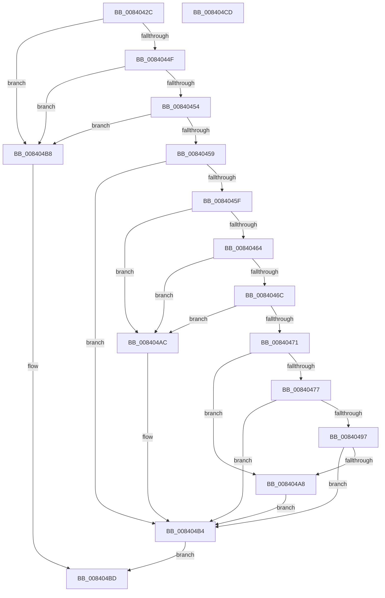

# RtlpMuiRegValidateAndGetInstallFallbackBase

- RVA: `0x0084042C`–`0x008404CE` (길이 `162` bytes)
- VA: `0x000000014084042C`
- 실행 섹션: `PAGE`
- PDB 이름 있음: `예`; PDB Function 태그: `아니요`
- unwind 정보 RVA: `0x000733E4`
- 디코드: `53`개 명령, `162/162` bytes 표시
- 미해석 바이트: `0` (있으면 어셈블리에 `.byte`로 보존)

> 이 문서는 커널 이미지의 기계어와 PDB 기호를 분석해 생성했습니다. 4번과 5번은 함수 원형과 자료형을 바이너리 사용 방식에서 추정한 C 해석이며 원본 소스 복구 결과는 아닙니다.

## 1. Dependencies

- 직접 호출 지점: **2**; 고유 호출 대상: **2**
- 직접 호출자로 확인된 함수: **1**
- RIP 상대 이미지 참조: **0**

### Outgoing calls
- `0x0084048E` → [RtlLCIDToCultureName](../AD/RtlLCIDToCultureName_function_00AD3010.md) (function, `0x00AD3010`)
- `0x0084049F` → [RtlpLangNameInMultiSzString](../79/RtlpLangNameInMultiSzString_function_00791AE8.md) (function, `0x00791AE8`)

### Direct callers
- [RtlpMuiRegPopulateBaseLanguages](../83/RtlpMuiRegPopulateBaseLanguages_function_0083FC4C.md) at `0x0083FDF6`

### Static image references
- 디코드된 RIP-relative 메모리 참조가 없습니다.

## 2. Other-region calls and transfers

- 다른 실행 섹션으로 향하는 call: **0**
- 별도 외부 분기/꼬리 이동을 확인하지 못했습니다.

## 3. Assembly (complete function range)

```asm
0084042C  48 8B C4                        mov rax, rsp
0084042F  48 89 58 08                     mov qword ptr [rax + 8], rbx
00840433  48 89 70 10                     mov qword ptr [rax + 0x10], rsi
00840437  57                              push rdi
00840438  48 83 EC 30                     sub rsp, 0x30
0084043C  33 F6                           xor esi, esi
0084043E  0F 57 C0                        xorps xmm0, xmm0
00840441  BB 01 00 00 C0                  mov ebx, 0xc0000001
00840446  0F 11 40 E8                     movups xmmword ptr [rax - 0x18], xmm0
0084044A  48 85 C9                        test rcx, rcx
0084044D  74 69                           je 0x1408404b8
0084044F  4D 85 C9                        test r9, r9
00840452  74 64                           je 0x1408404b8
00840454  48 85 D2                        test rdx, rdx
00840457  74 5F                           je 0x1408404b8
00840459  83 7A 04 07                     cmp dword ptr [rdx + 4], 7
0084045D  75 55                           jne 0x1408404b4
0084045F  39 72 0C                        cmp dword ptr [rdx + 0xc], esi
00840462  76 48                           jbe 0x1408404ac
00840464  8B 7A 08                        mov edi, dword ptr [rdx + 8]
00840467  48 03 FA                        add rdi, rdx
0084046A  74 40                           je 0x1408404ac
0084046C  66 39 37                        cmp word ptr [rdi], si
0084046F  74 3B                           je 0x1408404ac
00840471  66 45 85 C0                     test r8w, r8w
00840475  74 31                           je 0x1408404a8
00840477  4C 89 48 F0                     mov qword ptr [rax - 0x10], r9
0084047B  48 8D 54 24 20                  lea rdx, [rsp + 0x20]
00840480  B8 AA 00 00 00                  mov eax, 0xaa
00840485  41 0F B7 C8                     movzx ecx, r8w
00840489  66 89 44 24 22                  mov word ptr [rsp + 0x22], ax
0084048E  E8 7D 2B 29 00                  call 0x140ad3010
00840493  84 C0                           test al, al
00840495  74 1D                           je 0x1408404b4
00840497  48 8B 54 24 28                  mov rdx, qword ptr [rsp + 0x28]
0084049C  48 8B CF                        mov rcx, rdi
0084049F  E8 44 16 F5 FF                  call 0x140791ae8
008404A4  84 C0                           test al, al
008404A6  74 0C                           je 0x1408404b4
008404A8  8B DE                           mov ebx, esi
008404AA  EB 08                           jmp 0x1408404b4
008404AC  66 41 F7 D8                     neg r8w
008404B0  1B C0                           sbb eax, eax
008404B2  23 D8                           and ebx, eax
008404B4  8B C3                           mov eax, ebx
008404B6  EB 05                           jmp 0x1408404bd
008404B8  B8 0D 00 00 C0                  mov eax, 0xc000000d
008404BD  48 8B 5C 24 40                  mov rbx, qword ptr [rsp + 0x40]
008404C2  48 8B 74 24 48                  mov rsi, qword ptr [rsp + 0x48]
008404C7  48 83 C4 30                     add rsp, 0x30
008404CB  5F                              pop rdi
008404CC  C3                              ret
008404CD  CC                              int3
```

## 4. C-style interpretation (structured pseudocode)

```c
__int64 __fastcall RtlpMuiRegValidateAndGetInstallFallbackBase(__int64 a1, __int64 a2, unsigned __int16 a3, __int64 a4)
{
    __int64 result;
    __int64 v_rbx;
    __int64 v_rdi;
    __int64 v_rsi;
    __int64 v_rsp;
    unsigned __int64 v_stack_m10;
    unsigned __int16 v_stack_m16;
    unsigned __int64 v_stack_m18;
    unsigned __int64 v_stack_p10;
    unsigned __int64 v_stack_p8;

    *(unsigned __int64 *)(v_rsp + 8) = v_rbx;
    *(unsigned __int64 *)(v_rsp + 16) = v_rsi;
    v_rsp = (v_rsp) - (48);
    v_rsi = 0;
    *(unsigned __int64 *)(v_rsp - 24) = v_xmm0;
    if (a1 == 0) goto loc_008404B8;
    if (a4 == 0) goto loc_008404B8;
    if (a2 == 0) goto loc_008404B8;
    if ((*(unsigned int *)(a2 + 4)) != 7) goto loc_008404B4;
    if ((*(unsigned int *)(a2 + 12)) <= 0) goto loc_008404AC;
    v_rdi = ((unsigned int)(*(unsigned int *)(a2 + 8))) + (a2);
    if (condition_is_equal) goto loc_008404AC;
    if ((*(unsigned __int16 *)(v_rdi)) == 0) goto loc_008404AC;
    if (a3 == 0) goto loc_008404A8;
    *(unsigned __int64 *)(v_rsp - 16) = a4;
    v_stack_m16 = 170;
    result = RtlLCIDToCultureName(a3, v_stack_m18, a3, a4);
    if ((unsigned __int8)(result) == 0) goto loc_008404B4;
    result = RtlpLangNameInMultiSzString(v_rdi, v_stack_m10, a3, a4);
    if ((unsigned __int8)(result) == 0) goto loc_008404B4;
loc_008404A8:
    goto loc_008404B4;
loc_008404AC:
    a3 = (unsigned __int16)(-(a3));
    v_rbx = (unsigned int)((0) & ((unsigned int)(result)));
loc_008404B4:
    goto loc_008404BD;
loc_008404B8:
loc_008404BD:
    v_rsp = (v_rsp) + (48);
    return (unsigned int)(0xC000000DULL);
}
```

## 5. (Beta) C Style

```c
int64_t RtlpMuiRegValidateAndGetInstallFallbackBase(int64_t Arg1, int64_t Arg2, uint16_t Arg3, int64_t Arg4)
{
    int64_t result;
    int64_t local_rbx;
    int64_t local_rdi;
    int64_t local_rsi;
    int64_t local_rsp;
    uint64_t v_stack_m10;
    uint16_t v_stack_m16;
    uint64_t v_stack_m18;
    uint64_t v_stack_p10;
    uint64_t v_stack_p8;

    *(uint64_t *)(local_rsp + 0x8) = local_rbx;
    *(uint64_t *)(local_rsp + 0x10) = local_rsi;
    local_rsp = (local_rsp) - (48);
    local_rsi = 0;
    *(uint64_t *)(local_rsp - 0x18) = v_xmm0;
    if (Arg1 == 0) goto loc_008404B8;
    if (Arg4 == 0) goto loc_008404B8;
    if (Arg2 == 0) goto loc_008404B8;
    if ((*(uint32_t *)(Arg2 + 0x4)) != 7) goto loc_008404B4;
    if ((*(uint32_t *)(Arg2 + 0xC)) <= 0) goto loc_008404AC;
    local_rdi = ((uint32_t)(*(uint32_t *)(Arg2 + 0x8))) + (Arg2);
    if (condition_is_equal) goto loc_008404AC;
    if ((*(uint16_t *)(local_rdi)) == 0) goto loc_008404AC;
    if (Arg3 == 0) goto loc_008404A8;
    *(uint64_t *)(local_rsp - 0x10) = Arg4;
    v_stack_m16 = 170;
    result = RtlLCIDToCultureName(Arg3, v_stack_m18, Arg3, Arg4);
    if ((uint8_t)(result) == 0) goto loc_008404B4;
    result = RtlpLangNameInMultiSzString(local_rdi, v_stack_m10, Arg3, Arg4);
    if ((uint8_t)(result) == 0) goto loc_008404B4;
loc_008404A8:
    goto loc_008404B4;
loc_008404AC:
    Arg3 = (uint16_t)(-(Arg3));
    local_rbx = (uint32_t)((0) & ((uint32_t)(result)));
loc_008404B4:
    goto loc_008404BD;
loc_008404B8:
loc_008404BD:
    local_rsp = (local_rsp) + (48);
    return (uint32_t)(0xC000000DULL);
}
```

## 6. Execution-region graph

[열기: 2D/3D 그래프와 함수 탐색 컨트롤 패널](../../../control-panel.html?section=page&rva=0x0084042C&view=graph)

- 2D 그래프는 위에서 아래로 흐르고, 3D 그래프는 빈 공간을 드래그해 회전합니다. Shift+드래그는 이동, 휠은 확대·축소, 함수 노드 선택은 대상 보고서 이동입니다.

### Static fallback


