# RtlpMuiRegValidateInstalled

- RVA: `0x008404D4`–`0x0084088C` (길이 `952` bytes)
- VA: `0x00000001408404D4`
- 실행 섹션: `PAGE`
- PDB 이름 있음: `예`; PDB Function 태그: `아니요`
- unwind 정보 RVA: `0x000BCB44`
- 디코드: `258`개 명령, `952/952` bytes 표시
- 미해석 바이트: `0` (있으면 어셈블리에 `.byte`로 보존)

> 이 문서는 커널 이미지의 기계어와 PDB 기호를 분석해 생성했습니다. 4번과 5번은 함수 원형과 자료형을 바이너리 사용 방식에서 추정한 C 해석이며 원본 소스 복구 결과는 아닙니다.

## 1. Dependencies

- 직접 호출 지점: **14**; 고유 호출 대상: **14**
- 직접 호출자로 확인된 함수: **1**
- RIP 상대 이미지 참조: **2**

### Outgoing calls
- `0x0084054D` → [memset](../../text/6C/memset_function_006C6C40.md) (function, `0x006C6C40`)
- `0x00840577` → [NtQueryInstallUILanguage](../A7/NtQueryInstallUILanguage_function_00A74B30.md) (function, `0x00A74B30`)
- `0x00840599` → [RtlpMuiRegGetInstalledLanguageIndexByLangId](../83/RtlpMuiRegGetInstalledLanguageIndexByLangId_function_0083E31C.md) (function, `0x0083E31C`)
- `0x008405C8` → [_MuiRegAllocArray](../../text/6A/_MuiRegAllocArray_function_006A9418.md) (function, `0x006A9418`)
- `0x008405FA` → [RtlLCIDToCultureName](../AD/RtlLCIDToCultureName_function_00AD3010.md) (function, `0x00AD3010`)
- `0x00840617` → [RtlpMuiRegGetOrAddString](../83/RtlpMuiRegGetOrAddString_function_0083E830.md) (function, `0x0083E830`)
- `0x00840668` → [RtlpMuiRegGetOrAddLangInfo](../83/RtlpMuiRegGetOrAddLangInfo_function_0083E74C.md) (function, `0x0083E74C`)
- `0x008406B1` → [RtlpGetNameFromLangInfoNode](../../text/5E/RtlpGetNameFromLangInfoNode_function_005EBCCC.md) (function, `0x005EBCCC`)
- `0x008406C2` → [RtlpIsALicensedRegularLanguage](../83/RtlpIsALicensedRegularLanguage_function_0083D1EC.md) (function, `0x0083D1EC`)
- `0x00840705` → [RtlpRemovePendingDeleteLanguages](../../text/6A/RtlpRemovePendingDeleteLanguages_function_006A9684.md) (function, `0x006A9684`)
- `0x00840739` → [RtlpMuiRegValidatePartialLanguage](RtlpMuiRegValidatePartialLanguage_function_00840AC0.md) (function, `0x00840AC0`)
- `0x00840836` → [RtlpMuiRegValidateLIPLanguage](RtlpMuiRegValidateLIPLanguage_function_00840894.md) (function, `0x00840894`)
- `0x00840857` → [ExFreePoolWithTag](../../poolcode/B8/ExFreePoolWithTag_function_00B82870.md) (function, `0x00B82870`)
- `0x00840865` → [_security_check_cookie](../../text/6A/_security_check_cookie_function_006AC640.md) (function, `0x006AC640`)

### Direct callers
- [RtlpMuiRegLoadInstalled](../83/RtlpMuiRegLoadInstalled_function_0083FB1C.md) at `0x0083FC13`

### Static image references
- `0x008404F7` → RVA `0x00E0A740` (`.data`; read)
- `0x00840552` → RVA `0x00FD9BB8` (`PAGEDATA`; read)

## 2. Other-region calls and transfers

- 다른 실행 섹션으로 향하는 call: **6**
  - `0x0084054D` → [memset](../../text/6C/memset_function_006C6C40.md) (`PAGE` → `.text`)
  - `0x008405C8` → [_MuiRegAllocArray](../../text/6A/_MuiRegAllocArray_function_006A9418.md) (`PAGE` → `.text`)
  - `0x008406B1` → [RtlpGetNameFromLangInfoNode](../../text/5E/RtlpGetNameFromLangInfoNode_function_005EBCCC.md) (`PAGE` → `.text`)
  - `0x00840705` → [RtlpRemovePendingDeleteLanguages](../../text/6A/RtlpRemovePendingDeleteLanguages_function_006A9684.md) (`PAGE` → `.text`)
  - `0x00840857` → [ExFreePoolWithTag](../../poolcode/B8/ExFreePoolWithTag_function_00B82870.md) (`PAGE` → `POOLCODE`)
  - `0x00840865` → [_security_check_cookie](../../text/6A/_security_check_cookie_function_006AC640.md) (`PAGE` → `.text`)
- 별도 외부 분기/꼬리 이동을 확인하지 못했습니다.

## 3. Assembly (complete function range)

```asm
008404D4  48 8B C4                        mov rax, rsp
008404D7  48 89 58 10                     mov qword ptr [rax + 0x10], rbx
008404DB  48 89 70 18                     mov qword ptr [rax + 0x18], rsi
008404DF  48 89 78 20                     mov qword ptr [rax + 0x20], rdi
008404E3  55                              push rbp
008404E4  41 54                           push r12
008404E6  41 55                           push r13
008404E8  41 56                           push r14
008404EA  41 57                           push r15
008404EC  48 8D 68 A8                     lea rbp, [rax - 0x58]
008404F0  48 81 EC 30 01 00 00            sub rsp, 0x130
008404F7  48 8B 05 42 A2 5C 00            mov rax, qword ptr [rip + 0x5ca242]
008404FE  48 33 C4                        xor rax, rsp
00840501  48 89 45 20                     mov qword ptr [rbp + 0x20], rax
00840505  48 8B D9                        mov rbx, rcx
00840508  0F 57 C0                        xorps xmm0, xmm0
0084050B  33 C9                           xor ecx, ecx
0084050D  33 C0                           xor eax, eax
0084050F  66 89 4C 24 20                  mov word ptr [rsp + 0x20], cx
00840514  44 8B F9                        mov r15d, ecx
00840517  89 4C 24 34                     mov dword ptr [rsp + 0x34], ecx
0084051B  44 8B E1                        mov r12d, ecx
0084051E  48 89 4C 24 28                  mov qword ptr [rsp + 0x28], rcx
00840523  83 CE FF                        or esi, 0xffffffff
00840526  48 8D 4C 24 70                  lea rcx, [rsp + 0x70]
0084052B  48 89 44 24 60                  mov qword ptr [rsp + 0x60], rax
00840530  33 D2                           xor edx, edx
00840532  89 44 24 68                     mov dword ptr [rsp + 0x68], eax
00840536  41 B8 AA 00 00 00               mov r8d, 0xaa
0084053C  66 89 74 24 24                  mov word ptr [rsp + 0x24], si
00840541  8B FE                           mov edi, esi
00840543  0F 11 44 24 50                  movups xmmword ptr [rsp + 0x50], xmm0
00840548  0F 11 44 24 40                  movups xmmword ptr [rsp + 0x40], xmm0
0084054D  E8 EE 66 E8 FF                  call 0x1406c6c40
00840552  8B 05 60 96 79 00               mov eax, dword ptr [rip + 0x799660]
00840558  44 0F B7 73 04                  movzx r14d, word ptr [rbx + 4]
0084055D  F7 D8                           neg eax
0084055F  45 1B ED                        sbb r13d, r13d
00840562  41 F7 D5                        not r13d
00840565  41 81 E5 34 00 00 C0            and r13d, 0xc0000034
0084056C  66 45 85 F6                     test r14w, r14w
00840570  75 18                           jne 0x14084058a
00840572  48 8D 4C 24 20                  lea rcx, [rsp + 0x20]
00840577  E8 B4 45 23 00                  call 0x140a74b30
0084057C  85 C0                           test eax, eax
0084057E  0F 88 DA 02 00 00               js 0x14084085e
00840584  44 0F B7 74 24 20               movzx r14d, word ptr [rsp + 0x20]
0084058A  4C 8D 4C 24 24                  lea r9, [rsp + 0x24]
0084058F  45 33 C0                        xor r8d, r8d
00840592  41 0F B7 D6                     movzx edx, r14w
00840596  48 8B CB                        mov rcx, rbx
00840599  E8 7E DD FF FF                  call 0x14083e31c
0084059E  3D 34 00 00 C0                  cmp eax, 0xc0000034
008405A3  74 19                           je 0x1408405be
008405A5  3D BB 00 00 C0                  cmp eax, 0xc00000bb
008405AA  74 12                           je 0x1408405be
008405AC  85 C0                           test eax, eax
008405AE  0F 88 43 01 00 00               js 0x1408406f7
008405B4  0F BF 7C 24 24                  movsx edi, word ptr [rsp + 0x24]
008405B9  E9 C1 00 00 00                  jmp 0x14084067f
008405BE  BA 55 00 00 00                  mov edx, 0x55
008405C3  66 89 74 24 20                  mov word ptr [rsp + 0x20], si
008405C8  E8 4B 8E E6 FF                  call 0x1406a9418
008405CD  48 89 44 24 28                  mov qword ptr [rsp + 0x28], rax
008405D2  4C 8B E0                        mov r12, rax
008405D5  48 85 C0                        test rax, rax
008405D8  75 0A                           jne 0x1408405e4
008405DA  B8 17 00 00 C0                  mov eax, 0xc0000017
008405DF  E9 7A 02 00 00                  jmp 0x14084085e
008405E4  41 0F B7 CE                     movzx ecx, r14w
008405E8  48 8D 54 24 30                  lea rdx, [rsp + 0x30]
008405ED  48 89 44 24 38                  mov qword ptr [rsp + 0x38], rax
008405F2  C7 44 24 30 00 00 AA 00         mov dword ptr [rsp + 0x30], 0xaa0000
008405FA  E8 11 2A 29 00                  call 0x140ad3010
008405FF  84 C0                           test al, al
00840601  0F 84 F0 00 00 00               je 0x1408406f7
00840607  48 8B 54 24 38                  mov rdx, qword ptr [rsp + 0x38]
0084060C  4C 8D 4C 24 20                  lea r9, [rsp + 0x20]
00840611  41 B0 01                        mov r8b, 1
00840614  48 8B CB                        mov rcx, rbx
00840617  E8 14 E2 FF FF                  call 0x14083e830
0084061C  33 D2                           xor edx, edx
0084061E  85 C0                           test eax, eax
00840620  0F B7 C6                        movzx eax, si
00840623  78 05                           js 0x14084062a
00840625  0F B7 44 24 20                  movzx eax, word ptr [rsp + 0x20]
0084062A  66 89 44 24 56                  mov word ptr [rsp + 0x56], ax
0084062F  B9 FF 3F 00 00                  mov ecx, 0x3fff
00840634  0F B7 C2                        movzx eax, dx
00840637  C7 44 24 50 31 00 00 00         mov dword ptr [rsp + 0x50], 0x31
0084063F  66 23 C1                        and ax, cx
00840642  66 44 89 74 24 54               mov word ptr [rsp + 0x54], r14w
00840648  66 89 44 24 58                  mov word ptr [rsp + 0x58], ax
0084064D  48 89 54 24 5C                  mov qword ptr [rsp + 0x5c], rdx
00840652  48 89 54 24 64                  mov qword ptr [rsp + 0x64], rdx
00840657  66 89 54 24 5A                  mov word ptr [rsp + 0x5a], dx
0084065C  45 33 C0                        xor r8d, r8d
0084065F  48 8D 54 24 50                  lea rdx, [rsp + 0x50]
00840664  48 8D 4B 18                     lea rcx, [rbx + 0x18]
00840668  E8 DF E0 FF FF                  call 0x14083e74c
0084066D  85 C0                           test eax, eax
0084066F  0F 88 82 00 00 00               js 0x1408406f7
00840675  48 8B 43 18                     mov rax, qword ptr [rbx + 0x18]
00840679  0F B7 78 06                     movzx edi, word ptr [rax + 6]
0084067D  FF CF                           dec edi
0084067F  3B FE                           cmp edi, esi
00840681  74 74                           je 0x1408406f7
00840683  48 8D 44 24 70                  lea rax, [rsp + 0x70]
00840688  48 8B CB                        mov rcx, rbx
0084068B  48 89 44 24 48                  mov qword ptr [rsp + 0x48], rax
00840690  4C 8D 44 24 40                  lea r8, [rsp + 0x40]
00840695  B8 AA 00 00 00                  mov eax, 0xaa
0084069A  66 89 44 24 42                  mov word ptr [rsp + 0x42], ax
0084069F  48 63 C7                        movsxd rax, edi
008406A2  4C 6B F0 1C                     imul r14, rax, 0x1c
008406A6  48 8B 43 18                     mov rax, qword ptr [rbx + 0x18]
008406AA  48 8B 50 10                     mov rdx, qword ptr [rax + 0x10]
008406AE  49 03 D6                        add rdx, r14
008406B1  E8 16 B6 DA FF                  call 0x1405ebccc
008406B6  85 C0                           test eax, eax
008406B8  78 3D                           js 0x1408406f7
008406BA  48 8B 54 24 48                  mov rdx, qword ptr [rsp + 0x48]
008406BF  48 8B CB                        mov rcx, rbx
008406C2  E8 25 CB FF FF                  call 0x14083d1ec
008406C7  85 C0                           test eax, eax
008406C9  79 26                           jns 0x1408406f1
008406CB  48 8B 43 18                     mov rax, qword ptr [rbx + 0x18]
008406CF  48 8B 48 10                     mov rcx, qword ptr [rax + 0x10]
008406D3  B8 DF FF 00 00                  mov eax, 0xffdf
008406D8  66 42 21 04 31                  and word ptr [rcx + r14], ax
008406DD  48 8B 43 18                     mov rax, qword ptr [rbx + 0x18]
008406E1  48 8B 48 10                     mov rcx, qword ptr [rax + 0x10]
008406E5  B8 00 80 00 00                  mov eax, 0x8000
008406EA  66 42 09 04 31                  or word ptr [rcx + r14], ax
008406EF  EB 06                           jmp 0x1408406f7
008406F1  41 BF 01 00 00 00               mov r15d, 1
008406F7  45 85 ED                        test r13d, r13d
008406FA  75 03                           jne 0x1408406ff
008406FC  0F B7 F7                        movzx esi, di
008406FF  0F B7 D6                        movzx edx, si
00840702  48 8B CB                        mov rcx, rbx
00840705  E8 7A 8F E6 FF                  call 0x1406a9684
0084070A  48 8B 4B 18                     mov rcx, qword ptr [rbx + 0x18]
0084070E  33 D2                           xor edx, edx
00840710  44 8B F2                        mov r14d, edx
00840713  BE 00 10 00 00                  mov esi, 0x1000
00840718  66 3B 51 06                     cmp dx, word ptr [rcx + 6]
0084071C  0F 83 86 00 00 00               jae 0x1408407a8
00840722  8B F2                           mov esi, edx
00840724  48 8B 41 10                     mov rax, qword ptr [rcx + 0x10]
00840728  8A 0C 06                        mov cl, byte ptr [rsi + rax]
0084072B  80 E1 22                        and cl, 0x22
0084072E  80 F9 22                        cmp cl, 0x22
00840731  75 55                           jne 0x140840788
00840733  41 8B D6                        mov edx, r14d
00840736  48 8B CB                        mov rcx, rbx
00840739  E8 82 03 00 00                  call 0x140840ac0
0084073E  48 8B 43 18                     mov rax, qword ptr [rbx + 0x18]
00840742  41 8D 57 01                     lea edx, [r15 + 1]
00840746  48 8B 48 10                     mov rcx, qword ptr [rax + 0x10]
0084074A  0F B7 04 31                     movzx eax, word ptr [rcx + rsi]
0084074E  66 0F BA E0 0C                  bt ax, 0xc
00840753  41 0F 42 D7                     cmovb edx, r15d
00840757  44 8B FA                        mov r15d, edx
0084075A  45 85 ED                        test r13d, r13d
0084075D  75 29                           jne 0x140840788
0084075F  44 3B F7                        cmp r14d, edi
00840762  74 24                           je 0x140840788
00840764  3B 53 78                        cmp edx, dword ptr [rbx + 0x78]
00840767  76 1F                           jbe 0x140840788
00840769  41 B8 DF FF 00 00               mov r8d, 0xffdf
0084076F  66 41 23 C0                     and ax, r8w
00840773  66 89 04 31                     mov word ptr [rcx + rsi], ax
00840777  48 8B 43 18                     mov rax, qword ptr [rbx + 0x18]
0084077B  48 8B 48 10                     mov rcx, qword ptr [rax + 0x10]
0084077F  B8 00 80 00 00                  mov eax, 0x8000
00840784  66 09 04 31                     or word ptr [rcx + rsi], ax
00840788  48 8B 4B 18                     mov rcx, qword ptr [rbx + 0x18]
0084078C  41 FF C6                        inc r14d
0084078F  48 83 C6 1C                     add rsi, 0x1c
00840793  0F B7 41 06                     movzx eax, word ptr [rcx + 6]
00840797  44 3B F0                        cmp r14d, eax
0084079A  7C 88                           jl 0x140840724
0084079C  4C 8B 64 24 28                  mov r12, qword ptr [rsp + 0x28]
008407A1  33 D2                           xor edx, edx
008407A3  BE 00 10 00 00                  mov esi, 0x1000
008407A8  44 8B D2                        mov r10d, edx
008407AB  66 3B 51 06                     cmp dx, word ptr [rcx + 6]
008407AF  73 6B                           jae 0x14084081c
008407B1  4C 8B C2                        mov r8, rdx
008407B4  4C 8B 59 10                     mov r11, qword ptr [rcx + 0x10]
008407B8  43 0F B7 0C 03                  movzx ecx, word ptr [r11 + r8]
008407BD  8A C1                           mov al, cl
008407BF  24 21                           and al, 0x21
008407C1  3C 21                           cmp al, 0x21
008407C3  75 3C                           jne 0x140840801
008407C5  66 85 CE                        test si, cx
008407C8  41 8D 57 01                     lea edx, [r15 + 1]
008407CC  41 0F 45 D7                     cmovne edx, r15d
008407D0  44 8B FA                        mov r15d, edx
008407D3  45 85 ED                        test r13d, r13d
008407D6  75 29                           jne 0x140840801
008407D8  44 3B D7                        cmp r10d, edi
008407DB  74 24                           je 0x140840801
008407DD  3B 53 78                        cmp edx, dword ptr [rbx + 0x78]
008407E0  76 1F                           jbe 0x140840801
008407E2  B8 DF FF 00 00                  mov eax, 0xffdf
008407E7  66 23 C8                        and cx, ax
008407EA  66 43 89 0C 03                  mov word ptr [r11 + r8], cx
008407EF  48 8B 43 18                     mov rax, qword ptr [rbx + 0x18]
008407F3  48 8B 48 10                     mov rcx, qword ptr [rax + 0x10]
008407F7  B8 00 80 00 00                  mov eax, 0x8000
008407FC  66 42 09 04 01                  or word ptr [rcx + r8], ax
00840801  48 8B 4B 18                     mov rcx, qword ptr [rbx + 0x18]
00840805  41 FF C2                        inc r10d
00840808  49 83 C0 1C                     add r8, 0x1c
0084080C  0F B7 41 06                     movzx eax, word ptr [rcx + 6]
00840810  44 3B D0                        cmp r10d, eax
00840813  7C 9F                           jl 0x1408407b4
00840815  4C 8B 64 24 28                  mov r12, qword ptr [rsp + 0x28]
0084081A  33 D2                           xor edx, edx
0084081C  8B FA                           mov edi, edx
0084081E  66 3B 51 06                     cmp dx, word ptr [rcx + 6]
00840822  73 29                           jae 0x14084084d
00840824  48 8B F2                        mov rsi, rdx
00840827  48 8B 41 10                     mov rax, qword ptr [rcx + 0x10]
0084082B  F6 04 06 04                     test byte ptr [rsi + rax], 4
0084082F  74 0A                           je 0x14084083b
00840831  8B D7                           mov edx, edi
00840833  48 8B CB                        mov rcx, rbx
00840836  E8 59 00 00 00                  call 0x140840894
0084083B  48 8B 4B 18                     mov rcx, qword ptr [rbx + 0x18]
0084083F  FF C7                           inc edi
00840841  48 83 C6 1C                     add rsi, 0x1c
00840845  0F B7 41 06                     movzx eax, word ptr [rcx + 6]
00840849  3B F8                           cmp edi, eax
0084084B  7C DA                           jl 0x140840827
0084084D  4D 85 E4                        test r12, r12
00840850  74 0A                           je 0x14084085c
00840852  33 D2                           xor edx, edx
00840854  49 8B CC                        mov rcx, r12
00840857  E8 14 20 34 00                  call 0x140b82870
0084085C  33 C0                           xor eax, eax
0084085E  48 8B 4D 20                     mov rcx, qword ptr [rbp + 0x20]
00840862  48 33 CC                        xor rcx, rsp
00840865  E8 D6 BD E6 FF                  call 0x1406ac640
0084086A  4C 8D 9C 24 30 01 00 00         lea r11, [rsp + 0x130]
00840872  49 8B 5B 38                     mov rbx, qword ptr [r11 + 0x38]
00840876  49 8B 73 40                     mov rsi, qword ptr [r11 + 0x40]
0084087A  49 8B 7B 48                     mov rdi, qword ptr [r11 + 0x48]
0084087E  49 8B E3                        mov rsp, r11
00840881  41 5F                           pop r15
00840883  41 5E                           pop r14
00840885  41 5D                           pop r13
00840887  41 5C                           pop r12
00840889  5D                              pop rbp
0084088A  C3                              ret
0084088B  CC                              int3
```

## 4. C-style interpretation (structured pseudocode)

```c
__int64 __fastcall RtlpMuiRegValidateInstalled(__int64 a1, int a2)
{
    __int64 result;
    __int64 v_r10;
    __int64 v_r13;
    __int64 v_r14;
    __int64 v_rdi;
    __int64 v_rsi;
    __int64 v_rsp;
    unsigned __int16 v_stack_m100;
    unsigned __int16 v_stack_m102;
    unsigned __int16 v_stack_m104;
    unsigned __int64 v_stack_m108;
    unsigned __int64 v_stack_m110;
    unsigned __int16 v_stack_m116;
    unsigned __int64 v_stack_m118;
    unsigned __int64 v_stack_m120;
    unsigned int v_stack_m124;
    unsigned __int64 v_stack_m128;
    unsigned __int64 v_stack_m130;
    unsigned __int16 v_stack_m134;
    unsigned __int16 v_stack_m138;
    unsigned __int64 v_stack_m28;
    unsigned __int64 v_stack_mE8;
    unsigned int v_stack_mF0;
    unsigned __int64 v_stack_mF4;
    unsigned __int64 v_stack_mF8;
    unsigned __int64 v_stack_mFC;
    unsigned __int16 v_stack_mFE;

    *(unsigned __int64 *)(v_rsp + 16) = v_rbx;
    *(unsigned __int64 *)(v_rsp + 24) = v_rsi;
    *(unsigned __int64 *)(v_rsp + 32) = v_rdi;
    v_rsp = (v_rsp) - (304);
    result = (*(unsigned __int64 *)(v_rip + 6070850)) ^ (v_rsp);
    *(unsigned __int64 *)(v_rsp - 88 + 32) = result;
    a1 = 0;
    result = 0;
    v_stack_m138 = 0;
    v_stack_m124 = 0;
    v_stack_m130 = 0;
    v_rsi = (unsigned int)((v_rsi) | (0xFFFFFFFFULL));
    v_stack_mF8 = 0;
    a2 = 0;
    v_stack_mF0 = 0;
    v_stack_m134 = (unsigned __int16)(v_rsi);
    v_stack_m108 = v_xmm0;
    v_stack_m118 = v_xmm0;
    result = memset(v_stack_mE8, a2, 170, a4);
    result = (unsigned int)(-((unsigned int)(*(unsigned int *)(v_rip + 7968352))));
    v_r13 = (unsigned int)(~(v_r13));
    v_r13 = (unsigned int)((v_r13) & (0xC0000034ULL));
    if ((unsigned __int16)(*(unsigned __int16 *)(a1 + 4)) != 0) goto loc_0084058A;
    result = NtQueryInstallUILanguage(v_stack_m138, a2, 170, a4);
    if (sign_flag) goto loc_0084085E;
loc_0084058A:
    a3 = 0;
    result = RtlpMuiRegGetInstalledLanguageIndexByLangId(0, (unsigned __int16)(v_stack_m138), a3, v_stack_m134);
    if (((unsigned int)(result)) == 0xC0000034ULL) goto loc_008405BE;
    if (((unsigned int)(result)) == 0xC00000BBULL) goto loc_008405BE;
    if (sign_flag) goto loc_008406F7;
    goto loc_0084067F;
loc_008405BE:
    v_stack_m138 = (unsigned __int16)(v_rsi);
    result = _MuiRegAllocArray(0, 85, a3, v_stack_m134);
    v_stack_m130 = result;
    if (result != 0) goto loc_008405E4;
    goto loc_0084085E;
loc_008405E4:
    v_stack_m120 = (unsigned int)(0xC0000017ULL);
    v_stack_m128 = 0xAA0000ULL;
    result = RtlLCIDToCultureName((unsigned __int16)(v_stack_m138), v_stack_m128, a3, v_stack_m134);
    if ((unsigned __int8)(result) == 0) goto loc_008406F7;
    result = RtlpMuiRegGetOrAddString(0, v_stack_m120, 1, v_stack_m138);
    a2 = 0;
    result = (unsigned __int16)(v_rsi);
    if (!(sign_flag)) {
        result = v_stack_m138;
    }
    v_stack_m102 = (unsigned __int16)(result);
    v_stack_m108 = 49;
    result = (unsigned __int16)((0) & ((unsigned __int16)((unsigned int)(0x3FFFULL))));
    v_stack_m104 = (unsigned __int16)(v_stack_m138);
    v_stack_m100 = (unsigned __int16)(result);
    v_stack_mFC = 0;
    v_stack_mF4 = 0;
    v_stack_mFE = 0;
    a3 = 0;
    result = RtlpMuiRegGetOrAddLangInfo(a1 + 24, v_stack_m108, a3, v_stack_m138);
    if (sign_flag) goto loc_008406F7;
    v_rdi = (unsigned int)((*(unsigned __int16 *)(*(unsigned __int64 *)(a1 + 24) + 6)) - 1);
loc_0084067F:
    if (((unsigned int)(v_rdi)) == ((unsigned int)(v_rsi))) goto loc_008406F7;
    v_stack_m110 = v_stack_mE8;
    v_stack_m116 = 170;
    v_r14 = (v_stack_m138) * ((int)((unsigned int)(v_rdi)));
    a2 = (*(unsigned __int64 *)(*(unsigned __int64 *)(a1 + 24) + 16)) + (v_r14);
    result = RtlpGetNameFromLangInfoNode(0, a2, v_stack_m118, v_stack_m138);
    if (sign_flag) goto loc_008406F7;
    result = RtlpIsALicensedRegularLanguage(0, v_stack_m110, v_stack_m118, v_stack_m138);
    if (!sign_flag) goto loc_008406F1;
    goto loc_008406F7;
loc_008406F1:
loc_008406F7:
    if ((unsigned int)(v_r13) == 0) {
        v_rsi = (unsigned __int16)(v_rdi);
    }
    result = RtlpRemovePendingDeleteLanguages(0, (unsigned __int16)(v_rsi), v_stack_m118, v_stack_m138);
    a2 = 0;
    if (0 >= (*(unsigned __int16 *)(*(unsigned __int64 *)(a1 + 24) + 6))) goto loc_008407A8;
loc_00840724:
    a1 = (unsigned __int8)((*(unsigned __int8 *)(0 + *(unsigned __int64 *)(*(unsigned __int64 *)(a1 + 24) + 16) * 1)) & (34));
    if (((unsigned __int8)(a1)) != 34) goto loc_00840788;
    result = RtlpMuiRegValidatePartialLanguage(a1, 0, v_stack_m118, v_stack_m138);
    a2 = 1 + 1;
    if (((unsigned __int8)(a1)) < 34) { a2 = 1; }
    if ((unsigned int)(v_r13) != 0) goto loc_00840788;
    if (0 == ((unsigned int)(v_rdi))) goto loc_00840788;
    result = *(unsigned __int16 *)(*(unsigned __int64 *)(*(unsigned __int64 *)(a1 + 24) + 16) + 0 * 1);
    if (a2 >= = (*(unsigned int *)(a1 + 120))) {
        a3 = 0xFFDFULL;
        result = (unsigned __int16)((*(unsigned __int16 *)(*(unsigned __int64 *)(*(unsigned __int64 *)(a1 + 24) + 16) + 0 * 1)) & ((unsigned __int16)(a3)));
        *(unsigned __int16 *)(*(unsigned __int64 *)(*(unsigned __int64 *)(a1 + 24) + 16) + 0 * 1) = (unsigned __int16)(result);
        result = *(unsigned __int64 *)(a1 + 24);
        a1 = *(unsigned __int64 *)(result + 16);
        result = 0x8000ULL;
    }
    v_r14 = (unsigned int)((0) + 1);
    v_rsi = (0) + (28);
    if (((unsigned int)(v_r14)) < ((unsigned int)(*(unsigned __int16 *)(*(unsigned __int64 *)(a1 + 24) + 6)))) goto loc_00840724;
    a2 = 0;
loc_008407A8:
    if (0 >= (*(unsigned __int16 *)(*(unsigned __int64 *)(a1 + 24) + 6))) goto loc_0084081C;
loc_008407B4:
    result = (unsigned __int8)(((unsigned __int8)(*(unsigned __int16 *)(*(unsigned __int64 *)(*(unsigned __int64 *)(a1 + 24) + 16) + 0 * 1))) & (33));
    if (((unsigned __int8)(result)) != 33) goto loc_00840801;
    a2 = (unsigned int)(a2) + 1;
    if ((((unsigned __int16)((unsigned int)(0x1000ULL))) & ((unsigned __int16)(*(unsigned __int16 *)(*(unsigned __int64 *)(*(unsigned __int64 *)(a1 + 24) + 16) + 0 * 1)))) != 0) { a2 = (unsigned int)((unsigned int)(a2)); }
    if ((unsigned int)(v_r13) != 0) goto loc_00840801;
    if (0 == ((unsigned int)(v_rdi))) goto loc_00840801;
    if (a2 >= = (*(unsigned int *)(a1 + 120))) {
        result = 0xFFDFULL;
        a1 = (unsigned __int16)((*(unsigned __int16 *)(*(unsigned __int64 *)(*(unsigned __int64 *)(a1 + 24) + 16) + 0 * 1)) & ((unsigned __int16)(result)));
        *(unsigned __int16 *)(*(unsigned __int64 *)(*(unsigned __int64 *)(a1 + 24) + 16) + 0 * 1) = (unsigned __int16)(a1);
        result = *(unsigned __int64 *)(a1 + 24);
        a1 = *(unsigned __int64 *)(result + 16);
        result = 0x8000ULL;
    }
    v_r10 = (unsigned int)((0) + 1);
    a3 = (0) + (28);
    if (((unsigned int)(v_r10)) < ((unsigned int)(*(unsigned __int16 *)(*(unsigned __int64 *)(a1 + 24) + 6)))) goto loc_008407B4;
    a2 = 0;
loc_0084081C:
    if (0 >= (*(unsigned __int16 *)(*(unsigned __int64 *)(a1 + 24) + 6))) goto loc_0084084D;
loc_00840827:
    result = *(unsigned __int64 *)(*(unsigned __int64 *)(a1 + 24) + 16);
    if (((*(unsigned __int8 *)(0 + *(unsigned __int64 *)(*(unsigned __int64 *)(a1 + 24) + 16) * 1)) & (4)) != 0) {
        a2 = 0;
        a1 = a1;
        result = RtlpMuiRegValidateLIPLanguage(a1, a2, a3, v_stack_m138);
    }
    v_rdi = (unsigned int)((0) + 1);
    v_rsi = (0) + (28);
    if (((unsigned int)(v_rdi)) < ((unsigned int)(*(unsigned __int16 *)(*(unsigned __int64 *)(a1 + 24) + 6)))) goto loc_00840827;
loc_0084084D:
    result = *(unsigned __int16 *)(*(unsigned __int64 *)(a1 + 24) + 6);
    if (v_stack_m130 != 0) {
        a2 = 0;
        a1 = v_stack_m130;
        result = ExFreePoolWithTag(a1, a2, a3, v_stack_m138);
    }
    result = 0;
loc_0084085E:
    a1 = (*(unsigned __int64 *)(v_rsp - 88 + 32)) ^ (v_rsp);
    result = _security_check_cookie(a1, a2, a3, v_stack_m138);
    return result;
}
```

## 5. (Beta) C Style

```c
int64_t RtlpMuiRegValidateInstalled(void *Arg1, int32_t Arg2)
{
    uint8_t *arg1 = (uint8_t *)Arg1;

    int64_t result;
    int64_t local_r10;
    int64_t local_r13;
    int64_t local_r14;
    int64_t local_rdi;
    int64_t local_rsi;
    int64_t local_rsp;
    uint16_t v_stack_m100;
    uint16_t v_stack_m102;
    uint16_t v_stack_m104;
    uint64_t v_stack_m108;
    uint64_t v_stack_m110;
    uint16_t v_stack_m116;
    uint64_t v_stack_m118;
    uint64_t v_stack_m120;
    uint32_t v_stack_m124;
    uint64_t v_stack_m128;
    uint64_t v_stack_m130;
    uint16_t v_stack_m134;
    uint16_t v_stack_m138;
    uint64_t v_stack_m28;
    uint64_t v_stack_mE8;
    uint32_t v_stack_mF0;
    uint64_t v_stack_mF4;
    uint64_t v_stack_mF8;
    uint64_t v_stack_mFC;
    uint16_t v_stack_mFE;

    *(uint64_t *)(local_rsp + 0x10) = local_rbx;
    *(uint64_t *)(local_rsp + 0x18) = local_rsi;
    *(uint64_t *)(local_rsp + 0x20) = local_rdi;
    local_rsp = (local_rsp) - (304);
    result = (*(uint64_t *)(v_rip + 0x5CA242)) ^ (local_rsp);
    *(uint64_t *)(local_rsp - 0x58 + 0x20) = result;
    Arg1 = 0;
    result = 0;
    v_stack_m138 = 0;
    v_stack_m124 = 0;
    v_stack_m130 = 0;
    local_rsi = (uint32_t)((local_rsi) | (0xFFFFFFFFULL));
    v_stack_mF8 = 0;
    Arg2 = 0;
    v_stack_mF0 = 0;
    v_stack_m134 = (uint16_t)(local_rsi);
    v_stack_m108 = v_xmm0;
    v_stack_m118 = v_xmm0;
    result = memset(v_stack_mE8, Arg2, 170, a4);
    result = (uint32_t)(-((uint32_t)(*(uint32_t *)(v_rip + 0x799660))));
    local_r13 = (uint32_t)(~(local_r13));
    local_r13 = (uint32_t)((local_r13) & (0xC0000034ULL));
    if ((uint16_t)(*(uint16_t *)(arg1 + 0x4)) != 0) goto loc_0084058A;
    result = NtQueryInstallUILanguage(v_stack_m138, Arg2, 170, a4);
    if (sign_flag) goto loc_0084085E;
loc_0084058A:
    a3 = 0;
    result = RtlpMuiRegGetInstalledLanguageIndexByLangId(0, (uint16_t)(v_stack_m138), a3, v_stack_m134);
    if (((uint32_t)(result)) == 0xC0000034ULL) goto loc_008405BE;
    if (((uint32_t)(result)) == 0xC00000BBULL) goto loc_008405BE;
    if (sign_flag) goto loc_008406F7;
    goto loc_0084067F;
loc_008405BE:
    v_stack_m138 = (uint16_t)(local_rsi);
    result = _MuiRegAllocArray(0, 85, a3, v_stack_m134);
    v_stack_m130 = result;
    if (result != 0) goto loc_008405E4;
    goto loc_0084085E;
loc_008405E4:
    v_stack_m120 = (uint32_t)(0xC0000017ULL);
    v_stack_m128 = 0xAA0000ULL;
    result = RtlLCIDToCultureName((uint16_t)(v_stack_m138), v_stack_m128, a3, v_stack_m134);
    if ((uint8_t)(result) == 0) goto loc_008406F7;
    result = RtlpMuiRegGetOrAddString(0, v_stack_m120, 1, v_stack_m138);
    Arg2 = 0;
    result = (uint16_t)(local_rsi);
    if (!(sign_flag)) {
        result = v_stack_m138;
    }
    v_stack_m102 = (uint16_t)(result);
    v_stack_m108 = 49;
    result = (uint16_t)((0) & ((uint16_t)((uint32_t)(0x3FFFULL))));
    v_stack_m104 = (uint16_t)(v_stack_m138);
    v_stack_m100 = (uint16_t)(result);
    v_stack_mFC = 0;
    v_stack_mF4 = 0;
    v_stack_mFE = 0;
    a3 = 0;
    result = RtlpMuiRegGetOrAddLangInfo(Arg1 + 24, v_stack_m108, a3, v_stack_m138);
    if (sign_flag) goto loc_008406F7;
    local_rdi = (uint32_t)((*(uint16_t *)(*(uint64_t *)(arg1 + 0x18) + 0x6)) - 1);
loc_0084067F:
    if (((uint32_t)(local_rdi)) == ((uint32_t)(local_rsi))) goto loc_008406F7;
    v_stack_m110 = v_stack_mE8;
    v_stack_m116 = 170;
    local_r14 = (v_stack_m138) * ((int32_t)((uint32_t)(local_rdi)));
    Arg2 = (*(uint64_t *)(*(uint64_t *)(arg1 + 0x18) + 0x10)) + (local_r14);
    result = RtlpGetNameFromLangInfoNode(0, Arg2, v_stack_m118, v_stack_m138);
    if (sign_flag) goto loc_008406F7;
    result = RtlpIsALicensedRegularLanguage(0, v_stack_m110, v_stack_m118, v_stack_m138);
    if (!sign_flag) goto loc_008406F1;
    goto loc_008406F7;
loc_008406F1:
loc_008406F7:
    if ((uint32_t)(local_r13) == 0) {
        local_rsi = (uint16_t)(local_rdi);
    }
    result = RtlpRemovePendingDeleteLanguages(0, (uint16_t)(local_rsi), v_stack_m118, v_stack_m138);
    Arg2 = 0;
    if (0 >= (*(uint16_t *)(*(uint64_t *)(arg1 + 0x18) + 0x6))) goto loc_008407A8;
loc_00840724:
    Arg1 = (uint8_t)((*(uint8_t *)(0 + *(uint64_t *)(*(uint64_t *)(arg1 + 0x18) + 0x10) * 1)) & (34));
    if (((uint8_t)(Arg1)) != 34) goto loc_00840788;
    result = RtlpMuiRegValidatePartialLanguage(Arg1, 0, v_stack_m118, v_stack_m138);
    Arg2 = 1 + 1;
    if (((uint8_t)(Arg1)) < 34) { Arg2 = 1; }
    if ((uint32_t)(local_r13) != 0) goto loc_00840788;
    if (0 == ((uint32_t)(local_rdi))) goto loc_00840788;
    result = *(uint16_t *)(*(uint64_t *)(*(uint64_t *)(arg1 + 0x18) + 0x10) + 0x0 * 1);
    if (Arg2 >= = (*(uint32_t *)(arg1 + 0x78))) {
        a3 = 0xFFDFULL;
        result = (uint16_t)((*(uint16_t *)(*(uint64_t *)(*(uint64_t *)(arg1 + 0x18) + 0x10) + 0x0 * 1)) & ((uint16_t)(a3)));
        *(uint16_t *)(*(uint64_t *)(*(uint64_t *)(arg1 + 0x18) + 0x10) + 0x0 * 1) = (uint16_t)(result);
        result = *(uint64_t *)(arg1 + 0x18);
        Arg1 = *(uint64_t *)(result + 0x10);
        result = 0x8000ULL;
    }
    local_r14 = (uint32_t)((0) + 1);
    local_rsi = (0) + (28);
    if (((uint32_t)(local_r14)) < ((uint32_t)(*(uint16_t *)(*(uint64_t *)(arg1 + 0x18) + 0x6)))) goto loc_00840724;
    Arg2 = 0;
loc_008407A8:
    if (0 >= (*(uint16_t *)(*(uint64_t *)(arg1 + 0x18) + 0x6))) goto loc_0084081C;
loc_008407B4:
    result = (uint8_t)(((uint8_t)(*(uint16_t *)(*(uint64_t *)(*(uint64_t *)(arg1 + 0x18) + 0x10) + 0x0 * 1))) & (33));
    if (((uint8_t)(result)) != 33) goto loc_00840801;
    Arg2 = (uint32_t)(Arg2) + 1;
    if ((((uint16_t)((uint32_t)(0x1000ULL))) & ((uint16_t)(*(uint16_t *)(*(uint64_t *)(*(uint64_t *)(arg1 + 0x18) + 0x10) + 0x0 * 1)))) != 0) { Arg2 = (uint32_t)((uint32_t)(Arg2)); }
    if ((uint32_t)(local_r13) != 0) goto loc_00840801;
    if (0 == ((uint32_t)(local_rdi))) goto loc_00840801;
    if (Arg2 >= = (*(uint32_t *)(arg1 + 0x78))) {
        result = 0xFFDFULL;
        Arg1 = (uint16_t)((*(uint16_t *)(*(uint64_t *)(*(uint64_t *)(arg1 + 0x18) + 0x10) + 0x0 * 1)) & ((uint16_t)(result)));
        *(uint16_t *)(*(uint64_t *)(*(uint64_t *)(arg1 + 0x18) + 0x10) + 0x0 * 1) = (uint16_t)(Arg1);
        result = *(uint64_t *)(arg1 + 0x18);
        Arg1 = *(uint64_t *)(result + 0x10);
        result = 0x8000ULL;
    }
    local_r10 = (uint32_t)((0) + 1);
    a3 = (0) + (28);
    if (((uint32_t)(local_r10)) < ((uint32_t)(*(uint16_t *)(*(uint64_t *)(arg1 + 0x18) + 0x6)))) goto loc_008407B4;
    Arg2 = 0;
loc_0084081C:
    if (0 >= (*(uint16_t *)(*(uint64_t *)(arg1 + 0x18) + 0x6))) goto loc_0084084D;
loc_00840827:
    result = *(uint64_t *)(*(uint64_t *)(arg1 + 0x18) + 0x10);
    if (((*(uint8_t *)(0 + *(uint64_t *)(*(uint64_t *)(arg1 + 0x18) + 0x10) * 1)) & (4)) != 0) {
        Arg2 = 0;
        Arg1 = Arg1;
        result = RtlpMuiRegValidateLIPLanguage(Arg1, Arg2, a3, v_stack_m138);
    }
    local_rdi = (uint32_t)((0) + 1);
    local_rsi = (0) + (28);
    if (((uint32_t)(local_rdi)) < ((uint32_t)(*(uint16_t *)(*(uint64_t *)(arg1 + 0x18) + 0x6)))) goto loc_00840827;
loc_0084084D:
    result = *(uint16_t *)(*(uint64_t *)(arg1 + 0x18) + 0x6);
    if (v_stack_m130 != 0) {
        Arg2 = 0;
        Arg1 = v_stack_m130;
        result = ExFreePoolWithTag(Arg1, Arg2, a3, v_stack_m138);
    }
    result = 0;
loc_0084085E:
    Arg1 = (*(uint64_t *)(local_rsp - 0x58 + 0x20)) ^ (local_rsp);
    result = _security_check_cookie(Arg1, Arg2, a3, v_stack_m138);
    return result;
}
```

### 관측된 메모리 오프셋

구조체 형식이 확인되지 않은 접근은 인자 기준의 오프셋으로만 기록했습니다.

| 기준 인자 | 오프셋 표현 | 폭 (bit) | 접근 |
|---|---:|---:|---|
| `Arg1` | `+ 0x4` | `16` | `R` |
| `Arg1` | `+ 0x18` | `64` | `R` |
| `Arg1` | `+ 0x78` | `32` | `R` |

## 6. Execution-region graph

[열기: 2D/3D 그래프와 함수 탐색 컨트롤 패널](../../../control-panel.html?section=page&rva=0x008404D4&view=graph)

- 2D 그래프는 위에서 아래로 흐르고, 3D 그래프는 빈 공간을 드래그해 회전합니다. Shift+드래그는 이동, 휠은 확대·축소, 함수 노드 선택은 대상 보고서 이동입니다.

### Static fallback

```mermaid
flowchart TD
  bb_008404D4[BB_008404D4]
  bb_00840572[BB_00840572]
  bb_00840584[BB_00840584]
  bb_0084058A[BB_0084058A]
  bb_008405A5[BB_008405A5]
  bb_008405AC[BB_008405AC]
  bb_008405B4[BB_008405B4]
  bb_008405BE[BB_008405BE]
  bb_008405DA[BB_008405DA]
  bb_008405E4[BB_008405E4]
  bb_00840607[BB_00840607]
  bb_00840625[BB_00840625]
  bb_0084062A[BB_0084062A]
  bb_00840675[BB_00840675]
  bb_0084067F[BB_0084067F]
  bb_00840683[BB_00840683]
  bb_008406BA[BB_008406BA]
  bb_008406CB[BB_008406CB]
  bb_008406F1[BB_008406F1]
  bb_008406F7[BB_008406F7]
  bb_008406FC[BB_008406FC]
  bb_008406FF[BB_008406FF]
  bb_00840722[BB_00840722]
  bb_00840724[BB_00840724]
  bb_00840733[BB_00840733]
  bb_0084075F[BB_0084075F]
  bb_00840764[BB_00840764]
  bb_00840769[BB_00840769]
  bb_00840788[BB_00840788]
  bb_0084079C[BB_0084079C]
  bb_008407A8[BB_008407A8]
  bb_008407B1[BB_008407B1]
  bb_008407B4[BB_008407B4]
  bb_008407C5[BB_008407C5]
  bb_008407D8[BB_008407D8]
  bb_008407DD[BB_008407DD]
  bb_008407E2[BB_008407E2]
  bb_00840801[BB_00840801]
  bb_00840815[BB_00840815]
  bb_0084081C[BB_0084081C]
  bb_00840824[BB_00840824]
  bb_00840827[BB_00840827]
  bb_00840831[BB_00840831]
  bb_0084083B[BB_0084083B]
  bb_0084084D[BB_0084084D]
  bb_00840852[BB_00840852]
  bb_0084085C[BB_0084085C]
  bb_0084085E[BB_0084085E]
  bb_0084088B[BB_0084088B]
  bb_008404D4 -->|branch| bb_0084058A
  bb_008404D4 -->|fallthrough| bb_00840572
  bb_00840572 -->|branch| bb_0084085E
  bb_00840572 -->|fallthrough| bb_00840584
  bb_00840584 -->|flow| bb_0084058A
  bb_0084058A -->|branch| bb_008405BE
  bb_0084058A -->|fallthrough| bb_008405A5
  bb_008405A5 -->|branch| bb_008405BE
  bb_008405A5 -->|fallthrough| bb_008405AC
  bb_008405AC -->|branch| bb_008406F7
  bb_008405AC -->|fallthrough| bb_008405B4
  bb_008405B4 -->|branch| bb_0084067F
  bb_008405BE -->|branch| bb_008405E4
  bb_008405BE -->|fallthrough| bb_008405DA
  bb_008405DA -->|branch| bb_0084085E
  bb_008405E4 -->|branch| bb_008406F7
  bb_008405E4 -->|fallthrough| bb_00840607
  bb_00840607 -->|branch| bb_0084062A
  bb_00840607 -->|fallthrough| bb_00840625
  bb_00840625 -->|flow| bb_0084062A
  bb_0084062A -->|branch| bb_008406F7
  bb_0084062A -->|fallthrough| bb_00840675
  bb_00840675 -->|flow| bb_0084067F
  bb_0084067F -->|branch| bb_008406F7
  bb_0084067F -->|fallthrough| bb_00840683
  bb_00840683 -->|branch| bb_008406F7
  bb_00840683 -->|fallthrough| bb_008406BA
  bb_008406BA -->|branch| bb_008406F1
  bb_008406BA -->|fallthrough| bb_008406CB
  bb_008406CB -->|branch| bb_008406F7
  bb_008406F1 -->|flow| bb_008406F7
  bb_008406F7 -->|branch| bb_008406FF
  bb_008406F7 -->|fallthrough| bb_008406FC
  bb_008406FC -->|flow| bb_008406FF
  bb_008406FF -->|branch| bb_008407A8
  bb_008406FF -->|fallthrough| bb_00840722
  bb_00840722 -->|flow| bb_00840724
  bb_00840724 -->|branch| bb_00840788
  bb_00840724 -->|fallthrough| bb_00840733
  bb_00840733 -->|branch| bb_00840788
  bb_00840733 -->|fallthrough| bb_0084075F
  bb_0084075F -->|branch| bb_00840788
  bb_0084075F -->|fallthrough| bb_00840764
  bb_00840764 -->|branch| bb_00840788
  bb_00840764 -->|fallthrough| bb_00840769
  bb_00840769 -->|flow| bb_00840788
  bb_00840788 -->|branch| bb_00840724
  bb_00840788 -->|fallthrough| bb_0084079C
  bb_0084079C -->|flow| bb_008407A8
  bb_008407A8 -->|branch| bb_0084081C
  bb_008407A8 -->|fallthrough| bb_008407B1
  bb_008407B1 -->|flow| bb_008407B4
  bb_008407B4 -->|branch| bb_00840801
  bb_008407B4 -->|fallthrough| bb_008407C5
  bb_008407C5 -->|branch| bb_00840801
  bb_008407C5 -->|fallthrough| bb_008407D8
  bb_008407D8 -->|branch| bb_00840801
  bb_008407D8 -->|fallthrough| bb_008407DD
  bb_008407DD -->|branch| bb_00840801
  bb_008407DD -->|fallthrough| bb_008407E2
  bb_008407E2 -->|flow| bb_00840801
  bb_00840801 -->|branch| bb_008407B4
  bb_00840801 -->|fallthrough| bb_00840815
  bb_00840815 -->|flow| bb_0084081C
  bb_0084081C -->|branch| bb_0084084D
  bb_0084081C -->|fallthrough| bb_00840824
  bb_00840824 -->|flow| bb_00840827
  bb_00840827 -->|branch| bb_0084083B
  bb_00840827 -->|fallthrough| bb_00840831
  bb_00840831 -->|flow| bb_0084083B
  bb_0084083B -->|branch| bb_00840827
  bb_0084083B -->|fallthrough| bb_0084084D
  bb_0084084D -->|branch| bb_0084085C
  bb_0084084D -->|fallthrough| bb_00840852
  bb_00840852 -->|flow| bb_0084085C
  bb_0084085C -->|flow| bb_0084085E
```


