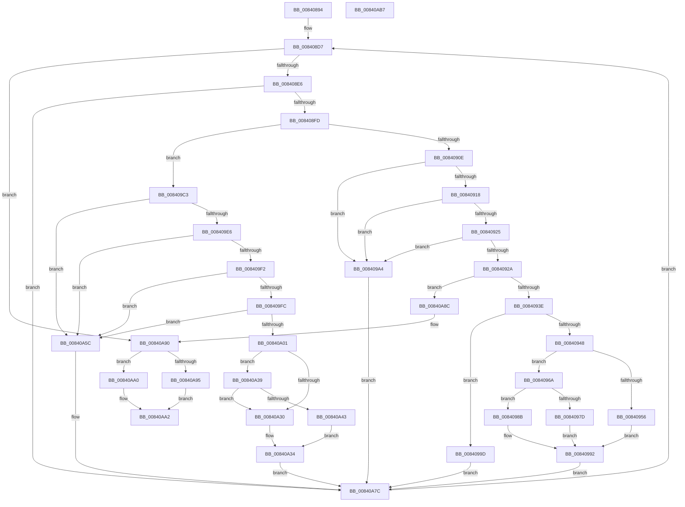

# RtlpMuiRegValidateLIPLanguage

- RVA: `0x00840894`–`0x00840AB8` (길이 `548` bytes)
- VA: `0x0000000140840894`
- 실행 섹션: `PAGE`
- PDB 이름 있음: `예`; PDB Function 태그: `아니요`
- unwind 정보 RVA: `0x00068D9C`
- 디코드: `159`개 명령, `548/548` bytes 표시
- 미해석 바이트: `0` (있으면 어셈블리에 `.byte`로 보존)

> 이 문서는 커널 이미지의 기계어와 PDB 기호를 분석해 생성했습니다. 4번과 5번은 함수 원형과 자료형을 바이너리 사용 방식에서 추정한 C 해석이며 원본 소스 복구 결과는 아닙니다.

## 1. Dependencies

- 직접 호출 지점: **1**; 고유 호출 대상: **1**
- 직접 호출자로 확인된 함수: **1**
- RIP 상대 이미지 참조: **0**

### Outgoing calls
- `0x008409DA` → [RtlpMuiRegGetInstalledLangInfoIndex](../83/RtlpMuiRegGetInstalledLangInfoIndex_function_0083E070.md) (function, `0x0083E070`)

### Direct callers
- [RtlpMuiRegValidateInstalled](RtlpMuiRegValidateInstalled_function_008404D4.md) at `0x00840836`

### Static image references
- 디코드된 RIP-relative 메모리 참조가 없습니다.

## 2. Other-region calls and transfers

- 다른 실행 섹션으로 향하는 call: **0**
- 별도 외부 분기/꼬리 이동을 확인하지 못했습니다.

## 3. Assembly (complete function range)

```asm
00840894  48 89 5C 24 18                  mov qword ptr [rsp + 0x18], rbx
00840899  48 89 4C 24 08                  mov qword ptr [rsp + 8], rcx
0084089E  55                              push rbp
0084089F  56                              push rsi
008408A0  57                              push rdi
008408A1  41 54                           push r12
008408A3  41 55                           push r13
008408A5  41 56                           push r14
008408A7  41 57                           push r15
008408A9  48 83 EC 20                     sub rsp, 0x20
008408AD  48 8B 41 18                     mov rax, qword ptr [rcx + 0x18]
008408B1  45 33 C9                        xor r9d, r9d
008408B4  4C 63 EA                        movsxd r13, edx
008408B7  41 8B E9                        mov ebp, r9d
008408BA  49 6B DD 1C                     imul rbx, r13, 0x1c
008408BE  48 8B D1                        mov rdx, rcx
008408C1  45 8B E1                        mov r12d, r9d
008408C4  48 03 58 10                     add rbx, qword ptr [rax + 0x10]
008408C8  41 8B F9                        mov edi, r9d
008408CB  41 BB 20 18 00 00               mov r11d, 0x1820
008408D1  41 BE 20 08 00 00               mov r14d, 0x820
008408D7  41 BA 00 10 00 00               mov r10d, 0x1000
008408DD  83 FF 08                        cmp edi, 8
008408E0  0F 8D AA 01 00 00               jge 0x140840a90
008408E6  0F B7 73 08                     movzx esi, word ptr [rbx + 8]
008408EA  41 8A CC                        mov cl, r12b
008408ED  02 C9                           add cl, cl
008408EF  0F B7 C6                        movzx eax, si
008408F2  66 D3 E8                        shr ax, cl
008408F5  24 03                           and al, 3
008408F7  0F 84 7F 01 00 00               je 0x140840a7c
008408FD  4D 63 FC                        movsxd r15, r12d
00840900  4E 0F BF 44 7B 0C               movsx r8, word ptr [rbx + r15*2 + 0xc]
00840906  3C 02                           cmp al, 2
00840908  0F 85 B5 00 00 00               jne 0x1408409c3
0084090E  66 45 85 C0                     test r8w, r8w
00840912  0F 88 8C 00 00 00               js 0x1408409a4
00840918  48 8B 52 18                     mov rdx, qword ptr [rdx + 0x18]
0084091C  0F B7 42 06                     movzx eax, word ptr [rdx + 6]
00840920  44 3B C0                        cmp r8d, eax
00840923  7D 7F                           jge 0x1408409a4
00840925  45 3B C5                        cmp r8d, r13d
00840928  74 7A                           je 0x1408409a4
0084092A  4D 6B C0 1C                     imul r8, r8, 0x1c
0084092E  4C 03 42 10                     add r8, qword ptr [rdx + 0x10]
00840932  41 0F B7 00                     movzx eax, word ptr [r8]
00840936  A8 04                           test al, 4
00840938  0F 85 4E 01 00 00               jne 0x140840a8c
0084093E  66 41 23 C3                     and ax, r11w
00840942  66 41 3B C6                     cmp ax, r14w
00840946  74 55                           je 0x14084099d
00840948  8B CF                           mov ecx, edi
0084094A  BA 03 00 00 00                  mov edx, 3
0084094F  66 45 39 48 04                  cmp word ptr [r8 + 4], r9w
00840954  74 14                           je 0x14084096a
00840956  D3 E2                           shl edx, cl
00840958  F7 D2                           not edx
0084095A  23 D6                           and edx, esi
0084095C  0F AB FA                        bts edx, edi
0084095F  66 89 53 08                     mov word ptr [rbx + 8], dx
00840963  41 0F B7 40 04                  movzx eax, word ptr [r8 + 4]
00840968  EB 28                           jmp 0x140840992
0084096A  66 D3 E2                        shl dx, cl
0084096D  0F B7 C2                        movzx eax, dx
00840970  66 F7 D0                        not ax
00840973  66 23 C6                        and ax, si
00840976  66 45 39 48 06                  cmp word ptr [r8 + 6], r9w
0084097B  7E 0E                           jle 0x14084098b
0084097D  66 0B C2                        or ax, dx
00840980  66 89 43 08                     mov word ptr [rbx + 8], ax
00840984  41 0F B7 40 06                  movzx eax, word ptr [r8 + 6]
00840989  EB 07                           jmp 0x140840992
0084098B  66 89 43 08                     mov word ptr [rbx + 8], ax
0084098F  41 8B C1                        mov eax, r9d
00840992  66 42 89 44 7B 0C               mov word ptr [rbx + r15*2 + 0xc], ax
00840998  E9 DF 00 00 00                  jmp 0x140840a7c
0084099D  FF C5                           inc ebp
0084099F  E9 D8 00 00 00                  jmp 0x140840a7c
008409A4  B8 03 00 00 00                  mov eax, 3
008409A9  8B CF                           mov ecx, edi
008409AB  66 D3 E0                        shl ax, cl
008409AE  66 F7 D0                        not ax
008409B1  66 23 C6                        and ax, si
008409B4  66 89 43 08                     mov word ptr [rbx + 8], ax
008409B8  66 46 89 4C 7B 0C               mov word ptr [rbx + r15*2 + 0xc], r9w
008409BE  E9 B9 00 00 00                  jmp 0x140840a7c
008409C3  4C 8B 72 18                     mov r14, qword ptr [rdx + 0x18]
008409C7  4C 8D 4C 24 68                  lea r9, [rsp + 0x68]
008409CC  83 C9 FF                        or ecx, 0xffffffff
008409CF  0F B6 D0                        movzx edx, al
008409D2  66 89 4C 24 68                  mov word ptr [rsp + 0x68], cx
008409D7  49 8B CE                        mov rcx, r14
008409DA  E8 91 D6 FF FF                  call 0x14083e070
008409DF  45 33 C9                        xor r9d, r9d
008409E2  85 C0                           test eax, eax
008409E4  78 76                           js 0x140840a5c
008409E6  4C 0F BF 44 24 68               movsx r8, word ptr [rsp + 0x68]
008409EC  66 45 85 C0                     test r8w, r8w
008409F0  78 6A                           js 0x140840a5c
008409F2  41 0F B7 46 06                  movzx eax, word ptr [r14 + 6]
008409F7  44 3B C0                        cmp r8d, eax
008409FA  7D 60                           jge 0x140840a5c
008409FC  45 3B C5                        cmp r8d, r13d
008409FF  74 5B                           je 0x140840a5c
00840A01  49 8B 46 10                     mov rax, qword ptr [r14 + 0x10]
00840A05  BA 03 00 00 00                  mov edx, 3
00840A0A  49 6B C8 1C                     imul rcx, r8, 0x1c
00840A0E  41 BB 20 18 00 00               mov r11d, 0x1820
00840A14  41 BE 20 08 00 00               mov r14d, 0x820
00840A1A  44 0F B7 0C 01                  movzx r9d, word ptr [rcx + rax]
00840A1F  8B CF                           mov ecx, edi
00840A21  66 D3 E2                        shl dx, cl
00840A24  66 F7 D2                        not dx
00840A27  66 23 D6                        and dx, si
00840A2A  41 F6 C1 04                     test r9b, 4
00840A2E  74 09                           je 0x140840a39
00840A30  66 89 53 08                     mov word ptr [rbx + 8], dx
00840A34  45 33 C9                        xor r9d, r9d
00840A37  EB 43                           jmp 0x140840a7c
00840A39  66 45 23 CB                     and r9w, r11w
00840A3D  66 45 3B CE                     cmp r9w, r14w
00840A41  75 ED                           jne 0x140840a30
00840A43  B8 02 00 00 00                  mov eax, 2
00840A48  66 D3 E0                        shl ax, cl
00840A4B  66 0B C2                        or ax, dx
00840A4E  66 89 43 08                     mov word ptr [rbx + 8], ax
00840A52  FF C5                           inc ebp
00840A54  66 46 89 44 7B 0C               mov word ptr [rbx + r15*2 + 0xc], r8w
00840A5A  EB D8                           jmp 0x140840a34
00840A5C  8B CF                           mov ecx, edi
00840A5E  B8 03 00 00 00                  mov eax, 3
00840A63  66 D3 E0                        shl ax, cl
00840A66  41 BE 20 08 00 00               mov r14d, 0x820
00840A6C  66 F7 D0                        not ax
00840A6F  41 BB 20 18 00 00               mov r11d, 0x1820
00840A75  66 23 C6                        and ax, si
00840A78  66 89 43 08                     mov word ptr [rbx + 8], ax
00840A7C  48 8B 54 24 60                  mov rdx, qword ptr [rsp + 0x60]
00840A81  41 FF C4                        inc r12d
00840A84  83 C7 02                        add edi, 2
00840A87  E9 4B FE FF FF                  jmp 0x1408408d7
00840A8C  66 44 09 13                     or word ptr [rbx], r10w
00840A90  83 FD 01                        cmp ebp, 1
00840A93  7D 0B                           jge 0x140840aa0
00840A95  66 44 09 13                     or word ptr [rbx], r10w
00840A99  B8 01 00 00 C0                  mov eax, 0xc0000001
00840A9E  EB 02                           jmp 0x140840aa2
00840AA0  33 C0                           xor eax, eax
00840AA2  48 8B 5C 24 70                  mov rbx, qword ptr [rsp + 0x70]
00840AA7  48 83 C4 20                     add rsp, 0x20
00840AAB  41 5F                           pop r15
00840AAD  41 5E                           pop r14
00840AAF  41 5D                           pop r13
00840AB1  41 5C                           pop r12
00840AB3  5F                              pop rdi
00840AB4  5E                              pop rsi
00840AB5  5D                              pop rbp
00840AB6  C3                              ret
00840AB7  CC                              int3
```

## 4. C-style interpretation (structured pseudocode)

```c
__int64 __fastcall RtlpMuiRegValidateLIPLanguage(__int64 a1, int a2, __int64 a3, int a4)
{
    __int64 result;
    __int64 v_r12;
    __int64 v_rbp;
    __int64 v_rbx;
    __int64 v_rdi;
    __int64 v_rsp;
    unsigned __int64 v_stack_p10;
    unsigned __int64 v_stack_p18;
    unsigned __int64 v_stack_p8;

    v_stack_p18 = v_rbx;
    v_stack_p8 = a1;
    v_rsp = (v_rsp) - (32);
    a4 = 0;
    v_rbx = (v_rbx) * ((int)(a2));
    v_rbx = (v_rbx) + (*(unsigned __int64 *)(*(unsigned __int64 *)(a1 + 24) + 16));
loc_008408D7:
    if (0 >= 8) goto loc_00840A90;
    a1 = (unsigned __int8)((0) + (0));
    result = (unsigned __int16)(((unsigned __int16)(*(unsigned __int16 *)(v_rbx + 8))) >> ((unsigned __int8)(a1)));
    result = (unsigned __int8)((result) & (3));
    if (condition_is_equal) goto loc_00840A7C;
    if (((unsigned __int8)(result)) != 2) goto loc_008409C3;
    if (sign_flag) goto loc_008409A4;
    if (((unsigned int)((__int16)(*(unsigned __int16 *)(v_rbx + (int)(0) * 2 + 12)))) >= ((unsigned int)(*(unsigned __int16 *)(*(unsigned __int64 *)(a1 + 24) + 6)))) goto loc_008409A4;
    if (((unsigned int)((__int16)(*(unsigned __int16 *)(v_rbx + (int)(0) * 2 + 12)))) == ((unsigned int)((int)(a2)))) goto loc_008409A4;
    a3 = ((__int16)(*(unsigned __int16 *)(v_rbx + (int)(0) * 2 + 12))) * ((__int16)(*(unsigned __int16 *)(v_rbx + (int)(0) * 2 + 12)));
    a3 = (a3) + (*(unsigned __int64 *)(*(unsigned __int64 *)(a1 + 24) + 16));
    if ((((unsigned __int8)(*(unsigned __int16 *)(a3))) & (4)) != 0) goto loc_00840A8C;
    result = (unsigned __int16)((*(unsigned __int16 *)(a3)) & ((unsigned __int16)((unsigned int)(0x1820ULL))));
    if (((unsigned __int16)(result)) == ((unsigned __int16)((unsigned int)(0x820ULL)))) goto loc_0084099D;
    if ((*(unsigned __int16 *)(a3 + 4)) == 0) goto loc_0084096A;
    a2 = (unsigned int)((3) << (0));
    a2 = (unsigned int)(~(a2));
    a2 = (unsigned int)((a2) & ((unsigned int)(*(unsigned __int16 *)(v_rbx + 8))));
    *(unsigned __int16 *)(v_rbx + 8) = (unsigned __int16)(a2);
    goto loc_00840992;
loc_0084096A:
    a2 = (unsigned __int16)((a2) << (0));
    result = (unsigned __int16)(~((unsigned __int16)(a2)));
    result = (unsigned __int16)((result) & ((unsigned __int16)(*(unsigned __int16 *)(v_rbx + 8))));
    if ((*(unsigned __int16 *)(a3 + 6)) <= 0) goto loc_0084098B;
    result = (unsigned __int16)((result) | ((unsigned __int16)(a2)));
    *(unsigned __int16 *)(v_rbx + 8) = (unsigned __int16)(result);
    goto loc_00840992;
loc_0084098B:
    *(unsigned __int16 *)(v_rbx + 8) = (unsigned __int16)(*(unsigned __int16 *)(a3 + 6));
loc_00840992:
    *(unsigned __int16 *)(v_rbx + (int)(0) * 2 + 12) = 0;
    goto loc_00840A7C;
loc_0084099D:
    v_rbp = (unsigned int)((0) + 1);
    goto loc_00840A7C;
loc_008409A4:
    result = (unsigned __int16)((3) << (0));
    result = (unsigned __int16)(~(result));
    result = (unsigned __int16)((result) & ((unsigned __int16)(*(unsigned __int16 *)(v_rbx + 8))));
    *(unsigned __int16 *)(v_rbx + 8) = (unsigned __int16)(result);
    *(unsigned __int16 *)(v_rbx + (int)(0) * 2 + 12) = 0;
    goto loc_00840A7C;
loc_008409C3:
    a1 = (unsigned int)((0) | (0xFFFFFFFFULL));
    v_stack_p10 = (unsigned __int16)(a1);
    result = RtlpMuiRegGetInstalledLangInfoIndex(*(unsigned __int64 *)(a2 + 24), (unsigned __int8)(result), a3, v_stack_p10);
    a4 = 0;
    if (sign_flag) goto loc_00840A5C;
    if (sign_flag) goto loc_00840A5C;
    if (((unsigned int)((__int16)(v_stack_p10))) >= ((unsigned int)(*(unsigned __int16 *)(*(unsigned __int64 *)(a2 + 24) + 6)))) goto loc_00840A5C;
    if (((unsigned int)((__int16)(v_stack_p10))) == ((unsigned int)((int)(a2)))) goto loc_00840A5C;
    a1 = (*(unsigned __int64 *)(a2 + 24)) * ((__int16)(v_stack_p10));
    a2 = (unsigned __int16)((3) << (0));
    a2 = (unsigned __int16)(~(a2));
    a2 = (unsigned __int16)((a2) & ((unsigned __int16)(*(unsigned __int16 *)(v_rbx + 8))));
    if ((((unsigned __int8)(*(unsigned __int16 *)(a1 + *(unsigned __int64 *)(*(unsigned __int64 *)(a2 + 24) + 16) * 1))) & (4)) == 0) goto loc_00840A39;
loc_00840A30:
    *(unsigned __int16 *)(v_rbx + 8) = (unsigned __int16)(a2);
loc_00840A34:
    a4 = 0;
    goto loc_00840A7C;
loc_00840A39:
    a4 = (unsigned __int16)((a4) & ((unsigned __int16)((unsigned int)(0x1820ULL))));
    if (((unsigned __int16)(a4)) != ((unsigned __int16)((unsigned int)(0x820ULL)))) goto loc_00840A30;
    result = (unsigned __int16)((2) << (0));
    result = (unsigned __int16)((result) | ((unsigned __int16)(a2)));
    *(unsigned __int16 *)(v_rbx + 8) = (unsigned __int16)(result);
    v_rbp = (unsigned int)((v_rbp) + 1);
    *(unsigned __int16 *)(v_rbx + (int)(0) * 2 + 12) = (unsigned __int16)((__int16)(v_stack_p10));
    goto loc_00840A34;
loc_00840A5C:
    result = (unsigned __int16)((3) << (0));
    result = (unsigned __int16)(~(result));
    result = (unsigned __int16)((result) & ((unsigned __int16)(*(unsigned __int16 *)(v_rbx + 8))));
    *(unsigned __int16 *)(v_rbx + 8) = (unsigned __int16)(result);
loc_00840A7C:
    v_r12 = (unsigned int)((0) + 1);
    v_rdi = (unsigned int)((0) + (2));
    goto loc_008408D7;
loc_00840A8C:
loc_00840A90:
    if (((unsigned int)(v_rbp)) >= 1) goto loc_00840AA0;
    goto loc_00840AA2;
loc_00840AA0:
    result = 0;
loc_00840AA2:
    v_rsp = (v_rsp) + (32);
    return result;
}
```

## 5. (Beta) C Style

```c
int64_t RtlpMuiRegValidateLIPLanguage(void *Arg1, int32_t Arg2, int64_t Arg3, int32_t Arg4)
{
    uint8_t *arg1 = (uint8_t *)Arg1;

    int64_t result;
    int64_t local_r12;
    int64_t local_rbp;
    int64_t local_rbx;
    int64_t local_rdi;
    int64_t local_rsp;
    uint64_t v_stack_p10;
    uint64_t v_stack_p18;
    uint64_t v_stack_p8;

    v_stack_p18 = local_rbx;
    v_stack_p8 = Arg1;
    local_rsp = (local_rsp) - (32);
    Arg4 = 0;
    local_rbx = (local_rbx) * ((int32_t)(Arg2));
    local_rbx = (local_rbx) + (*(uint64_t *)(*(uint64_t *)(arg1 + 0x18) + 0x10));
loc_008408D7:
    if (0 >= 8) goto loc_00840A90;
    Arg1 = (uint8_t)((0) + (0));
    result = (uint16_t)(((uint16_t)(*(uint16_t *)(local_rbx + 0x8))) >> ((uint8_t)(Arg1)));
    result = (uint8_t)((result) & (3));
    if (condition_is_equal) goto loc_00840A7C;
    if (((uint8_t)(result)) != 2) goto loc_008409C3;
    if (sign_flag) goto loc_008409A4;
    if (((uint32_t)((int16_t)(*(uint16_t *)(local_rbx + (int32_t)(0) * 2 + 0xC)))) >= ((uint32_t)(*(uint16_t *)(*(uint64_t *)(arg1 + 0x18) + 0x6)))) goto loc_008409A4;
    if (((uint32_t)((int16_t)(*(uint16_t *)(local_rbx + (int32_t)(0) * 2 + 0xC)))) == ((uint32_t)((int32_t)(Arg2)))) goto loc_008409A4;
    Arg3 = ((int16_t)(*(uint16_t *)(local_rbx + (int32_t)(0) * 2 + 0xC))) * ((int16_t)(*(uint16_t *)(local_rbx + (int32_t)(0) * 2 + 0xC)));
    Arg3 = (Arg3) + (*(uint64_t *)(*(uint64_t *)(arg1 + 0x18) + 0x10));
    if ((((uint8_t)(*(uint16_t *)(Arg3))) & (4)) != 0) goto loc_00840A8C;
    result = (uint16_t)((*(uint16_t *)(Arg3)) & ((uint16_t)((uint32_t)(0x1820ULL))));
    if (((uint16_t)(result)) == ((uint16_t)((uint32_t)(0x820ULL)))) goto loc_0084099D;
    if ((*(uint16_t *)(Arg3 + 0x4)) == 0) goto loc_0084096A;
    Arg2 = (uint32_t)((3) << (0));
    Arg2 = (uint32_t)(~(Arg2));
    Arg2 = (uint32_t)((Arg2) & ((uint32_t)(*(uint16_t *)(local_rbx + 0x8))));
    *(uint16_t *)(local_rbx + 0x8) = (uint16_t)(Arg2);
    goto loc_00840992;
loc_0084096A:
    Arg2 = (uint16_t)((Arg2) << (0));
    result = (uint16_t)(~((uint16_t)(Arg2)));
    result = (uint16_t)((result) & ((uint16_t)(*(uint16_t *)(local_rbx + 0x8))));
    if ((*(uint16_t *)(Arg3 + 0x6)) <= 0) goto loc_0084098B;
    result = (uint16_t)((result) | ((uint16_t)(Arg2)));
    *(uint16_t *)(local_rbx + 0x8) = (uint16_t)(result);
    goto loc_00840992;
loc_0084098B:
    *(uint16_t *)(local_rbx + 0x8) = (uint16_t)(*(uint16_t *)(Arg3 + 0x6));
loc_00840992:
    *(uint16_t *)(local_rbx + (int32_t)(0) * 2 + 0xC) = 0;
    goto loc_00840A7C;
loc_0084099D:
    local_rbp = (uint32_t)((0) + 1);
    goto loc_00840A7C;
loc_008409A4:
    result = (uint16_t)((3) << (0));
    result = (uint16_t)(~(result));
    result = (uint16_t)((result) & ((uint16_t)(*(uint16_t *)(local_rbx + 0x8))));
    *(uint16_t *)(local_rbx + 0x8) = (uint16_t)(result);
    *(uint16_t *)(local_rbx + (int32_t)(0) * 2 + 0xC) = 0;
    goto loc_00840A7C;
loc_008409C3:
    Arg1 = (uint32_t)((0) | (0xFFFFFFFFULL));
    v_stack_p10 = (uint16_t)(Arg1);
    result = RtlpMuiRegGetInstalledLangInfoIndex(*(uint64_t *)(Arg2 + 0x18), (uint8_t)(result), Arg3, v_stack_p10);
    Arg4 = 0;
    if (sign_flag) goto loc_00840A5C;
    if (sign_flag) goto loc_00840A5C;
    if (((uint32_t)((int16_t)(v_stack_p10))) >= ((uint32_t)(*(uint16_t *)(*(uint64_t *)(Arg2 + 0x18) + 0x6)))) goto loc_00840A5C;
    if (((uint32_t)((int16_t)(v_stack_p10))) == ((uint32_t)((int32_t)(Arg2)))) goto loc_00840A5C;
    Arg1 = (*(uint64_t *)(Arg2 + 0x18)) * ((int16_t)(v_stack_p10));
    Arg2 = (uint16_t)((3) << (0));
    Arg2 = (uint16_t)(~(Arg2));
    Arg2 = (uint16_t)((Arg2) & ((uint16_t)(*(uint16_t *)(local_rbx + 0x8))));
    if ((((uint8_t)(*(uint16_t *)(arg1 + *(uint64_t *)(*(uint64_t *)(Arg2 + 0x18) + 0x10) * 1))) & (4)) == 0) goto loc_00840A39;
loc_00840A30:
    *(uint16_t *)(local_rbx + 0x8) = (uint16_t)(Arg2);
loc_00840A34:
    Arg4 = 0;
    goto loc_00840A7C;
loc_00840A39:
    Arg4 = (uint16_t)((Arg4) & ((uint16_t)((uint32_t)(0x1820ULL))));
    if (((uint16_t)(Arg4)) != ((uint16_t)((uint32_t)(0x820ULL)))) goto loc_00840A30;
    result = (uint16_t)((2) << (0));
    result = (uint16_t)((result) | ((uint16_t)(Arg2)));
    *(uint16_t *)(local_rbx + 0x8) = (uint16_t)(result);
    local_rbp = (uint32_t)((local_rbp) + 1);
    *(uint16_t *)(local_rbx + (int32_t)(0) * 2 + 0xC) = (uint16_t)((int16_t)(v_stack_p10));
    goto loc_00840A34;
loc_00840A5C:
    result = (uint16_t)((3) << (0));
    result = (uint16_t)(~(result));
    result = (uint16_t)((result) & ((uint16_t)(*(uint16_t *)(local_rbx + 0x8))));
    *(uint16_t *)(local_rbx + 0x8) = (uint16_t)(result);
loc_00840A7C:
    local_r12 = (uint32_t)((0) + 1);
    local_rdi = (uint32_t)((0) + (2));
    goto loc_008408D7;
loc_00840A8C:
loc_00840A90:
    if (((uint32_t)(local_rbp)) >= 1) goto loc_00840AA0;
    goto loc_00840AA2;
loc_00840AA0:
    result = 0;
loc_00840AA2:
    local_rsp = (local_rsp) + (32);
    return result;
}
```

### 관측된 메모리 오프셋

구조체 형식이 확인되지 않은 접근은 인자 기준의 오프셋으로만 기록했습니다.

| 기준 인자 | 오프셋 표현 | 폭 (bit) | 접근 |
|---|---:|---:|---|
| `Arg1` | `+ 0x18` | `64` | `R` |

## 6. Execution-region graph

[열기: 2D/3D 그래프와 함수 탐색 컨트롤 패널](../../../control-panel.html?section=page&rva=0x00840894&view=graph)

- 2D 그래프는 위에서 아래로 흐르고, 3D 그래프는 빈 공간을 드래그해 회전합니다. Shift+드래그는 이동, 휠은 확대·축소, 함수 노드 선택은 대상 보고서 이동입니다.

### Static fallback


