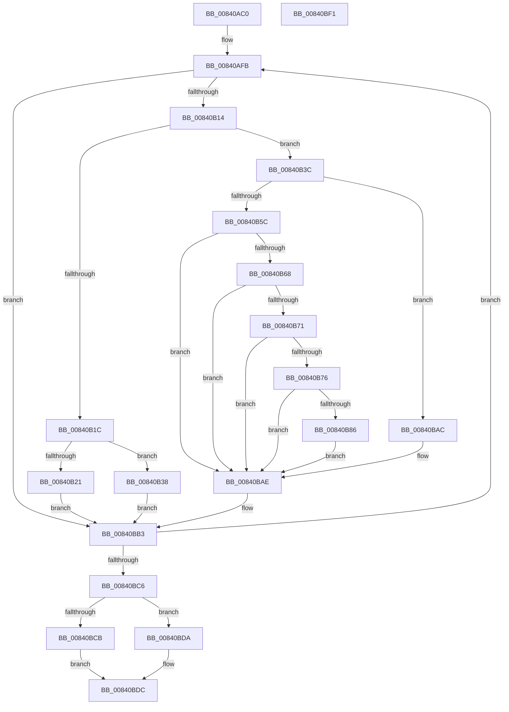

# RtlpMuiRegValidatePartialLanguage

- RVA: `0x00840AC0`–`0x00840BF2` (길이 `306` bytes)
- VA: `0x0000000140840AC0`
- 실행 섹션: `PAGE`
- PDB 이름 있음: `예`; PDB Function 태그: `아니요`
- unwind 정보 RVA: `0x00068D9C`
- 디코드: `99`개 명령, `306/306` bytes 표시
- 미해석 바이트: `0` (있으면 어셈블리에 `.byte`로 보존)

> 이 문서는 커널 이미지의 기계어와 PDB 기호를 분석해 생성했습니다. 4번과 5번은 함수 원형과 자료형을 바이너리 사용 방식에서 추정한 C 해석이며 원본 소스 복구 결과는 아닙니다.

## 1. Dependencies

- 직접 호출 지점: **1**; 고유 호출 대상: **1**
- 직접 호출자로 확인된 함수: **1**
- RIP 상대 이미지 참조: **0**

### Outgoing calls
- `0x00840B53` → [RtlpMuiRegGetInstalledLangInfoIndex](../83/RtlpMuiRegGetInstalledLangInfoIndex_function_0083E070.md) (function, `0x0083E070`)

### Direct callers
- [RtlpMuiRegValidateInstalled](RtlpMuiRegValidateInstalled_function_008404D4.md) at `0x00840739`

### Static image references
- 디코드된 RIP-relative 메모리 참조가 없습니다.

## 2. Other-region calls and transfers

- 다른 실행 섹션으로 향하는 call: **0**
- 별도 외부 분기/꼬리 이동을 확인하지 못했습니다.

## 3. Assembly (complete function range)

```asm
00840AC0  48 89 5C 24 18                  mov qword ptr [rsp + 0x18], rbx
00840AC5  48 89 4C 24 08                  mov qword ptr [rsp + 8], rcx
00840ACA  55                              push rbp
00840ACB  56                              push rsi
00840ACC  57                              push rdi
00840ACD  41 54                           push r12
00840ACF  41 55                           push r13
00840AD1  41 56                           push r14
00840AD3  41 57                           push r15
00840AD5  48 83 EC 20                     sub rsp, 0x20
00840AD9  48 8B 41 18                     mov rax, qword ptr [rcx + 0x18]
00840ADD  45 33 C9                        xor r9d, r9d
00840AE0  4C 63 EA                        movsxd r13, edx
00840AE3  41 8B F9                        mov edi, r9d
00840AE6  49 6B DD 1C                     imul rbx, r13, 0x1c
00840AEA  48 8B D1                        mov rdx, rcx
00840AED  45 8B F9                        mov r15d, r9d
00840AF0  48 03 58 10                     add rbx, qword ptr [rax + 0x10]
00840AF4  41 8B F1                        mov esi, r9d
00840AF7  4C 8D 73 0C                     lea r14, [rbx + 0xc]
00840AFB  44 0F B7 63 08                  movzx r12d, word ptr [rbx + 8]
00840B00  41 8A CF                        mov cl, r15b
00840B03  02 C9                           add cl, cl
00840B05  41 0F B7 C4                     movzx eax, r12w
00840B09  66 D3 E8                        shr ax, cl
00840B0C  24 03                           and al, 3
00840B0E  0F 84 9F 00 00 00               je 0x140840bb3
00840B14  45 0F BF 06                     movsx r8d, word ptr [r14]
00840B18  3C 02                           cmp al, 2
00840B1A  75 20                           jne 0x140840b3c
00840B1C  45 3B C5                        cmp r8d, r13d
00840B1F  75 17                           jne 0x140840b38
00840B21  B8 03 00 00 00                  mov eax, 3
00840B26  8B CE                           mov ecx, esi
00840B28  66 D3 E0                        shl ax, cl
00840B2B  66 F7 D0                        not ax
00840B2E  66 41 23 C4                     and ax, r12w
00840B32  66 89 43 08                     mov word ptr [rbx + 8], ax
00840B36  EB 7B                           jmp 0x140840bb3
00840B38  FF C7                           inc edi
00840B3A  EB 77                           jmp 0x140840bb3
00840B3C  48 8B 6A 18                     mov rbp, qword ptr [rdx + 0x18]
00840B40  4C 8D 4C 24 68                  lea r9, [rsp + 0x68]
00840B45  83 C9 FF                        or ecx, 0xffffffff
00840B48  0F B6 D0                        movzx edx, al
00840B4B  66 89 4C 24 68                  mov word ptr [rsp + 0x68], cx
00840B50  48 8B CD                        mov rcx, rbp
00840B53  E8 18 D5 FF FF                  call 0x14083e070
00840B58  85 C0                           test eax, eax
00840B5A  78 50                           js 0x140840bac
00840B5C  4C 0F BF 44 24 68               movsx r8, word ptr [rsp + 0x68]
00840B62  66 45 85 C0                     test r8w, r8w
00840B66  78 46                           js 0x140840bae
00840B68  0F B7 45 06                     movzx eax, word ptr [rbp + 6]
00840B6C  44 3B C0                        cmp r8d, eax
00840B6F  7D 3D                           jge 0x140840bae
00840B71  45 3B C5                        cmp r8d, r13d
00840B74  74 38                           je 0x140840bae
00840B76  48 8B 45 10                     mov rax, qword ptr [rbp + 0x10]
00840B7A  FF C7                           inc edi
00840B7C  49 6B C8 1C                     imul rcx, r8, 0x1c
00840B80  F6 04 01 01                     test byte ptr [rcx + rax], 1
00840B84  74 28                           je 0x140840bae
00840B86  8B CE                           mov ecx, esi
00840B88  BA 03 00 00 00                  mov edx, 3
00840B8D  66 D3 E2                        shl dx, cl
00840B90  B8 02 00 00 00                  mov eax, 2
00840B95  66 F7 D2                        not dx
00840B98  66 D3 E0                        shl ax, cl
00840B9B  66 41 23 D4                     and dx, r12w
00840B9F  66 0B D0                        or dx, ax
00840BA2  66 89 53 08                     mov word ptr [rbx + 8], dx
00840BA6  66 45 89 06                     mov word ptr [r14], r8w
00840BAA  EB 02                           jmp 0x140840bae
00840BAC  FF C7                           inc edi
00840BAE  48 8B 54 24 60                  mov rdx, qword ptr [rsp + 0x60]
00840BB3  41 FF C7                        inc r15d
00840BB6  49 83 C6 02                     add r14, 2
00840BBA  83 C6 02                        add esi, 2
00840BBD  83 FE 08                        cmp esi, 8
00840BC0  0F 8C 35 FF FF FF               jl 0x140840afb
00840BC6  83 FF 01                        cmp edi, 1
00840BC9  7D 0F                           jge 0x140840bda
00840BCB  B8 00 10 00 00                  mov eax, 0x1000
00840BD0  66 09 03                        or word ptr [rbx], ax
00840BD3  B8 01 00 00 C0                  mov eax, 0xc0000001
00840BD8  EB 02                           jmp 0x140840bdc
00840BDA  33 C0                           xor eax, eax
00840BDC  48 8B 5C 24 70                  mov rbx, qword ptr [rsp + 0x70]
00840BE1  48 83 C4 20                     add rsp, 0x20
00840BE5  41 5F                           pop r15
00840BE7  41 5E                           pop r14
00840BE9  41 5D                           pop r13
00840BEB  41 5C                           pop r12
00840BED  5F                              pop rdi
00840BEE  5E                              pop rsi
00840BEF  5D                              pop rbp
00840BF0  C3                              ret
00840BF1  CC                              int3
```

## 4. C-style interpretation (structured pseudocode)

```c
__int64 __fastcall RtlpMuiRegValidatePartialLanguage(__int64 a1, int a2, __int64 a3, int a4)
{
    __int64 result;
    __int64 v_r14;
    __int64 v_r15;
    __int64 v_rbx;
    __int64 v_rdi;
    __int64 v_rsi;
    __int64 v_rsp;
    unsigned __int64 v_stack_p10;
    unsigned __int64 v_stack_p18;
    unsigned __int64 v_stack_p8;

    v_stack_p18 = v_rbx;
    v_stack_p8 = a1;
    v_rsp = (v_rsp) - (32);
    a4 = 0;
    v_rbx = (v_rbx) * ((int)(a2));
    v_rbx = (v_rbx) + (*(unsigned __int64 *)(*(unsigned __int64 *)(a1 + 24) + 16));
loc_00840AFB:
    a1 = (unsigned __int8)((0) + (0));
    result = (unsigned __int16)(((unsigned __int16)(*(unsigned __int16 *)(v_rbx + 8))) >> ((unsigned __int8)(a1)));
    result = (unsigned __int8)((result) & (3));
    if (condition_is_equal) goto loc_00840BB3;
    if (((unsigned __int8)(result)) != 2) goto loc_00840B3C;
    if (((unsigned int)((__int16)(*(unsigned __int16 *)(v_rbx + 12)))) != ((unsigned int)((int)(a2)))) goto loc_00840B38;
    result = (unsigned __int16)((3) << (0));
    result = (unsigned __int16)(~(result));
    result = (unsigned __int16)((result) & ((unsigned __int16)(*(unsigned __int16 *)(v_rbx + 8))));
    *(unsigned __int16 *)(v_rbx + 8) = (unsigned __int16)(result);
    goto loc_00840BB3;
loc_00840B38:
    v_rdi = (unsigned int)((0) + 1);
    goto loc_00840BB3;
loc_00840B3C:
    a1 = (unsigned int)((0) | (0xFFFFFFFFULL));
    v_stack_p10 = (unsigned __int16)(a1);
    result = RtlpMuiRegGetInstalledLangInfoIndex(*(unsigned __int64 *)(a1 + 24), (unsigned __int8)(result), (__int16)(*(unsigned __int16 *)(v_rbx + 12)), v_stack_p10);
    if (sign_flag) goto loc_00840BAC;
    if (sign_flag) goto loc_00840BAE;
    if (((unsigned int)((__int16)(v_stack_p10))) >= ((unsigned int)(*(unsigned __int16 *)(*(unsigned __int64 *)(a1 + 24) + 6)))) goto loc_00840BAE;
    if (((unsigned int)((__int16)(v_stack_p10))) == ((unsigned int)((int)(a2)))) goto loc_00840BAE;
    v_rdi = (unsigned int)((v_rdi) + 1);
    a1 = (*(unsigned __int64 *)(a1 + 24)) * ((__int16)(v_stack_p10));
    if (((*(unsigned __int8 *)(a1 + *(unsigned __int64 *)(*(unsigned __int64 *)(a1 + 24) + 16) * 1)) & (1)) == 0) goto loc_00840BAE;
    a2 = (unsigned __int16)((3) << (0));
    a2 = (unsigned __int16)(~(a2));
    result = (unsigned __int16)((2) << (0));
    a2 = (unsigned __int16)((a2) & ((unsigned __int16)(*(unsigned __int16 *)(v_rbx + 8))));
    a2 = (unsigned __int16)((a2) | ((unsigned __int16)(result)));
    *(unsigned __int16 *)(v_rbx + 8) = (unsigned __int16)(a2);
    *(unsigned __int16 *)(v_rbx + 12) = (unsigned __int16)((__int16)(v_stack_p10));
    goto loc_00840BAE;
loc_00840BAC:
    v_rdi = (unsigned int)((v_rdi) + 1);
loc_00840BAE:
loc_00840BB3:
    v_r15 = (unsigned int)((0) + 1);
    v_r14 = (v_rbx + 12) + (2);
    v_rsi = (unsigned int)((0) + (2));
    if (((unsigned int)(v_rsi)) < 8) goto loc_00840AFB;
    if (((unsigned int)(v_rdi)) >= 1) goto loc_00840BDA;
    goto loc_00840BDC;
loc_00840BDA:
    result = 0;
loc_00840BDC:
    v_rsp = (v_rsp) + (32);
    return result;
}
```

## 5. (Beta) C Style

```c
int64_t RtlpMuiRegValidatePartialLanguage(void *Arg1, int32_t Arg2, int64_t Arg3, int32_t Arg4)
{
    uint8_t *arg1 = (uint8_t *)Arg1;

    int64_t result;
    int64_t local_r14;
    int64_t local_r15;
    int64_t local_rbx;
    int64_t local_rdi;
    int64_t local_rsi;
    int64_t local_rsp;
    uint64_t v_stack_p10;
    uint64_t v_stack_p18;
    uint64_t v_stack_p8;

    v_stack_p18 = local_rbx;
    v_stack_p8 = Arg1;
    local_rsp = (local_rsp) - (32);
    Arg4 = 0;
    local_rbx = (local_rbx) * ((int32_t)(Arg2));
    local_rbx = (local_rbx) + (*(uint64_t *)(*(uint64_t *)(arg1 + 0x18) + 0x10));
loc_00840AFB:
    Arg1 = (uint8_t)((0) + (0));
    result = (uint16_t)(((uint16_t)(*(uint16_t *)(local_rbx + 0x8))) >> ((uint8_t)(Arg1)));
    result = (uint8_t)((result) & (3));
    if (condition_is_equal) goto loc_00840BB3;
    if (((uint8_t)(result)) != 2) goto loc_00840B3C;
    if (((uint32_t)((int16_t)(*(uint16_t *)(local_rbx + 0xC)))) != ((uint32_t)((int32_t)(Arg2)))) goto loc_00840B38;
    result = (uint16_t)((3) << (0));
    result = (uint16_t)(~(result));
    result = (uint16_t)((result) & ((uint16_t)(*(uint16_t *)(local_rbx + 0x8))));
    *(uint16_t *)(local_rbx + 0x8) = (uint16_t)(result);
    goto loc_00840BB3;
loc_00840B38:
    local_rdi = (uint32_t)((0) + 1);
    goto loc_00840BB3;
loc_00840B3C:
    Arg1 = (uint32_t)((0) | (0xFFFFFFFFULL));
    v_stack_p10 = (uint16_t)(Arg1);
    result = RtlpMuiRegGetInstalledLangInfoIndex(*(uint64_t *)(arg1 + 0x18), (uint8_t)(result), (int16_t)(*(uint16_t *)(local_rbx + 0xC)), v_stack_p10);
    if (sign_flag) goto loc_00840BAC;
    if (sign_flag) goto loc_00840BAE;
    if (((uint32_t)((int16_t)(v_stack_p10))) >= ((uint32_t)(*(uint16_t *)(*(uint64_t *)(arg1 + 0x18) + 0x6)))) goto loc_00840BAE;
    if (((uint32_t)((int16_t)(v_stack_p10))) == ((uint32_t)((int32_t)(Arg2)))) goto loc_00840BAE;
    local_rdi = (uint32_t)((local_rdi) + 1);
    Arg1 = (*(uint64_t *)(arg1 + 0x18)) * ((int16_t)(v_stack_p10));
    if (((*(uint8_t *)(arg1 + *(uint64_t *)(*(uint64_t *)(arg1 + 0x18) + 0x10) * 1)) & (1)) == 0) goto loc_00840BAE;
    Arg2 = (uint16_t)((3) << (0));
    Arg2 = (uint16_t)(~(Arg2));
    result = (uint16_t)((2) << (0));
    Arg2 = (uint16_t)((Arg2) & ((uint16_t)(*(uint16_t *)(local_rbx + 0x8))));
    Arg2 = (uint16_t)((Arg2) | ((uint16_t)(result)));
    *(uint16_t *)(local_rbx + 0x8) = (uint16_t)(Arg2);
    *(uint16_t *)(local_rbx + 0xC) = (uint16_t)((int16_t)(v_stack_p10));
    goto loc_00840BAE;
loc_00840BAC:
    local_rdi = (uint32_t)((local_rdi) + 1);
loc_00840BAE:
loc_00840BB3:
    local_r15 = (uint32_t)((0) + 1);
    local_r14 = (local_rbx + 12) + (2);
    local_rsi = (uint32_t)((0) + (2));
    if (((uint32_t)(local_rsi)) < 8) goto loc_00840AFB;
    if (((uint32_t)(local_rdi)) >= 1) goto loc_00840BDA;
    goto loc_00840BDC;
loc_00840BDA:
    result = 0;
loc_00840BDC:
    local_rsp = (local_rsp) + (32);
    return result;
}
```

### 관측된 메모리 오프셋

구조체 형식이 확인되지 않은 접근은 인자 기준의 오프셋으로만 기록했습니다.

| 기준 인자 | 오프셋 표현 | 폭 (bit) | 접근 |
|---|---:|---:|---|
| `Arg1` | `+ 0x18` | `64` | `R` |

## 6. Execution-region graph

[열기: 2D/3D 그래프와 함수 탐색 컨트롤 패널](../../../control-panel.html?section=page&rva=0x00840AC0&view=graph)

- 2D 그래프는 위에서 아래로 흐르고, 3D 그래프는 빈 공간을 드래그해 회전합니다. Shift+드래그는 이동, 휠은 확대·축소, 함수 노드 선택은 대상 보고서 이동입니다.

### Static fallback


