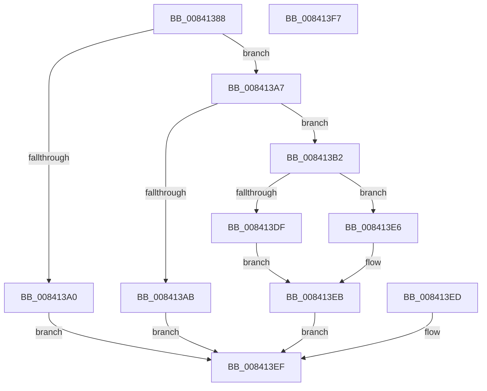

# SeQueryHSTIResults

- RVA: `0x00841388`–`0x008413F8` (길이 `112` bytes)
- VA: `0x0000000140841388`
- 실행 섹션: `PAGE`
- PDB 이름 있음: `예`; PDB Function 태그: `아니요`
- unwind 정보 RVA: `0x000DB678`
- 디코드: `33`개 명령, `112/112` bytes 표시
- 미해석 바이트: `0` (있으면 어셈블리에 `.byte`로 보존)

> 이 문서는 커널 이미지의 기계어와 PDB 기호를 분석해 생성했습니다. 4번과 5번은 함수 원형과 자료형을 바이너리 사용 방식에서 추정한 C 해석이며 원본 소스 복구 결과는 아닙니다.

## 1. Dependencies

- 직접 호출 지점: **2**; 고유 호출 대상: **2**
- 직접 호출자로 확인된 함수: **1**
- RIP 상대 이미지 참조: **2**

### Outgoing calls
- `0x008413DF` → [RtlCopyToUser](../70/RtlCopyToUser_function_00705D68.md) (function, `0x00705D68`)
- `0x008413E6` → [RtlCopyVolatileMemory](../../text/6B/RtlCopyVolatileMemory_function_006BC9D0.md) (function, `0x006BC9D0`)

### Direct callers
- [ExpQuerySystemInformation](../A5/ExpQuerySystemInformation_function_00A57858.md) at `0x00A5A600`

### Static image references
- `0x00841391` → RVA `0x00FF3480` (`PAGEDATA`; read)
- `0x008413D1` → RVA `0x00FF3488` (`PAGEDATA`; read)

## 2. Other-region calls and transfers

- 다른 실행 섹션으로 향하는 call: **1**
  - `0x008413E6` → [RtlCopyVolatileMemory](../../text/6B/RtlCopyVolatileMemory_function_006BC9D0.md) (`PAGE` → `.text`)
- 별도 외부 분기/꼬리 이동을 확인하지 못했습니다.

## 3. Assembly (complete function range)

```asm
00841388  40 53                           push rbx
0084138A  48 83 EC 30                     sub rsp, 0x30
0084138E  4C 8B C9                        mov r9, rcx
00841391  8B 05 E9 20 7B 00               mov eax, dword ptr [rip + 0x7b20e9]
00841397  41 89 00                        mov dword ptr [r8], eax
0084139A  33 DB                           xor ebx, ebx
0084139C  85 C0                           test eax, eax
0084139E  75 07                           jne 0x1408413a7
008413A0  BB 25 02 00 C0                  mov ebx, 0xc0000225
008413A5  EB 48                           jmp 0x1408413ef
008413A7  3B D0                           cmp edx, eax
008413A9  73 07                           jae 0x1408413b2
008413AB  BB 04 00 00 C0                  mov ebx, 0xc0000004
008413B0  EB 3D                           jmp 0x1408413ef
008413B2  65 48 8B 04 25 88 01 00 00      mov rax, qword ptr gs:[0x188]
008413BB  48 89 44 24 58                  mov qword ptr [rsp + 0x58], rax
008413C0  8A 88 32 02 00 00               mov cl, byte ptr [rax + 0x232]
008413C6  88 4C 24 50                     mov byte ptr [rsp + 0x50], cl
008413CA  44 8B 05 AF 20 7B 00            mov r8d, dword ptr [rip + 0x7b20af]
008413D1  48 8B 15 B0 20 7B 00            mov rdx, qword ptr [rip + 0x7b20b0]
008413D8  84 C9                           test cl, cl
008413DA  49 8B C9                        mov rcx, r9
008413DD  74 07                           je 0x1408413e6
008413DF  E8 84 49 EC FF                  call 0x140705d68
008413E4  EB 05                           jmp 0x1408413eb
008413E6  E8 E5 B5 E7 FF                  call 0x1406bc9d0
008413EB  EB 02                           jmp 0x1408413ef
008413ED  33 DB                           xor ebx, ebx
008413EF  8B C3                           mov eax, ebx
008413F1  48 83 C4 30                     add rsp, 0x30
008413F5  5B                              pop rbx
008413F6  C3                              ret
008413F7  CC                              int3
```

## 4. C-style interpretation (structured pseudocode)

```c
__int64 __fastcall SeQueryHSTIResults(__int64 a1, int a2, __int64 a3)
{
    __int64 result;
    __int64 v_rbx;
    __int64 v_rsp;
    unsigned __int8 v_stack_p18;
    unsigned __int64 v_stack_p20;

    v_rsp = (v_rsp) - (48);
    *(unsigned int *)(a3) = (unsigned int)((unsigned int)(*(unsigned int *)(v_rip + 8069353)));
    v_rbx = 0;
    if ((unsigned int)((unsigned int)(*(unsigned int *)(v_rip + 8069353))) != 0) goto loc_008413A7;
    goto loc_008413EF;
loc_008413A7:
    if (a2 >= ((unsigned int)((unsigned int)(*(unsigned int *)(v_rip + 8069353))))) goto loc_008413B2;
    goto loc_008413EF;
loc_008413B2:
    v_stack_p20 = *(unsigned __int64 *)(gs_base + (0 + 392));
    v_stack_p18 = (unsigned __int8)(*(unsigned __int8 *)(*(unsigned __int64 *)(gs_base + (0 + 392)) + 562));
    if ((unsigned __int8)(*(unsigned __int8 *)(*(unsigned __int64 *)(gs_base + (0 + 392)) + 562)) == 0) goto loc_008413E6;
    result = RtlCopyToUser(a1, *(unsigned __int64 *)(v_rip + 8069296), (unsigned int)(*(unsigned int *)(v_rip + 8069295)), a1);
    goto loc_008413EB;
loc_008413E6:
    result = RtlCopyVolatileMemory(a1, *(unsigned __int64 *)(v_rip + 8069296), (unsigned int)(*(unsigned int *)(v_rip + 8069295)), a1);
loc_008413EB:
    goto loc_008413EF;
loc_008413EF:
    v_rsp = (v_rsp) + (48);
    return (unsigned int)((unsigned int)((unsigned int)(0xC0000004ULL)));
}
```

## 5. (Beta) C Style

```c
int64_t SeQueryHSTIResults(int64_t Arg1, int32_t Arg2, void *Arg3)
{
    uint8_t *arg3 = (uint8_t *)Arg3;

    int64_t result;
    int64_t local_rbx;
    int64_t local_rsp;
    uint8_t v_stack_p18;
    uint64_t v_stack_p20;

    local_rsp = (local_rsp) - (48);
    *(uint32_t *)(arg3) = (uint32_t)((uint32_t)(*(uint32_t *)(v_rip + 0x7B20E9)));
    local_rbx = 0;
    if ((uint32_t)((uint32_t)(*(uint32_t *)(v_rip + 0x7B20E9))) != 0) goto loc_008413A7;
    goto loc_008413EF;
loc_008413A7:
    if (Arg2 >= ((uint32_t)((uint32_t)(*(uint32_t *)(v_rip + 0x7B20E9))))) goto loc_008413B2;
    goto loc_008413EF;
loc_008413B2:
    v_stack_p20 = *(uint64_t *)(gs_base + (0 + 0x188));
    v_stack_p18 = (uint8_t)(*(uint8_t *)(*(uint64_t *)(gs_base + (0 + 0x188)) + 0x232));
    if ((uint8_t)(*(uint8_t *)(*(uint64_t *)(gs_base + (0 + 0x188)) + 0x232)) == 0) goto loc_008413E6;
    result = RtlCopyToUser(Arg1, *(uint64_t *)(v_rip + 0x7B20B0), (uint32_t)(*(uint32_t *)(v_rip + 0x7B20AF)), Arg1);
    goto loc_008413EB;
loc_008413E6:
    result = RtlCopyVolatileMemory(Arg1, *(uint64_t *)(v_rip + 0x7B20B0), (uint32_t)(*(uint32_t *)(v_rip + 0x7B20AF)), Arg1);
loc_008413EB:
    goto loc_008413EF;
loc_008413EF:
    local_rsp = (local_rsp) + (48);
    return (uint32_t)((uint32_t)((uint32_t)(0xC0000004ULL)));
}
```

### 관측된 메모리 오프셋

구조체 형식이 확인되지 않은 접근은 인자 기준의 오프셋으로만 기록했습니다.

| 기준 인자 | 오프셋 표현 | 폭 (bit) | 접근 |
|---|---:|---:|---|
| `Arg3` | `+ 0x0` | `32` | `W` |

## 6. Execution-region graph

[열기: 2D/3D 그래프와 함수 탐색 컨트롤 패널](../../../control-panel.html?section=page&rva=0x00841388&view=graph)

- 2D 그래프는 위에서 아래로 흐르고, 3D 그래프는 빈 공간을 드래그해 회전합니다. Shift+드래그는 이동, 휠은 확대·축소, 함수 노드 선택은 대상 보고서 이동입니다.

### Static fallback


