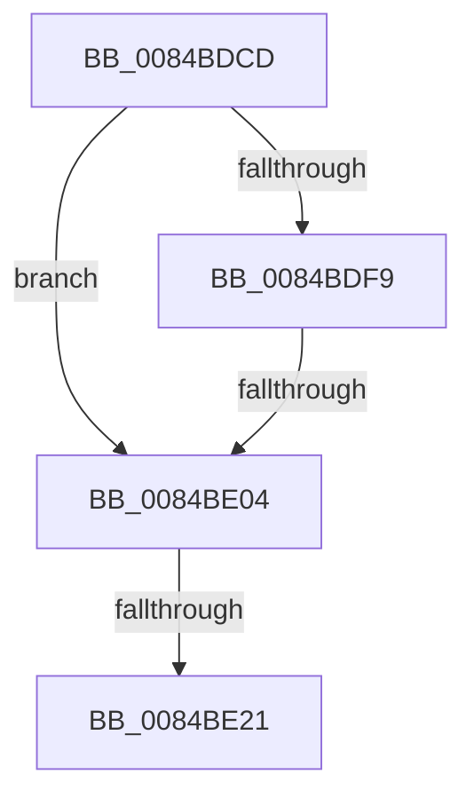

# sub_0084BDCD

- RVA: `0x0084BDCD`–`0x0084BE3E` (길이 `113` bytes)
- VA: `0x000000014084BDCD`
- 실행 섹션: `PAGE`
- PDB 이름 있음: `아니요`; PDB Function 태그: `아니요`
- unwind 정보 RVA: `0x000696B8`
- 디코드: `25`개 명령, `113/113` bytes 표시
- 미해석 바이트: `0` (있으면 어셈블리에 `.byte`로 보존)

> 이 문서는 커널 이미지의 기계어와 PDB 기호를 분석해 생성했습니다. 4번과 5번은 함수 원형과 자료형을 바이너리 사용 방식에서 추정한 C 해석이며 원본 소스 복구 결과는 아닙니다.

## 1. Dependencies

- 직접 호출 지점: **0**; 고유 호출 대상: **0**
- 직접 호출자로 확인된 함수: **0**
- RIP 상대 이미지 참조: **0**

### Outgoing calls
- 직접 디코드된 call 명령이 없습니다.

### Direct callers
- 이 함수 시작 RVA로 연결되는 직접 call은 확인되지 않았습니다. 간접 호출은 완전히 역산할 수 없습니다.

### Static image references
- 디코드된 RIP-relative 메모리 참조가 없습니다.

## 2. Other-region calls and transfers

- 다른 실행 섹션으로 향하는 call: **0**
- call이 아닌 외부 분기/꼬리 이동: **2**
  - `0x0084BDFE` → [sub_0084BEDE + 0x3B](Unknown_function_0084BEDE.md) (`tail-transfer`)
  - `0x0084BE1B` → [sub_0084BEDE](Unknown_function_0084BEDE.md) (`tail-transfer`)

## 3. Assembly (complete function range)

```asm
0084BDCD  48 89 74 24 58                  mov qword ptr [rsp + 0x58], rsi
0084BDD2  0F 57 C0                        xorps xmm0, xmm0
0084BDD5  0F BF 71 42                     movsx esi, word ptr [rcx + 0x42]
0084BDD9  B8 FF FF FF FF                  mov eax, 0xffffffff
0084BDDE  48 89 7C 24 60                  mov qword ptr [rsp + 0x60], rdi
0084BDE3  33 FF                           xor edi, edi
0084BDE5  0F 11 44 24 20                  movups xmmword ptr [rsp + 0x20], xmm0
0084BDEA  66 89 44 24 22                  mov word ptr [rsp + 0x22], ax
0084BDEF  0F 11 44 24 30                  movups xmmword ptr [rsp + 0x30], xmm0
0084BDF4  83 FE 02                        cmp esi, 2
0084BDF7  7C 0B                           jl 0x14084be04
0084BDF9  8B C6                           mov eax, esi
0084BDFB  83 E8 01                        sub eax, 1
0084BDFE  0F 85 15 01 00 00               jne 0x14084bf19
0084BE04  48 0F BF 43 42                  movsx rax, word ptr [rbx + 0x42]
0084BE09  66 89 74 24 20                  mov word ptr [rsp + 0x20], si
0084BE0E  48 89 7C 24 38                  mov qword ptr [rsp + 0x38], rdi
0084BE13  66 89 44 24 22                  mov word ptr [rsp + 0x22], ax
0084BE18  66 85 C0                        test ax, ax
0084BE1B  0F 85 BD 00 00 00               jne 0x14084bede
0084BE21  48 89 5C C4 28                  mov qword ptr [rsp + rax*8 + 0x28], rbx
0084BE26  48 8B 7C 24 38                  mov rdi, qword ptr [rsp + 0x38]
0084BE2B  0F B7 44 24 22                  movzx eax, word ptr [rsp + 0x22]
0084BE30  48 8B 74 24 58                  mov rsi, qword ptr [rsp + 0x58]
0084BE35  48 C7 44 24 50 00 00 00 00      mov qword ptr [rsp + 0x50], 0
```

## 4. C-style interpretation (structured pseudocode)

```c
__int64 __fastcall sub_0084BDCD(__int64 a1, __int64 a2, __int64 a3, __int64 a4, __int64 a5, __int64 a6, __int64 a7, __int64 a8, __int64 a9, __int64 a10, __int64 a11)
{
    __int64 result;
    __int64 v_rdi;
    unsigned __int64 v_stack_p20;
    unsigned __int16 v_stack_p22;
    unsigned __int64 v_stack_p38;
    unsigned __int64 v_stack_p50;
    unsigned __int64 v_stack_p58;
    unsigned __int64 v_stack_p60;

    v_stack_p58 = v_rsi;
    v_stack_p60 = v_rdi;
    v_rdi = 0;
    v_stack_p20 = v_xmm0;
    v_stack_p22 = (unsigned __int16)((unsigned int)(0xFFFFFFFFULL));
    a6 = v_xmm0;
    if (((unsigned int)((__int16)(*(unsigned __int16 *)(a1 + 66)))) < 2) goto loc_0084BE04;
    result = (unsigned int)(((unsigned int)((unsigned int)((__int16)(*(unsigned __int16 *)(a1 + 66))))) - (1));
loc_0084BE04:
    v_stack_p20 = (unsigned __int16)((__int16)(*(unsigned __int16 *)(a1 + 66)));
    v_stack_p38 = 0;
    v_stack_p22 = (unsigned __int16)((__int16)(*(unsigned __int16 *)(v_rbx + 66)));
    *(unsigned __int64 *)(v_rsp + (__int16)(*(unsigned __int16 *)(v_rbx + 66)) * 8 + 40) = v_rbx;
    v_stack_p50 = 0;
    return v_stack_p22;
}
```

## 5. (Beta) C Style

```c
int64_t sub_0084BDCD(void *Arg1, int64_t Arg2, int64_t Arg3, int64_t Arg4, uint64_t Arg5, int64_t Arg6, int64_t Arg7, uint64_t Arg8, uint64_t Arg9, uint64_t Arg10, int64_t Arg11)
{
    uint8_t *arg1 = (uint8_t *)Arg1;

    int64_t result;
    int64_t local_rdi;
    uint64_t v_stack_p20;
    uint16_t v_stack_p22;
    uint64_t v_stack_p38;
    uint64_t v_stack_p50;
    uint64_t v_stack_p58;
    uint64_t v_stack_p60;

    v_stack_p58 = local_rsi;
    v_stack_p60 = local_rdi;
    local_rdi = 0;
    v_stack_p20 = v_xmm0;
    v_stack_p22 = (uint16_t)((uint32_t)(0xFFFFFFFFULL));
    Arg6 = v_xmm0;
    if (((uint32_t)((int16_t)(*(uint16_t *)(arg1 + 0x42)))) < 2) goto loc_0084BE04;
    result = (uint32_t)(((uint32_t)((uint32_t)((int16_t)(*(uint16_t *)(arg1 + 0x42))))) - (1));
loc_0084BE04:
    v_stack_p20 = (uint16_t)((int16_t)(*(uint16_t *)(arg1 + 0x42)));
    v_stack_p38 = 0;
    v_stack_p22 = (uint16_t)((int16_t)(*(uint16_t *)(local_rbx + 0x42)));
    *(uint64_t *)(local_rsp + (int16_t)(*(uint16_t *)(local_rbx + 0x42)) * 8 + 0x28) = local_rbx;
    v_stack_p50 = 0;
    return v_stack_p22;
}
```

### 관측된 메모리 오프셋

구조체 형식이 확인되지 않은 접근은 인자 기준의 오프셋으로만 기록했습니다.

| 기준 인자 | 오프셋 표현 | 폭 (bit) | 접근 |
|---|---:|---:|---|
| `Arg1` | `+ 0x42` | `16` | `R` |

## 6. Execution-region graph

[열기: 2D/3D 그래프와 함수 탐색 컨트롤 패널](../../../control-panel.html?section=page&rva=0x0084BDCD&view=graph)

- 2D 그래프는 위에서 아래로 흐르고, 3D 그래프는 빈 공간을 드래그해 회전합니다. Shift+드래그는 이동, 휠은 확대·축소, 함수 노드 선택은 대상 보고서 이동입니다.

### Static fallback


