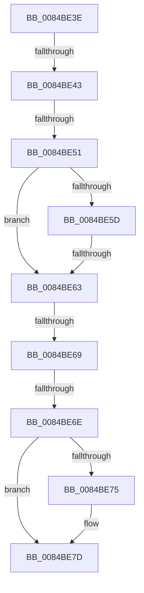

# sub_0084BE3E

- RVA: `0x0084BE3E`–`0x0084BE85` (길이 `71` bytes)
- VA: `0x000000014084BE3E`
- 실행 섹션: `PAGE`
- PDB 이름 있음: `아니요`; PDB Function 태그: `아니요`
- unwind 정보 RVA: `0x000696D0`
- 디코드: `21`개 명령, `71/71` bytes 표시
- 미해석 바이트: `0` (있으면 어셈블리에 `.byte`로 보존)

> 이 문서는 커널 이미지의 기계어와 PDB 기호를 분석해 생성했습니다. 4번과 5번은 함수 원형과 자료형을 바이너리 사용 방식에서 추정한 C 해석이며 원본 소스 복구 결과는 아닙니다.

## 1. Dependencies

- 직접 호출 지점: **1**; 고유 호출 대상: **1**
- 직접 호출자로 확인된 함수: **0**
- RIP 상대 이미지 참조: **0**

### Outgoing calls
- `0x0084BE78` → [CmSiFreeMemory](../../text/47/CmSiFreeMemory_function_00475D80.md) (function, `0x00475D80`)

### Direct callers
- 이 함수 시작 RVA로 연결되는 직접 call은 확인되지 않았습니다. 간접 호출은 완전히 역산할 수 없습니다.

### Static image references
- 디코드된 RIP-relative 메모리 참조가 없습니다.

## 2. Other-region calls and transfers

- 다른 실행 섹션으로 향하는 call: **1**
  - `0x0084BE78` → [CmSiFreeMemory](../../text/47/CmSiFreeMemory_function_00475D80.md) (`PAGE` → `.text`)
- call이 아닌 외부 분기/꼬리 이동: **5**
  - `0x0084BE41` → [sub_0084BE91 + 0x5](Unknown_function_0084BE91.md) (`tail-transfer`)
  - `0x0084BE4B` → [sub_0084BE91 + 0x43](Unknown_function_0084BE91.md) (`tail-transfer`)
  - `0x0084BE61` → [sub_0084BE91 + 0x5](Unknown_function_0084BE91.md) (`tail-transfer`)
  - `0x0084BE67` → [sub_0084BE91](Unknown_function_0084BE91.md) (`tail-transfer`)
  - `0x0084BE6C` → [sub_0084BE91 + 0x9](Unknown_function_0084BE91.md) (`tail-transfer`)

## 3. Assembly (complete function range)

```asm
0084BE3E  66 85 C0                        test ax, ax
0084BE41  78 53                           js 0x14084be96
0084BE43  48 0F BF C8                     movsx rcx, ax
0084BE47  66 83 F8 02                     cmp ax, 2
0084BE4B  0F 8D 83 00 00 00               jge 0x14084bed4
0084BE51  48 8B 4C CC 28                  mov rcx, qword ptr [rsp + rcx*8 + 0x28]
0084BE56  66 83 79 42 00                  cmp word ptr [rcx + 0x42], 0
0084BE5B  74 06                           je 0x14084be63
0084BE5D  80 79 41 01                     cmp byte ptr [rcx + 0x41], 1
0084BE61  74 33                           je 0x14084be96
0084BE63  83 79 28 FF                     cmp dword ptr [rcx + 0x28], -1
0084BE67  74 28                           je 0x14084be91
0084BE69  48 85 ED                        test rbp, rbp
0084BE6C  75 2C                           jne 0x14084be9a
0084BE6E  32 DB                           xor bl, bl
0084BE70  48 85 FF                        test rdi, rdi
0084BE73  74 08                           je 0x14084be7d
0084BE75  48 8B CF                        mov rcx, rdi
0084BE78  E8 03 9F C2 FF                  call 0x140475d80
0084BE7D  48 8B 7C 24 60                  mov rdi, qword ptr [rsp + 0x60]
0084BE82  0F B6 C3                        movzx eax, bl
```

## 4. C-style interpretation (structured pseudocode)

```c
__int64 __fastcall sub_0084BE3E(__int64 a1, __int64 a2, __int64 a3, __int64 a4, __int64 a5, __int64 a6, __int64 a7, __int64 a8, __int64 a9, __int64 a10, __int64 a11, __int64 a12)
{
    __int64 result;
    __int64 v_rbx;

    if ((*(unsigned __int16 *)(*(unsigned __int64 *)(v_rsp + (__int16)((unsigned __int16)(result)) * 8 + 40) + 66)) == 0) goto loc_0084BE63;
loc_0084BE63:
    v_rbx = 0;
    if (v_rdi != 0) {
        a1 = v_rdi;
        result = CmSiFreeMemory(a1, a2, a3, a4);
    }
    return 0;
}
```

## 5. (Beta) C Style

```c
int64_t sub_0084BE3E(int64_t Arg1, int64_t Arg2, int64_t Arg3, int64_t Arg4, void *Arg5, uint64_t Arg6, uint64_t Arg7, uint64_t Arg8, uint64_t Arg9, uint64_t Arg10, uint64_t Arg11, int64_t Arg12)
{
    uint8_t *arg5 = (uint8_t *)Arg5;

    int64_t result;
    int64_t local_rbx;

    if ((*(uint16_t *)(*(uint64_t *)(local_rsp + (int16_t)((uint16_t)(result)) * 8 + 0x28) + 0x42)) == 0) goto loc_0084BE63;
loc_0084BE63:
    local_rbx = 0;
    if (local_rdi != 0) {
        Arg1 = local_rdi;
        result = CmSiFreeMemory(Arg1, Arg2, Arg3, Arg4);
    }
    return 0;
}
```

### 관측된 메모리 오프셋

구조체 형식이 확인되지 않은 접근은 인자 기준의 오프셋으로만 기록했습니다.

| 기준 인자 | 오프셋 표현 | 폭 (bit) | 접근 |
|---|---:|---:|---|
| `Arg5` | `+ 0x28` | `32` | `R` |
| `Arg5` | `+ 0x41` | `8` | `R` |
| `Arg5` | `+ 0x42` | `16` | `R` |

## 6. Execution-region graph

[열기: 2D/3D 그래프와 함수 탐색 컨트롤 패널](../../../control-panel.html?section=page&rva=0x0084BE3E&view=graph)

- 2D 그래프는 위에서 아래로 흐르고, 3D 그래프는 빈 공간을 드래그해 회전합니다. Shift+드래그는 이동, 휠은 확대·축소, 함수 노드 선택은 대상 보고서 이동입니다.

### Static fallback


