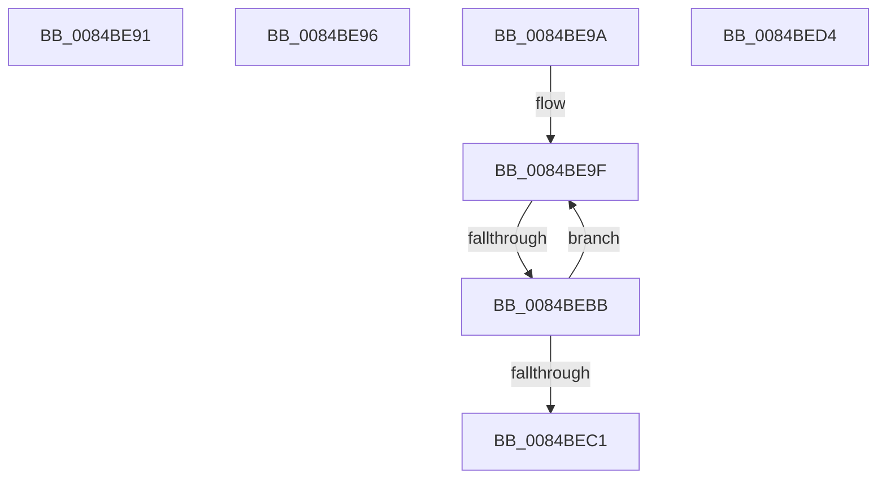

# sub_0084BE91

- RVA: `0x0084BE91`–`0x0084BEDE` (길이 `77` bytes)
- VA: `0x000000014084BE91`
- 실행 섹션: `PAGE`
- PDB 이름 있음: `아니요`; PDB Function 태그: `아니요`
- unwind 정보 RVA: `0x000696F8`
- 디코드: `21`개 명령, `77/77` bytes 표시
- 미해석 바이트: `0` (있으면 어셈블리에 `.byte`로 보존)

> 이 문서는 커널 이미지의 기계어와 PDB 기호를 분석해 생성했습니다. 4번과 5번은 함수 원형과 자료형을 바이너리 사용 방식에서 추정한 C 해석이며 원본 소스 복구 결과는 아닙니다.

## 1. Dependencies

- 직접 호출 지점: **2**; 고유 호출 대상: **2**
- 직접 호출자로 확인된 함수: **0**
- RIP 상대 이미지 참조: **0**

### Outgoing calls
- `0x0084BEB1` → [CmListGetNextElement](../../pagecmrc/BC/CmListGetNextElement_function_00BC9940.md) (function, `0x00BC9940`)
- `0x0084BEC8` → [CmEqualTrans](CmEqualTrans_function_0084BF60.md) (function, `0x0084BF60`)

### Direct callers
- 이 함수 시작 RVA로 연결되는 직접 call은 확인되지 않았습니다. 간접 호출은 완전히 역산할 수 없습니다.

### Static image references
- 디코드된 RIP-relative 메모리 참조가 없습니다.

## 2. Other-region calls and transfers

- 다른 실행 섹션으로 향하는 call: **1**
  - `0x0084BEB1` → [CmListGetNextElement](../../pagecmrc/BC/CmListGetNextElement_function_00BC9940.md) (`PAGE` → `PAGECMRC`)
- call이 아닌 외부 분기/꼬리 이동: **5**
  - `0x0084BE94` → [sub_0084BE3E](Unknown_function_0084BE3E.md) (`tail-transfer`)
  - `0x0084BE98` → [sub_0084BE3E + 0x32](Unknown_function_0084BE3E.md) (`tail-transfer`)
  - `0x0084BEB9` → [sub_0084BE3E + 0x30](Unknown_function_0084BE3E.md) (`tail-transfer`)
  - `0x0084BED2` → [sub_0084BE3E + 0x32](Unknown_function_0084BE3E.md) (`tail-transfer`)
  - `0x0084BED9` → [sub_0084BE3E + 0x18](Unknown_function_0084BE3E.md) (`tail-transfer`)

## 3. Assembly (complete function range)

```asm
0084BE91  66 FF C8                        dec ax
0084BE94  EB A8                           jmp 0x14084be3e
0084BE96  B3 01                           mov bl, 1
0084BE98  EB D6                           jmp 0x14084be70
0084BE9A  4C 8B 4C 24 28                  mov r9, qword ptr [rsp + 0x28]
0084BE9F  41 B8 20 00 00 00               mov r8d, 0x20
0084BEA5  48 8D 54 24 50                  lea rdx, [rsp + 0x50]
0084BEAA  49 8D 89 D0 00 00 00            lea rcx, [r9 + 0xd0]
0084BEB1  E8 8A DA 37 00                  call 0x140bc9940
0084BEB6  48 85 C0                        test rax, rax
0084BEB9  74 B3                           je 0x14084be6e
0084BEBB  83 78 44 02                     cmp dword ptr [rax + 0x44], 2
0084BEBF  75 DE                           jne 0x14084be9f
0084BEC1  48 8B 48 38                     mov rcx, qword ptr [rax + 0x38]
0084BEC5  48 8B D5                        mov rdx, rbp
0084BEC8  E8 93 00 00 00                  call 0x14084bf60
0084BECD  84 C0                           test al, al
0084BECF  0F 95 C3                        setne bl
0084BED2  EB 9C                           jmp 0x14084be70
0084BED4  48 8B 4C CF F0                  mov rcx, qword ptr [rdi + rcx*8 - 0x10]
0084BED9  E9 78 FF FF FF                  jmp 0x14084be56
```

## 4. C-style interpretation (structured pseudocode)

```c
__int64 __fastcall sub_0084BE91(void)
{
    __int64 result;
    unsigned __int64 v_stack_p28;
    unsigned __int64 v_stack_p50;

    result = (unsigned __int16)((result) - 1);
}
```

## 5. (Beta) C Style

```c
void sub_0084BE91(void)
{
    int64_t result;
    uint64_t v_stack_p28;
    uint64_t v_stack_p50;

    result = (uint16_t)((result) - 1);
}
```

## 6. Execution-region graph

[열기: 2D/3D 그래프와 함수 탐색 컨트롤 패널](../../../control-panel.html?section=page&rva=0x0084BE91&view=graph)

- 2D 그래프는 위에서 아래로 흐르고, 3D 그래프는 빈 공간을 드래그해 회전합니다. Shift+드래그는 이동, 휠은 확대·축소, 함수 노드 선택은 대상 보고서 이동입니다.

### Static fallback


