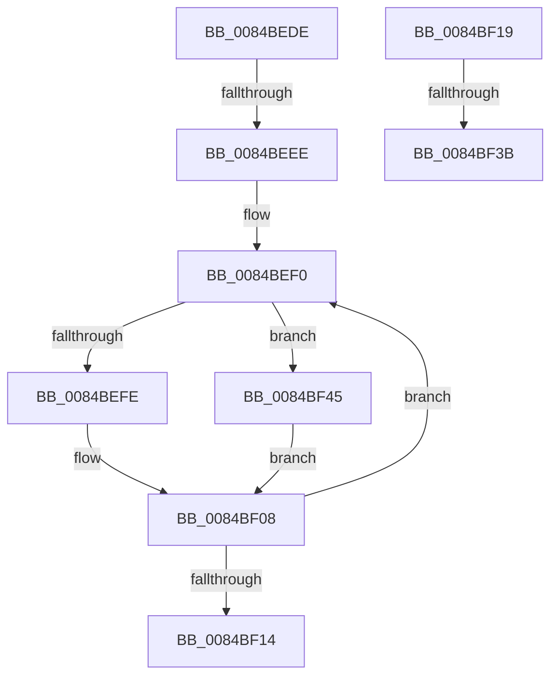

# sub_0084BEDE

- RVA: `0x0084BEDE`–`0x0084BF4C` (길이 `110` bytes)
- VA: `0x000000014084BEDE`
- 실행 섹션: `PAGE`
- PDB 이름 있음: `아니요`; PDB Function 태그: `아니요`
- unwind 정보 RVA: `0x0006970C`
- 디코드: `27`개 명령, `110/110` bytes 표시
- 미해석 바이트: `0` (있으면 어셈블리에 `.byte`로 보존)

> 이 문서는 커널 이미지의 기계어와 PDB 기호를 분석해 생성했습니다. 4번과 5번은 함수 원형과 자료형을 바이너리 사용 방식에서 추정한 C 해석이며 원본 소스 복구 결과는 아닙니다.

## 1. Dependencies

- 직접 호출 지점: **1**; 고유 호출 대상: **1**
- 직접 호출자로 확인된 함수: **0**
- RIP 상대 이미지 참조: **0**

### Outgoing calls
- `0x0084BF2A` → [CmpAllocatePool](../../text/3C/CmpAllocatePool_function_003CD504.md) (function, `0x003CD504`)

### Direct callers
- 이 함수 시작 RVA로 연결되는 직접 call은 확인되지 않았습니다. 간접 호출은 완전히 역산할 수 없습니다.

### Static image references
- 디코드된 RIP-relative 메모리 참조가 없습니다.

## 2. Other-region calls and transfers

- 다른 실행 섹션으로 향하는 call: **1**
  - `0x0084BF2A` → [CmpAllocatePool](../../text/3C/CmpAllocatePool_function_003CD504.md) (`PAGE` → `.text`)
- call이 아닌 외부 분기/꼬리 이동: **4**
  - `0x0084BEE8` → [sub_0084BDCD + 0x5E](Unknown_function_0084BDCD.md) (`tail-transfer`)
  - `0x0084BF14` → [sub_0084BDCD + 0x5E](Unknown_function_0084BDCD.md) (`tail-transfer`)
  - `0x0084BF35` → [sub_0084BDCD + 0x37](Unknown_function_0084BDCD.md) (`tail-transfer`)
  - `0x0084BF40` → [sub_0084BDCD + 0x5E](Unknown_function_0084BDCD.md) (`tail-transfer`)

## 3. Assembly (complete function range)

```asm
0084BEDE  48 8B 8B C0 00 00 00            mov rcx, qword ptr [rbx + 0xc0]
0084BEE5  48 85 C9                        test rcx, rcx
0084BEE8  0F 84 3D FF FF FF               je 0x14084be2b
0084BEEE  66 90                           nop
0084BEF0  48 8B 51 10                     mov rdx, qword ptr [rcx + 0x10]
0084BEF4  4C 0F BF C0                     movsx r8, ax
0084BEF8  66 83 F8 02                     cmp ax, 2
0084BEFC  7D 47                           jge 0x14084bf45
0084BEFE  4A 89 54 C4 28                  mov qword ptr [rsp + r8*8 + 0x28], rdx
0084BF03  48 8B 7C 24 38                  mov rdi, qword ptr [rsp + 0x38]
0084BF08  48 8B 49 18                     mov rcx, qword ptr [rcx + 0x18]
0084BF0C  66 FF C8                        dec ax
0084BF0F  48 85 C9                        test rcx, rcx
0084BF12  75 DC                           jne 0x14084bef0
0084BF14  E9 12 FF FF FF                  jmp 0x14084be2b
0084BF19  8B D0                           mov edx, eax
0084BF1B  B9 00 01 00 00                  mov ecx, 0x100
0084BF20  48 C1 E2 03                     shl rdx, 3
0084BF24  41 B8 43 4D 36 35               mov r8d, 0x35364d43
0084BF2A  E8 D5 15 B8 FF                  call 0x1403cd504
0084BF2F  48 8B F8                        mov rdi, rax
0084BF32  48 85 C0                        test rax, rax
0084BF35  0F 85 C9 FE FF FF               jne 0x14084be04
0084BF3B  48 8B 7C 24 38                  mov rdi, qword ptr [rsp + 0x38]
0084BF40  E9 E6 FE FF FF                  jmp 0x14084be2b
0084BF45  4A 89 54 C7 F0                  mov qword ptr [rdi + r8*8 - 0x10], rdx
0084BF4A  EB BC                           jmp 0x14084bf08
```

## 4. C-style interpretation (structured pseudocode)

```c
__int64 __fastcall sub_0084BEDE(__int64 a1, __int64 a2, __int64 a3, __int64 a4, __int64 a5, __int64 a6, __int64 a7)
{
    __int64 result;
    unsigned __int64 v_stack_p38;

loc_0084BEF0:
    if (((unsigned __int16)(result)) >= 2) goto loc_0084BF45;
    *(unsigned __int64 *)(v_rsp + (__int16)((unsigned __int16)(result)) * 8 + 40) = *(unsigned __int64 *)(*(unsigned __int64 *)(v_rbx + 192) + 16);
loc_0084BF08:
    result = (unsigned __int16)((result) - 1);
    if (*(unsigned __int64 *)(*(unsigned __int64 *)(v_rbx + 192) + 24) != 0) goto loc_0084BEF0;
loc_0084BF45:
    *(unsigned __int64 *)(a7 + (__int16)((unsigned __int16)(result)) * 8 - 16) = *(unsigned __int64 *)(*(unsigned __int64 *)(v_rbx + 192) + 16);
    goto loc_0084BF08;
}
```

## 5. (Beta) C Style

```c
int64_t sub_0084BEDE(int64_t Arg1, int64_t Arg2, int64_t Arg3, int64_t Arg4, uint64_t Arg5, uint64_t Arg6, int64_t Arg7)
{
    int64_t result;
    uint64_t v_stack_p38;

loc_0084BEF0:
    if (((uint16_t)(result)) >= 2) goto loc_0084BF45;
    *(uint64_t *)(local_rsp + (int16_t)((uint16_t)(result)) * 8 + 0x28) = *(uint64_t *)(*(uint64_t *)(local_rbx + 0xC0) + 0x10);
loc_0084BF08:
    result = (uint16_t)((result) - 1);
    if (*(uint64_t *)(*(uint64_t *)(local_rbx + 0xC0) + 0x18) != 0) goto loc_0084BEF0;
loc_0084BF45:
    *(uint64_t *)(Arg7 + (int16_t)((uint16_t)(result)) * 8 - 0x10) = *(uint64_t *)(*(uint64_t *)(local_rbx + 0xC0) + 0x10);
    goto loc_0084BF08;
}
```

## 6. Execution-region graph

[열기: 2D/3D 그래프와 함수 탐색 컨트롤 패널](../../../control-panel.html?section=page&rva=0x0084BEDE&view=graph)

- 2D 그래프는 위에서 아래로 흐르고, 3D 그래프는 빈 공간을 드래그해 회전합니다. Shift+드래그는 이동, 휠은 확대·축소, 함수 노드 선택은 대상 보고서 이동입니다.

### Static fallback


