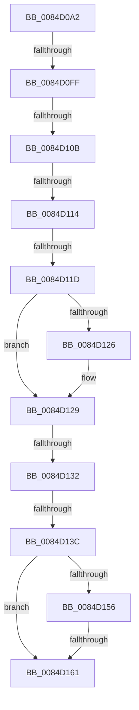

# sub_0084D0A2

- RVA: `0x0084D0A2`–`0x0084D16B` (길이 `201` bytes)
- VA: `0x000000014084D0A2`
- 실행 섹션: `PAGE`
- PDB 이름 있음: `아니요`; PDB Function 태그: `아니요`
- unwind 정보 RVA: `0x00069890`
- 디코드: `50`개 명령, `201/201` bytes 표시
- 미해석 바이트: `0` (있으면 어셈블리에 `.byte`로 보존)

> 이 문서는 커널 이미지의 기계어와 PDB 기호를 분석해 생성했습니다. 4번과 5번은 함수 원형과 자료형을 바이너리 사용 방식에서 추정한 C 해석이며 원본 소스 복구 결과는 아닙니다.

## 1. Dependencies

- 직접 호출 지점: **3**; 고유 호출 대상: **3**
- 직접 호출자로 확인된 함수: **0**
- RIP 상대 이미지 참조: **0**

### Outgoing calls
- `0x0084D0D8` → [CmpInitializeThreadInfo](../../text/3F/CmpInitializeThreadInfo_function_003FBE70.md) (function, `0x003FBE70`)
- `0x0084D140` → [CmpAttachToRegistryProcess](../../pagecmrc/BC/CmpAttachToRegistryProcess_function_00BC98E0.md) (function, `0x00BC98E0`)
- `0x0084D145` → [CmpLockRegistry](../../pagecmrc/BC/CmpLockRegistry_function_00BC9B34.md) (function, `0x00BC9B34`)

### Direct callers
- 이 함수 시작 RVA로 연결되는 직접 call은 확인되지 않았습니다. 간접 호출은 완전히 역산할 수 없습니다.

### Static image references
- 디코드된 RIP-relative 메모리 참조가 없습니다.

## 2. Other-region calls and transfers

- 다른 실행 섹션으로 향하는 call: **3**
  - `0x0084D0D8` → [CmpInitializeThreadInfo](../../text/3F/CmpInitializeThreadInfo_function_003FBE70.md) (`PAGE` → `.text`)
  - `0x0084D140` → [CmpAttachToRegistryProcess](../../pagecmrc/BC/CmpAttachToRegistryProcess_function_00BC98E0.md) (`PAGE` → `PAGECMRC`)
  - `0x0084D145` → [CmpLockRegistry](../../pagecmrc/BC/CmpLockRegistry_function_00BC9B34.md) (`PAGE` → `PAGECMRC`)
- call이 아닌 외부 분기/꼬리 이동: **7**
  - `0x0084D0F9` → [sub_0084D3C7](Unknown_function_0084D3C7.md) (`tail-transfer`)
  - `0x0084D105` → [sub_0084D3C7](Unknown_function_0084D3C7.md) (`tail-transfer`)
  - `0x0084D10E` → [sub_0084D3C7](Unknown_function_0084D3C7.md) (`tail-transfer`)
  - `0x0084D117` → [sub_0084D3C7](Unknown_function_0084D3C7.md) (`tail-transfer`)
  - `0x0084D12C` → [sub_0084D4E7](Unknown_function_0084D4E7.md) (`tail-transfer`)
  - `0x0084D136` → [sub_0084D3C7](Unknown_function_0084D3C7.md) (`tail-transfer`)
  - `0x0084D15B` → [sub_0084D46C](Unknown_function_0084D46C.md) (`tail-transfer`)

## 3. Assembly (complete function range)

```asm
0084D0A2  49 89 5B 08                     mov qword ptr [r11 + 8], rbx
0084D0A6  49 89 73 E8                     mov qword ptr [r11 - 0x18], rsi
0084D0AA  0F 57 C0                        xorps xmm0, xmm0
0084D0AD  49 89 7B E0                     mov qword ptr [r11 - 0x20], rdi
0084D0B1  33 C0                           xor eax, eax
0084D0B3  4C 8B D9                        mov r11, rcx
0084D0B6  4C 89 4D C7                     mov qword ptr [rbp - 0x39], r9
0084D0BA  48 8D 4D CF                     lea rcx, [rbp - 0x31]
0084D0BE  48 89 45 DF                     mov qword ptr [rbp - 0x21], rax
0084D0C2  4D 8B D0                        mov r10, r8
0084D0C5  48 8B FA                        mov rdi, rdx
0084D0C8  0F 11 45 CF                     movups xmmword ptr [rbp - 0x31], xmm0
0084D0CC  0F 11 4D E7                     movups xmmword ptr [rbp - 0x19], xmm1
0084D0D0  0F 11 4D F7                     movups xmmword ptr [rbp - 9], xmm1
0084D0D4  0F 11 4D 07                     movups xmmword ptr [rbp + 7], xmm1
0084D0D8  E8 93 ED BA FF                  call 0x1403fbe70
0084D0DD  0F 57 D2                        xorps xmm2, xmm2
0084D0E0  33 DB                           xor ebx, ebx
0084D0E2  41 BD FF FF FF FF               mov r13d, 0xffffffff
0084D0E8  0F 11 54 24 20                  movups xmmword ptr [rsp + 0x20], xmm2
0084D0ED  66 44 89 6D 81                  mov word ptr [rbp - 0x7f], r13w
0084D0F2  0F 11 55 8F                     movups xmmword ptr [rbp - 0x71], xmm2
0084D0F6  48 85 FF                        test rdi, rdi
0084D0F9  0F 84 C8 02 00 00               je 0x14084d3c7
0084D0FF  81 3F 32 30 79 6B               cmp dword ptr [rdi], 0x6b793032
0084D105  0F 85 BC 02 00 00               jne 0x14084d3c7
0084D10B  4D 85 DB                        test r11, r11
0084D10E  0F 84 B3 02 00 00               je 0x14084d3c7
0084D114  39 5D 7F                        cmp dword ptr [rbp + 0x7f], ebx
0084D117  0F 85 AA 02 00 00               jne 0x14084d3c7
0084D11D  48 8B 7F 08                     mov rdi, qword ptr [rdi + 8]
0084D121  4D 85 D2                        test r10, r10
0084D124  74 03                           je 0x14084d129
0084D126  49 89 3A                        mov qword ptr [r10], rdi
0084D129  4D 85 C9                        test r9, r9
0084D12C  0F 84 B5 03 00 00               je 0x14084d4e7
0084D132  40 F6 C7 01                     test dil, 1
0084D136  0F 85 8B 02 00 00               jne 0x14084d3c7
0084D13C  48 8D 4D E7                     lea rcx, [rbp - 0x19]
0084D140  E8 9B C7 37 00                  call 0x140bc98e0
0084D145  E8 EA C9 37 00                  call 0x140bc9b34
0084D14A  0F BF 77 42                     movsx esi, word ptr [rdi + 0x42]
0084D14E  48 8B CB                        mov rcx, rbx
0084D151  83 FE 02                        cmp esi, 2
0084D154  7C 0B                           jl 0x14084d161
0084D156  8B C6                           mov eax, esi
0084D158  83 E8 01                        sub eax, 1
0084D15B  0F 85 0B 03 00 00               jne 0x14084d46c
0084D161  66 89 74 24 20                  mov word ptr [rsp + 0x20], si
0084D166  48 0F BF 77 42                  movsx rsi, word ptr [rdi + 0x42]
```

## 4. C-style interpretation (structured pseudocode)

```c
__int64 __fastcall sub_0084D0A2(__int64 a1, __int64 a2, __int64 a3, __int64 a4)
{
    __int64 result;
    __int64 v_rbx;
    unsigned __int64 v_stack_p20;

    *(unsigned __int64 *)(v_r11 + 8) = v_rbx;
    *(unsigned __int64 *)(v_r11 - 24) = v_rsi;
    *(unsigned __int64 *)(v_r11 - 32) = v_rdi;
    result = 0;
    *(unsigned __int64 *)(v_rbp - 57) = a4;
    *(unsigned __int64 *)(v_rbp - 33) = 0;
    *(unsigned __int64 *)(v_rbp - 49) = v_xmm0;
    *(unsigned __int64 *)(v_rbp - 25) = v_xmm1;
    *(unsigned __int64 *)(v_rbp - 9) = v_xmm1;
    *(unsigned __int64 *)(v_rbp + 7) = v_xmm1;
    result = CmpInitializeThreadInfo(v_rbp - 49, a2, a3, a4);
    v_rbx = 0;
    v_stack_p20 = v_xmm2;
    *(unsigned __int16 *)(v_rbp - 127) = (unsigned __int16)((unsigned int)(0xFFFFFFFFULL));
    *(unsigned __int64 *)(v_rbp - 113) = v_xmm2;
    if (a3 != 0) {
        *(unsigned __int64 *)(a3) = *(unsigned __int64 *)(a2 + 8);
    }
    result = CmpAttachToRegistryProcess(v_rbp - 25, a2, a3, a4);
    result = CmpLockRegistry(v_rbp - 25, a2, a3, a4);
    if (((unsigned int)((__int16)(*(unsigned __int16 *)(*(unsigned __int64 *)(a2 + 8) + 66)))) < 2) goto loc_0084D161;
    result = (unsigned int)(((unsigned int)((unsigned int)((__int16)(*(unsigned __int16 *)(*(unsigned __int64 *)(a2 + 8) + 66))))) - (1));
loc_0084D161:
    v_stack_p20 = (unsigned __int16)((__int16)(*(unsigned __int16 *)(*(unsigned __int64 *)(a2 + 8) + 66)));
    return result;
}
```

## 5. (Beta) C Style

```c
int64_t sub_0084D0A2(int64_t Arg1, int64_t Arg2, int64_t Arg3, int64_t Arg4)
{
    int64_t result;
    int64_t local_rbx;
    uint64_t v_stack_p20;

    *(uint64_t *)(local_r11 + 0x8) = local_rbx;
    *(uint64_t *)(local_r11 - 0x18) = local_rsi;
    *(uint64_t *)(local_r11 - 0x20) = local_rdi;
    result = 0;
    *(uint64_t *)(local_rbp - 0x39) = Arg4;
    *(uint64_t *)(local_rbp - 0x21) = 0;
    *(uint64_t *)(local_rbp - 0x31) = v_xmm0;
    *(uint64_t *)(local_rbp - 0x19) = v_xmm1;
    *(uint64_t *)(local_rbp - 0x9) = v_xmm1;
    *(uint64_t *)(local_rbp + 0x7) = v_xmm1;
    result = CmpInitializeThreadInfo(local_rbp - 49, Arg2, Arg3, Arg4);
    local_rbx = 0;
    v_stack_p20 = v_xmm2;
    *(uint16_t *)(local_rbp - 0x7F) = (uint16_t)((uint32_t)(0xFFFFFFFFULL));
    *(uint64_t *)(local_rbp - 0x71) = v_xmm2;
    if (Arg3 != 0) {
        *(uint64_t *)(Arg3) = *(uint64_t *)(Arg2 + 0x8);
    }
    result = CmpAttachToRegistryProcess(local_rbp - 25, Arg2, Arg3, Arg4);
    result = CmpLockRegistry(local_rbp - 25, Arg2, Arg3, Arg4);
    if (((uint32_t)((int16_t)(*(uint16_t *)(*(uint64_t *)(Arg2 + 0x8) + 0x42)))) < 2) goto loc_0084D161;
    result = (uint32_t)(((uint32_t)((uint32_t)((int16_t)(*(uint16_t *)(*(uint64_t *)(Arg2 + 0x8) + 0x42))))) - (1));
loc_0084D161:
    v_stack_p20 = (uint16_t)((int16_t)(*(uint16_t *)(*(uint64_t *)(Arg2 + 0x8) + 0x42)));
    return result;
}
```

## 6. Execution-region graph

[열기: 2D/3D 그래프와 함수 탐색 컨트롤 패널](../../../control-panel.html?section=page&rva=0x0084D0A2&view=graph)

- 2D 그래프는 위에서 아래로 흐르고, 3D 그래프는 빈 공간을 드래그해 회전합니다. Shift+드래그는 이동, 휠은 확대·축소, 함수 노드 선택은 대상 보고서 이동입니다.

### Static fallback


