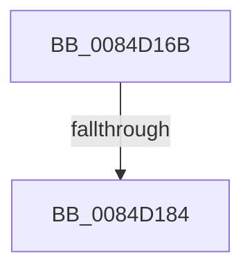

# sub_0084D16B

- RVA: `0x0084D16B`–`0x0084D18D` (길이 `34` bytes)
- VA: `0x000000014084D16B`
- 실행 섹션: `PAGE`
- PDB 이름 있음: `아니요`; PDB Function 태그: `아니요`
- unwind 정보 RVA: `0x000698AC`
- 디코드: `7`개 명령, `34/34` bytes 표시
- 미해석 바이트: `0` (있으면 어셈블리에 `.byte`로 보존)

> 이 문서는 커널 이미지의 기계어와 PDB 기호를 분석해 생성했습니다. 4번과 5번은 함수 원형과 자료형을 바이너리 사용 방식에서 추정한 C 해석이며 원본 소스 복구 결과는 아닙니다.

## 1. Dependencies

- 직접 호출 지점: **0**; 고유 호출 대상: **0**
- 직접 호출자로 확인된 함수: **0**
- RIP 상대 이미지 참조: **0**

### Outgoing calls
- 직접 디코드된 call 명령이 없습니다.

### Direct callers
- 이 함수 시작 RVA로 연결되는 직접 call은 확인되지 않았습니다. 간접 호출은 완전히 역산할 수 없습니다.

### Static image references
- 디코드된 RIP-relative 메모리 참조가 없습니다.

## 2. Other-region calls and transfers

- 다른 실행 섹션으로 향하는 call: **0**
- call이 아닌 외부 분기/꼬리 이동: **1**
  - `0x0084D17E` → [sub_0084D3EB](Unknown_function_0084D3EB.md) (`tail-transfer`)

## 3. Assembly (complete function range)

```asm
0084D16B  4C 89 B4 24 C8 00 00 00         mov qword ptr [rsp + 0xc8], r14
0084D173  48 89 4D 97                     mov qword ptr [rbp - 0x69], rcx
0084D177  66 89 75 81                     mov word ptr [rbp - 0x7f], si
0084D17B  66 85 F6                        test si, si
0084D17E  0F 85 67 02 00 00               jne 0x14084d3eb
0084D184  48 89 7C F5 87                  mov qword ptr [rbp + rsi*8 - 0x79], rdi
0084D189  0F B7 75 81                     movzx esi, word ptr [rbp - 0x7f]
```

## 4. C-style interpretation (structured pseudocode)

```c
void __fastcall sub_0084D16B(__int64 a1)
{
    unsigned __int64 v_stack_pC8;

    v_stack_pC8 = v_r14;
    *(unsigned __int64 *)(v_rbp - 105) = a1;
    *(unsigned __int16 *)(v_rbp - 127) = (unsigned __int16)(v_rsi);
    *(unsigned __int64 *)(v_rbp + v_rsi * 8 - 121) = v_rdi;
    return;
}
```

## 5. (Beta) C Style

```c
void sub_0084D16B(int64_t Arg1)
{
    uint64_t v_stack_pC8;

    v_stack_pC8 = local_r14;
    *(uint64_t *)(local_rbp - 0x69) = Arg1;
    *(uint16_t *)(local_rbp - 0x7F) = (uint16_t)(local_rsi);
    *(uint64_t *)(local_rbp + local_rsi * 8 - 0x79) = local_rdi;
    return;
}
```

## 6. Execution-region graph

[열기: 2D/3D 그래프와 함수 탐색 컨트롤 패널](../../../control-panel.html?section=page&rva=0x0084D16B&view=graph)

- 2D 그래프는 위에서 아래로 흐르고, 3D 그래프는 빈 공간을 드래그해 회전합니다. Shift+드래그는 이동, 휠은 확대·축소, 함수 노드 선택은 대상 보고서 이동입니다.

### Static fallback


