# sub_0084D18D

- RVA: `0x0084D18D`–`0x0084D304` (길이 `375` bytes)
- VA: `0x000000014084D18D`
- 실행 섹션: `PAGE`
- PDB 이름 있음: `아니요`; PDB Function 태그: `아니요`
- unwind 정보 RVA: `0x000698C0`
- 디코드: `89`개 명령, `375/375` bytes 표시
- 미해석 바이트: `0` (있으면 어셈블리에 `.byte`로 보존)

> 이 문서는 커널 이미지의 기계어와 PDB 기호를 분석해 생성했습니다. 4번과 5번은 함수 원형과 자료형을 바이너리 사용 방식에서 추정한 C 해석이며 원본 소스 복구 결과는 아닙니다.

## 1. Dependencies

- 직접 호출 지점: **5**; 고유 호출 대상: **5**
- 직접 호출자로 확인된 함수: **0**
- RIP 상대 이미지 참조: **0**

### Outgoing calls
- `0x0084D1D1` → [CmpLockKcbShared](../../pagecmrc/BC/CmpLockKcbShared_function_00BC9A1C.md) (function, `0x00BC9A1C`)
- `0x0084D202` → [CmpAcquireShutdownRundown](../../pagecmrc/BC/CmpAcquireShutdownRundown_function_00BC9400.md) (function, `0x00BC9400`)
- `0x0084D2B1` → [CmpConstructNameFromKeyNodes](../85/CmpConstructNameFromKeyNodes_function_00855960.md) (function, `0x00855960`)
- `0x0084D2D2` → [CmSiFreeMemory](../../text/47/CmSiFreeMemory_function_00475D80.md) (function, `0x00475D80`)
- `0x0084D2DC` → [CmpReleaseShutdownRundown](../../pagecmrc/BC/CmpReleaseShutdownRundown_function_00BC9880.md) (function, `0x00BC9880`)

### Direct callers
- 이 함수 시작 RVA로 연결되는 직접 call은 확인되지 않았습니다. 간접 호출은 완전히 역산할 수 없습니다.

### Static image references
- 디코드된 RIP-relative 메모리 참조가 없습니다.

## 2. Other-region calls and transfers

- 다른 실행 섹션으로 향하는 call: **4**
  - `0x0084D1D1` → [CmpLockKcbShared](../../pagecmrc/BC/CmpLockKcbShared_function_00BC9A1C.md) (`PAGE` → `PAGECMRC`)
  - `0x0084D202` → [CmpAcquireShutdownRundown](../../pagecmrc/BC/CmpAcquireShutdownRundown_function_00BC9400.md) (`PAGE` → `PAGECMRC`)
  - `0x0084D2D2` → [CmSiFreeMemory](../../text/47/CmSiFreeMemory_function_00475D80.md) (`PAGE` → `.text`)
  - `0x0084D2DC` → [CmpReleaseShutdownRundown](../../pagecmrc/BC/CmpReleaseShutdownRundown_function_00BC9880.md) (`PAGE` → `PAGECMRC`)
- call이 아닌 외부 분기/꼬리 이동: **13**
  - `0x0084D1C5` → [sub_0084D3D8](Unknown_function_0084D3D8.md) (`tail-transfer`)
  - `0x0084D1E8` → [sub_0084D499 + 0x43](Unknown_function_0084D499.md) (`tail-transfer`)
  - `0x0084D225` → [sub_0084D499](Unknown_function_0084D499.md) (`tail-transfer`)
  - `0x0084D240` → [sub_0084D428](Unknown_function_0084D428.md) (`tail-transfer`)
  - `0x0084D252` → [sub_0084D3A1](Unknown_function_0084D3A1.md) (`tail-transfer`)
  - `0x0084D25F` → [sub_0084D3A1](Unknown_function_0084D3A1.md) (`tail-transfer`)
  - `0x0084D26C` → [sub_0084D3A1](Unknown_function_0084D3A1.md) (`tail-transfer`)
  - `0x0084D27A` → [sub_0084D3D8 + 0x9](Unknown_function_0084D3D8.md) (`tail-transfer`)
  - `0x0084D28F` → [sub_0084D3A1](Unknown_function_0084D3A1.md) (`tail-transfer`)
  - `0x0084D299` → [sub_0084D3A1 + 0x1E](Unknown_function_0084D3A1.md) (`tail-transfer`)
  - `0x0084D2A3` → [sub_0084D499 + 0x2E](Unknown_function_0084D499.md) (`tail-transfer`)
  - `0x0084D2BE` → [sub_0084D3A1 + 0x16](Unknown_function_0084D3A1.md) (`tail-transfer`)
  - `0x0084D302` → [sub_0084D304 + 0x3D](Unknown_function_0084D304.md) (`tail-transfer`)

## 3. Assembly (complete function range)

```asm
0084D18D  4C 89 A4 24 D0 00 00 00         mov qword ptr [rsp + 0xd0], r12
0084D195  44 0F B7 F3                     movzx r14d, bx
0084D199  4C 89 BC 24 C0 00 00 00         mov qword ptr [rsp + 0xc0], r15
0084D1A1  66 3B DE                        cmp bx, si
0084D1A4  7F 3E                           jg 0x14084d1e4
0084D1A6  4C 8B 65 97                     mov r12, qword ptr [rbp - 0x69]
0084D1AA  48 8D 4D 87                     lea rcx, [rbp - 0x79]
0084D1AE  4C 2B E1                        sub r12, rcx
0084D1B1  4C 8D 7D 87                     lea r15, [rbp - 0x79]
0084D1B5  49 83 C4 F0                     add r12, -0x10
0084D1B9  0F 1F 80 00 00 00 00            nop dword ptr [rax]
0084D1C0  66 41 83 FE 02                  cmp r14w, 2
0084D1C5  0F 8D 0D 02 00 00               jge 0x14084d3d8
0084D1CB  49 8B CF                        mov rcx, r15
0084D1CE  48 8B 09                        mov rcx, qword ptr [rcx]
0084D1D1  E8 46 C8 37 00                  call 0x140bc9a1c
0084D1D6  66 41 FF C6                     inc r14w
0084D1DA  49 83 C7 08                     add r15, 8
0084D1DE  66 44 3B F6                     cmp r14w, si
0084D1E2  7E DC                           jle 0x14084d1c0
0084D1E4  48 39 5F 50                     cmp qword ptr [rdi + 0x50], rbx
0084D1E8  0F 84 EE 02 00 00               je 0x14084d4dc
0084D1EE  0F 57 C0                        xorps xmm0, xmm0
0084D1F1  48 89 5D 9F                     mov qword ptr [rbp - 0x61], rbx
0084D1F5  0F 11 45 A7                     movups xmmword ptr [rbp - 0x59], xmm0
0084D1F9  66 44 89 6D A9                  mov word ptr [rbp - 0x57], r13w
0084D1FE  0F 11 45 B7                     movups xmmword ptr [rbp - 0x49], xmm0
0084D202  E8 F9 C1 37 00                  call 0x140bc9400
0084D207  44 0F BF 7F 42                  movsx r15d, word ptr [rdi + 0x42]
0084D20C  44 0F B6 E0                     movzx r12d, al
0084D210  4C 8B F3                        mov r14, rbx
0084D213  41 BD 9A 00 00 C0               mov r13d, 0xc000009a
0084D219  41 83 FF 02                     cmp r15d, 2
0084D21D  7C 0C                           jl 0x14084d22b
0084D21F  41 8B C7                        mov eax, r15d
0084D222  83 E8 01                        sub eax, 1
0084D225  0F 85 6E 02 00 00               jne 0x14084d499
0084D22B  48 0F BF 47 42                  movsx rax, word ptr [rdi + 0x42]
0084D230  66 44 89 7D A7                  mov word ptr [rbp - 0x59], r15w
0084D235  4C 89 75 BF                     mov qword ptr [rbp - 0x41], r14
0084D239  66 89 45 A9                     mov word ptr [rbp - 0x57], ax
0084D23D  66 85 C0                        test ax, ax
0084D240  0F 85 E2 01 00 00               jne 0x14084d428
0084D246  48 89 7C C5 AF                  mov qword ptr [rbp + rax*8 - 0x51], rdi
0084D24B  4C 8B 75 BF                     mov r14, qword ptr [rbp - 0x41]
0084D24F  45 84 E4                        test r12b, r12b
0084D252  0F 84 49 01 00 00               je 0x14084d3a1
0084D258  F7 47 08 00 00 02 00            test dword ptr [rdi + 8], 0x20000
0084D25F  0F 85 3C 01 00 00               jne 0x14084d3a1
0084D265  0F B7 4D A9                     movzx ecx, word ptr [rbp - 0x57]
0084D269  66 85 C9                        test cx, cx
0084D26C  0F 88 2F 01 00 00               js 0x14084d3a1
0084D272  48 0F BF C1                     movsx rax, cx
0084D276  66 83 F9 02                     cmp cx, 2
0084D27A  0F 8D 61 01 00 00               jge 0x14084d3e1
0084D280  48 8B 44 C5 AF                  mov rax, qword ptr [rbp + rax*8 - 0x51]
0084D285  66 39 58 42                     cmp word ptr [rax + 0x42], bx
0084D289  74 0A                           je 0x14084d295
0084D28B  80 78 41 01                     cmp byte ptr [rax + 0x41], 1
0084D28F  0F 84 0C 01 00 00               je 0x14084d3a1
0084D295  83 78 28 FF                     cmp dword ptr [rax + 0x28], -1
0084D299  0F 84 20 01 00 00               je 0x14084d3bf
0084D29F  83 7F 28 FF                     cmp dword ptr [rdi + 0x28], -1
0084D2A3  0F 84 1E 02 00 00               je 0x14084d4c7
0084D2A9  48 8D 55 9F                     lea rdx, [rbp - 0x61]
0084D2AD  48 8D 4D A7                     lea rcx, [rbp - 0x59]
0084D2B1  E8 AA 86 00 00                  call 0x140855960
0084D2B6  4C 8B 75 BF                     mov r14, qword ptr [rbp - 0x41]
0084D2BA  8B F8                           mov edi, eax
0084D2BC  85 C0                           test eax, eax
0084D2BE  0F 88 F3 00 00 00               js 0x14084d3b7
0084D2C4  4C 8B 7D 9F                     mov r15, qword ptr [rbp - 0x61]
0084D2C8  8B FB                           mov edi, ebx
0084D2CA  4D 85 F6                        test r14, r14
0084D2CD  74 08                           je 0x14084d2d7
0084D2CF  49 8B CE                        mov rcx, r14
0084D2D2  E8 A9 8A C2 FF                  call 0x140475d80
0084D2D7  45 84 E4                        test r12b, r12b
0084D2DA  74 05                           je 0x14084d2e1
0084D2DC  E8 9F C5 37 00                  call 0x140bc9880
0084D2E1  85 FF                           test edi, edi
0084D2E3  78 0A                           js 0x14084d2ef
0084D2E5  48 8B 45 C7                     mov rax, qword ptr [rbp - 0x39]
0084D2E9  44 8B EB                        mov r13d, ebx
0084D2EC  4C 89 38                        mov qword ptr [rax], r15
0084D2EF  4C 8B BC 24 C0 00 00 00         mov r15, qword ptr [rsp + 0xc0]
0084D2F7  4C 8B A4 24 D0 00 00 00         mov r12, qword ptr [rsp + 0xd0]
0084D2FF  66 3B DE                        cmp bx, si
0084D302  7F 3D                           jg 0x14084d341
```

## 4. C-style interpretation (structured pseudocode)

```c
__int64 __fastcall sub_0084D18D(__int64 a1, __int64 a2, __int64 a3, __int64 a4, __int64 a5, __int64 a6, __int64 a7, __int64 a8, __int64 a9, __int64 a10, __int64 a11, __int64 a12, __int64 a13, __int64 a14, __int64 a15, __int64 a16, __int64 a17, __int64 a18, __int64 a19, __int64 a20, __int64 a21, __int64 a22, __int64 a23, __int64 a24, __int64 a25, __int64 a26)
{
    __int64 result;
    __int64 v_r12;
    __int64 v_r13;
    __int64 v_r14;
    __int64 v_r15;
    unsigned __int64 v_stack_pC0;
    unsigned __int64 v_stack_pD0;

    v_stack_pD0 = v_r12;
    v_stack_pC0 = v_r15;
    if (((unsigned __int16)(v_rbx)) > ((unsigned __int16)(v_rsi))) goto loc_0084D1E4;
    v_r12 = (*(unsigned __int64 *)(v_rbp - 105)) - (v_rbp - 121);
    v_r12 = (v_r12) + (-16);
loc_0084D1C0:
    result = CmpLockKcbShared(*(unsigned __int64 *)(v_rbp - 121), a2, a3, a4);
    v_r14 = (unsigned __int16)(((unsigned __int16)(v_rbx)) + 1);
    v_r15 = (v_rbp - 121) + (8);
    if (((unsigned __int16)(v_r14)) <= ((unsigned __int16)(v_rsi))) goto loc_0084D1C0;
loc_0084D1E4:
    *(unsigned __int64 *)(v_rbp - 97) = v_rbx;
    *(unsigned __int64 *)(v_rbp - 89) = v_xmm0;
    *(unsigned __int16 *)(v_rbp - 87) = (unsigned __int16)(v_r13);
    *(unsigned __int64 *)(v_rbp - 73) = v_xmm0;
    result = CmpAcquireShutdownRundown(*(unsigned __int64 *)(v_rbp - 121), a2, a3, a4);
    if (((unsigned int)((__int16)(*(unsigned __int16 *)(v_rdi + 66)))) < 2) goto loc_0084D22B;
    result = (unsigned int)(((unsigned int)((unsigned int)((__int16)(*(unsigned __int16 *)(v_rdi + 66))))) - (1));
loc_0084D22B:
    *(unsigned __int16 *)(v_rbp - 89) = (unsigned __int16)((__int16)(*(unsigned __int16 *)(v_rdi + 66)));
    *(unsigned __int64 *)(v_rbp - 65) = v_rbx;
    *(unsigned __int16 *)(v_rbp - 87) = (unsigned __int16)((__int16)(*(unsigned __int16 *)(v_rdi + 66)));
    *(unsigned __int64 *)(v_rbp + (__int16)(*(unsigned __int16 *)(v_rdi + 66)) * 8 - 81) = v_rdi;
    if ((*(unsigned __int16 *)(*(unsigned __int64 *)(v_rbp + (__int16)((unsigned __int16)(*(unsigned __int16 *)(v_rbp - 87))) * 8 - 81) + 66)) == ((unsigned __int16)(v_rbx))) goto loc_0084D295;
loc_0084D295:
    result = CmpConstructNameFromKeyNodes(v_rbp - 89, v_rbp - 97, a3, a4);
    if (*(unsigned __int64 *)(v_rbp - 65) != 0) {
        a1 = *(unsigned __int64 *)(v_rbp - 65);
        result = CmSiFreeMemory(a1, v_rbp - 97, a3, a4);
    }
    if ((unsigned __int8)((unsigned __int8)(result)) != 0) {
        result = CmpReleaseShutdownRundown(a1, v_rbp - 97, a3, a4);
    }
    v_r13 = (unsigned int)(0xC000009AULL);
    if (!(sign_flag)) {
        result = *(unsigned __int64 *)(v_rbp - 57);
        v_r13 = (unsigned int)(v_rbx);
        *(unsigned __int64 *)(result) = *(unsigned __int64 *)(v_rbp - 97);
    }
}
```

## 5. (Beta) C Style

```c
int64_t sub_0084D18D(int64_t Arg1, int64_t Arg2, int64_t Arg3, int64_t Arg4, uint64_t Arg5, uint64_t Arg6, uint64_t Arg7, uint64_t Arg8, uint64_t Arg9, uint64_t Arg10, uint64_t Arg11, uint64_t Arg12, uint64_t Arg13, uint64_t Arg14, uint64_t Arg15, uint64_t Arg16, uint64_t Arg17, uint64_t Arg18, uint64_t Arg19, uint64_t Arg20, uint64_t Arg21, uint64_t Arg22, uint64_t Arg23, int64_t Arg24, uint64_t Arg25, int64_t Arg26)
{
    int64_t result;
    int64_t local_r12;
    int64_t local_r13;
    int64_t local_r14;
    int64_t local_r15;
    uint64_t v_stack_pC0;
    uint64_t v_stack_pD0;

    v_stack_pD0 = local_r12;
    v_stack_pC0 = local_r15;
    if (((uint16_t)(local_rbx)) > ((uint16_t)(local_rsi))) goto loc_0084D1E4;
    local_r12 = (*(uint64_t *)(local_rbp - 0x69)) - (local_rbp - 121);
    local_r12 = (local_r12) + (-16);
loc_0084D1C0:
    result = CmpLockKcbShared(*(uint64_t *)(local_rbp - 0x79), Arg2, Arg3, Arg4);
    local_r14 = (uint16_t)(((uint16_t)(local_rbx)) + 1);
    local_r15 = (local_rbp - 121) + (8);
    if (((uint16_t)(local_r14)) <= ((uint16_t)(local_rsi))) goto loc_0084D1C0;
loc_0084D1E4:
    *(uint64_t *)(local_rbp - 0x61) = local_rbx;
    *(uint64_t *)(local_rbp - 0x59) = v_xmm0;
    *(uint16_t *)(local_rbp - 0x57) = (uint16_t)(local_r13);
    *(uint64_t *)(local_rbp - 0x49) = v_xmm0;
    result = CmpAcquireShutdownRundown(*(uint64_t *)(local_rbp - 0x79), Arg2, Arg3, Arg4);
    if (((uint32_t)((int16_t)(*(uint16_t *)(local_rdi + 0x42)))) < 2) goto loc_0084D22B;
    result = (uint32_t)(((uint32_t)((uint32_t)((int16_t)(*(uint16_t *)(local_rdi + 0x42))))) - (1));
loc_0084D22B:
    *(uint16_t *)(local_rbp - 0x59) = (uint16_t)((int16_t)(*(uint16_t *)(local_rdi + 0x42)));
    *(uint64_t *)(local_rbp - 0x41) = local_rbx;
    *(uint16_t *)(local_rbp - 0x57) = (uint16_t)((int16_t)(*(uint16_t *)(local_rdi + 0x42)));
    *(uint64_t *)(local_rbp + (int16_t)(*(uint16_t *)(local_rdi + 0x42)) * 8 - 0x51) = local_rdi;
    if ((*(uint16_t *)(*(uint64_t *)(local_rbp + (int16_t)((uint16_t)(*(uint16_t *)(local_rbp - 0x57))) * 8 - 0x51) + 0x42)) == ((uint16_t)(local_rbx))) goto loc_0084D295;
loc_0084D295:
    result = CmpConstructNameFromKeyNodes(local_rbp - 89, local_rbp - 97, Arg3, Arg4);
    if (*(uint64_t *)(local_rbp - 0x41) != 0) {
        Arg1 = *(uint64_t *)(local_rbp - 0x41);
        result = CmSiFreeMemory(Arg1, local_rbp - 97, Arg3, Arg4);
    }
    if ((uint8_t)((uint8_t)(result)) != 0) {
        result = CmpReleaseShutdownRundown(Arg1, local_rbp - 97, Arg3, Arg4);
    }
    local_r13 = (uint32_t)(0xC000009AULL);
    if (!(sign_flag)) {
        result = *(uint64_t *)(local_rbp - 0x39);
        local_r13 = (uint32_t)(local_rbx);
        *(uint64_t *)(result) = *(uint64_t *)(local_rbp - 0x61);
    }
}
```

## 6. Execution-region graph

[열기: 2D/3D 그래프와 함수 탐색 컨트롤 패널](../../../control-panel.html?section=page&rva=0x0084D18D&view=graph)

- 2D 그래프는 위에서 아래로 흐르고, 3D 그래프는 빈 공간을 드래그해 회전합니다. Shift+드래그는 이동, 휠은 확대·축소, 함수 노드 선택은 대상 보고서 이동입니다.

### Static fallback

```mermaid
flowchart TD
  bb_0084D18D[BB_0084D18D]
  bb_0084D1A6[BB_0084D1A6]
  bb_0084D1C0[BB_0084D1C0]
  bb_0084D1CB[BB_0084D1CB]
  bb_0084D1E4[BB_0084D1E4]
  bb_0084D1EE[BB_0084D1EE]
  bb_0084D21F[BB_0084D21F]
  bb_0084D22B[BB_0084D22B]
  bb_0084D246[BB_0084D246]
  bb_0084D258[BB_0084D258]
  bb_0084D265[BB_0084D265]
  bb_0084D272[BB_0084D272]
  bb_0084D280[BB_0084D280]
  bb_0084D28B[BB_0084D28B]
  bb_0084D295[BB_0084D295]
  bb_0084D29F[BB_0084D29F]
  bb_0084D2A9[BB_0084D2A9]
  bb_0084D2C4[BB_0084D2C4]
  bb_0084D2CF[BB_0084D2CF]
  bb_0084D2D7[BB_0084D2D7]
  bb_0084D2DC[BB_0084D2DC]
  bb_0084D2E1[BB_0084D2E1]
  bb_0084D2E5[BB_0084D2E5]
  bb_0084D2EF[BB_0084D2EF]
  bb_0084D18D -->|branch| bb_0084D1E4
  bb_0084D18D -->|fallthrough| bb_0084D1A6
  bb_0084D1A6 -->|flow| bb_0084D1C0
  bb_0084D1C0 -->|fallthrough| bb_0084D1CB
  bb_0084D1CB -->|branch| bb_0084D1C0
  bb_0084D1CB -->|fallthrough| bb_0084D1E4
  bb_0084D1E4 -->|fallthrough| bb_0084D1EE
  bb_0084D1EE -->|branch| bb_0084D22B
  bb_0084D1EE -->|fallthrough| bb_0084D21F
  bb_0084D21F -->|fallthrough| bb_0084D22B
  bb_0084D22B -->|fallthrough| bb_0084D246
  bb_0084D246 -->|fallthrough| bb_0084D258
  bb_0084D258 -->|fallthrough| bb_0084D265
  bb_0084D265 -->|fallthrough| bb_0084D272
  bb_0084D272 -->|fallthrough| bb_0084D280
  bb_0084D280 -->|branch| bb_0084D295
  bb_0084D280 -->|fallthrough| bb_0084D28B
  bb_0084D28B -->|fallthrough| bb_0084D295
  bb_0084D295 -->|fallthrough| bb_0084D29F
  bb_0084D29F -->|fallthrough| bb_0084D2A9
  bb_0084D2A9 -->|fallthrough| bb_0084D2C4
  bb_0084D2C4 -->|branch| bb_0084D2D7
  bb_0084D2C4 -->|fallthrough| bb_0084D2CF
  bb_0084D2CF -->|flow| bb_0084D2D7
  bb_0084D2D7 -->|branch| bb_0084D2E1
  bb_0084D2D7 -->|fallthrough| bb_0084D2DC
  bb_0084D2DC -->|flow| bb_0084D2E1
  bb_0084D2E1 -->|branch| bb_0084D2EF
  bb_0084D2E1 -->|fallthrough| bb_0084D2E5
  bb_0084D2E5 -->|flow| bb_0084D2EF
```


