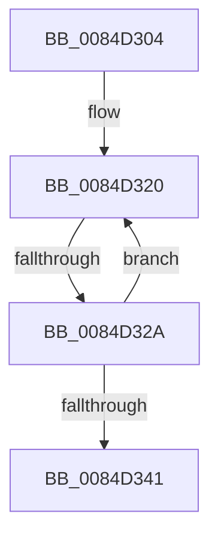

# sub_0084D304

- RVA: `0x0084D304`–`0x0084D349` (길이 `69` bytes)
- VA: `0x000000014084D304`
- 실행 섹션: `PAGE`
- PDB 이름 있음: `아니요`; PDB Function 태그: `아니요`
- unwind 정보 RVA: `0x000698D8`
- 디코드: `16`개 명령, `69/69` bytes 표시
- 미해석 바이트: `0` (있으면 어셈블리에 `.byte`로 보존)

> 이 문서는 커널 이미지의 기계어와 PDB 기호를 분석해 생성했습니다. 4번과 5번은 함수 원형과 자료형을 바이너리 사용 방식에서 추정한 C 해석이며 원본 소스 복구 결과는 아닙니다.

## 1. Dependencies

- 직접 호출 지점: **1**; 고유 호출 대상: **1**
- 직접 호출자로 확인된 함수: **0**
- RIP 상대 이미지 참조: **0**

### Outgoing calls
- `0x0084D330` → [CmpUnlockKcb](../../pagecmrc/BC/CmpUnlockKcb_function_00BC92C0.md) (function, `0x00BC92C0`)

### Direct callers
- 이 함수 시작 RVA로 연결되는 직접 call은 확인되지 않았습니다. 간접 호출은 완전히 역산할 수 없습니다.

### Static image references
- 디코드된 RIP-relative 메모리 참조가 없습니다.

## 2. Other-region calls and transfers

- 다른 실행 섹션으로 향하는 call: **1**
  - `0x0084D330` → [CmpUnlockKcb](../../pagecmrc/BC/CmpUnlockKcb_function_00BC92C0.md) (`PAGE` → `PAGECMRC`)
- call이 아닌 외부 분기/꼬리 이동: **1**
  - `0x0084D324` → [sub_0084D3CF](Unknown_function_0084D3CF.md) (`tail-transfer`)

## 3. Assembly (complete function range)

```asm
0084D304  4C 8B 75 97                     mov r14, qword ptr [rbp - 0x69]
0084D308  48 8D 4D 87                     lea rcx, [rbp - 0x79]
0084D30C  4C 2B F1                        sub r14, rcx
0084D30F  48 8D 7D 87                     lea rdi, [rbp - 0x79]
0084D313  49 83 C6 F0                     add r14, -0x10
0084D317  66 0F 1F 84 00 00 00 00 00      nop word ptr [rax + rax]
0084D320  66 83 FB 02                     cmp bx, 2
0084D324  0F 8D A5 00 00 00               jge 0x14084d3cf
0084D32A  48 8B CF                        mov rcx, rdi
0084D32D  48 8B 09                        mov rcx, qword ptr [rcx]
0084D330  E8 8B BF 37 00                  call 0x140bc92c0
0084D335  66 FF C3                        inc bx
0084D338  48 83 C7 08                     add rdi, 8
0084D33C  66 3B DE                        cmp bx, si
0084D33F  7E DF                           jle 0x14084d320
0084D341  4C 8B B4 24 C8 00 00 00         mov r14, qword ptr [rsp + 0xc8]
```

## 4. C-style interpretation (structured pseudocode)

```c
__int64 __fastcall sub_0084D304(__int64 a1, __int64 a2, __int64 a3, __int64 a4, __int64 a5, __int64 a6, __int64 a7, __int64 a8, __int64 a9, __int64 a10, __int64 a11, __int64 a12, __int64 a13, __int64 a14, __int64 a15, __int64 a16, __int64 a17, __int64 a18, __int64 a19, __int64 a20, __int64 a21, __int64 a22, __int64 a23, __int64 a24, __int64 a25)
{
    __int64 result;
    __int64 v_r14;
    __int64 v_rbx;
    __int64 v_rdi;

    v_r14 = (*(unsigned __int64 *)(v_rbp - 105)) - (v_rbp - 121);
    v_r14 = (v_r14) + (-16);
loc_0084D320:
    result = CmpUnlockKcb(*(unsigned __int64 *)(v_rbp - 121), a2, a3, a4);
    v_rbx = (unsigned __int16)((v_rbx) + 1);
    v_rdi = (v_rbp - 121) + (8);
    if (((unsigned __int16)(v_rbx)) <= ((unsigned __int16)(v_rsi))) goto loc_0084D320;
    return result;
}
```

## 5. (Beta) C Style

```c
int64_t sub_0084D304(int64_t Arg1, int64_t Arg2, int64_t Arg3, int64_t Arg4, uint64_t Arg5, uint64_t Arg6, uint64_t Arg7, uint64_t Arg8, uint64_t Arg9, uint64_t Arg10, uint64_t Arg11, uint64_t Arg12, uint64_t Arg13, uint64_t Arg14, uint64_t Arg15, uint64_t Arg16, uint64_t Arg17, uint64_t Arg18, uint64_t Arg19, uint64_t Arg20, uint64_t Arg21, uint64_t Arg22, uint64_t Arg23, uint64_t Arg24, int64_t Arg25)
{
    int64_t result;
    int64_t local_r14;
    int64_t local_rbx;
    int64_t local_rdi;

    local_r14 = (*(uint64_t *)(local_rbp - 0x69)) - (local_rbp - 121);
    local_r14 = (local_r14) + (-16);
loc_0084D320:
    result = CmpUnlockKcb(*(uint64_t *)(local_rbp - 0x79), Arg2, Arg3, Arg4);
    local_rbx = (uint16_t)((local_rbx) + 1);
    local_rdi = (local_rbp - 121) + (8);
    if (((uint16_t)(local_rbx)) <= ((uint16_t)(local_rsi))) goto loc_0084D320;
    return result;
}
```

## 6. Execution-region graph

[열기: 2D/3D 그래프와 함수 탐색 컨트롤 패널](../../../control-panel.html?section=page&rva=0x0084D304&view=graph)

- 2D 그래프는 위에서 아래로 흐르고, 3D 그래프는 빈 공간을 드래그해 회전합니다. Shift+드래그는 이동, 휠은 확대·축소, 함수 노드 선택은 대상 보고서 이동입니다.

### Static fallback


