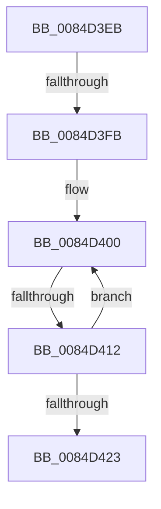

# sub_0084D3EB

- RVA: `0x0084D3EB`–`0x0084D428` (길이 `61` bytes)
- VA: `0x000000014084D3EB`
- 실행 섹션: `PAGE`
- PDB 이름 있음: `아니요`; PDB Function 태그: `아니요`
- unwind 정보 RVA: `0x00069998`
- 디코드: `14`개 명령, `61/61` bytes 표시
- 미해석 바이트: `0` (있으면 어셈블리에 `.byte`로 보존)

> 이 문서는 커널 이미지의 기계어와 PDB 기호를 분석해 생성했습니다. 4번과 5번은 함수 원형과 자료형을 바이너리 사용 방식에서 추정한 C 해석이며 원본 소스 복구 결과는 아닙니다.

## 1. Dependencies

- 직접 호출 지점: **0**; 고유 호출 대상: **0**
- 직접 호출자로 확인된 함수: **0**
- RIP 상대 이미지 참조: **0**

### Outgoing calls
- 직접 디코드된 call 명령이 없습니다.

### Direct callers
- 이 함수 시작 RVA로 연결되는 직접 call은 확인되지 않았습니다. 간접 호출은 완전히 역산할 수 없습니다.

### Static image references
- 디코드된 RIP-relative 메모리 참조가 없습니다.

## 2. Other-region calls and transfers

- 다른 실행 섹션으로 향하는 call: **0**
- call이 아닌 외부 분기/꼬리 이동: **3**
  - `0x0084D3F5` → [sub_0084D18D](Unknown_function_0084D18D.md) (`tail-transfer`)
  - `0x0084D40C` → [sub_0084D4EF](Unknown_function_0084D4EF.md) (`tail-transfer`)
  - `0x0084D423` → [sub_0084D16B + 0x1E](Unknown_function_0084D16B.md) (`tail-transfer`)

## 3. Assembly (complete function range)

```asm
0084D3EB  48 8B 8F C0 00 00 00            mov rcx, qword ptr [rdi + 0xc0]
0084D3F2  48 85 C9                        test rcx, rcx
0084D3F5  0F 84 92 FD FF FF               je 0x14084d18d
0084D3FB  0F 1F 44 00 00                  nop dword ptr [rax + rax]
0084D400  48 8B 51 10                     mov rdx, qword ptr [rcx + 0x10]
0084D404  4C 0F BF C6                     movsx r8, si
0084D408  66 83 FE 02                     cmp si, 2
0084D40C  0F 8D DD 00 00 00               jge 0x14084d4ef
0084D412  4A 89 54 C5 87                  mov qword ptr [rbp + r8*8 - 0x79], rdx
0084D417  48 8B 49 18                     mov rcx, qword ptr [rcx + 0x18]
0084D41B  66 FF CE                        dec si
0084D41E  48 85 C9                        test rcx, rcx
0084D421  75 DD                           jne 0x14084d400
0084D423  E9 61 FD FF FF                  jmp 0x14084d189
```

## 4. C-style interpretation (structured pseudocode)

```c
void __fastcall sub_0084D3EB(void)
{
    __int64 v_rsi;

loc_0084D400:
    *(unsigned __int64 *)(v_rbp + (__int16)((unsigned __int16)(v_rsi)) * 8 - 121) = *(unsigned __int64 *)(*(unsigned __int64 *)(v_rdi + 192) + 16);
    v_rsi = (unsigned __int16)((v_rsi) - 1);
    if (*(unsigned __int64 *)(*(unsigned __int64 *)(v_rdi + 192) + 24) != 0) goto loc_0084D400;
}
```

## 5. (Beta) C Style

```c
void sub_0084D3EB(void)
{
    int64_t local_rsi;

loc_0084D400:
    *(uint64_t *)(local_rbp + (int16_t)((uint16_t)(local_rsi)) * 8 - 0x79) = *(uint64_t *)(*(uint64_t *)(local_rdi + 0xC0) + 0x10);
    local_rsi = (uint16_t)((local_rsi) - 1);
    if (*(uint64_t *)(*(uint64_t *)(local_rdi + 0xC0) + 0x18) != 0) goto loc_0084D400;
}
```

## 6. Execution-region graph

[열기: 2D/3D 그래프와 함수 탐색 컨트롤 패널](../../../control-panel.html?section=page&rva=0x0084D3EB&view=graph)

- 2D 그래프는 위에서 아래로 흐르고, 3D 그래프는 빈 공간을 드래그해 회전합니다. Shift+드래그는 이동, 휠은 확대·축소, 함수 노드 선택은 대상 보고서 이동입니다.

### Static fallback


