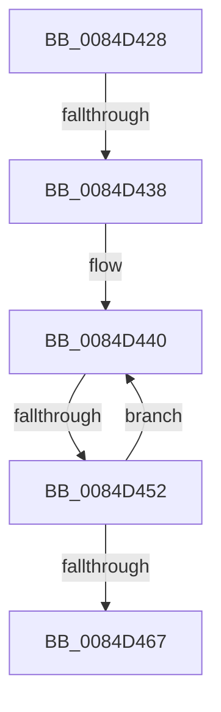

# sub_0084D428

- RVA: `0x0084D428`–`0x0084D46C` (길이 `68` bytes)
- VA: `0x000000014084D428`
- 실행 섹션: `PAGE`
- PDB 이름 있음: `아니요`; PDB Function 태그: `아니요`
- unwind 정보 RVA: `0x000699B8`
- 디코드: `15`개 명령, `68/68` bytes 표시
- 미해석 바이트: `0` (있으면 어셈블리에 `.byte`로 보존)

> 이 문서는 커널 이미지의 기계어와 PDB 기호를 분석해 생성했습니다. 4번과 5번은 함수 원형과 자료형을 바이너리 사용 방식에서 추정한 C 해석이며 원본 소스 복구 결과는 아닙니다.

## 1. Dependencies

- 직접 호출 지점: **0**; 고유 호출 대상: **0**
- 직접 호출자로 확인된 함수: **0**
- RIP 상대 이미지 참조: **0**

### Outgoing calls
- 직접 디코드된 call 명령이 없습니다.

### Direct callers
- 이 함수 시작 RVA로 연결되는 직접 call은 확인되지 않았습니다. 간접 호출은 완전히 역산할 수 없습니다.

### Static image references
- 디코드된 RIP-relative 메모리 참조가 없습니다.

## 2. Other-region calls and transfers

- 다른 실행 섹션으로 향하는 call: **0**
- call이 아닌 외부 분기/꼬리 이동: **3**
  - `0x0084D432` → [sub_0084D18D + 0xC2](Unknown_function_0084D18D.md) (`tail-transfer`)
  - `0x0084D44C` → [sub_0084D4FD](Unknown_function_0084D4FD.md) (`tail-transfer`)
  - `0x0084D467` → [sub_0084D18D + 0xC2](Unknown_function_0084D18D.md) (`tail-transfer`)

## 3. Assembly (complete function range)

```asm
0084D428  48 8B 8F C0 00 00 00            mov rcx, qword ptr [rdi + 0xc0]
0084D42F  48 85 C9                        test rcx, rcx
0084D432  0F 84 17 FE FF FF               je 0x14084d24f
0084D438  0F 1F 84 00 00 00 00 00         nop dword ptr [rax + rax]
0084D440  48 8B 51 10                     mov rdx, qword ptr [rcx + 0x10]
0084D444  4C 0F BF C0                     movsx r8, ax
0084D448  66 83 F8 02                     cmp ax, 2
0084D44C  0F 8D AB 00 00 00               jge 0x14084d4fd
0084D452  4A 89 54 C5 AF                  mov qword ptr [rbp + r8*8 - 0x51], rdx
0084D457  4C 8B 75 BF                     mov r14, qword ptr [rbp - 0x41]
0084D45B  48 8B 49 18                     mov rcx, qword ptr [rcx + 0x18]
0084D45F  66 FF C8                        dec ax
0084D462  48 85 C9                        test rcx, rcx
0084D465  75 D9                           jne 0x14084d440
0084D467  E9 E3 FD FF FF                  jmp 0x14084d24f
```

## 4. C-style interpretation (structured pseudocode)

```c
__int64 __fastcall sub_0084D428(void)
{
    __int64 result;

loc_0084D440:
    *(unsigned __int64 *)(v_rbp + (__int16)((unsigned __int16)(result)) * 8 - 81) = *(unsigned __int64 *)(*(unsigned __int64 *)(v_rdi + 192) + 16);
    result = (unsigned __int16)((result) - 1);
    if (*(unsigned __int64 *)(*(unsigned __int64 *)(v_rdi + 192) + 24) != 0) goto loc_0084D440;
}
```

## 5. (Beta) C Style

```c
void sub_0084D428(void)
{
    int64_t result;

loc_0084D440:
    *(uint64_t *)(local_rbp + (int16_t)((uint16_t)(result)) * 8 - 0x51) = *(uint64_t *)(*(uint64_t *)(local_rdi + 0xC0) + 0x10);
    result = (uint16_t)((result) - 1);
    if (*(uint64_t *)(*(uint64_t *)(local_rdi + 0xC0) + 0x18) != 0) goto loc_0084D440;
}
```

## 6. Execution-region graph

[열기: 2D/3D 그래프와 함수 탐색 컨트롤 패널](../../../control-panel.html?section=page&rva=0x0084D428&view=graph)

- 2D 그래프는 위에서 아래로 흐르고, 3D 그래프는 빈 공간을 드래그해 회전합니다. Shift+드래그는 이동, 휠은 확대·축소, 함수 노드 선택은 대상 보고서 이동입니다.

### Static fallback


