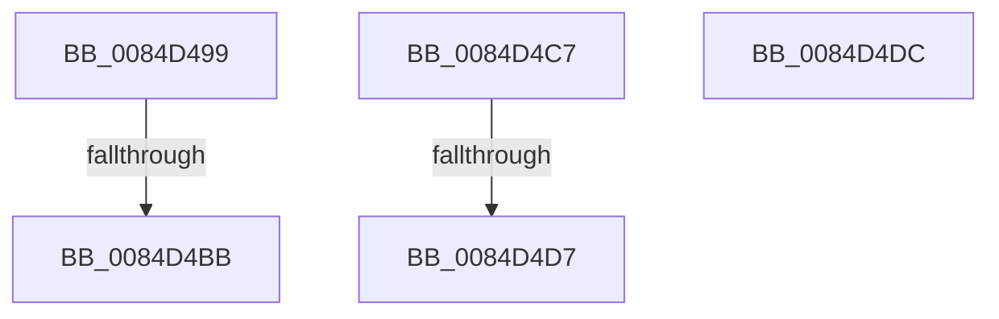

# sub_0084D499

- RVA: `0x0084D499`–`0x0084D4E7` (길이 `78` bytes)
- VA: `0x000000014084D499`
- 실행 섹션: `PAGE`
- PDB 이름 있음: `아니요`; PDB Function 태그: `아니요`
- unwind 정보 RVA: `0x000699FC`
- 디코드: `16`개 명령, `78/78` bytes 표시
- 미해석 바이트: `0` (있으면 어셈블리에 `.byte`로 보존)

> 이 문서는 커널 이미지의 기계어와 PDB 기호를 분석해 생성했습니다. 4번과 5번은 함수 원형과 자료형을 바이너리 사용 방식에서 추정한 C 해석이며 원본 소스 복구 결과는 아닙니다.

## 1. Dependencies

- 직접 호출 지점: **1**; 고유 호출 대상: **1**
- 직접 호출자로 확인된 함수: **0**
- RIP 상대 이미지 참조: **0**

### Outgoing calls
- `0x0084D4AA` → [CmpAllocatePool](../../text/3C/CmpAllocatePool_function_003CD504.md) (function, `0x003CD504`)

### Direct callers
- 이 함수 시작 RVA로 연결되는 직접 call은 확인되지 않았습니다. 간접 호출은 완전히 역산할 수 없습니다.

### Static image references
- 디코드된 RIP-relative 메모리 참조가 없습니다.

## 2. Other-region calls and transfers

- 다른 실행 섹션으로 향하는 call: **1**
  - `0x0084D4AA` → [CmpAllocatePool](../../text/3C/CmpAllocatePool_function_003CD504.md) (`PAGE` → `.text`)
- call이 아닌 외부 분기/꼬리 이동: **5**
  - `0x0084D4B5` → [sub_0084D18D + 0x9E](Unknown_function_0084D18D.md) (`tail-transfer`)
  - `0x0084D4C2` → [sub_0084D3A1 + 0x16](Unknown_function_0084D3A1.md) (`tail-transfer`)
  - `0x0084D4D1` → [sub_0084D18D + 0x11C](Unknown_function_0084D18D.md) (`tail-transfer`)
  - `0x0084D4D7` → [sub_0084D3A1](Unknown_function_0084D3A1.md) (`tail-transfer`)
  - `0x0084D4E2` → [sub_0084D18D + 0x162](Unknown_function_0084D18D.md) (`tail-transfer`)

## 3. Assembly (complete function range)

```asm
0084D499  8B D0                           mov edx, eax
0084D49B  B9 00 01 00 00                  mov ecx, 0x100
0084D4A0  48 C1 E2 03                     shl rdx, 3
0084D4A4  41 B8 43 4D 36 35               mov r8d, 0x35364d43
0084D4AA  E8 55 00 B8 FF                  call 0x1403cd504
0084D4AF  4C 8B F0                        mov r14, rax
0084D4B2  48 85 C0                        test rax, rax
0084D4B5  0F 85 70 FD FF FF               jne 0x14084d22b
0084D4BB  4C 8B 75 BF                     mov r14, qword ptr [rbp - 0x41]
0084D4BF  41 8B FD                        mov edi, r13d
0084D4C2  E9 F0 FE FF FF                  jmp 0x14084d3b7
0084D4C7  F7 87 B8 00 00 00 00 00 04 00   test dword ptr [rdi + 0xb8], 0x40000
0084D4D1  0F 84 D2 FD FF FF               je 0x14084d2a9
0084D4D7  E9 C5 FE FF FF                  jmp 0x14084d3a1
0084D4DC  41 BD 9A 00 00 C0               mov r13d, 0xc000009a
0084D4E2  E9 08 FE FF FF                  jmp 0x14084d2ef
```

## 4. C-style interpretation (structured pseudocode)

```c
__int64 __fastcall sub_0084D499(void)
{
    __int64 result;

    a2 = ((unsigned int)((unsigned int)(result))) << (3);
    result = CmpAllocatePool(256, a2, (unsigned int)(0x35364D43ULL), a4);
}
```

## 5. (Beta) C Style

```c
void sub_0084D499(void)
{
    int64_t result;

    a2 = ((uint32_t)((uint32_t)(result))) << (3);
    result = CmpAllocatePool(256, a2, (uint32_t)(0x35364D43ULL), a4);
}
```

## 6. Execution-region graph

[열기: 2D/3D 그래프와 함수 탐색 컨트롤 패널](../../../control-panel.html?section=page&rva=0x0084D499&view=graph)

- 2D 그래프는 위에서 아래로 흐르고, 3D 그래프는 빈 공간을 드래그해 회전합니다. Shift+드래그는 이동, 휠은 확대·축소, 함수 노드 선택은 대상 보고서 이동입니다.

### Static fallback


