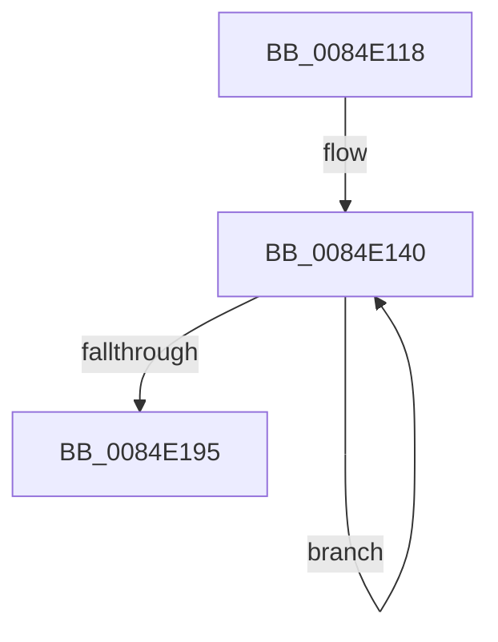

# sub_0084E118

- RVA: `0x0084E118`–`0x0084E1A4` (길이 `140` bytes)
- VA: `0x000000014084E118`
- 실행 섹션: `PAGE`
- PDB 이름 있음: `아니요`; PDB Function 태그: `아니요`
- unwind 정보 RVA: `0x00069B88`
- 디코드: `33`개 명령, `140/140` bytes 표시
- 미해석 바이트: `0` (있으면 어셈블리에 `.byte`로 보존)

> 이 문서는 커널 이미지의 기계어와 PDB 기호를 분석해 생성했습니다. 4번과 5번은 함수 원형과 자료형을 바이너리 사용 방식에서 추정한 C 해석이며 원본 소스 복구 결과는 아닙니다.

## 1. Dependencies

- 직접 호출 지점: **0**; 고유 호출 대상: **0**
- 직접 호출자로 확인된 함수: **0**
- RIP 상대 이미지 참조: **0**

### Outgoing calls
- 직접 디코드된 call 명령이 없습니다.

### Direct callers
- 이 함수 시작 RVA로 연결되는 직접 call은 확인되지 않았습니다. 간접 호출은 완전히 역산할 수 없습니다.

### Static image references
- 디코드된 RIP-relative 메모리 참조가 없습니다.

## 2. Other-region calls and transfers

- 다른 실행 섹션으로 향하는 call: **0**
- call이 아닌 외부 분기/꼬리 이동: **1**
  - `0x0084E1A2` → [sub_0084E1A4 + 0x20](Unknown_function_0084E1A4.md) (`tail-transfer`)

## 3. Assembly (complete function range)

```asm
0084E118  48 89 5C 24 10                  mov qword ptr [rsp + 0x10], rbx
0084E11D  45 8B D9                        mov r11d, r9d
0084E120  41 83 E3 1F                     and r11d, 0x1f
0084E124  48 89 3C 24                     mov qword ptr [rsp], rdi
0084E128  41 8B D9                        mov ebx, r9d
0084E12B  41 2B DB                        sub ebx, r11d
0084E12E  BF 10 00 00 00                  mov edi, 0x10
0084E133  0F 1F 40 00                     nop dword ptr [rax]
0084E137  66 0F 1F 84 00 00 00 00 00      nop word ptr [rax + rax]
0084E140  F3 42 0F 7E 0C 00               movq xmm1, qword ptr [rax + r8]
0084E146  8D 4F F8                        lea ecx, [rdi - 8]
0084E149  0F 57 C0                        xorps xmm0, xmm0
0084E14C  66 0F 60 C8                     punpcklbw xmm1, xmm0
0084E150  F3 41 0F 7F 0C 42               movdqu xmmword ptr [r10 + rax*2], xmm1
0084E156  83 C0 20                        add eax, 0x20
0084E159  F3 42 0F 7E 0C 01               movq xmm1, qword ptr [rcx + r8]
0084E15F  66 0F 60 C8                     punpcklbw xmm1, xmm0
0084E163  F3 41 0F 7F 0C 4A               movdqu xmmword ptr [r10 + rcx*2], xmm1
0084E169  8B CF                           mov ecx, edi
0084E16B  F3 42 0F 7E 0C 01               movq xmm1, qword ptr [rcx + r8]
0084E171  66 0F 60 C8                     punpcklbw xmm1, xmm0
0084E175  F3 41 0F 7F 0C 4A               movdqu xmmword ptr [r10 + rcx*2], xmm1
0084E17B  8D 4F 08                        lea ecx, [rdi + 8]
0084E17E  83 C7 20                        add edi, 0x20
0084E181  F3 42 0F 7E 0C 01               movq xmm1, qword ptr [rcx + r8]
0084E187  66 0F 60 C8                     punpcklbw xmm1, xmm0
0084E18B  F3 41 0F 7F 0C 4A               movdqu xmmword ptr [r10 + rcx*2], xmm1
0084E191  3B C3                           cmp eax, ebx
0084E193  72 AB                           jb 0x14084e140
0084E195  48 8B 3C 24                     mov rdi, qword ptr [rsp]
0084E199  48 8B 5C 24 10                  mov rbx, qword ptr [rsp + 0x10]
0084E19E  41 83 FB 04                     cmp r11d, 4
0084E1A2  72 20                           jb 0x14084e1c4
```

## 4. C-style interpretation (structured pseudocode)

```c
__int64 __fastcall sub_0084E118(__int64 a1, __int64 a2, __int64 a3, int a4)
{
    __int64 result;
    __int64 v_r11;
    __int64 v_rbx;
    __int64 v_rdi;
    unsigned __int64 v_stack_p0;
    unsigned __int64 v_stack_p10;

    v_stack_p10 = v_rbx;
    v_r11 = (unsigned int)(((unsigned int)(a4)) & (31));
    v_stack_p0 = v_rdi;
    v_rbx = (unsigned int)(((unsigned int)(a4)) - ((unsigned int)(v_r11)));
loc_0084E140:
    *(unsigned __int64 *)(v_r10 + result * 2) = v_xmm1;
    result = (unsigned int)((result) + (32));
    *(unsigned __int64 *)(v_r10 + 16 - 8 * 2) = v_xmm1;
    *(unsigned __int64 *)(v_r10 + 16 * 2) = v_xmm1;
    v_rdi = (unsigned int)((16) + (32));
    *(unsigned __int64 *)(v_r10 + 16 + 8 * 2) = v_xmm1;
    if (((unsigned int)(result)) < ((unsigned int)(v_rbx))) goto loc_0084E140;
}
```

## 5. (Beta) C Style

```c
int64_t sub_0084E118(int64_t Arg1, int64_t Arg2, int64_t Arg3, int32_t Arg4)
{
    int64_t result;
    int64_t local_r11;
    int64_t local_rbx;
    int64_t local_rdi;
    uint64_t v_stack_p0;
    uint64_t v_stack_p10;

    v_stack_p10 = local_rbx;
    local_r11 = (uint32_t)(((uint32_t)(Arg4)) & (31));
    v_stack_p0 = local_rdi;
    local_rbx = (uint32_t)(((uint32_t)(Arg4)) - ((uint32_t)(local_r11)));
loc_0084E140:
    *(uint64_t *)(local_r10 + result * 2) = v_xmm1;
    result = (uint32_t)((result) + (32));
    *(uint64_t *)(local_r10 + 0x10 - 0x8 * 2) = v_xmm1;
    *(uint64_t *)(local_r10 + 0x10 * 2) = v_xmm1;
    local_rdi = (uint32_t)((16) + (32));
    *(uint64_t *)(local_r10 + 0x10 + 0x8 * 2) = v_xmm1;
    if (((uint32_t)(result)) < ((uint32_t)(local_rbx))) goto loc_0084E140;
}
```

## 6. Execution-region graph

[열기: 2D/3D 그래프와 함수 탐색 컨트롤 패널](../../../control-panel.html?section=page&rva=0x0084E118&view=graph)

- 2D 그래프는 위에서 아래로 흐르고, 3D 그래프는 빈 공간을 드래그해 회전합니다. Shift+드래그는 이동, 휠은 확대·축소, 함수 노드 선택은 대상 보고서 이동입니다.

### Static fallback


