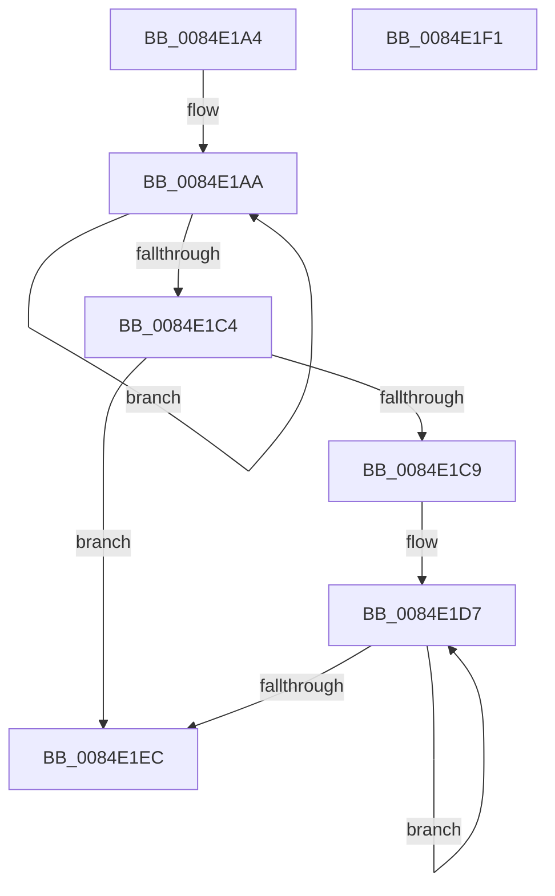

# sub_0084E1A4

- RVA: `0x0084E1A4`–`0x0084E1F2` (길이 `78` bytes)
- VA: `0x000000014084E1A4`
- 실행 섹션: `PAGE`
- PDB 이름 있음: `아니요`; PDB Function 태그: `아니요`
- unwind 정보 RVA: `0x00069BA0`
- 디코드: `24`개 명령, `78/78` bytes 표시
- 미해석 바이트: `0` (있으면 어셈블리에 `.byte`로 보존)

> 이 문서는 커널 이미지의 기계어와 PDB 기호를 분석해 생성했습니다. 4번과 5번은 함수 원형과 자료형을 바이너리 사용 방식에서 추정한 C 해석이며 원본 소스 복구 결과는 아닙니다.

## 1. Dependencies

- 직접 호출 지점: **0**; 고유 호출 대상: **0**
- 직접 호출자로 확인된 함수: **0**
- RIP 상대 이미지 참조: **0**

### Outgoing calls
- 직접 디코드된 call 명령이 없습니다.

### Direct callers
- 이 함수 시작 RVA로 연결되는 직접 call은 확인되지 않았습니다. 간접 호출은 완전히 역산할 수 없습니다.

### Static image references
- 디코드된 RIP-relative 메모리 참조가 없습니다.

## 2. Other-region calls and transfers

- 다른 실행 섹션으로 향하는 call: **0**
- 별도 외부 분기/꼬리 이동을 확인하지 못했습니다.

## 3. Assembly (complete function range)

```asm
0084E1A4  41 8B D1                        mov edx, r9d
0084E1A7  83 E2 FC                        and edx, 0xfffffffc
0084E1AA  66 42 0F 6E 0C 00               movd xmm1, dword ptr [rax + r8]
0084E1B0  0F 57 C0                        xorps xmm0, xmm0
0084E1B3  66 0F 60 C8                     punpcklbw xmm1, xmm0
0084E1B7  66 41 0F D6 0C 42               movq qword ptr [r10 + rax*2], xmm1
0084E1BD  83 C0 04                        add eax, 4
0084E1C0  3B C2                           cmp eax, edx
0084E1C2  72 E6                           jb 0x14084e1aa
0084E1C4  41 3B C1                        cmp eax, r9d
0084E1C7  73 23                           jae 0x14084e1ec
0084E1C9  44 2B C8                        sub r9d, eax
0084E1CC  4A 8D 14 00                     lea rdx, [rax + r8]
0084E1D0  41 8B C9                        mov ecx, r9d
0084E1D3  4D 8D 04 42                     lea r8, [r10 + rax*2]
0084E1D7  0F B6 02                        movzx eax, byte ptr [rdx]
0084E1DA  48 8D 52 01                     lea rdx, [rdx + 1]
0084E1DE  66 41 89 00                     mov word ptr [r8], ax
0084E1E2  4D 8D 40 02                     lea r8, [r8 + 2]
0084E1E6  48 83 E9 01                     sub rcx, 1
0084E1EA  75 EB                           jne 0x14084e1d7
0084E1EC  48 83 C4 08                     add rsp, 8
0084E1F0  C3                              ret
0084E1F1  CC                              int3
```

## 4. C-style interpretation (structured pseudocode)

```c
__int64 __fastcall sub_0084E1A4(__int64 a1, __int64 a2, __int64 a3, int a4)
{
    __int64 result;
    __int64 v_rsp;

    a2 = (unsigned int)(((unsigned int)(a4)) & (0xFFFFFFFCULL));
loc_0084E1AA:
    *(unsigned __int64 *)(v_r10 + result * 2) = v_xmm1;
    result = (unsigned int)((result) + (4));
    if (((unsigned int)(result)) < ((unsigned int)(a2))) goto loc_0084E1AA;
    if (((unsigned int)(result)) >= a4) goto loc_0084E1EC;
    a4 = (unsigned int)((a4) - ((unsigned int)(result)));
loc_0084E1D7:
    *(unsigned __int16 *)(v_r10 + result * 2) = (unsigned __int16)(*(unsigned __int8 *)(result + a3 * 1));
    a1 = ((unsigned int)(a4)) - (1);
    if (condition_is_not_equal) goto loc_0084E1D7;
loc_0084E1EC:
    v_rsp = (v_rsp) + (8);
    return *(unsigned __int8 *)(result + a3 * 1);
}
```

## 5. (Beta) C Style

```c
int64_t sub_0084E1A4(int64_t Arg1, int64_t Arg2, int64_t Arg3, int32_t Arg4)
{
    int64_t result;
    int64_t local_rsp;

    Arg2 = (uint32_t)(((uint32_t)(Arg4)) & (0xFFFFFFFCULL));
loc_0084E1AA:
    *(uint64_t *)(local_r10 + result * 2) = v_xmm1;
    result = (uint32_t)((result) + (4));
    if (((uint32_t)(result)) < ((uint32_t)(Arg2))) goto loc_0084E1AA;
    if (((uint32_t)(result)) >= Arg4) goto loc_0084E1EC;
    Arg4 = (uint32_t)((Arg4) - ((uint32_t)(result)));
loc_0084E1D7:
    *(uint16_t *)(local_r10 + result * 2) = (uint16_t)(*(uint8_t *)(result + Arg3 * 1));
    Arg1 = ((uint32_t)(Arg4)) - (1);
    if (condition_is_not_equal) goto loc_0084E1D7;
loc_0084E1EC:
    local_rsp = (local_rsp) + (8);
    return *(uint8_t *)(result + Arg3 * 1);
}
```

## 6. Execution-region graph

[열기: 2D/3D 그래프와 함수 탐색 컨트롤 패널](../../../control-panel.html?section=page&rva=0x0084E1A4&view=graph)

- 2D 그래프는 위에서 아래로 흐르고, 3D 그래프는 빈 공간을 드래그해 회전합니다. Shift+드래그는 이동, 휠은 확대·축소, 함수 노드 선택은 대상 보고서 이동입니다.

### Static fallback


