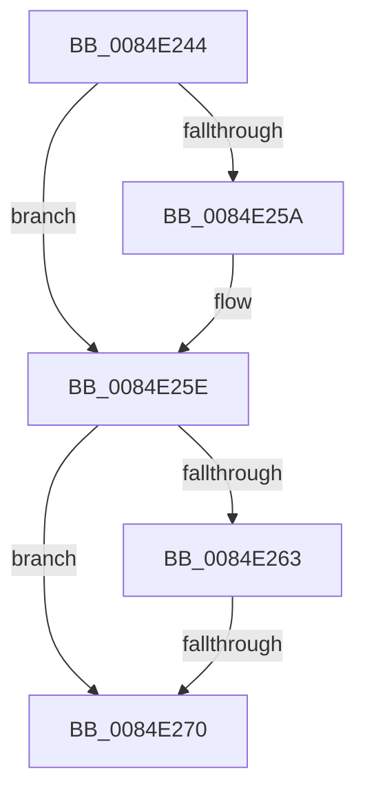

# sub_0084E244

- RVA: `0x0084E244`–`0x0084E27C` (길이 `56` bytes)
- VA: `0x000000014084E244`
- 실행 섹션: `PAGE`
- PDB 이름 있음: `아니요`; PDB Function 태그: `아니요`
- unwind 정보 RVA: `0x00069BC8`
- 디코드: `15`개 명령, `56/56` bytes 표시
- 미해석 바이트: `0` (있으면 어셈블리에 `.byte`로 보존)

> 이 문서는 커널 이미지의 기계어와 PDB 기호를 분석해 생성했습니다. 4번과 5번은 함수 원형과 자료형을 바이너리 사용 방식에서 추정한 C 해석이며 원본 소스 복구 결과는 아닙니다.

## 1. Dependencies

- 직접 호출 지점: **0**; 고유 호출 대상: **0**
- 직접 호출자로 확인된 함수: **0**
- RIP 상대 이미지 참조: **0**

### Outgoing calls
- 직접 디코드된 call 명령이 없습니다.

### Direct callers
- 이 함수 시작 RVA로 연결되는 직접 call은 확인되지 않았습니다. 간접 호출은 완전히 역산할 수 없습니다.

### Static image references
- 디코드된 RIP-relative 메모리 참조가 없습니다.

## 2. Other-region calls and transfers

- 다른 실행 섹션으로 향하는 call: **0**
- call이 아닌 외부 분기/꼬리 이동: **2**
  - `0x0084E26E` → [sub_0084E27C](Unknown_function_0084E27C.md) (`tail-transfer`)
  - `0x0084E27A` → [CmGetKeyLastWriteTime + 0x25](CmGetKeyLastWriteTime_function_0084E200.md) (`tail-transfer`)

## 3. Assembly (complete function range)

```asm
0084E244  48 89 6C 24 30                  mov qword ptr [rsp + 0x30], rbp
0084E249  48 8D A9 D0 00 00 00            lea rbp, [rcx + 0xd0]
0084E250  4C 89 74 24 38                  mov qword ptr [rsp + 0x38], r14
0084E255  48 85 F6                        test rsi, rsi
0084E258  75 04                           jne 0x14084e25e
0084E25A  48 8B 75 08                     mov rsi, qword ptr [rbp + 8]
0084E25E  48 3B EE                        cmp rbp, rsi
0084E261  74 0D                           je 0x14084e270
0084E263  4C 8D 76 E0                     lea r14, [rsi - 0x20]
0084E267  48 8B 76 08                     mov rsi, qword ptr [rsi + 8]
0084E26B  4D 85 F6                        test r14, r14
0084E26E  75 0C                           jne 0x14084e27c
0084E270  4C 8B 74 24 38                  mov r14, qword ptr [rsp + 0x38]
0084E275  48 8B 6C 24 30                  mov rbp, qword ptr [rsp + 0x30]
0084E27A  EB A9                           jmp 0x14084e225
```

## 4. C-style interpretation (structured pseudocode)

```c
void __fastcall sub_0084E244(__int64 a1, __int64 a2, __int64 a3, __int64 a4, __int64 a5, __int64 a6, __int64 a7)
{
    __int64 v_rsi;
    unsigned __int64 v_stack_p30;
    unsigned __int64 v_stack_p38;

    v_stack_p30 = v_rbp;
    v_stack_p38 = v_r14;
    if (v_rsi == 0) {
        v_rsi = *(unsigned __int64 *)(a1 + 208 + 8);
    }
    if ((a1 + 208) == v_rsi) goto loc_0084E270;
loc_0084E270:
}
```

## 5. (Beta) C Style

```c
void sub_0084E244(void *Arg1, int64_t Arg2, int64_t Arg3, int64_t Arg4, uint64_t Arg5, int64_t Arg6, int64_t Arg7)
{
    uint8_t *arg1 = (uint8_t *)Arg1;

    int64_t local_rsi;
    uint64_t v_stack_p30;
    uint64_t v_stack_p38;

    v_stack_p30 = local_rbp;
    v_stack_p38 = local_r14;
    if (local_rsi == 0) {
        local_rsi = *(uint64_t *)(arg1 + 0xD0 + 0x8);
    }
    if ((Arg1 + 208) == local_rsi) goto loc_0084E270;
loc_0084E270:
}
```

### 관측된 메모리 오프셋

구조체 형식이 확인되지 않은 접근은 인자 기준의 오프셋으로만 기록했습니다.

| 기준 인자 | 오프셋 표현 | 폭 (bit) | 접근 |
|---|---:|---:|---|
| `Arg1` | `+ 0x8` | `64` | `R` |
| `Arg1` | `+ 0xD0` | `64` | `R` |

## 6. Execution-region graph

[열기: 2D/3D 그래프와 함수 탐색 컨트롤 패널](../../../control-panel.html?section=page&rva=0x0084E244&view=graph)

- 2D 그래프는 위에서 아래로 흐르고, 3D 그래프는 빈 공간을 드래그해 회전합니다. Shift+드래그는 이동, 휠은 확대·축소, 함수 노드 선택은 대상 보고서 이동입니다.

### Static fallback


