# sub_0084E4B5

- RVA: `0x0084E4B5`–`0x0084E786` (길이 `721` bytes)
- VA: `0x000000014084E4B5`
- 실행 섹션: `PAGE`
- PDB 이름 있음: `아니요`; PDB Function 태그: `아니요`
- unwind 정보 RVA: `0x00069C24`
- 디코드: `161`개 명령, `721/721` bytes 표시
- 미해석 바이트: `0` (있으면 어셈블리에 `.byte`로 보존)

> 이 문서는 커널 이미지의 기계어와 PDB 기호를 분석해 생성했습니다. 4번과 5번은 함수 원형과 자료형을 바이너리 사용 방식에서 추정한 C 해석이며 원본 소스 복구 결과는 아닙니다.

## 1. Dependencies

- 직접 호출 지점: **16**; 고유 호출 대상: **14**
- 직접 호출자로 확인된 함수: **0**
- RIP 상대 이미지 참조: **2**

### Outgoing calls
- `0x0084E511` → [HvpGetCellContextInitialize](../85/HvpGetCellContextInitialize_function_00855F10.md) (function, `0x00855F10`)
- `0x0084E528` → [CmpInitializeDelayDerefContext](../../text/42/CmpInitializeDelayDerefContext_function_0042A7F0.md) (function, `0x0042A7F0`)
- `0x0084E531` → [CmpAttachToRegistryProcess](../../pagecmrc/BC/CmpAttachToRegistryProcess_function_00BC98E0.md) (function, `0x00BC98E0`)
- `0x0084E558` → [CmpLockRegistry](../../pagecmrc/BC/CmpLockRegistry_function_00BC9B34.md) (function, `0x00BC9B34`)
- `0x0084E578` → [CmpLockKcbShared](../../pagecmrc/BC/CmpLockKcbShared_function_00BC9A1C.md) (function, `0x00BC9A1C`)
- `0x0084E582` → [CmpPerformKeyBodyDeletionCheck](../../pagecmrc/BC/CmpPerformKeyBodyDeletionCheck_function_00BC97D0.md) (function, `0x00BC97D0`)
- `0x0084E614` → [CmpFindSubKeyByNumberEx](CmpFindSubKeyByNumberEx_function_0084F1A0.md) (function, `0x0084F1A0`)
- `0x0084E647` → [HvpGetCellFlat](../85/HvpGetCellFlat_function_00854C60.md) (function, `0x00854C60`)
- `0x0084E685` → [HvpReleaseCellPaged](../85/HvpReleaseCellPaged_function_00855F40.md) (function, `0x00855F40`)
- `0x0084E68D` → [HvLockHiveFlusherShared](HvLockHiveFlusherShared_function_0084F95C.md) (function, `0x0084F95C`)
- `0x0084E6A9` → [HvpGetCellFlat](../85/HvpGetCellFlat_function_00854C60.md) (function, `0x00854C60`)
- `0x0084E6DF` → [ExfReleasePushLockShared](../../text/26/ExfReleasePushLockShared_function_00263440.md) (function, `0x00263440`)
- `0x0084E6E8` → [KeAbPostRelease](../../text/2E/KeAbPostRelease_function_002E1600.md) (function, `0x002E1600`)
- `0x0084E725` → [CmpQueryKeyDataFromNode](CmpQueryKeyDataFromNode_function_0084EAE0.md) (function, `0x0084EAE0`)
- `0x0084E746` → [HvpReleaseCellPaged](../85/HvpReleaseCellPaged_function_00855F40.md) (function, `0x00855F40`)
- `0x0084E75C` → [CmpUnlockKcb](../../pagecmrc/BC/CmpUnlockKcb_function_00BC92C0.md) (function, `0x00BC92C0`)

### Direct callers
- 이 함수 시작 RVA로 연결되는 직접 call은 확인되지 않았습니다. 간접 호출은 완전히 역산할 수 없습니다.

### Static image references
- `0x0084E5AE` → RVA `0x00E0ECA0` (`.data`; read)
- `0x0084E664` → RVA `0x00E0EC94` (`.data`; reference)

## 2. Other-region calls and transfers

- 다른 실행 섹션으로 향하는 call: **8**
  - `0x0084E528` → [CmpInitializeDelayDerefContext](../../text/42/CmpInitializeDelayDerefContext_function_0042A7F0.md) (`PAGE` → `.text`)
  - `0x0084E531` → [CmpAttachToRegistryProcess](../../pagecmrc/BC/CmpAttachToRegistryProcess_function_00BC98E0.md) (`PAGE` → `PAGECMRC`)
  - `0x0084E558` → [CmpLockRegistry](../../pagecmrc/BC/CmpLockRegistry_function_00BC9B34.md) (`PAGE` → `PAGECMRC`)
  - `0x0084E578` → [CmpLockKcbShared](../../pagecmrc/BC/CmpLockKcbShared_function_00BC9A1C.md) (`PAGE` → `PAGECMRC`)
  - `0x0084E582` → [CmpPerformKeyBodyDeletionCheck](../../pagecmrc/BC/CmpPerformKeyBodyDeletionCheck_function_00BC97D0.md) (`PAGE` → `PAGECMRC`)
  - `0x0084E6DF` → [ExfReleasePushLockShared](../../text/26/ExfReleasePushLockShared_function_00263440.md) (`PAGE` → `.text`)
  - `0x0084E6E8` → [KeAbPostRelease](../../text/2E/KeAbPostRelease_function_002E1600.md) (`PAGE` → `.text`)
  - `0x0084E75C` → [CmpUnlockKcb](../../pagecmrc/BC/CmpUnlockKcb_function_00BC92C0.md) (`PAGE` → `PAGECMRC`)
- call이 아닌 외부 분기/꼬리 이동: **18**
  - `0x0084E53E` → [sub_0084E7D5 + 0xB1](Unknown_function_0084E7D5.md) (`tail-transfer`)
  - `0x0084E548` → [sub_0084E7D5](Unknown_function_0084E7D5.md) (`tail-transfer`)
  - `0x0084E552` → [sub_0084E7D5](Unknown_function_0084E7D5.md) (`tail-transfer`)
  - `0x0084E567` → [sub_0084E7D5 + 0x1CD](Unknown_function_0084E7D5.md) (`tail-transfer`)
  - `0x0084E595` → [sub_0084E7D5 + 0x1E](Unknown_function_0084E7D5.md) (`tail-transfer`)
  - `0x0084E59F` → [sub_0084E7D5 + 0x1E](Unknown_function_0084E7D5.md) (`tail-transfer`)
  - `0x0084E5A8` → [sub_0084E7D5 + 0x29B](Unknown_function_0084E7D5.md) (`tail-transfer`)
  - `0x0084E5C1` → [sub_0084E7D5 + 0x15A](Unknown_function_0084E7D5.md) (`tail-transfer`)
  - `0x0084E5DB` → [sub_0084E7D5 + 0xA1](Unknown_function_0084E7D5.md) (`tail-transfer`)
  - `0x0084E61D` → [sub_0084E7D5 + 0x2DA](Unknown_function_0084E7D5.md) (`tail-transfer`)
  - `0x0084E62A` → [sub_0084E7D5 + 0x2D5](Unknown_function_0084E7D5.md) (`tail-transfer`)
  - `0x0084E641` → [sub_0084E7D5 + 0xA](Unknown_function_0084E7D5.md) (`tail-transfer`)
  - `0x0084E67F` → [sub_0084E7D5 + 0x97](Unknown_function_0084E7D5.md) (`tail-transfer`)
  - `0x0084E6A3` → [sub_0084E7D5 + 0x14](Unknown_function_0084E7D5.md) (`tail-transfer`)
  - `0x0084E6C8` → [sub_0084E7D5 + 0x51](Unknown_function_0084E7D5.md) (`tail-transfer`)
  - `0x0084E740` → [sub_0084E7D5 + 0x8D](Unknown_function_0084E7D5.md) (`tail-transfer`)
  - `0x0084E74E` → [sub_0084E7D5 + 0x7C](Unknown_function_0084E7D5.md) (`tail-transfer`)
  - `0x0084E784` → [sub_0084E786 + 0x8](Unknown_function_0084E786.md) (`tail-transfer`)

## 3. Assembly (complete function range)

```asm
0084E4B5  49 89 73 20                     mov qword ptr [r11 + 0x20], rsi
0084E4B9  49 89 7B E8                     mov qword ptr [r11 - 0x18], rdi
0084E4BD  33 FF                           xor edi, edi
0084E4BF  4D 89 63 E0                     mov qword ptr [r11 - 0x20], r12
0084E4C3  4D 89 6B D8                     mov qword ptr [r11 - 0x28], r13
0084E4C7  45 8B E8                        mov r13d, r8d
0084E4CA  4D 89 73 D0                     mov qword ptr [r11 - 0x30], r14
0084E4CE  4C 8B F1                        mov r14, rcx
0084E4D1  48 89 45 88                     mov qword ptr [rbp - 0x78], rax
0084E4D5  48 8D 4C 24 50                  lea rcx, [rsp + 0x50]
0084E4DA  48 8B 45 60                     mov rax, qword ptr [rbp + 0x60]
0084E4DE  4D 89 7B C8                     mov qword ptr [r11 - 0x38], r15
0084E4E2  4C 8B FA                        mov r15, rdx
0084E4E5  44 89 4C 24 6C                  mov dword ptr [rsp + 0x6c], r9d
0084E4EA  44 89 44 24 68                  mov dword ptr [rsp + 0x68], r8d
0084E4EF  48 89 45 80                     mov qword ptr [rbp - 0x80], rax
0084E4F3  89 7C 24 58                     mov dword ptr [rsp + 0x58], edi
0084E4F7  48 89 7C 24 50                  mov qword ptr [rsp + 0x50], rdi
0084E4FC  0F 11 45 B0                     movups xmmword ptr [rbp - 0x50], xmm0
0084E500  48 89 7C 24 78                  mov qword ptr [rsp + 0x78], rdi
0084E505  0F 11 45 C0                     movups xmmword ptr [rbp - 0x40], xmm0
0084E509  0F 11 45 D0                     movups xmmword ptr [rbp - 0x30], xmm0
0084E50D  0F 11 45 98                     movups xmmword ptr [rbp - 0x68], xmm0
0084E511  E8 FA 79 00 00                  call 0x140855f10
0084E516  48 8D 4D 98                     lea rcx, [rbp - 0x68]
0084E51A  48 89 7C 24 60                  mov qword ptr [rsp + 0x60], rdi
0084E51F  48 89 7C 24 70                  mov qword ptr [rsp + 0x70], rdi
0084E524  48 89 7D 90                     mov qword ptr [rbp - 0x70], rdi
0084E528  E8 C3 C2 BD FF                  call 0x14042a7f0
0084E52D  48 8D 4D B0                     lea rcx, [rbp - 0x50]
0084E531  E8 AA B3 37 00                  call 0x140bc98e0
0084E536  49 8B 46 08                     mov rax, qword ptr [r14 + 8]
0084E53A  66 39 78 42                     cmp word ptr [rax + 0x42], di
0084E53E  0F 85 42 03 00 00               jne 0x14084e886
0084E544  49 39 7E 38                     cmp qword ptr [r14 + 0x38], rdi
0084E548  0F 85 87 02 00 00               jne 0x14084e7d5
0084E54E  49 39 7E 40                     cmp qword ptr [r14 + 0x40], rdi
0084E552  0F 85 7D 02 00 00               jne 0x14084e7d5
0084E558  E8 D7 B5 37 00                  call 0x140bc9b34
0084E55D  49 8B 76 08                     mov rsi, qword ptr [r14 + 8]
0084E561  41 B4 01                        mov r12b, 1
0084E564  4D 85 FF                        test r15, r15
0084E567  0F 85 35 04 00 00               jne 0x14084e9a2
0084E56D  4C 8B EF                        mov r13, rdi
0084E570  48 85 F6                        test rsi, rsi
0084E573  74 08                           je 0x14084e57d
0084E575  48 8B CE                        mov rcx, rsi
0084E578  E8 9F B4 37 00                  call 0x140bc9a1c
0084E57D  33 D2                           xor edx, edx
0084E57F  49 8B CE                        mov rcx, r14
0084E582  E8 49 B2 37 00                  call 0x140bc97d0
0084E587  8B D8                           mov ebx, eax
0084E589  85 C0                           test eax, eax
0084E58B  0F 88 BA 01 00 00               js 0x14084e74b
0084E591  49 39 7E 38                     cmp qword ptr [r14 + 0x38], rdi
0084E595  0F 85 58 02 00 00               jne 0x14084e7f3
0084E59B  49 39 7E 40                     cmp qword ptr [r14 + 0x40], rdi
0084E59F  0F 85 4E 02 00 00               jne 0x14084e7f3
0084E5A5  4D 85 FF                        test r15, r15
0084E5A8  0F 85 C2 04 00 00               jne 0x14084ea70
0084E5AE  40 38 3D EB 06 5C 00            cmp byte ptr [rip + 0x5c06eb], dil
0084E5B5  74 10                           je 0x14084e5c7
0084E5B7  F7 86 B8 00 00 00 00 00 00 01   test dword ptr [rsi + 0xb8], 0x1000000
0084E5C1  0F 85 68 03 00 00               jne 0x14084e92f
0084E5C7  4C 8B 4C 24 60                  mov r9, qword ptr [rsp + 0x60]
0084E5CC  4C 8B 76 20                     mov r14, qword ptr [rsi + 0x20]
0084E5D0  8B 56 28                        mov edx, dword ptr [rsi + 0x28]
0084E5D3  4C 89 74 24 78                  mov qword ptr [rsp + 0x78], r14
0084E5D8  4D 85 C9                        test r9, r9
0084E5DB  0F 85 95 02 00 00               jne 0x14084e876
0084E5E1  48 8B C7                        mov rax, rdi
0084E5E4  48 8B CF                        mov rcx, rdi
0084E5E7  4C 8B C7                        mov r8, rdi
0084E5EA  48 89 44 24 40                  mov qword ptr [rsp + 0x40], rax
0084E5EF  48 8D 45 98                     lea rax, [rbp - 0x68]
0084E5F3  48 89 44 24 38                  mov qword ptr [rsp + 0x38], rax
0084E5F8  4C 89 4C 24 30                  mov qword ptr [rsp + 0x30], r9
0084E5FD  4C 8D 4C 24 58                  lea r9, [rsp + 0x58]
0084E602  48 89 4C 24 28                  mov qword ptr [rsp + 0x28], rcx
0084E607  49 8B CE                        mov rcx, r14
0084E60A  4C 89 44 24 20                  mov qword ptr [rsp + 0x20], r8
0084E60F  44 8B 44 24 68                  mov r8d, dword ptr [rsp + 0x68]
0084E614  E8 87 0B 00 00                  call 0x14084f1a0
0084E619  8B D8                           mov ebx, eax
0084E61B  85 C0                           test eax, eax
0084E61D  0F 88 8C 04 00 00               js 0x14084eaaf
0084E623  8B 5C 24 58                     mov ebx, dword ptr [rsp + 0x58]
0084E627  83 FB FF                        cmp ebx, -1
0084E62A  0F 84 7A 04 00 00               je 0x14084eaaa
0084E630  4C 8D 44 24 50                  lea r8, [rsp + 0x50]
0084E635  8B D3                           mov edx, ebx
0084E637  49 8B CE                        mov rcx, r14
0084E63A  45 84 A6 8C 00 00 00            test byte ptr [r14 + 0x8c], r12b
0084E641  0F 84 98 01 00 00               je 0x14084e7df
0084E647  E8 14 66 00 00                  call 0x140854c60
0084E64C  41 F7 86 A0 00 00 00 01 80 00 00  test dword ptr [r14 + 0xa0], 0x8001
0084E657  4C 8B F8                        mov r15, rax
0084E65A  0F 85 92 00 00 00               jne 0x14084e6f2
0084E660  0F B6 40 0C                     movzx eax, byte ptr [rax + 0xc]
0084E664  84 05 2A 06 5C 00               test byte ptr [rip + 0x5c062a], al
0084E66A  0F 85 82 00 00 00               jne 0x14084e6f2
0084E670  48 8D 54 24 50                  lea rdx, [rsp + 0x50]
0084E675  49 8B CE                        mov rcx, r14
0084E678  45 84 A6 8C 00 00 00            test byte ptr [r14 + 0x8c], r12b
0084E67F  0F 85 E7 01 00 00               jne 0x14084e86c
0084E685  E8 B6 78 00 00                  call 0x140855f40
0084E68A  49 8B CE                        mov rcx, r14
0084E68D  E8 CA 12 00 00                  call 0x14084f95c
0084E692  4C 8D 44 24 50                  lea r8, [rsp + 0x50]
0084E697  8B D3                           mov edx, ebx
0084E699  49 8B CE                        mov rcx, r14
0084E69C  45 84 A6 8C 00 00 00            test byte ptr [r14 + 0x8c], r12b
0084E6A3  0F 84 40 01 00 00               je 0x14084e7e9
0084E6A9  E8 B2 65 00 00                  call 0x140854c60
0084E6AE  41 F7 86 A0 00 00 00 01 80 00 00  test dword ptr [r14 + 0xa0], 0x8001
0084E6B9  4C 8B F8                        mov r15, rax
0084E6BC  75 10                           jne 0x14084e6ce
0084E6BE  0F B6 40 0C                     movzx eax, byte ptr [rax + 0xc]
0084E6C2  84 05 CC 05 5C 00               test byte ptr [rip + 0x5c05cc], al
0084E6C8  0F 84 58 01 00 00               je 0x14084e826
0084E6CE  B8 11 00 00 00                  mov eax, 0x11
0084E6D3  F0 49 0F B1 7E 48               lock cmpxchg qword ptr [r14 + 0x48], rdi
0084E6D9  74 09                           je 0x14084e6e4
0084E6DB  49 8D 4E 48                     lea rcx, [r14 + 0x48]
0084E6DF  E8 5C 4D A1 FF                  call 0x140263440
0084E6E4  49 8D 4E 48                     lea rcx, [r14 + 0x48]
0084E6E8  E8 13 2F A9 FF                  call 0x1402e1600
0084E6ED  4C 8B 74 24 78                  mov r14, qword ptr [rsp + 0x78]
0084E6F2  48 8B 44 24 60                  mov rax, qword ptr [rsp + 0x60]
0084E6F7  49 8B D7                        mov rdx, r15
0084E6FA  48 8B 7C 24 70                  mov rdi, qword ptr [rsp + 0x70]
0084E6FF  49 8B CE                        mov rcx, r14
0084E702  4C 8B 4D 88                     mov r9, qword ptr [rbp - 0x78]
0084E706  44 8B 44 24 6C                  mov r8d, dword ptr [rsp + 0x6c]
0084E70B  48 89 44 24 38                  mov qword ptr [rsp + 0x38], rax
0084E710  48 8B 45 80                     mov rax, qword ptr [rbp - 0x80]
0084E714  48 89 7C 24 30                  mov qword ptr [rsp + 0x30], rdi
0084E719  48 89 44 24 28                  mov qword ptr [rsp + 0x28], rax
0084E71E  8B 45 58                        mov eax, dword ptr [rbp + 0x58]
0084E721  89 44 24 20                     mov dword ptr [rsp + 0x20], eax
0084E725  E8 B6 03 00 00                  call 0x14084eae0
0084E72A  8B D8                           mov ebx, eax
0084E72C  4D 85 FF                        test r15, r15
0084E72F  74 1A                           je 0x14084e74b
0084E731  48 8D 54 24 50                  lea rdx, [rsp + 0x50]
0084E736  49 8B CE                        mov rcx, r14
0084E739  45 84 A6 8C 00 00 00            test byte ptr [r14 + 0x8c], r12b
0084E740  0F 85 1C 01 00 00               jne 0x14084e862
0084E746  E8 F5 77 00 00                  call 0x140855f40
0084E74B  4D 85 ED                        test r13, r13
0084E74E  0F 85 FD 00 00 00               jne 0x14084e851
0084E754  48 85 F6                        test rsi, rsi
0084E757  74 08                           je 0x14084e761
0084E759  48 8B CE                        mov rcx, rsi
0084E75C  E8 5F AB 37 00                  call 0x140bc92c0
0084E761  4C 8B BC 24 F0 00 00 00         mov r15, qword ptr [rsp + 0xf0]
0084E769  4C 8B B4 24 F8 00 00 00         mov r14, qword ptr [rsp + 0xf8]
0084E771  4C 8B AC 24 00 01 00 00         mov r13, qword ptr [rsp + 0x100]
0084E779  48 8B B4 24 48 01 00 00         mov rsi, qword ptr [rsp + 0x148]
0084E781  48 85 FF                        test rdi, rdi
0084E784  74 08                           je 0x14084e78e
```

## 4. C-style interpretation (structured pseudocode)

```c
__int64 __fastcall sub_0084E4B5(__int64 a1, __int64 a2, int a3, int a4, __int64 a5, __int64 a6, __int64 a7, __int64 a8, __int64 a9, __int64 a10, unsigned int a11, __int64 a12, unsigned int a13, __int64 a14, __int64 a15, __int64 a16, __int64 a17, __int64 a18, __int64 a19, __int64 a20, __int64 a21, __int64 a22, __int64 a23, __int64 a24, __int64 a25, __int64 a26, __int64 a27, __int64 a28, __int64 a29, __int64 a30, __int64 a31, __int64 a32, __int64 a33, __int64 a34, __int64 a35, __int64 a36, __int64 a37, __int64 a38, __int64 a39, __int64 a40, __int64 a41)
{
    __int64 result;
    __int64 v_rdi;
    unsigned __int64 v_stack_p20;
    unsigned __int64 v_stack_p28;
    unsigned __int64 v_stack_p30;
    unsigned __int64 v_stack_p38;
    unsigned __int64 v_stack_p40;
    unsigned __int64 v_stack_p50;
    unsigned int v_stack_p58;
    unsigned __int64 v_stack_p60;
    unsigned int v_stack_p68;
    unsigned int v_stack_p6C;
    unsigned __int64 v_stack_p70;
    unsigned __int64 v_stack_p78;

    *(unsigned __int64 *)(v_r11 + 32) = v_rsi;
    *(unsigned __int64 *)(v_r11 - 24) = v_rdi;
    v_rdi = 0;
    *(unsigned __int64 *)(v_r11 - 32) = v_r12;
    *(unsigned __int64 *)(v_r11 - 40) = v_r13;
    *(unsigned __int64 *)(v_r11 - 48) = v_r14;
    *(unsigned __int64 *)(v_rbp - 120) = result;
    *(unsigned __int64 *)(v_r11 - 56) = v_r15;
    v_stack_p6C = a4;
    v_stack_p68 = a3;
    *(unsigned __int64 *)(v_rbp - 128) = *(unsigned __int64 *)(v_rbp + 96);
    v_stack_p58 = 0;
    v_stack_p50 = 0;
    *(unsigned __int64 *)(v_rbp - 80) = v_xmm0;
    v_stack_p78 = 0;
    *(unsigned __int64 *)(v_rbp - 64) = v_xmm0;
    *(unsigned __int64 *)(v_rbp - 48) = v_xmm0;
    *(unsigned __int64 *)(v_rbp - 104) = v_xmm0;
    result = HvpGetCellContextInitialize(a10, a2, a3, a4);
    v_stack_p60 = 0;
    v_stack_p70 = 0;
    *(unsigned __int64 *)(v_rbp - 112) = 0;
    result = CmpInitializeDelayDerefContext(v_rbp - 104, a2, a3, a4);
    result = CmpAttachToRegistryProcess(v_rbp - 80, a2, a3, a4);
    result = CmpLockRegistry(v_rbp - 80, a2, a3, a4);
    if (*(unsigned __int64 *)(a1 + 8) != 0) {
        a1 = *(unsigned __int64 *)(a1 + 8);
        result = CmpLockKcbShared(a1, a2, a3, a4);
    }
    a2 = 0;
    result = CmpPerformKeyBodyDeletionCheck(a1, a2, a3, a4);
    if (sign_flag) goto loc_0084E74B;
    if ((*(unsigned __int8 *)(v_rip + 6031083)) == 0) goto loc_0084E5C7;
loc_0084E5C7:
    v_stack_p78 = *(unsigned __int64 *)(*(unsigned __int64 *)(a1 + 8) + 32);
    v_stack_p40 = 0;
    v_stack_p38 = v_rbp - 104;
    v_stack_p30 = a12;
    v_stack_p28 = 0;
    v_stack_p20 = 0;
    result = CmpFindSubKeyByNumberEx(*(unsigned __int64 *)(*(unsigned __int64 *)(a1 + 8) + 32), (unsigned int)(*(unsigned int *)(*(unsigned __int64 *)(a1 + 8) + 40)), (unsigned int)(a13), a11);
    result = HvpGetCellFlat(*(unsigned __int64 *)(*(unsigned __int64 *)(a1 + 8) + 32), (unsigned int)((unsigned int)((unsigned int)(a11))), a10, a11);
    if (((*(unsigned int *)(*(unsigned __int64 *)(*(unsigned __int64 *)(a1 + 8) + 32) + 160)) & (0x8001ULL)) != 0) goto loc_0084E6F2;
    if (((*(unsigned __int8 *)(v_rip + 6030890)) & ((unsigned __int8)(*(unsigned __int8 *)(result + 12)))) != 0) goto loc_0084E6F2;
    result = HvpReleaseCellPaged(*(unsigned __int64 *)(*(unsigned __int64 *)(a1 + 8) + 32), a10, a10, a11);
    result = HvLockHiveFlusherShared(*(unsigned __int64 *)(*(unsigned __int64 *)(a1 + 8) + 32), a10, a10, a11);
    result = HvpGetCellFlat(*(unsigned __int64 *)(*(unsigned __int64 *)(a1 + 8) + 32), (unsigned int)((unsigned int)((unsigned int)(a11))), a10, a11);
    if (((*(unsigned int *)(*(unsigned __int64 *)(*(unsigned __int64 *)(a1 + 8) + 32) + 160)) & (0x8001ULL)) != 0) goto loc_0084E6CE;
loc_0084E6CE:
    result = 17;
    if (((*(unsigned __int8 *)(v_rip + 6030796)) & ((unsigned __int8)(*(unsigned __int8 *)(result + 12)))) != 0) {
        a1 = *(unsigned __int64 *)(*(unsigned __int64 *)(a1 + 8) + 32) + 72;
        result = ExfReleasePushLockShared(a1, (unsigned int)((unsigned int)((unsigned int)(a11))), a10, a11);
    }
    result = KeAbPostRelease(*(unsigned __int64 *)(*(unsigned __int64 *)(a1 + 8) + 32) + 72, (unsigned int)((unsigned int)((unsigned int)(a11))), a10, a11);
loc_0084E6F2:
    v_stack_p38 = a12;
    v_stack_p30 = a14;
    v_stack_p28 = *(unsigned __int64 *)(v_rbp - 128);
    v_stack_p20 = (unsigned int)((unsigned int)(*(unsigned int *)(v_rbp + 88)));
    result = CmpQueryKeyDataFromNode(a15, result, (unsigned int)(v_stack_p6C), *(unsigned __int64 *)(v_rbp - 120));
    if (result == 0) goto loc_0084E74B;
    result = HvpReleaseCellPaged(a15, a10, (unsigned int)(v_stack_p6C), *(unsigned __int64 *)(v_rbp - 120));
loc_0084E74B:
    if (*(unsigned __int64 *)(a1 + 8) != 0) {
        a1 = *(unsigned __int64 *)(a1 + 8);
        result = CmpUnlockKcb(a1, a10, (unsigned int)(v_stack_p6C), *(unsigned __int64 *)(v_rbp - 120));
    }
}
```

## 5. (Beta) C Style

```c
int64_t sub_0084E4B5(void *Arg1, int64_t Arg2, int32_t Arg3, int32_t Arg4, uint64_t Arg5, uint64_t Arg6, uint64_t Arg7, uint64_t Arg8, uint64_t Arg9, int64_t Arg10, uint32_t Arg11, int64_t Arg12, uint32_t Arg13, int64_t Arg14, int64_t Arg15, uint64_t Arg16, uint64_t Arg17, uint64_t Arg18, uint64_t Arg19, uint64_t Arg20, uint64_t Arg21, uint64_t Arg22, uint64_t Arg23, uint64_t Arg24, uint64_t Arg25, uint64_t Arg26, uint64_t Arg27, uint64_t Arg28, uint64_t Arg29, int64_t Arg30, int64_t Arg31, int64_t Arg32, uint64_t Arg33, uint64_t Arg34, uint64_t Arg35, uint64_t Arg36, uint64_t Arg37, uint64_t Arg38, uint64_t Arg39, uint64_t Arg40, int64_t Arg41)
{
    uint8_t *arg1 = (uint8_t *)Arg1;

    int64_t result;
    int64_t local_rdi;
    uint64_t v_stack_p20;
    uint64_t v_stack_p28;
    uint64_t v_stack_p30;
    uint64_t v_stack_p38;
    uint64_t v_stack_p40;
    uint64_t v_stack_p50;
    uint32_t v_stack_p58;
    uint64_t v_stack_p60;
    uint32_t v_stack_p68;
    uint32_t v_stack_p6C;
    uint64_t v_stack_p70;
    uint64_t v_stack_p78;

    *(uint64_t *)(local_r11 + 0x20) = local_rsi;
    *(uint64_t *)(local_r11 - 0x18) = local_rdi;
    local_rdi = 0;
    *(uint64_t *)(local_r11 - 0x20) = local_r12;
    *(uint64_t *)(local_r11 - 0x28) = local_r13;
    *(uint64_t *)(local_r11 - 0x30) = local_r14;
    *(uint64_t *)(local_rbp - 0x78) = result;
    *(uint64_t *)(local_r11 - 0x38) = local_r15;
    v_stack_p6C = Arg4;
    v_stack_p68 = Arg3;
    *(uint64_t *)(local_rbp - 0x80) = *(uint64_t *)(local_rbp + 0x60);
    v_stack_p58 = 0;
    v_stack_p50 = 0;
    *(uint64_t *)(local_rbp - 0x50) = v_xmm0;
    v_stack_p78 = 0;
    *(uint64_t *)(local_rbp - 0x40) = v_xmm0;
    *(uint64_t *)(local_rbp - 0x30) = v_xmm0;
    *(uint64_t *)(local_rbp - 0x68) = v_xmm0;
    result = HvpGetCellContextInitialize(Arg10, Arg2, Arg3, Arg4);
    v_stack_p60 = 0;
    v_stack_p70 = 0;
    *(uint64_t *)(local_rbp - 0x70) = 0;
    result = CmpInitializeDelayDerefContext(local_rbp - 104, Arg2, Arg3, Arg4);
    result = CmpAttachToRegistryProcess(local_rbp - 80, Arg2, Arg3, Arg4);
    result = CmpLockRegistry(local_rbp - 80, Arg2, Arg3, Arg4);
    if (*(uint64_t *)(arg1 + 0x8) != 0) {
        Arg1 = *(uint64_t *)(arg1 + 0x8);
        result = CmpLockKcbShared(Arg1, Arg2, Arg3, Arg4);
    }
    Arg2 = 0;
    result = CmpPerformKeyBodyDeletionCheck(Arg1, Arg2, Arg3, Arg4);
    if (sign_flag) goto loc_0084E74B;
    if ((*(uint8_t *)(v_rip + 0x5C06EB)) == 0) goto loc_0084E5C7;
loc_0084E5C7:
    v_stack_p78 = *(uint64_t *)(*(uint64_t *)(arg1 + 0x8) + 0x20);
    v_stack_p40 = 0;
    v_stack_p38 = local_rbp - 104;
    v_stack_p30 = Arg12;
    v_stack_p28 = 0;
    v_stack_p20 = 0;
    result = CmpFindSubKeyByNumberEx(*(uint64_t *)(*(uint64_t *)(arg1 + 0x8) + 0x20), (uint32_t)(*(uint32_t *)(*(uint64_t *)(arg1 + 0x8) + 0x28)), (uint32_t)(Arg13), Arg11);
    result = HvpGetCellFlat(*(uint64_t *)(*(uint64_t *)(arg1 + 0x8) + 0x20), (uint32_t)((uint32_t)((uint32_t)(Arg11))), Arg10, Arg11);
    if (((*(uint32_t *)(*(uint64_t *)(*(uint64_t *)(arg1 + 0x8) + 0x20) + 0xA0)) & (0x8001ULL)) != 0) goto loc_0084E6F2;
    if (((*(uint8_t *)(v_rip + 0x5C062A)) & ((uint8_t)(*(uint8_t *)(result + 0xC)))) != 0) goto loc_0084E6F2;
    result = HvpReleaseCellPaged(*(uint64_t *)(*(uint64_t *)(arg1 + 0x8) + 0x20), Arg10, Arg10, Arg11);
    result = HvLockHiveFlusherShared(*(uint64_t *)(*(uint64_t *)(arg1 + 0x8) + 0x20), Arg10, Arg10, Arg11);
    result = HvpGetCellFlat(*(uint64_t *)(*(uint64_t *)(arg1 + 0x8) + 0x20), (uint32_t)((uint32_t)((uint32_t)(Arg11))), Arg10, Arg11);
    if (((*(uint32_t *)(*(uint64_t *)(*(uint64_t *)(arg1 + 0x8) + 0x20) + 0xA0)) & (0x8001ULL)) != 0) goto loc_0084E6CE;
loc_0084E6CE:
    result = 17;
    if (((*(uint8_t *)(v_rip + 0x5C05CC)) & ((uint8_t)(*(uint8_t *)(result + 0xC)))) != 0) {
        Arg1 = *(uint64_t *)(*(uint64_t *)(arg1 + 0x8) + 0x20) + 72;
        result = ExfReleasePushLockShared(Arg1, (uint32_t)((uint32_t)((uint32_t)(Arg11))), Arg10, Arg11);
    }
    result = KeAbPostRelease(*(uint64_t *)(*(uint64_t *)(arg1 + 0x8) + 0x20) + 72, (uint32_t)((uint32_t)((uint32_t)(Arg11))), Arg10, Arg11);
loc_0084E6F2:
    v_stack_p38 = Arg12;
    v_stack_p30 = Arg14;
    v_stack_p28 = *(uint64_t *)(local_rbp - 0x80);
    v_stack_p20 = (uint32_t)((uint32_t)(*(uint32_t *)(local_rbp + 0x58)));
    result = CmpQueryKeyDataFromNode(Arg15, result, (uint32_t)(v_stack_p6C), *(uint64_t *)(local_rbp - 0x78));
    if (result == 0) goto loc_0084E74B;
    result = HvpReleaseCellPaged(Arg15, Arg10, (uint32_t)(v_stack_p6C), *(uint64_t *)(local_rbp - 0x78));
loc_0084E74B:
    if (*(uint64_t *)(arg1 + 0x8) != 0) {
        Arg1 = *(uint64_t *)(arg1 + 0x8);
        result = CmpUnlockKcb(Arg1, Arg10, (uint32_t)(v_stack_p6C), *(uint64_t *)(local_rbp - 0x78));
    }
}
```

### 관측된 메모리 오프셋

구조체 형식이 확인되지 않은 접근은 인자 기준의 오프셋으로만 기록했습니다.

| 기준 인자 | 오프셋 표현 | 폭 (bit) | 접근 |
|---|---:|---:|---|
| `Arg1` | `+ 0x8` | `64` | `R` |
| `Arg1` | `+ 0x38` | `64` | `R` |
| `Arg1` | `+ 0x40` | `64` | `R` |

## 6. Execution-region graph

[열기: 2D/3D 그래프와 함수 탐색 컨트롤 패널](../../../control-panel.html?section=page&rva=0x0084E4B5&view=graph)

- 2D 그래프는 위에서 아래로 흐르고, 3D 그래프는 빈 공간을 드래그해 회전합니다. Shift+드래그는 이동, 휠은 확대·축소, 함수 노드 선택은 대상 보고서 이동입니다.

### Static fallback

```mermaid
flowchart TD
  bb_0084E4B5[BB_0084E4B5]
  bb_0084E544[BB_0084E544]
  bb_0084E54E[BB_0084E54E]
  bb_0084E558[BB_0084E558]
  bb_0084E56D[BB_0084E56D]
  bb_0084E575[BB_0084E575]
  bb_0084E57D[BB_0084E57D]
  bb_0084E591[BB_0084E591]
  bb_0084E59B[BB_0084E59B]
  bb_0084E5A5[BB_0084E5A5]
  bb_0084E5AE[BB_0084E5AE]
  bb_0084E5B7[BB_0084E5B7]
  bb_0084E5C7[BB_0084E5C7]
  bb_0084E5E1[BB_0084E5E1]
  bb_0084E623[BB_0084E623]
  bb_0084E630[BB_0084E630]
  bb_0084E647[BB_0084E647]
  bb_0084E660[BB_0084E660]
  bb_0084E670[BB_0084E670]
  bb_0084E685[BB_0084E685]
  bb_0084E6A9[BB_0084E6A9]
  bb_0084E6BE[BB_0084E6BE]
  bb_0084E6CE[BB_0084E6CE]
  bb_0084E6DB[BB_0084E6DB]
  bb_0084E6E4[BB_0084E6E4]
  bb_0084E6F2[BB_0084E6F2]
  bb_0084E731[BB_0084E731]
  bb_0084E746[BB_0084E746]
  bb_0084E74B[BB_0084E74B]
  bb_0084E754[BB_0084E754]
  bb_0084E759[BB_0084E759]
  bb_0084E761[BB_0084E761]
  bb_0084E4B5 -->|fallthrough| bb_0084E544
  bb_0084E544 -->|fallthrough| bb_0084E54E
  bb_0084E54E -->|fallthrough| bb_0084E558
  bb_0084E558 -->|fallthrough| bb_0084E56D
  bb_0084E56D -->|branch| bb_0084E57D
  bb_0084E56D -->|fallthrough| bb_0084E575
  bb_0084E575 -->|flow| bb_0084E57D
  bb_0084E57D -->|branch| bb_0084E74B
  bb_0084E57D -->|fallthrough| bb_0084E591
  bb_0084E591 -->|fallthrough| bb_0084E59B
  bb_0084E59B -->|fallthrough| bb_0084E5A5
  bb_0084E5A5 -->|fallthrough| bb_0084E5AE
  bb_0084E5AE -->|branch| bb_0084E5C7
  bb_0084E5AE -->|fallthrough| bb_0084E5B7
  bb_0084E5B7 -->|fallthrough| bb_0084E5C7
  bb_0084E5C7 -->|fallthrough| bb_0084E5E1
  bb_0084E5E1 -->|fallthrough| bb_0084E623
  bb_0084E623 -->|fallthrough| bb_0084E630
  bb_0084E630 -->|fallthrough| bb_0084E647
  bb_0084E647 -->|branch| bb_0084E6F2
  bb_0084E647 -->|fallthrough| bb_0084E660
  bb_0084E660 -->|branch| bb_0084E6F2
  bb_0084E660 -->|fallthrough| bb_0084E670
  bb_0084E670 -->|fallthrough| bb_0084E685
  bb_0084E685 -->|fallthrough| bb_0084E6A9
  bb_0084E6A9 -->|branch| bb_0084E6CE
  bb_0084E6A9 -->|fallthrough| bb_0084E6BE
  bb_0084E6BE -->|fallthrough| bb_0084E6CE
  bb_0084E6CE -->|branch| bb_0084E6E4
  bb_0084E6CE -->|fallthrough| bb_0084E6DB
  bb_0084E6DB -->|flow| bb_0084E6E4
  bb_0084E6E4 -->|flow| bb_0084E6F2
  bb_0084E6F2 -->|branch| bb_0084E74B
  bb_0084E6F2 -->|fallthrough| bb_0084E731
  bb_0084E731 -->|fallthrough| bb_0084E746
  bb_0084E746 -->|flow| bb_0084E74B
  bb_0084E74B -->|fallthrough| bb_0084E754
  bb_0084E754 -->|branch| bb_0084E761
  bb_0084E754 -->|fallthrough| bb_0084E759
  bb_0084E759 -->|flow| bb_0084E761
```


