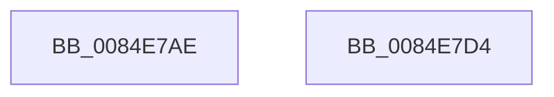

# sub_0084E7AE

- RVA: `0x0084E7AE`–`0x0084E7D5` (길이 `39` bytes)
- VA: `0x000000014084E7AE`
- 실행 섹션: `PAGE`
- PDB 이름 있음: `아니요`; PDB Function 태그: `아니요`
- unwind 정보 RVA: `0x00069C64`
- 디코드: `12`개 명령, `39/39` bytes 표시
- 미해석 바이트: `0` (있으면 어셈블리에 `.byte`로 보존)

> 이 문서는 커널 이미지의 기계어와 PDB 기호를 분석해 생성했습니다. 4번과 5번은 함수 원형과 자료형을 바이너리 사용 방식에서 추정한 C 해석이며 원본 소스 복구 결과는 아닙니다.

## 1. Dependencies

- 직접 호출 지점: **3**; 고유 호출 대상: **3**
- 직접 호출자로 확인된 함수: **0**
- RIP 상대 이미지 참조: **0**

### Outgoing calls
- `0x0084E7AE` → [CmpUnlockRegistry](../../pagecmrc/BC/CmpUnlockRegistry_function_00BC9A84.md) (function, `0x00BC9A84`)
- `0x0084E7B7` → [CmpDetachFromRegistryProcess](../../pagecmrc/BC/CmpDetachFromRegistryProcess_function_00BC9920.md) (function, `0x00BC9920`)
- `0x0084E7C5` → [_security_check_cookie](../../text/6A/_security_check_cookie_function_006AC640.md) (function, `0x006AC640`)

### Direct callers
- 이 함수 시작 RVA로 연결되는 직접 call은 확인되지 않았습니다. 간접 호출은 완전히 역산할 수 없습니다.

### Static image references
- 디코드된 RIP-relative 메모리 참조가 없습니다.

## 2. Other-region calls and transfers

- 다른 실행 섹션으로 향하는 call: **3**
  - `0x0084E7AE` → [CmpUnlockRegistry](../../pagecmrc/BC/CmpUnlockRegistry_function_00BC9A84.md) (`PAGE` → `PAGECMRC`)
  - `0x0084E7B7` → [CmpDetachFromRegistryProcess](../../pagecmrc/BC/CmpDetachFromRegistryProcess_function_00BC9920.md) (`PAGE` → `PAGECMRC`)
  - `0x0084E7C5` → [_security_check_cookie](../../text/6A/_security_check_cookie_function_006AC640.md) (`PAGE` → `.text`)
- 별도 외부 분기/꼬리 이동을 확인하지 못했습니다.

## 3. Assembly (complete function range)

```asm
0084E7AE  E8 D1 B2 37 00                  call 0x140bc9a84
0084E7B3  48 8D 4D B0                     lea rcx, [rbp - 0x50]
0084E7B7  E8 64 B1 37 00                  call 0x140bc9920
0084E7BC  8B C3                           mov eax, ebx
0084E7BE  48 8B 4D E0                     mov rcx, qword ptr [rbp - 0x20]
0084E7C2  48 33 CC                        xor rcx, rsp
0084E7C5  E8 76 DE E5 FF                  call 0x1406ac640
0084E7CA  48 81 C4 18 01 00 00            add rsp, 0x118
0084E7D1  5B                              pop rbx
0084E7D2  5D                              pop rbp
0084E7D3  C3                              ret
0084E7D4  CC                              int3
```

## 4. C-style interpretation (structured pseudocode)

```c
__int64 __fastcall sub_0084E7AE(void)
{
    __int64 result;
    __int64 v_rsp;

    result = CmpUnlockRegistry(a1, a2, a3, a4);
    result = CmpDetachFromRegistryProcess(v_rbp - 80, a2, a3, a4);
    a1 = (*(unsigned __int64 *)(v_rbp - 32)) ^ (v_rsp);
    result = _security_check_cookie(a1, a2, a3, a4);
    v_rsp = (v_rsp) + (280);
    return result;
}
```

## 5. (Beta) C Style

```c
void sub_0084E7AE(void)
{
    int64_t result;
    int64_t local_rsp;

    result = CmpUnlockRegistry(a1, a2, a3, a4);
    result = CmpDetachFromRegistryProcess(local_rbp - 80, a2, a3, a4);
    a1 = (*(uint64_t *)(local_rbp - 0x20)) ^ (local_rsp);
    result = _security_check_cookie(a1, a2, a3, a4);
    local_rsp = (local_rsp) + (280);
    return result;
}
```

## 6. Execution-region graph

[열기: 2D/3D 그래프와 함수 탐색 컨트롤 패널](../../../control-panel.html?section=page&rva=0x0084E7AE&view=graph)

- 2D 그래프는 위에서 아래로 흐르고, 3D 그래프는 빈 공간을 드래그해 회전합니다. Shift+드래그는 이동, 휠은 확대·축소, 함수 노드 선택은 대상 보고서 이동입니다.

### Static fallback


