# sub_0084E7D5

- RVA: `0x0084E7D5`–`0x0084EAD7` (길이 `770` bytes)
- VA: `0x000000014084E7D5`
- 실행 섹션: `PAGE`
- PDB 이름 있음: `아니요`; PDB Function 태그: `아니요`
- unwind 정보 RVA: `0x00069C78`
- 디코드: `187`개 명령, `770/770` bytes 표시
- 미해석 바이트: `0` (있으면 어셈블리에 `.byte`로 보존)

> 이 문서는 커널 이미지의 기계어와 PDB 기호를 분석해 생성했습니다. 4번과 5번은 함수 원형과 자료형을 바이너리 사용 방식에서 추정한 C 해석이며 원본 소스 복구 결과는 아닙니다.

## 1. Dependencies

- 직접 호출 지점: **17**; 고유 호출 대상: **10**
- 직접 호출자로 확인된 함수: **0**
- RIP 상대 이미지 참조: **1**

### Outgoing calls
- `0x0084E7D5` → [CmpLockRegistryExclusive](CmpLockRegistryExclusive_function_0084F9B4.md) (function, `0x0084F9B4`)
- `0x0084E7DF` → [HvpGetCellPaged](../85/HvpGetCellPaged_function_00854CB0.md) (function, `0x00854CB0`)
- `0x0084E7E9` → [HvpGetCellPaged](../85/HvpGetCellPaged_function_00854CB0.md) (function, `0x00854CB0`)
- `0x0084E7FB` → [CmpTransSearchAddTransFromKeyBody](../87/CmpTransSearchAddTransFromKeyBody_function_008736B8.md) (function, `0x008736B8`)
- `0x0084E812` → [CmpPerformKeyBodyDeletionCheck](../../pagecmrc/BC/CmpPerformKeyBodyDeletionCheck_function_00BC97D0.md) (function, `0x00BC97D0`)
- `0x0084E834` → [HvpMarkCellDirty](../85/HvpMarkCellDirty_function_00858080.md) (function, `0x00858080`)
- `0x0084E862` → [HvpReleaseCellFlat](../85/HvpReleaseCellFlat_function_0085CC20.md) (function, `0x0085CC20`)
- `0x0084E86C` → [HvpReleaseCellFlat](../85/HvpReleaseCellFlat_function_0085CC20.md) (function, `0x0085CC20`)
- `0x0084E8C1` → [CmpEnumerateLayeredKey](../94/CmpEnumerateLayeredKey_function_00945E58.md) (function, `0x00945E58`)
- `0x0084E90F` → [CmpUnlockKcb](../../pagecmrc/BC/CmpUnlockKcb_function_00BC92C0.md) (function, `0x00BC92C0`)
- `0x0084E922` → [CmpUnlockKcb](../../pagecmrc/BC/CmpUnlockKcb_function_00BC92C0.md) (function, `0x00BC92C0`)
- `0x0084E981` → [CmpFindSubKeyByNumberFromMergedView](../AB/CmpFindSubKeyByNumberFromMergedView_function_00AB8284.md) (function, `0x00AB8284`)
- `0x0084E9E5` → [CmpLockKcbShared](../../pagecmrc/BC/CmpLockKcbShared_function_00BC9A1C.md) (function, `0x00BC9A1C`)
- `0x0084EA03` → [CmpLockKcbShared](../../pagecmrc/BC/CmpLockKcbShared_function_00BC9A1C.md) (function, `0x00BC9A1C`)
- `0x0084EA37` → [CmpUnlockKcb](../../pagecmrc/BC/CmpUnlockKcb_function_00BC92C0.md) (function, `0x00BC92C0`)
- `0x0084EA63` → [CmpLockKcbShared](../../pagecmrc/BC/CmpLockKcbShared_function_00BC9A1C.md) (function, `0x00BC9A1C`)
- `0x0084EA78` → [CmpPerformKeyBodyDeletionCheck](../../pagecmrc/BC/CmpPerformKeyBodyDeletionCheck_function_00BC97D0.md) (function, `0x00BC97D0`)

### Direct callers
- 이 함수 시작 RVA로 연결되는 직접 call은 확인되지 않았습니다. 간접 호출은 완전히 역산할 수 없습니다.

### Static image references
- `0x0084E841` → RVA `0x00E0EC94` (`.data`; read)

## 2. Other-region calls and transfers

- 다른 실행 섹션으로 향하는 call: **8**
  - `0x0084E812` → [CmpPerformKeyBodyDeletionCheck](../../pagecmrc/BC/CmpPerformKeyBodyDeletionCheck_function_00BC97D0.md) (`PAGE` → `PAGECMRC`)
  - `0x0084E90F` → [CmpUnlockKcb](../../pagecmrc/BC/CmpUnlockKcb_function_00BC92C0.md) (`PAGE` → `PAGECMRC`)
  - `0x0084E922` → [CmpUnlockKcb](../../pagecmrc/BC/CmpUnlockKcb_function_00BC92C0.md) (`PAGE` → `PAGECMRC`)
  - `0x0084E9E5` → [CmpLockKcbShared](../../pagecmrc/BC/CmpLockKcbShared_function_00BC9A1C.md) (`PAGE` → `PAGECMRC`)
  - `0x0084EA03` → [CmpLockKcbShared](../../pagecmrc/BC/CmpLockKcbShared_function_00BC9A1C.md) (`PAGE` → `PAGECMRC`)
  - `0x0084EA37` → [CmpUnlockKcb](../../pagecmrc/BC/CmpUnlockKcb_function_00BC92C0.md) (`PAGE` → `PAGECMRC`)
  - `0x0084EA63` → [CmpLockKcbShared](../../pagecmrc/BC/CmpLockKcbShared_function_00BC9A1C.md) (`PAGE` → `PAGECMRC`)
  - `0x0084EA78` → [CmpPerformKeyBodyDeletionCheck](../../pagecmrc/BC/CmpPerformKeyBodyDeletionCheck_function_00BC97D0.md) (`PAGE` → `PAGECMRC`)
- call이 아닌 외부 분기/꼬리 이동: **26**
  - `0x0084E7DA` → [sub_0084E4B5 + 0xA8](Unknown_function_0084E4B5.md) (`tail-transfer`)
  - `0x0084E7E4` → [sub_0084E4B5 + 0x197](Unknown_function_0084E4B5.md) (`tail-transfer`)
  - `0x0084E7EE` → [sub_0084E4B5 + 0x1F9](Unknown_function_0084E4B5.md) (`tail-transfer`)
  - `0x0084E804` → [sub_0084E4B5 + 0x296](Unknown_function_0084E4B5.md) (`tail-transfer`)
  - `0x0084E81B` → [sub_0084E4B5 + 0xF0](Unknown_function_0084E4B5.md) (`tail-transfer`)
  - `0x0084E821` → [sub_0084E4B5 + 0x296](Unknown_function_0084E4B5.md) (`tail-transfer`)
  - `0x0084E83B` → [sub_0084E4B5 + 0x219](Unknown_function_0084E4B5.md) (`tail-transfer`)
  - `0x0084E84C` → [sub_0084E4B5 + 0x219](Unknown_function_0084E4B5.md) (`tail-transfer`)
  - `0x0084E85D` → [sub_0084E4B5 + 0x2A7](Unknown_function_0084E4B5.md) (`tail-transfer`)
  - `0x0084E867` → [sub_0084E4B5 + 0x296](Unknown_function_0084E4B5.md) (`tail-transfer`)
  - `0x0084E871` → [sub_0084E4B5 + 0x1D5](Unknown_function_0084E4B5.md) (`tail-transfer`)
  - `0x0084E881` → [sub_0084E4B5 + 0x135](Unknown_function_0084E4B5.md) (`tail-transfer`)
  - `0x0084E8D6` → [sub_0084E4B5 + 0x2AC](Unknown_function_0084E4B5.md) (`tail-transfer`)
  - `0x0084E995` → [sub_0084E4B5 + 0x16E](Unknown_function_0084E4B5.md) (`tail-transfer`)
  - `0x0084E9A9` → [sub_0084E4B5 + 0xBB](Unknown_function_0084E4B5.md) (`tail-transfer`)
  - `0x0084E9B7` → [sub_0084E4B5 + 0xC3](Unknown_function_0084E4B5.md) (`tail-transfer`)
  - `0x0084E9ED` → [sub_0084E4B5 + 0xC3](Unknown_function_0084E4B5.md) (`tail-transfer`)
  - `0x0084E9F8` → [sub_0084E4B5 + 0xC3](Unknown_function_0084E4B5.md) (`tail-transfer`)
  - `0x0084EA0B` → [sub_0084E4B5 + 0xC3](Unknown_function_0084E4B5.md) (`tail-transfer`)
  - `0x0084EA6B` → [sub_0084E4B5 + 0xC3](Unknown_function_0084E4B5.md) (`tail-transfer`)
  - `0x0084EA81` → [sub_0084E4B5 + 0x296](Unknown_function_0084E4B5.md) (`tail-transfer`)
  - `0x0084EA8F` → [sub_00B16998](../B1/Unknown_function_00B16998.md) (`tail-transfer`)
  - `0x0084EAA5` → [sub_00B16998](../B1/Unknown_function_00B16998.md) (`tail-transfer`)
  - `0x0084EAB4` → [sub_0084E4B5 + 0x296](Unknown_function_0084E4B5.md) (`tail-transfer`)
  - `0x0084EABC` → [sub_00B16998 + 0x30](../B1/Unknown_function_00B16998.md) (`tail-transfer`)
  - `0x0084EAD2` → [sub_00B16998 + 0x30](../B1/Unknown_function_00B16998.md) (`tail-transfer`)

## 3. Assembly (complete function range)

```asm
0084E7D5  E8 DA 11 00 00                  call 0x14084f9b4
0084E7DA  E9 7E FD FF FF                  jmp 0x14084e55d
0084E7DF  E8 CC 64 00 00                  call 0x140854cb0
0084E7E4  E9 63 FE FF FF                  jmp 0x14084e64c
0084E7E9  E8 C2 64 00 00                  call 0x140854cb0
0084E7EE  E9 BB FE FF FF                  jmp 0x14084e6ae
0084E7F3  48 8D 54 24 60                  lea rdx, [rsp + 0x60]
0084E7F8  49 8B CE                        mov rcx, r14
0084E7FB  E8 B8 4E 02 00                  call 0x1408736b8
0084E800  8B D8                           mov ebx, eax
0084E802  85 C0                           test eax, eax
0084E804  0F 88 41 FF FF FF               js 0x14084e74b
0084E80A  48 8B 54 24 60                  mov rdx, qword ptr [rsp + 0x60]
0084E80F  49 8B CE                        mov rcx, r14
0084E812  E8 B9 AF 37 00                  call 0x140bc97d0
0084E817  8B D8                           mov ebx, eax
0084E819  85 C0                           test eax, eax
0084E81B  0F 89 84 FD FF FF               jns 0x14084e5a5
0084E821  E9 25 FF FF FF                  jmp 0x14084e74b
0084E826  41 B9 01 00 00 00               mov r9d, 1
0084E82C  45 33 C0                        xor r8d, r8d
0084E82F  8B D3                           mov edx, ebx
0084E831  49 8B CE                        mov rcx, r14
0084E834  E8 47 98 00 00                  call 0x140858080
0084E839  85 C0                           test eax, eax
0084E83B  0F 88 8D FE FF FF               js 0x14084e6ce
0084E841  0F B6 05 4C 04 5C 00            movzx eax, byte ptr [rip + 0x5c044c]
0084E848  41 08 47 0C                     or byte ptr [r15 + 0xc], al
0084E84C  E9 7D FE FF FF                  jmp 0x14084e6ce
0084E851  48 85 F6                        test rsi, rsi
0084E854  0F 85 81 00 00 00               jne 0x14084e8db
0084E85A  49 8B CD                        mov rcx, r13
0084E85D  E9 FA FE FF FF                  jmp 0x14084e75c
0084E862  E8 B9 E3 00 00                  call 0x14085cc20
0084E867  E9 DF FE FF FF                  jmp 0x14084e74b
0084E86C  E8 AF E3 00 00                  call 0x14085cc20
0084E871  E9 14 FE FF FF                  jmp 0x14084e68a
0084E876  48 8D 44 24 70                  lea rax, [rsp + 0x70]
0084E87B  49 8B CD                        mov rcx, r13
0084E87E  4C 8B C6                        mov r8, rsi
0084E881  E9 64 FD FF FF                  jmp 0x14084e5ea
0084E886  44 8B 7D 58                     mov r15d, dword ptr [rbp + 0x58]
0084E88A  8B F7                           mov esi, edi
0084E88C  8B 7C 24 6C                     mov edi, dword ptr [rsp + 0x6c]
0084E890  4C 8B 65 88                     mov r12, qword ptr [rbp - 0x78]
0084E894  83 FE 0A                        cmp esi, 0xa
0084E897  4D 8B CC                        mov r9, r12
0084E89A  44 8B C7                        mov r8d, edi
0084E89D  41 8B D5                        mov edx, r13d
0084E8A0  0F 96 C0                        setbe al
0084E8A3  49 8B CE                        mov rcx, r14
0084E8A6  88 44 24 38                     mov byte ptr [rsp + 0x38], al
0084E8AA  48 8D 45 90                     lea rax, [rbp - 0x70]
0084E8AE  48 89 44 24 30                  mov qword ptr [rsp + 0x30], rax
0084E8B3  48 8B 45 80                     mov rax, qword ptr [rbp - 0x80]
0084E8B7  48 89 44 24 28                  mov qword ptr [rsp + 0x28], rax
0084E8BC  44 89 7C 24 20                  mov dword ptr [rsp + 0x20], r15d
0084E8C1  E8 92 75 0F 00                  call 0x140945e58
0084E8C6  FF C6                           inc esi
0084E8C8  8B D8                           mov ebx, eax
0084E8CA  3D 2D 02 00 C0                  cmp eax, 0xc000022d
0084E8CF  74 C3                           je 0x14084e894
0084E8D1  33 FF                           xor edi, edi
0084E8D3  45 32 E4                        xor r12b, r12b
0084E8D6  E9 86 FE FF FF                  jmp 0x14084e761
0084E8DB  4C 3B EE                        cmp r13, rsi
0084E8DE  0F 84 76 FF FF FF               je 0x14084e85a
0084E8E4  41 8B 45 08                     mov eax, dword ptr [r13 + 8]
0084E8E8  8B 4E 08                        mov ecx, dword ptr [rsi + 8]
0084E8EB  C1 E8 15                        shr eax, 0x15
0084E8EE  C1 E9 15                        shr ecx, 0x15
0084E8F1  25 FF 03 00 00                  and eax, 0x3ff
0084E8F6  81 E1 FF 03 00 00               and ecx, 0x3ff
0084E8FC  3B C1                           cmp eax, ecx
0084E8FE  77 1C                           ja 0x14084e91c
0084E900  0F 83 0A 01 00 00               jae 0x14084ea10
0084E906  4D 8B F5                        mov r14, r13
0084E909  4C 8B EE                        mov r13, rsi
0084E90C  49 8B CD                        mov rcx, r13
0084E90F  E8 AC A9 37 00                  call 0x140bc92c0
0084E914  4D 8B EE                        mov r13, r14
0084E917  E9 3E FF FF FF                  jmp 0x14084e85a
0084E91C  49 8B CD                        mov rcx, r13
0084E91F  4C 8B F6                        mov r14, rsi
0084E922  E8 99 A9 37 00                  call 0x140bc92c0
0084E927  4C 8B EE                        mov r13, rsi
0084E92A  E9 2B FF FF FF                  jmp 0x14084e85a
0084E92F  48 8B 44 24 60                  mov rax, qword ptr [rsp + 0x60]
0084E934  48 8D 4C 24 70                  lea rcx, [rsp + 0x70]
0084E939  48 85 C0                        test rax, rax
0084E93C  48 0F 44 CF                     cmove rcx, rdi
0084E940  4D 85 FF                        test r15, r15
0084E943  74 55                           je 0x14084e99a
0084E945  48 8B D6                        mov rdx, rsi
0084E948  4D 8B D5                        mov r10, r13
0084E94B  4C 8D 45 A8                     lea r8, [rbp - 0x58]
0084E94F  4C 8B C8                        mov r9, rax
0084E952  4C 89 44 24 40                  mov qword ptr [rsp + 0x40], r8
0084E957  44 8B 44 24 68                  mov r8d, dword ptr [rsp + 0x68]
0084E95C  48 89 4C 24 38                  mov qword ptr [rsp + 0x38], rcx
0084E961  48 8D 4C 24 58                  lea rcx, [rsp + 0x58]
0084E966  48 89 4C 24 30                  mov qword ptr [rsp + 0x30], rcx
0084E96B  48 8D 4C 24 78                  lea rcx, [rsp + 0x78]
0084E970  48 89 4C 24 28                  mov qword ptr [rsp + 0x28], rcx
0084E975  48 8D 4D 98                     lea rcx, [rbp - 0x68]
0084E979  48 89 4C 24 20                  mov qword ptr [rsp + 0x20], rcx
0084E97E  49 8B CA                        mov rcx, r10
0084E981  E8 FE 98 26 00                  call 0x140ab8284
0084E986  8B D8                           mov ebx, eax
0084E988  85 C0                           test eax, eax
0084E98A  0F 88 1F 01 00 00               js 0x14084eaaf
0084E990  4C 8B 74 24 78                  mov r14, qword ptr [rsp + 0x78]
0084E995  E9 89 FC FF FF                  jmp 0x14084e623
0084E99A  48 8B D7                        mov rdx, rdi
0084E99D  4C 8B D6                        mov r10, rsi
0084E9A0  EB A9                           jmp 0x14084e94b
0084E9A2  4D 8B 6F 08                     mov r13, qword ptr [r15 + 8]
0084E9A6  4D 85 ED                        test r13, r13
0084E9A9  0F 84 C1 FB FF FF               je 0x14084e570
0084E9AF  48 85 F6                        test rsi, rsi
0084E9B2  75 08                           jne 0x14084e9bc
0084E9B4  49 8B CD                        mov rcx, r13
0084E9B7  E9 BC FB FF FF                  jmp 0x14084e578
0084E9BC  4C 3B EE                        cmp r13, rsi
0084E9BF  74 31                           je 0x14084e9f2
0084E9C1  41 8B 45 08                     mov eax, dword ptr [r13 + 8]
0084E9C5  8B 4E 08                        mov ecx, dword ptr [rsi + 8]
0084E9C8  C1 E8 15                        shr eax, 0x15
0084E9CB  C1 E9 15                        shr ecx, 0x15
0084E9CE  25 FF 03 00 00                  and eax, 0x3ff
0084E9D3  81 E1 FF 03 00 00               and ecx, 0x3ff
0084E9D9  3B C1                           cmp eax, ecx
0084E9DB  77 20                           ja 0x14084e9fd
0084E9DD  73 65                           jae 0x14084ea44
0084E9DF  48 8B DE                        mov rbx, rsi
0084E9E2  49 8B CD                        mov rcx, r13
0084E9E5  E8 32 B0 37 00                  call 0x140bc9a1c
0084E9EA  48 8B CB                        mov rcx, rbx
0084E9ED  E9 86 FB FF FF                  jmp 0x14084e578
0084E9F2  49 8B DD                        mov rbx, r13
0084E9F5  48 8B CB                        mov rcx, rbx
0084E9F8  E9 7B FB FF FF                  jmp 0x14084e578
0084E9FD  48 8B CE                        mov rcx, rsi
0084EA00  49 8B DD                        mov rbx, r13
0084EA03  E8 14 B0 37 00                  call 0x140bc9a1c
0084EA08  48 8B CB                        mov rcx, rbx
0084EA0B  E9 68 FB FF FF                  jmp 0x14084e578
0084EA10  41 0F B7 8D BA 00 00 00         movzx ecx, word ptr [r13 + 0xba]
0084EA18  F6 C1 04                        test cl, 4
0084EA1B  0F 84 98 00 00 00               je 0x14084eab9
0084EA21  F7 86 B8 00 00 00 00 00 02 00   test dword ptr [rsi + 0xb8], 0x20000
0084EA2B  0F 84 88 00 00 00               je 0x14084eab9
0084EA31  49 8B CD                        mov rcx, r13
0084EA34  4C 8B F6                        mov r14, rsi
0084EA37  E8 84 A8 37 00                  call 0x140bc92c0
0084EA3C  4C 8B EE                        mov r13, rsi
0084EA3F  E9 16 FE FF FF                  jmp 0x14084e85a
0084EA44  41 0F B7 8D BA 00 00 00         movzx ecx, word ptr [r13 + 0xba]
0084EA4C  F6 C1 04                        test cl, 4
0084EA4F  74 3B                           je 0x14084ea8c
0084EA51  F7 86 B8 00 00 00 00 00 02 00   test dword ptr [rsi + 0xb8], 0x20000
0084EA5B  74 2F                           je 0x14084ea8c
0084EA5D  48 8B CE                        mov rcx, rsi
0084EA60  49 8B DD                        mov rbx, r13
0084EA63  E8 B4 AF 37 00                  call 0x140bc9a1c
0084EA68  48 8B CB                        mov rcx, rbx
0084EA6B  E9 08 FB FF FF                  jmp 0x14084e578
0084EA70  48 8B 54 24 60                  mov rdx, qword ptr [rsp + 0x60]
0084EA75  49 8B CF                        mov rcx, r15
0084EA78  E8 53 AD 37 00                  call 0x140bc97d0
0084EA7D  8B D8                           mov ebx, eax
0084EA7F  85 C0                           test eax, eax
0084EA81  0F 88 C4 FC FF FF               js 0x14084e74b
0084EA87  E9 A3 FE FF FF                  jmp 0x14084e92f
0084EA8C  F6 C1 02                        test cl, 2
0084EA8F  0F 84 03 7F 2C 00               je 0x140b16998
0084EA95  F7 86 B8 00 00 00 00 00 04 00   test dword ptr [rsi + 0xb8], 0x40000
0084EA9F  0F 85 3A FF FF FF               jne 0x14084e9df
0084EAA5  E9 EE 7E 2C 00                  jmp 0x140b16998
0084EAAA  BB 1A 00 00 80                  mov ebx, 0x8000001a
0084EAAF  48 8B 7C 24 70                  mov rdi, qword ptr [rsp + 0x70]
0084EAB4  E9 92 FC FF FF                  jmp 0x14084e74b
0084EAB9  F6 C1 02                        test cl, 2
0084EABC  0F 84 06 7F 2C 00               je 0x140b169c8
0084EAC2  F7 86 B8 00 00 00 00 00 04 00   test dword ptr [rsi + 0xb8], 0x40000
0084EACC  0F 85 34 FE FF FF               jne 0x14084e906
0084EAD2  E9 F1 7E 2C 00                  jmp 0x140b169c8
```

## 4. C-style interpretation (structured pseudocode)

```c
__int64 __fastcall sub_0084E7D5(__int64 a1, __int64 a2, int a3)
{
    __int64 result;
    unsigned int v_stack_p20;
    unsigned __int64 v_stack_p28;
    unsigned __int64 v_stack_p30;
    unsigned __int8 v_stack_p38;
    unsigned __int64 v_stack_p40;
    unsigned __int64 v_stack_p58;
    unsigned __int64 v_stack_p60;
    unsigned int v_stack_p68;
    unsigned int v_stack_p6C;
    unsigned __int64 v_stack_p70;
    unsigned __int64 v_stack_p78;

    result = CmpLockRegistryExclusive(a1, a2, a3, a4);
}
```

## 5. (Beta) C Style

```c
int64_t sub_0084E7D5(int64_t Arg1, int64_t Arg2, int32_t Arg3)
{
    int64_t result;
    uint32_t v_stack_p20;
    uint64_t v_stack_p28;
    uint64_t v_stack_p30;
    uint8_t v_stack_p38;
    uint64_t v_stack_p40;
    uint64_t v_stack_p58;
    uint64_t v_stack_p60;
    uint32_t v_stack_p68;
    uint32_t v_stack_p6C;
    uint64_t v_stack_p70;
    uint64_t v_stack_p78;

    result = CmpLockRegistryExclusive(Arg1, Arg2, Arg3, a4);
}
```

## 6. Execution-region graph

[열기: 2D/3D 그래프와 함수 탐색 컨트롤 패널](../../../control-panel.html?section=page&rva=0x0084E7D5&view=graph)

- 2D 그래프는 위에서 아래로 흐르고, 3D 그래프는 빈 공간을 드래그해 회전합니다. Shift+드래그는 이동, 휠은 확대·축소, 함수 노드 선택은 대상 보고서 이동입니다.

### Static fallback

```mermaid
flowchart TD
  bb_0084E7D5[BB_0084E7D5]
  bb_0084E7DF[BB_0084E7DF]
  bb_0084E7E9[BB_0084E7E9]
  bb_0084E7F3[BB_0084E7F3]
  bb_0084E80A[BB_0084E80A]
  bb_0084E821[BB_0084E821]
  bb_0084E826[BB_0084E826]
  bb_0084E841[BB_0084E841]
  bb_0084E851[BB_0084E851]
  bb_0084E85A[BB_0084E85A]
  bb_0084E862[BB_0084E862]
  bb_0084E86C[BB_0084E86C]
  bb_0084E876[BB_0084E876]
  bb_0084E886[BB_0084E886]
  bb_0084E894[BB_0084E894]
  bb_0084E8D1[BB_0084E8D1]
  bb_0084E8DB[BB_0084E8DB]
  bb_0084E8E4[BB_0084E8E4]
  bb_0084E900[BB_0084E900]
  bb_0084E906[BB_0084E906]
  bb_0084E91C[BB_0084E91C]
  bb_0084E92F[BB_0084E92F]
  bb_0084E945[BB_0084E945]
  bb_0084E94B[BB_0084E94B]
  bb_0084E990[BB_0084E990]
  bb_0084E99A[BB_0084E99A]
  bb_0084E9A2[BB_0084E9A2]
  bb_0084E9AF[BB_0084E9AF]
  bb_0084E9B4[BB_0084E9B4]
  bb_0084E9BC[BB_0084E9BC]
  bb_0084E9C1[BB_0084E9C1]
  bb_0084E9DD[BB_0084E9DD]
  bb_0084E9DF[BB_0084E9DF]
  bb_0084E9F2[BB_0084E9F2]
  bb_0084E9FD[BB_0084E9FD]
  bb_0084EA10[BB_0084EA10]
  bb_0084EA21[BB_0084EA21]
  bb_0084EA31[BB_0084EA31]
  bb_0084EA44[BB_0084EA44]
  bb_0084EA51[BB_0084EA51]
  bb_0084EA5D[BB_0084EA5D]
  bb_0084EA70[BB_0084EA70]
  bb_0084EA87[BB_0084EA87]
  bb_0084EA8C[BB_0084EA8C]
  bb_0084EA95[BB_0084EA95]
  bb_0084EAA5[BB_0084EAA5]
  bb_0084EAAA[BB_0084EAAA]
  bb_0084EAAF[BB_0084EAAF]
  bb_0084EAB9[BB_0084EAB9]
  bb_0084EAC2[BB_0084EAC2]
  bb_0084EAD2[BB_0084EAD2]
  bb_0084E7F3 -->|fallthrough| bb_0084E80A
  bb_0084E80A -->|fallthrough| bb_0084E821
  bb_0084E826 -->|fallthrough| bb_0084E841
  bb_0084E851 -->|branch| bb_0084E8DB
  bb_0084E851 -->|fallthrough| bb_0084E85A
  bb_0084E886 -->|flow| bb_0084E894
  bb_0084E894 -->|branch| bb_0084E894
  bb_0084E894 -->|fallthrough| bb_0084E8D1
  bb_0084E8DB -->|branch| bb_0084E85A
  bb_0084E8DB -->|fallthrough| bb_0084E8E4
  bb_0084E8E4 -->|branch| bb_0084E91C
  bb_0084E8E4 -->|fallthrough| bb_0084E900
  bb_0084E900 -->|branch| bb_0084EA10
  bb_0084E900 -->|fallthrough| bb_0084E906
  bb_0084E906 -->|branch| bb_0084E85A
  bb_0084E91C -->|branch| bb_0084E85A
  bb_0084E92F -->|branch| bb_0084E99A
  bb_0084E92F -->|fallthrough| bb_0084E945
  bb_0084E945 -->|flow| bb_0084E94B
  bb_0084E94B -->|branch| bb_0084EAAF
  bb_0084E94B -->|fallthrough| bb_0084E990
  bb_0084E99A -->|branch| bb_0084E94B
  bb_0084E9A2 -->|fallthrough| bb_0084E9AF
  bb_0084E9AF -->|branch| bb_0084E9BC
  bb_0084E9AF -->|fallthrough| bb_0084E9B4
  bb_0084E9BC -->|branch| bb_0084E9F2
  bb_0084E9BC -->|fallthrough| bb_0084E9C1
  bb_0084E9C1 -->|branch| bb_0084E9FD
  bb_0084E9C1 -->|fallthrough| bb_0084E9DD
  bb_0084E9DD -->|branch| bb_0084EA44
  bb_0084E9DD -->|fallthrough| bb_0084E9DF
  bb_0084EA10 -->|branch| bb_0084EAB9
  bb_0084EA10 -->|fallthrough| bb_0084EA21
  bb_0084EA21 -->|branch| bb_0084EAB9
  bb_0084EA21 -->|fallthrough| bb_0084EA31
  bb_0084EA31 -->|branch| bb_0084E85A
  bb_0084EA44 -->|branch| bb_0084EA8C
  bb_0084EA44 -->|fallthrough| bb_0084EA51
  bb_0084EA51 -->|branch| bb_0084EA8C
  bb_0084EA51 -->|fallthrough| bb_0084EA5D
  bb_0084EA70 -->|fallthrough| bb_0084EA87
  bb_0084EA87 -->|branch| bb_0084E92F
  bb_0084EA8C -->|fallthrough| bb_0084EA95
  bb_0084EA95 -->|branch| bb_0084E9DF
  bb_0084EA95 -->|fallthrough| bb_0084EAA5
  bb_0084EAAA -->|flow| bb_0084EAAF
  bb_0084EAB9 -->|fallthrough| bb_0084EAC2
  bb_0084EAC2 -->|branch| bb_0084E906
  bb_0084EAC2 -->|fallthrough| bb_0084EAD2
```


